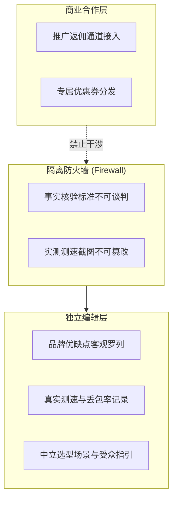

# 推广披露与商业独立性政策

**机场推荐**（jichangtuij.com）坚信，透明度是维系用户信任的基石。为了严格遵守国际消费者保护准则与主要搜索引擎（包括 Microsoft Bing 与 Google）关于商业联盟链接（Affiliate / Sponsored Links）的技术规范，我们在此公开发布完整的《推广披露与商业独立性政策》。

---

## 一、商业模式与推广返利机制

本站作为一个开放的技术评测与知识库平台，日常运营需要承担专用服务器租赁、全球分布式节点测试带宽采购及内容维护开销。

为了维持平台的长期运转，本站参与了部分服务商的公开推广合作项目（Affiliate Programs）：
- **返利性质**：当用户通过本站提供的特定官方推广链接注册并购买服务时，服务商可能会向本站支付一定比例的佣金；
- **用户价格一致性保证**：经由本站推广链接购买，用户所支付的套餐价格**绝对不会高于**直接访问服务商官网购买的价格。在许多情况下，通过本站专属优惠码，用户反而能够获得官方公开的最低折扣。

---

## 二、推广外链的技术实现与搜索引擎标注规范

所有涉及商业返利或合作推广的外链，在底层 HTML 输出层面均严格执行标准化封装：

1. **强制属性声明**：站内所有推广跳转链接均严格附加 `rel="sponsored nofollow noopener"` 属性，明确告知搜索引擎该链接属于商业合作性质，避免传递 PageRank 算法权重；
2. **显著视觉标识**：推广链接在前端组件渲染时强制显示带有“推广”字样的醒目标签，用户将鼠标悬停在标签上即可查阅完整的披露释义；
3. **禁止隐蔽重定向**：我们不使用隐蔽跳转或误导性欺骗脚本，所有推广链接文本均清晰标明目标品牌官方站点。

---

## 三、编辑独立性与防火墙机制（Separation of Editorial & Commercial）

为了确保评测结论的公正客观，我们建立了严格的“商业与内容防火墙”：

- **付费不能改变实测数据**：服务商无法通过支付推广费用来伪造、修改或删除本站记录的测速截图与丢包测试数据；
- **付费不能屏蔽负面提示**：即便某个服务商与本站存在推广合作，其真实的潜在短板（如“仅支持年付、不支持支付宝、晚高峰可能存在波动”）依然会完整列入评测文章的“使用限制与风险提示”模块；
- **不销售虚假排名**：站内的各推荐榜单均基于存续年限、专线网络规格、单 GB 成本及综合稳定性维度综合评选，绝不出售所谓“全网第一、置顶推荐”等虚假位置。
