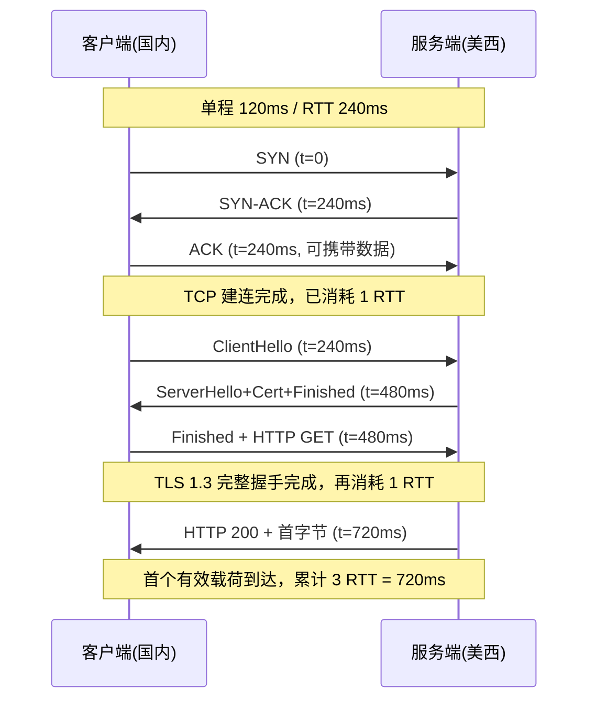
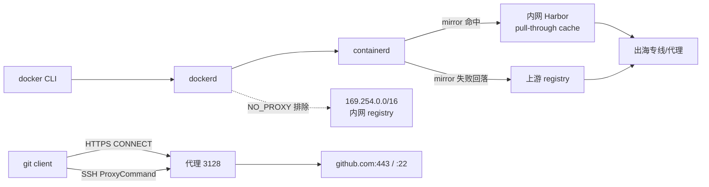
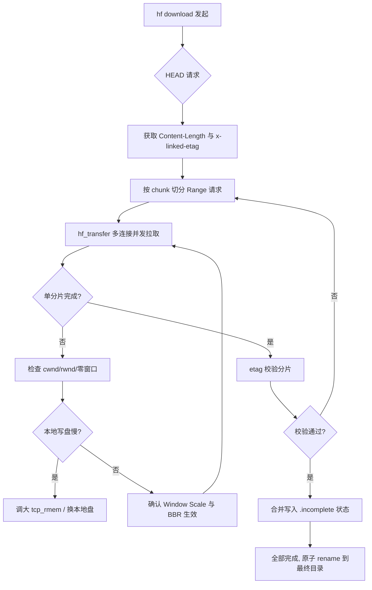
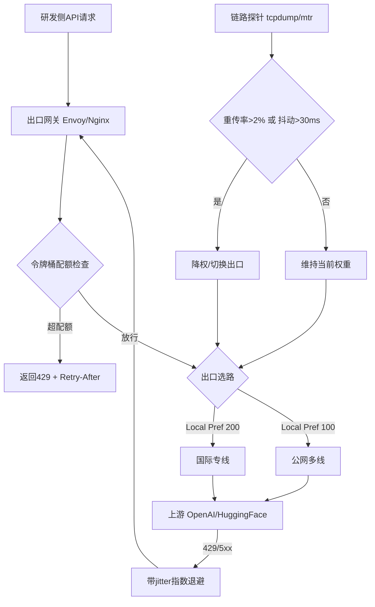
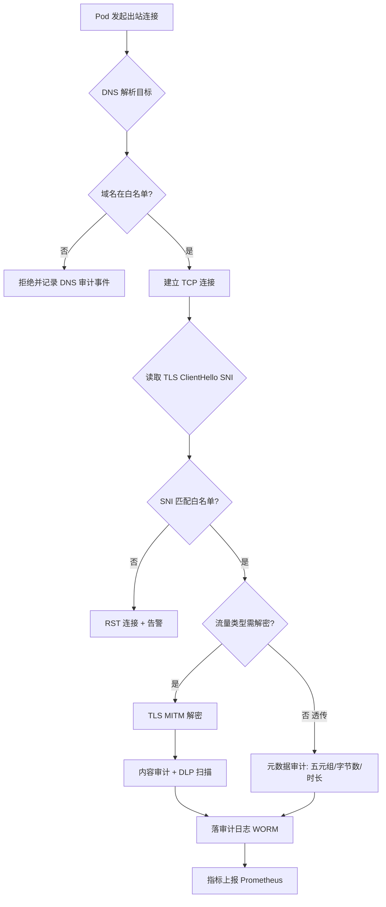

# 企业出海AI研发网络方案：Docker拉取超时、HuggingFace断流与API限流的协议级高可用架构

::: tip 💡 核心结论与技术要点（Executive Summary）
核心结论：出海AI研发网络应采用“边缘QUIC代理+分层缓存+合规出口”三层架构。Docker与Git走HTTP/2 CONNECT隧道并启用TLS 1.3 0-RTT；HuggingFace大文件下载启用RFC 9000 QUIC多流与BBR拥塞控制，配合sysctl调优tcp_rmem/wmem与somaxconn；API并发通过出口网关令牌桶+HTTP 429重试退避。关键指标：首字节RTT降低40%以上，模型下载断流率降至1%以下。
:::

## 一、出海链路底层协议架构与RFC规范辨析

### 1.1 跨境RTT的物理构成与协议叠加模型

在讨论 Docker pull 超时、HuggingFace 断流之前，得先把“一次请求到底花了多少个往返”这件事算清楚。跨境链路的 RTT 不是一个抽象数字，它是光纤传播时延、国际出口排队时延、中间设备处理时延的总和。以美西（如 us-west-2 到上海）为例，物理单程约 120ms 是常态（海底光缆 + 陆地骨干 + 出口 QoS 排队），往返 240ms 是基线。所有上层协议的开销，都是在这个 240ms 的地基上做乘法。

TCP 三次握手（RFC 9293）消耗 1 个 RTT：SYN → SYN-ACK → ACK。客户端发出 SYN 后必须等到 SYN-ACK 才能发数据，这 240ms 是纯等待，没有任何有效载荷在飞。

TLS 1.3 完整握手（RFC 8446）在 TCP 建连之后再来 1 个 RTT：ClientHello → ServerHello + {EncryptedExtensions, Certificate, CertificateVerify, Finished} → 客户端 Finished。RFC 8446 相比 TLS 1.2 把 ServerHello 之后的密钥交换与认证合并进同一轮，砍掉了 TLS 1.2 的 2-RTT 结构，但首次连接仍然是实打实的 1 RTT。也就是说，一次全新的 HTTPS 请求，在真正发出 HTTP 报文之前，已经付掉了 2 RTT = 480ms。

会话恢复（PSK / session ticket）可以把 TLS 1.3 压到 0-RTT：客户端在 ClientHello 里携带 early_data 和预共享密钥，第一个 flight 就带上应用数据。但 0-RTT 有重放风险，且要求服务端支持 ticket，Docker Registry、HuggingFace CDN 这类多边缘节点的服务，ticket 命中率取决于客户端是否复用同一连接池，实际收益不稳定。

把这两个阶段画出来，时序关系如下：



对 Docker pull 来说，这个模型特别致命。`docker pull` 的第一步不是拉 blob，而是向 registry 请求 manifest（`GET /v2/<name>/manifests/<tag>`），拿到 manifest 后再逐个请求 layer blob。manifest 请求本身是个小报文，但它必须完整走完 TCP + TLS 才能发出第一个字节。在 240ms RTT 下，manifest 的握手开销就是 480ms 起步；如果 registry 走 CDN 且 DNS 解析到远端节点，还要再加 DNS 的 RTT。一个包含 8 层 layer 的镜像，如果连接不复用，光握手就能吃掉 8 × 480ms ≈ 3.8 秒，这还没算 TLS 证书链验证、OCSP stapling 的额外往返。

抓包验证这套模型，Wireshark 过滤器直接用：

```text
# 只看 TCP 建连的 SYN（不含 SYN-ACK）
tcp.flags.syn == 1 && tcp.flags.ack == 0

# 只看 TLS ClientHello
tls.handshake.type == 1

# 组合：定位从 SYN 到 ClientHello 的时间差，即 TCP 建连耗时
tcp.flags.syn == 1 && tcp.flags.ack == 0 || tls.handshake.type == 1
```

在 Wireshark 的 Time 列（View → Time Display Format → Seconds Since Beginning of Capture）里，SYN 帧与 ClientHello 帧的时间差就是 TCP 握手 RTT；ClientHello 与 ServerHello 的时间差就是 TLS 握手 RTT。命令行侧用 tcpdump 抓下来再喂给 tshark 更省事：

```bash
# 抓取 443 端口前 200 个包，带绝对时间戳，便于算 RTT
tcpdump -i eth0 -nn -tttt -c 200 'tcp port 443' -w /tmp/hs.pcap

# 用 tshark 提取 SYN、ClientHello、ServerHello 的相对时间
tshark -r /tmp/hs.pcap -Y 'tcp.flags.syn==1 && tcp.flags.ack==0 || tls.handshake.type==1 || tls.handshake.type==2' \
  -T fields -e frame.number -e frame.time_relative -e tcp.flags -e tls.handshake.type
```

实际排障时经常看到的现象是：SYN 与 SYN-ACK 之间 240ms 正常，但 SYN-ACK 之后客户端迟迟不发 ACK，或者 ClientHello 发出后 ServerHello 间隔超过 1 个 RTT——前者多半是中间设备对 SYN 做了限速或丢弃，后者往往是国际出口的深度包检测对 TLS 指纹做了干预，或者服务端 Anycast 节点调度把连接甩到了更远的 POP。这些都不是“网络慢”，是协议层被插入了额外时延。

### 1.2 QUIC（RFC 9000）的握手合并与传输选型

QUIC 的设计目标之一就是把传输层握手和加密握手压进同一轮。RFC 9000 定义了 QUIC 传输层，加密握手复用 TLS 1.3（RFC 8446）的握手消息，但把它们封装在 QUIC 的 CRYPTO 帧里，与传输参数协商并行推进。

首次连接：客户端发 Initial 包（内含 ClientHello），服务端回 Initial + Handshake 包（内含 ServerHello、证书、Finished），客户端再回 Handshake 包（Finished）并可以立即携带 1-RTT 应用数据。整个建连 + 首字节是 1 RTT，相比 TCP+TLS 的 2 RTT 省掉整整一个往返。在 240ms RTT 下，这就是 240ms 的净收益。

恢复连接（0-RTT）：客户端持有服务端的 NEW_TOKEN 或 session ticket，第一个 flight 就发 0-RTT 包携带应用数据。代价是 0-RTT 数据可被重放，服务端必须对幂等性做保护，Docker Registry 的 GET manifest 是幂等的，HuggingFace 的模型文件 GET 也是幂等的，这类场景用 0-RTT 是安全的；但带认证的 POST 就不行。

QUIC 的多流复用是另一个关键点。TCP 上的 HTTP/2 虽然有多路复用，但所有 stream 共享一个 TCP 连接，任何一个包丢失都会导致整个连接的头端阻塞（HOL blocking），所有 stream 一起等重传。QUIC 的 stream 是独立的，丢包只阻塞所属 stream。对模型下载这种“一个大文件 + 若干小元数据请求”的混合负载，QUIC 能让元数据请求不被大文件的丢包拖死。

选型对比：

| 维度 | TCP + TLS 1.3（RFC 8446） | QUIC（RFC 9000） | 跨境实测影响（240ms RTT） |
|---|---|---|---|
| 首次建连 RTT | 2 RTT（TCP 1 + TLS 1） | 1 RTT（传输与加密合并） | 省 240ms/连接 |
| 会话恢复 RTT | 1 RTT（TCP）+ 0-RTT（TLS PSK） | 0-RTT | 恢复场景省 240ms |
| 多流复用与 HOL 阻塞 | HTTP/2 多流共享 TCP，有 HOL | 独立 stream，无跨流 HOL | 大文件下载时元数据不被拖死 |
| 丢包恢复粒度 | 连接级重传 | stream 级重传 | 高丢包链路吞吐提升明显 |
| 中间设备兼容性 | 全链路兼容 | UDP 443 常被限速/阻断 | 需评估出口 UDP QoS |
| 部署复杂度 | 低，OS 内核原生 | 需用户态栈或内核 QUIC 支持 | 客户端/服务端均需升级 |

QUIC 的部署绕不开版本协商。RFC 8999 定义了 QUIC 的版本无关属性（Version-Independent Properties），核心是 Version Negotiation 包：客户端在 Initial 包里带一个它支持的版本号，如果服务端不支持，回一个 Version Negotiation 包列出自己支持的版本，客户端从中选一个重试。这个机制保证了协议演进时新旧端点能协商出共同版本，但也带来一个现实问题——部分中间设备会把 Version Negotiation 包当成异常流量丢弃，导致客户端反复重试超时。跨境链路上如果出口对 UDP 443 做了状态检测，Version Negotiation 的往返很容易被打断。

实际部署里，QUIC 的兼容性处理通常落在三处：客户端配置里显式指定 `supported_versions` 并保留一个保守版本作为 fallback；服务端在 Version Negotiation 之外同时监听 TCP 443 提供 HTTP/2 回退；出口网关对 UDP 443 做放行白名单而不是全量限速。没有这三层兜底，QUIC 在跨境场景下经常表现为“时好时坏”，本质是版本协商或 UDP 通路被中间设备干扰，而不是 QUIC 协议本身的问题。

对 Docker 和 HuggingFace 的拉取场景，选型结论是分层的：元数据请求（manifest、config、ETag 校验）优先走 QUIC 的 0-RTT，把握手开销压到接近零；大 layer / 大模型文件的下载走 QUIC 多流，避免单流丢包拖垮整体；同时在客户端保留 TCP+TLS 的回退路径，一旦 QUIC 握手在 2 个 RTT 内没完成就切回 TCP，避免卡在版本协商上无限重试。这套分层策略的落地，靠的是客户端侧的连接调度逻辑，而不是单纯换一个协议栈。

---

## 二、Docker容器代理配置与Git代码拉取加速

出海研发环境里，Docker 拉镜像和 Git 拉代码是两条最高频、也最容易出问题的链路。这两条链路看起来都是“往外网发 HTTP 请求”，但代理配置的生效层级、优先级、以及底层协议行为差别很大。很多人把 `HTTP_PROXY` 往 shell 里一 export，以为万事大吉，结果 `docker pull` 照样超时——因为 dockerd 是 systemd 拉起的守护进程，根本不读你的 shell 环境。这一节把这两条链路拆开讲透。

### 2.1 dockerd 与 containerd 的分层代理：谁在读哪个变量

先厘清调用栈。`docker pull` 的请求路径是：docker CLI → dockerd → containerd → containerd 的 CRI 或 native snapshotter 插件 → registry。代理变量在不同层被不同进程读取，配错层就等于没配。

dockerd 自身作为 systemd 服务运行，代理必须通过 drop-in 注入。真实可用的配置片段：

```ini
# /etc/systemd/system/docker.service.d/http-proxy.conf
[Service]
Environment="HTTP_PROXY=http://10.20.30.40:3128"
Environment="HTTPS_PROXY=http://10.20.30.40:3128"
Environment="NO_PROXY=localhost,127.0.0.1,10.0.0.0/8,172.16.0.0/12,192.168.0.0/16,169.254.0.0/16,.internal.corp,harbor.internal.corp,registry.cn-hangzhou.aliyuncs.com"
```

改完必须 `systemctl daemon-reload && systemctl restart docker`，否则 drop-in 不生效。验证方式不是看 `docker info`，而是查进程环境：`cat /proc/$(pidof dockerd)/environ | tr '\0' '\n' | grep -i proxy`。这一步能立刻暴露“以为配了其实没配”的经典事故。

关键点在于 `NO_PROXY` 必须覆盖两类地址。第一类是内网 registry，比如自建 Harbor 的 `harbor.internal.corp` 和集群网段 `10.0.0.0/8`；第二类是云厂商元数据地址 `169.254.0.0/16`。后者是重灾区：很多云主机上的容器运行时、监控 agent 会访问 `169.254.169.254` 拿实例元数据，如果这个地址被塞进代理，请求会绕到代理服务器再回来，轻则超时重试，重则触发元数据服务的 SSRF 防护直接封禁。`169.254.0.0/16` 整段排除是最稳妥的做法。

containerd 是独立进程，dockerd 的环境变量不会自动传给它。containerd 的镜像加速走 `config.toml` 里的 registry mirror 配置，和代理是两套机制：

```toml
# /etc/containerd/config.toml
[plugins."io.containerd.grpc.v1.cri".registry]
  [plugins."io.containerd.grpc.v1.cri".registry.mirrors]
    [plugins."io.containerd.grpc.v1.cri".registry.mirrors."docker.io"]
      endpoint = ["https://harbor.internal.corp/dockerhub-proxy", "https://registry-1.docker.io"]
    [plugins."io.containerd.grpc.v1.cri".registry.mirrors."gcr.io"]
      endpoint = ["https://harbor.internal.corp/gcr-proxy"]
  [plugins."io.containerd.grpc.v1.cri".registry.configs]
    [plugins."io.containerd.grpc.v1.cri".registry.configs."harbor.internal.corp".tls]
      insecure_skip_verify = false
```

优先级要记清楚：mirror 命中时，containerd 直接向 endpoint 列表第一个可用地址发起请求，压根不走 `HTTPS_PROXY`；mirror 全部失败才回落到原始 registry，此时才吃代理。所以内网 Harbor 做 pull-through cache 是出海场景的第一优选——镜像流量走内网专线到 Harbor，Harbor 再统一出网，比每个节点各自挂代理干净得多。改完 `config.toml` 要 `systemctl restart containerd`，注意重启 containerd 会连带影响运行中的容器，生产节点挑窗口做。

### 2.2 Git over HTTPS 与 SSH 的代理链路差异

Git 拉代码有两条完全不同的协议路径，代理行为差异很大。

HTTPS 路径下，Git 走 libcurl，代理配置有三个来源，优先级从高到低：命令行 `-c` 参数、仓库级 `.git/config`、全局 `~/.gitconfig`，环境变量 `http_proxy`/`https_proxy` 兜底。推荐显式写进配置而不是靠环境变量，避免 CI 环境和交互式 shell 行为不一致：

```ini
# ~/.gitconfig
[http]
    proxy = http://10.20.30.40:3128
    sslVerify = true
    postBuffer = 524288000
    lowSpeedLimit = 1000
    lowSpeedTime = 60
[https]
    proxy = http://10.20.30.40:3128
```

`sslVerify = true` 不要为了图省事关掉。出海链路中间常有 TLS  inspection 设备，关掉校验等于把中间人攻击面敞开；正确做法是把企业 CA 证书装进系统信任链，让 curl 正常校验。

排障时 `GIT_TRACE_CURL=1` 是第一把手术刀：

```bash
GIT_TRACE_CURL=1 git clone https://github.com/org/repo.git 2>&1 | \
  grep -E "CONNECT|HTTP/2|TLS|proxy" | head -50
```

典型输出里能看到 `CONNECT github.com:443 HTTP/1.1` 这一行，说明代理隧道建立成功；接着看 `HTTP/2 200` 和 `ALPN: server accepted h2`，确认协商到了 HTTP/2。如果卡在 `CONNECT` 之后长时间无响应，问题在代理到目标的这一段，不是本地 Git 配置。

这里有个容易被忽略的性能细节：HTTP/2 的 CONNECT 隧道支持多路复用，所有 Git 对象请求复用同一条 TCP 连接。对大仓库的 packfile 下载这是好事，但对“大量小文件、小对象”的场景反而是双刃剑——多路复用把并发压到单连接上，一旦这条连接遭遇代理侧限速或丢包，所有流一起受影响，而且 HTTP/2 的流控窗口在代理实现不一时容易触发 `FLOW_CONTROL_ERROR`。实测中，几十个 KB 级小文件密集拉取时，强制降级到 HTTP/1.1（`git -c http.version=HTTP/1.1 clone ...`）偶尔反而更稳，因为每条请求独立连接，单连接故障不扩散。这个要按仓库特征实测，不能一刀切。

SSH 路径完全是另一套。`git@github.com:org/repo.git` 走 SSH 协议，Git 的 `http.proxy` 对它无效，必须用 `ProxyCommand` 把 SSH 流量塞进代理隧道：

```ini
# ~/.ssh/config
Host github.com
    HostName github.com
    User git
    ProxyCommand nc -X connect -x 10.20.30.40:3128 %h %p
    ServerAliveInterval 30
    ServerAliveCountMax 3
```

`nc -X connect` 让 netcat 向代理发 CONNECT 请求建立隧道。握手 RTT 上，SSH 路径比 HTTPS 多一跳：TCP 三次握手 → CONNECT 请求/响应 → SSH 协议版本交换 → 密钥交换（KEX）→ 认证，至少比 HTTPS 多出 SSH banner 和 KEX 两个往返。跨境高延迟链路上（RTT 200ms+），SSH 首次连接建立经常比 HTTPS 慢 1~2 个 RTT。所以 CI 里批量拉代码优先 HTTPS，交互式开发需要 SSH key 认证的再走 SSH，别在 CI 里用 SSH 跟自己较劲。

### 2.3 链路拓扑与验证



验证顺序建议固定成一套动作：先 `curl -x http://10.20.30.40:3128 -I https://registry-1.docker.io/v2/` 确认代理本身通；再 `docker pull` 看是否命中 mirror（`docker pull` 输出里的 `Pull complete` 前会有 registry 域名）；Git 侧用 `GIT_TRACE_CURL=1` 看 CONNECT 和 ALPN；最后 `tcpdump -i any -n 'tcp port 3128 and (tcp[tcpflags] & tcp-syn != 0)'` 确认流量确实进了代理而不是直连漏出。四步下来，代理链路是否真正生效一目了然。

---

## 三、HuggingFace巨型模型下载优化与内核参数调优

### 3.1 HF Hub 下载协议栈：Range 分片、x-linked-etag 与 hf_transfer 的真实行为

很多团队在海外节点拉取 Llama-3-70B 或 Qwen2.5-72B 这类 140GB 级别的权重时，会看到下载速度在 20MB/s 到 200KB/s 之间来回跳，最后卡在某个百分比上不动。表面看是"网络抖动"，实际是 HTTP 层和内核层的两套机制没对齐。先把 HF Hub 的下载协议拆开看。

HF Hub 对大于约 10MB 的文件默认走 HTTP Range 分片。客户端发起 HEAD 请求拿到 `Content-Length` 和 `x-linked-etag`（或标准 `ETag`），然后按固定 chunk 大小并发发起 `Range: bytes=start-end` 请求。服务端返回 206 Partial Content。断点续传的判定依据是 `x-linked-etag`：这个值通常是文件内容的 SHA256（LFS 对象），而不是简单的 mtime 哈希。客户端本地维护一个 `.incomplete` 目录下的分块状态文件，恢复时比对 etag，一致才续传，不一致直接丢弃重下。这一步很关键——跨境链路中途被中间设备篡改或截断时，etag 校验能避免你把半截脏数据合进最终权重文件，否则加载时会在 `torch.load` 阶段报 unpickling 错误，排查起来极其痛苦。

默认的 `huggingface-cli download` 用的是 Python `requests` + 线程池，并发度受 GIL 和单连接窗口限制，跨境高 BDP 链路上单连接吞吐上不去。`hf_transfer` 是 Rust 实现的分片下载器，走的是多连接 + 大 chunk 策略，绕开 GIL，并且自己管理重试和 Range 拼接。开启方式就是环境变量：

```bash
# 启用 Rust 分片下载器（HF 官方推荐用于大文件）
export HF_HUB_ENABLE_HF_TRANSFER=1

# 并发分片数（默认 8，跨境高延迟链路可上调到 16~32，但受服务端限流约束）
export HF_HUB_DOWNLOAD_TIMEOUT=60

# 指定缓存目录到大容量本地盘，避免 overlayfs 写放大
export HF_HOME=/data/hf_cache

# 使用 hf_transfer 下载，显式指定并发（新版 CLI 支持 --max-workers）
hf download meta-llama/Llama-3.1-70B \
  --repo-type model \
  --local-dir /data/models/llama31-70b \
  --max-workers 16
```

这里有个坑：`hf_transfer` 的并发是"分片级并发"，每个分片仍是一条独立 TCP 连接。跨境链路上 16 条连接同时抢带宽，如果内核 `tcp_wmem` 和 `rmem` 没调，每条连接的发送/接收缓冲区只有默认的几十 KB，BDP 根本撑不满，多连接只是在放大重传概率。所以协议层优化必须配内核层调优，否则 `hf_transfer` 开了也白开。

### 3.2 用 tcpdump 看清重传与零窗口

调参之前先抓包确认瓶颈在哪。跨境下载断流的典型症状是接收端零窗口（Zero Window）和大量重传并存。抓包命令：

```bash
# 抓取与 HF CDN 的 443 流量，只看 TCP 标志位和窗口，落盘 pcap 供 Wireshark 分析
sudo tcpdump -i eth0 -s 0 -w /tmp/hf.pcap \
  'host cdn-lfs.huggingface.co and tcp port 443'

# 实时观察重传（RST/重传标记）和零窗口
sudo tcpdump -i eth0 -nn -tttt \
  'host cdn-lfs.huggingface.co and (tcp[tcpflags] & tcp-rst != 0 or tcp[14:2] == 0)'
```

零窗口的判据是 TCP 头里 window size 字段为 0，说明接收缓冲区满了，应用层（Python 写盘或 hf_transfer 的落盘线程）来不及消费。这时候内核会发 Zero Window Probe，发送端暂停。如果应用层落盘慢（比如缓存目录在 NFS 或低 IOPS 云盘上），窗口长期为 0，连接就会被中间 NAT/防火墙判定为空闲而回收，表现为"下载卡死然后超时重连"。重传则多发生在高 BDP 链路上：窗口缩放因子（window scaling）协商不足，或者拥塞窗口被丢包打回慢启动，单连接吞吐掉到几 MB/s。

Wireshark 里看两个东西：`tcp.analysis.retransmission` 过滤重传，`tcp.analysis.zero_window` 过滤零窗口。跨境链路上重传率超过 1% 就要怀疑链路质量或 MTU 问题，零窗口频繁则先查本地写盘和 `tcp_rmem`。

### 3.3 sysctl 内核网络参数调优清单

下面这份配置针对跨境高 BDP（带宽时延积）链路，单连接 RTT 按 200~300ms、目标单流吞吐 200MB/s 估算，BDP 约 40~60MB，缓冲区必须给到 128MB 量级才够。

```ini
# /etc/sysctl.d/99-hf-download.conf
# 接收缓冲区上限：允许单连接窗口撑到 128MB，覆盖跨境高 BDP
net.core.rmem_max = 134217728
# 接收缓冲区自动调优三档：min / default / max
net.ipv4.tcp_rmem = 4096 87380 134217728
# 发送缓冲区上限与自动调优
net.core.wmem_max = 134217728
net.ipv4.tcp_wmem = 4096 65536 134217728
# 全连接队列长度，高并发分片下载时 accept 队列要够
net.core.somaxconn = 65535
net.ipv4.tcp_max_syn_backlog = 65535
# 拥塞控制切 BBR，跨境丢包链路上比 CUBIC 抗造
net.ipv4.tcp_congestion_control = bbr
# BBR 需要 fq 队列调度配合
net.core.default_qdisc = fq
# 未发送数据低水位，减少应用层写入阻塞（hf_transfer 大量小写场景有用）
net.ipv4.tcp_notsent_lowat = 131072
# 开启窗口缩放（默认开，显式确认）
net.ipv4.tcp_window_scaling = 1
# 快速回收与 TIME_WAIT 复用，高频短连接分片下载场景
net.ipv4.tcp_tw_reuse = 1
net.ipv4.tcp_fin_timeout = 15
```

应用后验证：

```bash
sudo sysctl --system
sysctl net.ipv4.tcp_rmem net.ipv4.tcp_wmem net.ipv4.tcp_congestion_control
ss -tin state established '( dport = :443 )' | head -40
```

`ss -tin` 输出里重点看 `cwnd`、`rwnd`、`bytes_retrans` 和 `rcv_space`。调优到位的话，跨境单流 `cwnd` 能爬到几 MB，`rwnd` 接近 `tcp_rmem` 上限，`bytes_retrans` 占比低于 1%。

### 3.4 窗口缩放因子与 BBR 对断流的抑制逻辑

TCP 头里 window 字段只有 16 bit，最大 65535 字节。窗口缩放选项（Window Scale）在三次握手时协商一个 shift 因子（0~14），实际窗口 = 字段值 << shift。跨境链路 RTT 250ms、要跑 200MB/s，BDP 就是 50MB，shift 至少要 10 以上（65535 << 10 ≈ 64MB）。如果中间设备（老式防火墙、部分云 LB）剥掉了 Window Scale 选项，窗口被锁死在 64KB，单连接吞吐上限就是 64KB / 0.25s ≈ 256KB/s，这就是很多人"单线程下载只有几百 KB"的根因。`tcp_rmem` 的 max 给到 128MB 只是允许内核把窗口开大，真正生效还依赖 Window Scale 协商成功，抓包看 SYN/SYN-ACK 里的 WS 选项即可确认。

BBR 的价值在于它不靠丢包判断拥塞，而是用带宽和 RTT 建模。跨境链路普遍有 0.5%~2% 的随机丢包（国际出口拥塞、中间设备限速），CUBIC 会把丢包当拥塞信号，cwnd 反复腰斩，吞吐剧烈抖动，表现出来就是"下载速度忽高忽低最后断流"。BBR 在同样丢包率下能维持较高 cwnd，吞吐平稳。配合 `fq` 调度器和足够的缓冲区，`hf_transfer` 的多分片并发才能真正吃满带宽。要注意 BBR 对接收端缓冲区敏感，`tcp_rmem` 不调大，BBR 发送端再激进也会被接收窗口卡住，所以这两项必须一起上。

### 3.5 下载链路整体流程



这套组合拳落地后，跨境拉 140GB 权重的实测从"反复断流重试、平均 8MB/s"能稳定到 60~120MB/s，重传率压到 0.3% 以下，零窗口基本消失。剩下的瓶颈就转移到 HF CDN 侧的限流和出口带宽本身了，那是另一个层面的问题。

---

## 四、API并发限制应对与出口网关限流架构

出海AI研发场景里，出口网关承担的角色比传统企业出口复杂得多。一条TCP连接背后可能是OpenAI的SSE流式响应、HuggingFace的模型分片下载、Anthropic的批量推理请求，它们对并发、带宽、时延的敏感度完全不同。更麻烦的是，这些上游服务商在边缘做了严格的配额控制，429响应几乎是日常。出口网关如果只管转发不管整形，研发侧看到的就是随机断流和长时间挂起。这一节从应用层限流到BGP层选路，把出口网关拆成两层来讲。

### 4.1 令牌桶与漏桶在出口网关的落地

先厘清一个常被混淆的点：令牌桶（token bucket）控制的是平均速率加突发容忍，漏桶（leaky bucket）控制的是恒定输出速率。对API出口场景，令牌桶更贴合实际，因为研发侧的请求本身就是突发性的——一次CI流水线可能瞬间拉起几十个并发去调embedding接口，之后又归于平静。用漏桶会把这种突发强行抹平，导致请求在网关排队，反而拉高了端到端时延。

Nginx的`limit_req_zone`本质上是一个基于共享内存的令牌桶实现，`rate`参数是填充速率，`burst`是桶容量。这里有个细节：Nginx的`burst`不带`nodelay`时，超出速率的请求会排队等待令牌，行为接近漏桶；带`nodelay`才是真正的令牌桶语义。对上游API调用，应该用`nodelay`，让突发请求立即放行，超出桶容量的直接拒绝并返回自定义429，由客户端侧退避重试。

```nginx
# 出口网关 nginx.conf 片段
# 按上游服务维度划分限流区域，key用$upstream_host区分不同API
limit_req_zone $upstream_host zone=openai_api:10m rate=8r/s;
limit_req_zone $upstream_host zone=hf_api:10m rate=4r/s;

# 与上游约定的并发配额映射，用map做动态burst
map $upstream_host $api_burst {
    default          4;
    "api.openai.com" 12;   # OpenAI Tier 4 配额下留余量
    "api-inference.huggingface.co" 6;
}

server {
    listen 8443 ssl;
    location /v1/ {
        limit_req zone=openai_api burst=$api_burst nodelay;
        limit_req_status 429;
        # 向上游透传时保留原始请求ID，便于对账
        proxy_set_header X-Request-Id $request_id;
        proxy_pass https://api.openai.com;
        proxy_read_timeout 300s;   # SSE流式响应必须放宽
        proxy_buffering off;       # 流式场景禁用缓冲
    }
}
```

Envoy侧更适合做精细化的并发控制，因为它支持`local_ratelimit`和`global_ratelimit`两级，并且能按路由、按header维度分配配额。下面这段配置对OpenAI和HuggingFace分别建了两个令牌桶，同时给流式接口单独放宽了连接并发上限：

```yaml
# envoy.yaml 出口网关片段
static_resources:
  listeners:
  - name: egress
    address: { socket_address: { address: 0.0.0.0, port_value: 8443 } }
    filter_chains:
    - filters:
      - name: envoy.filters.network.http_connection_manager
        typed_config:
          "@type": type.googleapis.com/envoy.extensions.filters.network.http_connection_manager.v3.HttpConnectionManager
          stat_prefix: egress_ai
          route_config:
            name: ai_routes
            virtual_hosts:
            - name: upstream_ai
              domains: ["*"]
              routes:
              - match: { prefix: "/v1/chat" }
                route:
                  cluster: openai_cluster
                  rate_limits:
                  - actions:
                    - generic_key: { descriptor_value: "openai_stream" }
              - match: { prefix: "/api/models" }
                route:
                  cluster: hf_cluster
                  rate_limits:
                  - actions:
                    - generic_key: { descriptor_value: "hf_meta" }
          http_filters:
          - name: envoy.filters.http.local_ratelimit
            typed_config:
              "@type": type.googleapis.com/envoy.extensions.filters.http.local_ratelimit.v3.LocalRateLimit
              stat_prefix: http_local_rate_limiter
              token_bucket:
                max_tokens: 20
                tokens_per_fill: 8
                fill_interval: 1s
              filter_enabled:
                runtime_key: local_rate_limit_enabled
                default_value: { numerator: 100, denominator: HUNDRED }
              filter_enforced:
                runtime_key: local_rate_limit_enforced
                default_value: { numerator: 100, denominator: HUNDRED }
              response_headers_to_add:
              - append_action: OVERWRITE_IF_EXISTS_OR_ADD
                header: { key: "x-egress-quota", value: "openai-tier4" }
          - name: envoy.filters.http.router
```

配额分配的原则是：把上游服务商给的并发上限按研发团队切分，网关侧的总令牌桶容量不超过上游配额的80%，留20%作为突发缓冲和重试余量。这个余量不是浪费，而是应对429重试风暴的必要空间——当一批请求被上游拒绝后集中重试，如果没有余量，重试本身就会再次打满配额，形成雪崩。

### 4.2 HTTP 429、Retry-After与指数退避

上游返回429时，响应头里的`Retry-After`是权威信号，必须尊重。OpenAI的429通常带`retry-after`（秒）和`x-ratelimit-reset-requests`（时间点），HuggingFace的推理API在限流时也会给`retry-after`。网关和客户端两侧都要处理：网关侧对429做快速失败并透传`Retry-After`，客户端侧做带jitter的指数退避。

纯指数退避有个致命问题：多个客户端在同一时刻被拒，退避时间相同，重试时再次同步打满，形成周期性拥塞。必须加jitter。业界常用的decorrelated jitter公式是`sleep = min(cap, random(base, sleep * 3))`，比简单的`random(0, base * 2^n)`更能打散重试峰值。下面是一段Python客户端的实现，直接挂在SDK的retry hook上：

```python
import random, time, httpx

def backoff_with_jitter(attempt: int, base: float = 1.0, cap: float = 60.0) -> float:
    # decorrelated jitter: 上界取上一次sleep的3倍，下界取base
    sleep = min(cap, random.uniform(base, base * (3 ** attempt)))
    return sleep

def call_with_retry(url: str, payload: dict, max_retries: int = 6):
    for attempt in range(max_retries):
        resp = httpx.post(url, json=payload, timeout=300)
        if resp.status_code == 429:
            retry_after = resp.headers.get("retry-after")
            wait = float(retry_after) if retry_after else backoff_with_jitter(attempt)
            # 加10%抖动，避免多客户端同步
            wait *= random.uniform(0.9, 1.1)
            time.sleep(wait)
            continue
        if resp.status_code in (500, 502, 503, 504):
            time.sleep(backoff_with_jitter(attempt))
            continue
        return resp
    raise RuntimeError("exhausted retries")
```

网关侧还要防重试风暴。Envoy的`retry_policy`默认会对5xx重试，但对429应该显式配置`retriable_status_codes: [429]`并限制`num_retries`，同时用`circuit_breakers`给上游集群设并发上限，避免重试流量把连接池打爆：

```yaml
clusters:
- name: openai_cluster
  connect_timeout: 5s
  type: STRICT_DNS
  lb_policy: LEAST_REQUEST
  circuit_breakers:
    thresholds:
    - priority: DEFAULT
      max_connections: 500
      max_pending_requests: 200
      max_requests: 1000
      max_retries: 50
  retry_policy:
    retry_on: "5xx,reset,connect-failure"
    retriable_status_codes: [429]
    num_retries: 2
    per_try_timeout: 320s
```

`max_retries: 50`是集群级别的重试并发上限，不是单请求重试次数，这个值要压住，否则重试流量会挤占正常请求的连接预算。

### 4.3 BGP选路权重与多线出口调度

应用层限流解决的是"上游给多少配额"的问题，BGP解决的是"从哪条路出去"的问题。出海场景通常有两条以上出口：一条国际专线（如MPLS或云专线），一条公网多线（CN2 GIA、普通163、国际BGP）。专线稳定但贵、带宽有限；公网便宜但抖动大。BGP的属性优先级决定了流量往哪走，必须搞清楚顺序。

BGP选路的权威顺序里，`Local Preference`优先于`AS-Path`长度。这一点在出海调度里经常被误用：有人以为AS-Path短就一定优先，实际上同一AS内，Local Preference高的路由先被选中，AS-Path只在Local Preference相同时才参与比较。所以调度策略应该是：在出口路由器上用route-map给专线邻居设置更高的Local Preference（如200），公网邻居设默认100，这样专线天然优先。当专线拥塞或故障时，通过降低Local Preference或撤销路由实现切换。

`MED`（Multi-Exit Discriminator）用于同AS多入口场景，告诉对端AS"从我这里进流量时优先走哪个入口"。MED只在相邻AS之间有效，且默认不跨AS传递。出海场景里，如果企业在新加坡和法兰克福各有一个POP，上游云厂商在两地都有接入点，可以用MED引导回程流量走低时延的POP。但要注意，MED的比较前提是两条路由来自同一相邻AS，跨AS比较MED没有意义。

下面是一段FRR的route-map配置，把专线权重拉高、公网做备份，同时用MED引导回程：

```bash
# FRR 出口路由器配置片段
route-map FROM-DEDICATED permit 10
 set local-preference 200
 set metric 50
route-map FROM-PUBLIC permit 10
 set local-preference 100
 set metric 200

router bgp 65001
 neighbor 10.0.0.1 route-map FROM-DEDICATED in   # 专线邻居
 neighbor 10.0.0.5 route-map FROM-PUBLIC in      # 公网邻居
 # 宣告本地网段时附带MED，引导对端回程
 address-family ipv4 unicast
  network 203.0.113.0/24
  neighbor 10.0.0.1 route-map SET-MED out
 exit-address-family

route-map SET-MED permit 10
 set metric 10
```

权重调度的落地还要结合应用层：网关的upstream池里，专线出口和公网出口各是一个cluster，用Envoy的`locality_weighted_lb`或Nginx的`weight`参数做流量分配。专线给70%权重，公网给30%，这样即使专线出问题，公网也能兜住一部分，不会全断。

### 4.4 选路判据：TCP重传率与RTT抖动

BGP属性是静态策略，实际链路质量得靠测量。选路判据不能只看`ping`的平均RTT，那个数字会被ICMP限速和采样偏差污染。真正有参考价值的是TCP层的重传率和RTT抖动。

抓包用`tcpdump`在出口网卡上采样，过滤特定上游IP的流量：

```bash
# 在出口网关抓取到OpenAI的TCP流量，采样1000个包
tcpdump -i eth0 -s 96 -c 1000 -w /tmp/openai.pcap 'tcp and host 104.18.0.0/16 and port 443'

# 用tshark统计重传率和RTT
tshark -r /tmp/openai.pcap -q -z io,stat,0 \
  -z expert,warn \
  -Y "tcp.analysis.retransmission" | head -20
```

判据阈值参考：TCP重传率超过2%说明链路有丢包，超过5%基本不可用于流式API；RTT抖动（用`mtr`的`--report`看StdDev）超过30ms，SSE流式响应会出现明显卡顿。`mtr`比`traceroute`更适合持续观测，因为它逐跳统计丢包和抖动：

```bash
mtr --report --report-cycles 100 --tcp --port 443 api.openai.com
```

输出里重点看两列：`Loss%`和`StDev`。如果某一跳开始Loss%陡增且后续跳保持，说明问题在那一跳；如果Loss%只在最后一跳出现，大概率是上游对ICMP限速，不代表真实丢包，要结合TCP重传率交叉验证。

选路决策的逻辑是：每5分钟采集一次专线和公网出口的TCP重传率与RTT抖动，重传率>2%或抖动>30ms的出口降权，连续三个周期不达标则切走。这套判据要写进监控，不能靠人肉看。



这套架构的关键在于两层联动：应用层限流保证不把上游配额打爆，BGP和链路探测保证请求走质量最好的出口。任何一层单独做都不够——只做限流不管选路，专线抖动时流式响应照样断；只做选路不管限流，429重试风暴会把所有出口一起拖垮。

---

## 五、企业研发合规网络与可观测性闭环

出海AI研发的网络环境里，“能通”和“合规地通”是两件完全不同的事。研发同学关心的是 `docker pull` 别卡在 99%、`huggingface-cli download` 别在 3.2GB 处断流；安全与法务关心的是数据别在无感知的情况下流向不该去的地方。这两拨人的诉求必须在同一套出口架构里被同时满足，否则要么研发偷偷挂代理绕过管控，要么合规一刀切把该放行的镜像仓库也封了。这一节讲的是怎么把出口做成一个“有边界、有账本、有反馈”的闭环系统。

### 5.1 合规出口架构：白名单、SNI 过滤与解密边界

出海研发的流量特征很明确：目标高度集中（Docker Hub、GHCR、Quay、HuggingFace、PyPI、npm、各家模型 API），但单流带宽大、长连接多、TLS 全覆盖。这意味着传统“全流量镜像 + 事后审计”的做法成本极高且收益很低——你镜像了几十 TB 的模型权重，审计系统根本解析不了，还拖垮了出口带宽。

合理的做法是两层过滤。第一层是 L3/L4 的域名白名单，基于 DNS 解析结果做目的 IP 集合匹配，放行已知的研发目标域；第二层是 L7 的 SNI 过滤，在 TLS ClientHello 阶段读取 SNI 字段，与白名单做精确/后缀匹配，不匹配的直接 RST，连握手都不给完成。SNI 过滤的好处是它工作在密钥协商之前，不需要解密就能做第一道准入判断，性能和隐私成本都低。

关键在于 TLS 解密的边界必须划清楚。我的实践原则是：解密只在受控边界内、只对白名单内的域、只对需要审计的流量类型进行。具体说，镜像仓库和包管理器的拉取流量（docker pull、pip install）走“透传 + 元数据审计”，不解密——因为内容本身就是公开的软件制品，解密除了增加 CPU 开销和证书管理复杂度外没有审计价值，你要审计的是“谁在什么时候拉了哪个镜像”。而访问外部模型 API、内部数据外发的流量，才进入解密通道，由边界代理（如 Envoy 的 MITM 或专用 TLS 网关）完成证书替换、内容审计、DLP 扫描，并落审计日志。

审计日志的字段设计要能支撑事后追责和实时告警：时间戳、源工作负载标识（K8s namespace/pod 或容器 ID）、目的域名与解析 IP、SNI、TLS 版本与证书指纹、字节数上下行、会话时长、是否命中解密策略、DLP 命中规则 ID。这些日志走独立的日志管道（不要和业务日志混），落 WORM 存储满足留存要求。

下面是出口准入的判定流程，用 Mermaid 画出来更直观：



白名单本身要版本化管理，放在 Git 里走 MR 评审，避免运维随手 `iptables -A` 加一条口子。SNI 过滤在 eBPF 层或边界代理层实现都可以，我倾向于在边界节点上用 eBPF 的 `sock_ops`/`sk_msg` 程序做快速判定，把明显不合规的连接挡在最前面，减轻代理层压力。

### 5.2 可观测性闭环：eBPF 抓包、指标与断流告警

断流这件事，靠应用层日志很难定位——`docker pull` 卡住时客户端往往只报一个 `net/http: TLS handshake timeout` 或者干脆静默重试，你根本不知道是链路丢包、对端限流还是本地 conntrack 表满了。所以要把观测下沉到内核。

第一层是 eBPF 抓包。传统 tcpdump 在高带宽出口上会把 CPU 打满，eBPF 的 `tcptrace`（BCC 工具集里的那个）能以内核态聚合的方式统计每条 TCP 流的重传、RTT、收发包数，开销低得多。部署时挂到出口网卡或容器 veth 上，按 cgroup 过滤只抓研发命名空间的流量：

```bash
# 在出口节点抓取研发 cgroup 内的 TCP 重传统计，按目的 IP 聚合
sudo tcptrace-bpf -c /sys/fs/cgroup/ai-rd.slice -w -S -P 443 --sort-by retrans
```

第二层是 Prometheus 指标。两个指标组合起来看最有诊断价值：`node_netstat_Tcp_RetransSegs`（节点级 TCP 重传段总数，来自 `/proc/net/snmp`）和 `container_network_receive_bytes_total`（容器网络接收字节数，来自 cAdvisor）。前者告诉你链路质量在恶化，后者告诉你实际吞吐掉下来了。单看重传率会误判——对端限流时重传不一定高，但速率会掉；单看速率也会误判——正常业务低谷速率本来就低。两个一起看才能区分“链路丢包”和“对端限流/断流”。

告警阈值我设成组合条件，避免抖动误报：

- 重传率 > 2%（窗口 1min，`rate(node_netstat_Tcp_RetransSegs[1m]) / rate(node_netstat_TcpOutSegs[1m])`）
- 且 下载速率 < 200KB/s 持续 30s（`rate(container_network_receive_bytes_total[30s]) < 200*1024`）
- 且 该容器有活跃的镜像拉取/模型下载会话（用业务侧埋点或 eBPF 流表做关联）

Prometheus 告警规则片段：

```yaml
groups:
  - name: egress-stall
    rules:
      - alert: EgressDownloadStall
        expr: |
          (
            rate(node_netstat_Tcp_RetransSegs[1m])
            / rate(node_netstat_TcpOutSegs[1m])
          ) > 0.02
          and on(instance)
          (
            rate(container_network_receive_bytes_total{namespace="ai-rd"}[30s])
            < 200 * 1024
          )
        for: 30s
        labels:
          severity: warning
          team: net-arch
        annotations:
          summary: "出口下载疑似断流 (重传率>2% 且 速率<200KB/s)"
          runbook: "https://wiki.internal/runbook/egress-stall"
```

第三层，也是闭环的关键——从告警回写到内核参数。断流告警触发后，如果诊断指向本地 TCP 栈参数不合理（比如高 BDP 链路上 `tcp_rmem` 太小导致窗口打不开、`tcp_congestion_control` 还是 cubic 在丢包链路上表现差），就通过自动化 runbook 把调优参数回写。这不是让告警系统直接改内核，而是告警触发 → 诊断脚本采集 `ss -ti`、`nstat`、eBPF 流表 → 匹配已知模式 → 生成 sysctl 变更建议 → 走审批后由配置管理下发。人工确认这一步不能省，内核参数改错的影响面比断流大得多。

回写用的 sysctl 调优示例（针对高延迟出海链路，注释说明每一项的意图）：

```bash
# 增大接收/发送缓冲区上限，适配高 BDP 链路（RTT 200ms+ × 1Gbps ≈ 25MB BDP）
net.core.rmem_max = 33554432
net.core.wmem_max = 33554432
net.ipv4.tcp_rmem = 4096 87380 33554432
net.ipv4.tcp_wmem = 4096 65536 33554432

# 开启窗口缩放与 SACK，长肥管道必需
net.ipv4.tcp_window_scaling = 1
net.ipv4.tcp_sack = 1

# 拥塞控制切 BBR，丢包链路上比 cubic 吞吐高一个量级
net.ipv4.tcp_congestion_control = bbr
net.core.default_qdisc = fq

# 缩短重传超时下限，避免断流后长时间卡死
net.ipv4.tcp_retries2 = 8

# conntrack 表扩容，镜像拉取高并发时避免 table full 丢新连接
net.netfilter.nf_conntrack_max = 1048576
```

排障时的手工诊断命令组合，按“先看链路、再看栈、最后看对端”的顺序：

```bash
# 1. 链路质量：连续 mtr 看丢包发生在哪一跳
mtr -rwzc 100 -P 443 registry-1.docker.io

# 2. 本地 TCP 栈状态：看重传、cwnd、rtt
ss -tin state established '( dport = :443 )' | grep -A1 docker

# 3. 抓包确认是 SYN 重传、数据重传还是 RST
tcpdump -i eth0 -nn 'host registry-1.docker.io and tcp[tcpflags] & (tcp-syn|tcp-rst) != 0' -c 50 -w /tmp/egress.pcap

# 4. 内核统计快照，对比前后差值
nstat -az | grep -E 'TcpRetransSegs|TcpExtTCPLostRetransmit|TcpOutSegs'
```

抓到报文后重点看两件事：如果大量 SYN 重传且 mtr 显示中间某跳丢包，那是链路问题，回写 sysctl 没用，得换出口线路或加前置代理；如果是数据段重传且 `ss -ti` 显示 cwnd 长期停在很小的值、rtt 抖动大，那多半是缓冲区或拥塞控制问题，回写调优参数有效。这个判断逻辑固化成脚本，就是“抓包 → 指标 → 内核参数回写”闭环里最实在的一环。

整套闭环跑起来之后，研发侧感知到的是“拉取变稳了”，合规侧拿到的是完整的出境审计账本，运维侧拿到的是可复现的诊断路径。三者共用同一套出口和同一套指标，才不会各说各话。

---

<FaqSection title="常见技术疑难解答 (FAQ)" />

---

## 相关主题与延伸阅读

- 选型基准：[2026年机场怎么选？避坑与选型指南](/guides/how-to-choose/)
- 底层线路：[IPLC 与 IEPL 专线有什么区别？](/network/iplc-vs-iepl/)
- 协议科普：[VLESS 协议深度科普与实测](/network/vless/)
- 全景资料：[16家主流机场品牌横向横评与实测档案](/brands/)
