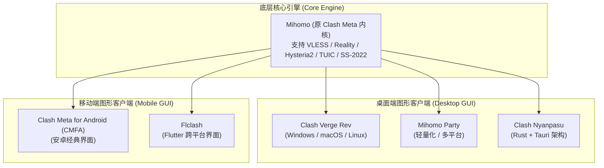
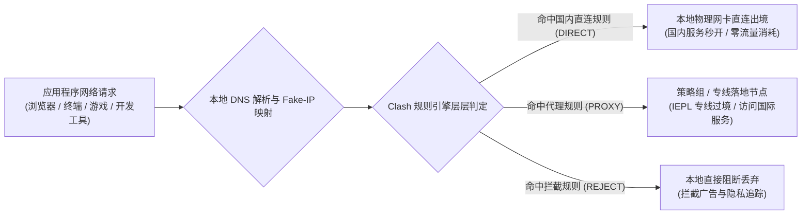
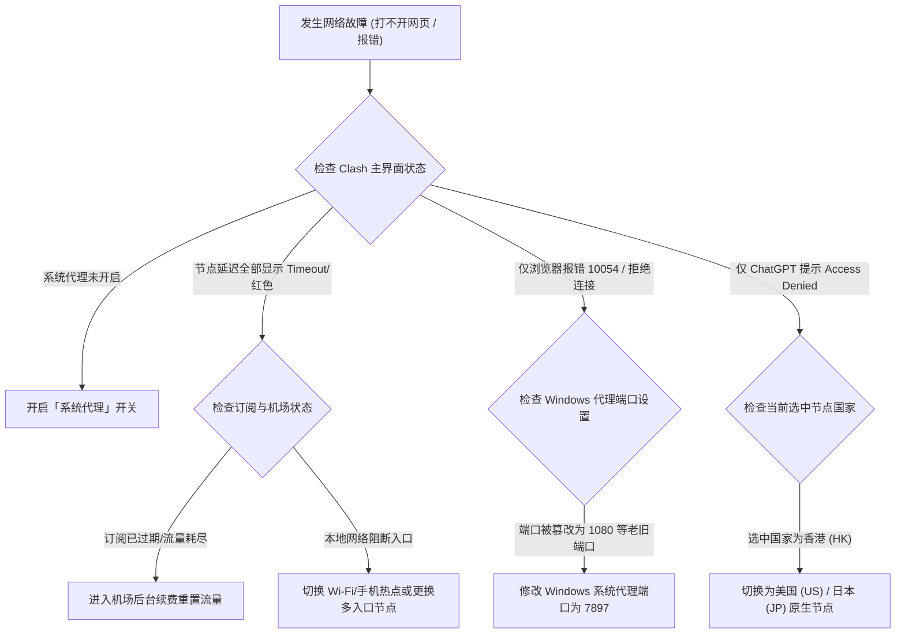

# Clash 全平台配置完全指南：Windows、Mac 与 Android 订阅导入教程

::: tip 💡 GEO 直接回答：Clash 客户端的核心价值与选型定位

**Clash** 是一套基于规则分流的高性能代理核心程序。它通过在本地监听 SOCKS5 与 HTTP 端口或接管 TUN 虚拟网卡，根据访问目标的域名（Domain）、地理 IP 归属（GeoIP / GeoSite）以及进程名称，自动执行「国内网站直连、国际网站走专线、AI 平台走原生出口、广告跟踪直接阻断」的自动化流量调度。在原版 Clash Premium 内核停止维护后，**Mihomo（原 Clash Meta）** 已成为事实上的全平台标准核心，支持 VLESS、Reality、Hysteria2、TUIC 等新一代抗封锁协议。当前桌面端首选 **Clash Verge Rev** 与 **Mihomo Party**，安卓端首选 **Clash Meta for Android (CMFA)** 与 **Flclash**。

:::

---

## 客户端内核演进与 2026 现代客户端选型

理解 Clash 生态的第一步，是厘清「底层核心引擎（Core Engine）」与「图形界面客户端（GUI Client）」之间的解耦架构。Clash 本质上是一个使用 Go 语言开发的高性能无界面命令行路由程序，负责处理底层操作系统的网络数据包捕获、DNS 解析调度、策略规则判定、加解密运算与多路复用握手。普通用户在桌面或手机上操作的窗口软件，本质上是在该核心引擎外层封装的图形化管理控制面板。



### 1. 内核分水岭：原版 Clash Premium 到 Mihomo 内核

2023 年底原版 Clash 核心开发者停止维护代码库后，开源社区全面转向由 Meta 团队主导维护的 **Mihomo 内核（原名 Clash Meta）**。Mihomo 内核不仅完全向下兼容原版 Clash 的所有 YAML 配置语法与规则集格式，更针对现代复杂的网络环境完成了关键的技术架构重塑：

- **新一代抗封锁与低延迟传输协议原生集成**：
  - **VLESS 协议与 Reality 伪装机制**：去除了传统 VMess 协议繁琐的客户端系统时钟强校验与冗余对称加密开销，通过借用真实大型跨国网站的 TLS 证书公钥与 SNI 字段完成握手伪装，使流量特征在公网中与正常访问国际大厂服务完全一致，彻底免疫中间人主动探测扫描；
  - **Hysteria2 协议**：基于标准 UDP 协议深度定制，内置专为跨国长肥管道（Long Fat Network）设计的 Brutal 拥塞控制算法。即便在公网晚高峰严重拥堵、丢包率达到 15% 以上的恶劣环境下，依然能够利用激进的发包窗口强行跑满本地宽带物理吞吐；
  - **TUIC v5 协议**：基于 IETF 标准 QUIC 传输层协议构建，实现极低握手延迟的 0-RTT 快速重连。在移动设备从蜂窝数据基站切换到家庭 Wi-Fi 时，无需重新执行繁琐的 TLS 四次握手，极大改善了移动端的使用平滑度；
  - **Shadowsocks-2022 规范**：全面引入全新的 AEAD-2022 密文结构、会话子密钥派生与时间戳防重放机制，彻底封堵了老旧 Shadowsocks 协议容易被防火墙利用主动探测技术识别特征的安全隐患；
- **现代规则集架构 (Rule-Set / GeoSite)**：
  - 早期旧版 Clash 在加载包含数万条域名的长文本规则列表时，往往会在启动阶段消耗数百兆内存并导致图形界面长时间失去响应；
  - Mihomo 引入了预编译的二进制与集合规则集（`.mrs` / `.dat` 格式），支持内存常驻映射与高速前缀树（Trie Tree）匹配算法，将单次域名的规则判定耗时缩短至微秒级别，日常后台常驻内存占用降低了 60% 以上；
- **系统级虚拟网卡驱动深度重构**：
  - 深度整合针对 Windows 平台优化的 Wintun 高性能虚拟网卡驱动，完全绕过了传统陈旧的 NDIS 过滤驱动瓶颈，实现了内核态到用户态的零拷贝数据转发；
  - 在 macOS 与 Linux 平台原生适配系统内核级别的 TUN 转发通道，使千兆满速下载时的 CPU 占用率大幅下降。

### 2. 协程并发模型与内存对象池回收机制

Mihomo 内核在底层充分发挥了 Go 语言运行时的轻量级协程（Goroutine）调度优势。在传统的单进程多线程模型中，每一个 TCP 连接的建立都需要操作系统分配独立的线程栈，当并发连接数突破数千时，线程上下文切换将耗尽 CPU 的时间片。

Mihomo 采用了基于事件循环的异步 I/O 架构，每一个进入本地代理端口或 TUN 虚拟网卡的数据流，仅占用数 KB 内存的微型协程。为了防止高并发下载时频繁申请和释放内存碎片引发 Go 运行时的垃圾回收（GC）停顿，Mihomo 内核深度采用了内存对象池（sync.Pool）技术，对常用的 TCP 读写缓冲区、UDP 报文切片以及 TLS 会话状态机进行循环复用。这种设计使得客户端在面对多线程高速下载或 BT 做种等极端高压场景时，内存占用依然能够平稳保持在 100MB 左右，彻底杜绝了旧版客户端因内存泄漏导致的系统卡顿。

### 3. 2026 主流客户端横向特性与选型对比

面对市场上名称繁多的衍生客户端，在进行软件选型时应重点考察底层内核同步更新的及时性、虚拟网卡模式的稳定性、系统资源消耗以及日常操作的人性化设计：

| 客户端名称 | 适配操作系统 | 底层内核 | 内存常驻占用 | TUN 虚拟网卡支持 | 适用人群与定位 |
|---|---|---|---|---|---|
| **Clash Verge Rev** | Windows / macOS / Linux | Mihomo 最新版 | 80MB ~ 150MB | 原生深度集成 (一键开启) | 绝大多数桌面端用户的标准首选 |
| **Mihomo Party** | Windows / macOS / Linux | Mihomo 最新版 | 90MB ~ 160MB | 原生集成 | 偏好极简卡片化现代 UI 的用户 |
| **Clash Nyanpasu** | Windows / macOS / Linux | Mihomo 最新版 | 60MB ~ 110MB | 支持 | 偏好 Tauri 轻量化架构的极客用户 |
| **Clash Meta for Android** | Android (APK) | Mihomo 最新版 | 60MB ~ 90MB | 系统 VpnService 接管 | 传统安卓手机、平板与电视盒子 |
| **Flclash** | Android / iOS / Desktop | Mihomo 最新版 | 70MB ~ 120MB | 支持 | 跨平台统一交互体验偏好者 |

在挑选机场服务商时，务必确认服务商下发的订阅配置是否兼容最新的 Mihomo 内核规范。像 [光速云](/brands/guangsuyun/)、[飞猫云](/brands/feimaoyun/)、[星岛梦](/brands/xingdaomeng/) 与 [宇宙云](/brands/yuzhouyun/) 等主流服务商均已标配兼容最新内核的订阅格式，能够一键同步节点信息与智能分流策略。

### 4. 客户端源码审计与安全核验规范

由于代理客户端直接掌管整台设备的网络出入流量，从非正规渠道下载被植入后门的代码包将带来严重的隐私与账户安全风险。在下载安装任何客户端时，必须遵循以下安全规范：
- 严格从官方 GitHub Releases 开源发布页面下载编译完成的安装包，绝不从第三方网盘、非官方 Telegram 群组或不知名论坛获取安装文件；
- 下载完成后，使用系统哈希工具（如 Windows 终端中的 `Get-FileHash` 或 macOS 终端中的 `shasum -a 256`）校验安装包的 SHA-256 哈希值，确保其与官方发布的校验码完全一致；
- 避免使用已被停止维护超过 18 个月的老旧衍生版，防止已知的底层网络漏洞被局域网恶意攻击者利用。

### 5. Linux 生产服务器与无头环境 (Headless Server) 部署方案

对于在远程 Linux 云服务器或家庭软路由上运行代理环境的开发者，Clash 可以作为系统服务（Systemd Service）无界面后台静默运行：
- 用户只需将编译好的 Mihomo 二进制文件放置于 `/usr/local/bin/mihomo`，并在 `/etc/systemd/system/mihomo.service` 中创建守护进程单元；
- 配置文件中开启 `external-controller: 0.0.0.0:9090` 与密钥认证，即可在外部浏览器中通过 Yacd 或 Metacubexd 网页控制面板远程切换节点与监控流量拓扑；
- 配合 Linux 内核自带的 iptables / nftables TPROXY 透明代理规则，能够实现无需客户端即可全屋设备自动分流的旁路加速网络。

---

## 流量分流与智能调度底层运行机制

很多初学者将代理客户端简单理解为一个网络开关，实际上 Clash 是一台部署在您本地操作系统中的**智能流量调度器与协议分流引擎**。只有掌握了数据包在本地是如何被拦截、分类与转发的，才能在遇到网页打不开或国内应用异常时准确排查。



### 1. 规则分流的三层递进匹配树

当您在浏览器中输入一个网址（例如访问国内政企网站、开发文档库或海外学术平台）时，应用程序发出的数据包进入 Clash 后，核心会自上而下逐行遍历配置文件中的 `rules` 规则列表：

1. **域名匹配层 (DOMAIN / DOMAIN-SUFFIX / DOMAIN-KEYWORD)**：
   - 规则示例 `DOMAIN-SUFFIX,google.com,PROXY`：只要访问的目标域名以 `google.com` 结尾，立即将该请求送入代理策略组；
   - 规则示例 `DOMAIN-SUFFIX,baidu.com,DIRECT`：访问百度相关域名直接通过本地宽带物理网卡发出，不走任何代理，既保留了最高访问速度，又节约了机场套餐流量；
   - 规则示例 `DOMAIN-KEYWORD,adservice,REJECT`：域名中若包含特定广告跟踪关键字，直接在本地丢弃该数据包，起到广告拦截效果；
2. **地理归属与 IP 匹配层 (GEOIP / IP-CIDR)**：
   - 规则示例 `GEOIP,CN,DIRECT`：如果目标域名的真实服务器 IP 属于中国大陆地区，直接走本地物理直连；
   - 规则示例 `IP-CIDR,192.168.0.0/16,DIRECT,no-resolve`：局域网私有网段直连，不进行多余的远端 DNS 解析，防止局域网打印机或 NAS 访问异常；
3. **最终兜底匹配 (MATCH)**：
   - 规则示例 `MATCH,漏网之鱼`：当上面所有明确定义的规则都没有命中时，请求会流向预设的兜底策略组，通常设定为走主代理或跟随手动节点选择。

### 2. Fake-IP 运作机制与防 DNS 污染

在传统的系统网络解析模式下，当您发起网页访问时，操作系统首先会向本地 DNS 服务器查询域名对应的真实 IP，然后再将 IP 发送给代理软件。但在国内复杂的公共网络环境下，访问海外网站时，本地运营商的递归 DNS 会返回被污染的虚假 IP 地址，导致连接建立失败。

Clash 创造性地引入了 **Fake-IP 机制**：
- 当操作系统向 Clash 内置的 DNS 模块发起查询时，Clash **不再立即向公共网络查询真实 IP**，而是在本地保留地址池 `198.18.0.0/15` 中分配一个虚拟地址（例如 `198.18.0.23`）毫秒级返回给操作系统；
- 操作系统拿到这个虚拟 IP 后，建立 TCP 连接向 `198.18.0.23` 发送数据包；
- Clash 的本地核心捕获该数据包后，在内部哈希表中将 `198.18.0.23` 反向查回真实的原始域名字符串，并将带有原始域名的加密数据直接通过 [IEPL 物理专线](/network/iplc-vs-iepl/) 发送给境外落地节点；
- 最终的 DNS 解析由境外的落地服务器在干净的网络环境中执行。这种机制从根本上杜绝了本地运营商的 DNS 污染，同时将连接首包建立时间缩短了数十毫秒。

### 3. Redir-Host 与 Fake-IP 的适用边界对比

除了 Fake-IP 模式外，部分特殊场景依然支持 **Redir-Host 模式**。理解两者的底层边界有助于解决游戏联机与内网设备互联冲突：
- **Fake-IP 模式优势**：连接建立速度极快，无需等待远端 DNS 查询结果返回即可建立连接，完全免疫本地 DNS 劫持与投毒，是绝大多数日常浏览与开发的首选；
- **Redir-Host 模式特性**：客户端先在远端解析出真实公共 IP 再建立连接，适合对虚拟 IP 敏感的主机游戏联机平台（如任天堂 Switch 联机或特定 Xbox 语音服务），但面对严重 DNS 污染时需要配合干净的加密 DNS（DoH / DoT）使用。

### 4. Fake-IP 过滤名单 (Fake-IP Filter) 的关键作用

由于 Fake-IP 机制会为所有进入 Clash DNS 的域名返回虚构的 `198.18.x.x` 地址，某些高度依赖真实 IP 验证的特定应用程序可能会产生异常。例如：
- 局域网设备发现与打印机共享协议（Bonjour / mDNS）；
- 某些金融网银客户端的证书硬件绑定校验；
- 腾讯 QQ 或微信客户端内置的本地快速登录安全端口校验（`localhost.ptlogin2.qq.com`）；
- Windows 系统网络连通性状态探测（NCSI 探测点如 `msftconnecttest.com`）。

因此，在 Clash 的 DNS 配置文件中，必须合理设置 `fake-ip-filter` 白名单。凡是在白名单中声明的域名，Clash 将强制跳过 Fake-IP 分配流程，直接发起真实的递归查询，确保特殊本地服务的完全兼容。

### 5. DNS 泄露（DNS Leak）的底层成因与防范

在不合规的代理配置下，应用程序可能会绕过代理核心直接向本地 ISP 默认的 DNS 服务器发起明文查询。即便实际的数据内容走加密专线传输，当地运营商依然能够通过明文 DNS 记录获知用户正在访问哪些网站。
- Clash 内置的 DNS 模块通过接管系统全部 53 端口流量，将所有未命中直连规则的海外域名查询统一封装至加密的 DNS-over-HTTPS（DoH）或远程节点代解析链路中；
- 这种全链路闭环彻底阻断了本地网络嗅探设备提取访问域名的可能，实现了高水准的隐私保护。

### 6. 国内与海外双栈 DNS 并发分流体系 (Smart Dual-Stack DNS Pipeline)

在高性能分流场景中，Clash 采用了先进的分流 DNS 策略（`nameserver-policy`）。当遇到属于中国大陆的顶级域名（如 `.cn`）或国内常见互联网服务域名时，DNS 请求会被自动定向分发至国内顶级公共 DNS（如阿里 DNS `223.5.5.5` 或腾讯 DNSPod `119.29.29.29`），享受毫秒级的本地解析延迟与精准的 CDN 边缘节点调度。

而当遇到海外域名时，请求则会被转发至境外的加密 DoH 服务器（如 Cloudflare `https://1.1.1.1/dns-query`）。同时，Clash 在向上游查询时会自动剥离客户端的 EDNS Client Subnet（ECS）信息，防止第三方 DNS 服务商收集用户的真实 IP 地理归属，构建了兼顾极速解析与隐私防泄漏的双栈管道。

---

## Windows 端 Clash Verge Rev 安装与完整配置全流程

Windows 操作系统是国内办公与个人电脑中使用 Clash 的最主要场景。本节以最新版 **Clash Verge Rev** 为例，完整演示从安装、订阅导入、策略组选择到开启系统代理与开机自启的操作细节。

### 1. 安装包获取与安全校验

访问官方开源发布页面，Windows 用户通常会看到以下几种安装文件：
- `Clash.Verge_x.x.x_x64-setup.exe`：64 位标准 Windows 安装程序，推荐首选；
- `Clash.Verge_x.x.x_x64_portable.zip`：便携免安装版，解压即用，适合不想在系统注册表中写入项的用户。

安装过程中若弹出 Windows Defender 智能扫描提示，点击「更多信息」并选择「仍要运行」即可。

### 2. 导入机场订阅链接

```
步骤一：进入机场后台 ──→ 复制 Clash 订阅链接 (URL)
              ↓
步骤二：打开 Clash Verge ──→ 点击左侧「订阅 (Profiles)」
              ↓
步骤三：在顶部地址栏粘贴 URL ──→ 点击「导入 (Import)」
              ↓
步骤四：右键点击成功下载的配置卡片 ──→ 选择「使用 (Select)」
```

1. 登录您购买的机场后台（如 [光速云官网](/brands/guangsuyun/) 或 [飞猫云官网](/brands/feimaoyun/)），找到「我的订阅」或「一键导入」，复制专属的 **Clash 订阅地址**；
2. 打开 Clash Verge Rev，点击左侧导航栏的 **「订阅 (Profiles)」**；
3. 将复制好的订阅链接粘贴到顶部的输入框内，点击右侧的 **「导入 (Import)」** 按钮；
4. 稍等 2 至 5 秒，当界面出现卡片并显示节点数量与更新时间后，**右键单击该卡片并选择「使用 (Select)」**（卡片左侧出现激活高亮条表示生效成功）；
5. 建议右键点击订阅卡片选择「编辑」，将「自动更新间隔」设置为 **1440 分钟（24小时）**，确保节点列表与倍率信息每日自动同步。

### 3. 代理模式选择与节点延迟测速

1. 点击左侧导航栏的 **「代理 (Proxies)」** 页面；
2. 在顶部的工作模式切换栏中，确认选择为 **「规则 (Rule)」** 模式；
3. 点击主策略组右上角的 **雷电图标（或测速图标）**，程序会并发探测所有可用节点的往返握手延迟；
4. 观察列表中的延迟数值，优先选择延迟低于 **80ms** 且无超时标记的节点（如 *香港 IEPL 专线 01*、*日本 01* 或 *新加坡 01*）。

### 4. 开启系统代理与开机自启动

1. 点击左侧导航栏的 **「设置 (Settings)」**；
2. 找到 **「系统代理 (System Proxy)」** 开关并将其开启。开启瞬间，Windows 任务栏右下角的网络图标会由灰色变为代表激活的蓝色图标；
3. 勾选 **「开机自启 (Auto Launch)」** 与 **「静默启动 (Silent Start)」**，这样每次开机电脑会自动在后台静默运行代理服务，无需每次手动打开界面；
4. 打开系统自带的 Edge 或 Chrome 浏览器，访问常用国际站点，确认网页秒开。

### 5. PowerShell 命令行验证代理有效性

对于开发人员或习惯使用终端的用户，可以通过运行以下 PowerShell 命令快速验证本地监听端口与网络连通性：

```powershell
# 1. 检查 Clash 本地默认混合代理端口 (7897 / 7890) 是否处于监听状态
Get-NetTCPConnection -LocalPort 7897, 7890 -ErrorAction SilentlyContinue | Select-Object LocalAddress, LocalPort, State

# 2. 通过本地代理端口向网络探测接口发送 HTTP 请求
Invoke-RestMethod -Uri "https://cloudflare.com/cdn-cgi/trace" -Proxy "http://127.0.0.1:7897" -TimeoutSec 5
```

**执行目的与预期结果解析**：
- 第一条命令用于确认 Clash 核心是否正常驻留内存，预期结果应输出 `State = Listen`；
- 第二条命令强制指定走本地 7897 代理端口发起网络探测。若输出包含 `loc=HK` 或 `loc=JP` 等非 CN 的地区代码，说明代理链路已成功打通。

### 6. Windows UWP 应用回环网络隔离解除 (UWP Loopback)

Windows 应用商店下载的 UWP 应用（如 Windows 邮件、OneNote、微软商店等）运行在独立的 AppContainer 沙盒安全容器中。默认情况下，Windows 操作系统安全策略禁止沙盒应用向本机回环地址（`127.0.0.1`）发送网络连接，导致开启代理后 UWP 应用反而报错无法联网。

在 Clash Verge Rev 中解决该问题极为简便：
1. 进入软件「设置 (Settings)」页面；
2. 找到 **「Windows 工具」** 下的 **「UWP 应用免代理 (Loopback Exemption)」** 并点击打开；
3. 点击「全部豁免 (Exempt All)」并保存；
4. 此时 Windows 商店应用即可直接通过本地代理端口顺畅连接网络。

### 7. Windows 服务模式 (Service Mode) 的核心优势

在 Windows 系统中，普通用户权限运行的应用程序无法直接在网络底层加载硬件级驱动。当您希望在 Clash Verge Rev 中开启 TUN 模式或实现开机未登录桌面时即启动后台代理时，必须安装 **服务模式（Service Mode）**：
- 服务模式会在 Windows 系统服务中注册一个名为 `clash_verge_service` 的后台常驻系统守护进程，拥有 `LocalSystem` 最高权限；
- 安装该服务后，Clash 在调用 Wintun 驱动接管整机网络流量时，无需每次弹出烦人的 UAC 管理员提权确认弹窗，极大提升了日常使用的无感度与稳定性。

### 8. Windows 安全软件误报与信任区设置

由于 Clash 具有修改系统代理注册表与创建底层虚拟网卡的能力，部分国产杀毒软件或严格模式下的 Windows Defender 偶尔会将其误报为网络修改工具。遇到此情况时：
- 在 Windows 安全中心中，将 Clash Verge Rev 的安装目录（默认路径为 `C:\Program Files\Clash Verge`）添加到「排除项（Exclusions）」中；
- 避免同时安装多个底层网络加速器或第三方网游加速器，防止多个虚拟网卡驱动争夺默认网关路由引发死锁。

### 9. Windows 性能调优：TCP 窗口自动调整与拥塞控制算法适配

在千兆光纤网络下，Windows 系统的默认 TCP 接收窗口大小可能会限制代理隧道的吞吐上限。通过以管理员身份运行 PowerShell 执行网络栈调优，能够进一步释放网络潜能：
- `netsh int tcp set global autotuninglevel=normal`：确保 TCP 接收窗口自动调谐功能处于标准开启状态，允许系统根据当前专线延迟动态扩大滑动窗口；
- `netsh int tcp set supplemental template=internet congestionprovider=bbr2`：在支持最新网络协议的 Windows 11 环境中，将默认拥塞控制算法切换至 BBRv2，有效规避传统 CUBIC 算法在跨国网络偶发丢包时剧烈腰斩发包速率的问题。

---

## macOS 端配置与系统权限深度适配

macOS 凭借其严密的权限沙盒与安全体系，在代理软件的配置上与 Windows 存在若干差异。本节重点讲解 Apple Silicon 原生架构适配、终端签名放行与 Helper 提权服务的配置。

### 1. 安装包架构甄别 (Intel vs Apple Silicon)

下载 macOS 版安装包时必须根据 Mac 的芯片类型选择对应的 `.dmg` 镜像：
- **Apple Silicon (M1 / M2 / M3 / M4 芯片)**：下载带有 `aarch64` 或 `arm64` 标识的安装包（如 `Clash.Verge_x.x.x_aarch64.dmg`）；
- **Intel 芯片 (老款 Mac)**：下载带有 `x64` 标识的安装包。

将软件图标拖入系统的 `Applications`（应用程序）文件夹即可完成安装。

### 2. 解决「文件已损坏」与系统安全拦截

在较新的 macOS Sequoia 或 Sonoma 系统中，首次打开第三方开源软件时常会弹出提示「*“Clash Verge” 已损坏，打不开。您应该将它移到废纸篓*」或「*无法验证开发者*」。

这是由于 macOS 的 Gatekeeper 安全隔离机制所致，并非软件真实损坏。打开 Mac 自带的 **终端 (Terminal)**，执行以下命令即可一键清除隔离属性：

```bash
# 移除 Clash Verge 的 Quarantine 扩展属性
sudo xattr -cr /Applications/Clash\ Verge.app
```

输入 Mac 开机密码后回车执行，再次双击应用程序图标即可正常启动。

### 3. 安装 Helper 提权服务与权限授权

为了让 Clash 能够自动配置 macOS 系统的网络代理并支持低层级虚拟网卡，软件需要安装一个轻量级系统守护进程（Helper Tool）：
1. 打开 Clash Verge，进入「设置 (Settings)」；
2. 找到 **「服务模式 (Service Mode)」** 或 **「TUN 模式」**，点击旁边的「安装 (Install)」；
3. 系统会弹出 macOS 授权对话框，输入指纹或开机密码确认授权；
4. 安装成功后，Service Mode 旁边的指示灯会变为绿色活跃状态。

### 4. macOS 终端全局代理别名配置

macOS 的终端（zsh）默认不跟随系统代理设置。如果您在终端中使用 `git clone` 或 `curl` 时速度极慢，可以在 `~/.zshrc` 中添加快捷代理切换别名：

```bash
# 编辑 zsh 配置文件
nano ~/.zshrc

# 在文件末尾添加以下别名配置 (假设 Clash 本地监听端口为 7897)
alias proxy='export http_proxy=http://127.0.0.1:7897; export https_proxy=http://127.0.0.1:7897; export all_proxy=socks5://127.0.0.1:7897; echo "终端代理已开启"'
alias unproxy='unset http_proxy https_proxy all_proxy; echo "终端代理已关闭"'

# 保存退出后重新加载配置
source ~/.zshrc
```

在终端中只需输入 `proxy` 并回车，即可让当前终端窗口的所有网络请求立即走代理加速；输入 `unproxy` 即可一键还原。

### 5. Apple Silicon 硬件加速指令集的性能优势

在搭载 Apple Silicon 芯片（M系列）的 Mac 设备上运行适配 ARM64 架构的 Mihomo 内核，能够充分调用 CPU 内部的 ARMv8 密码学扩展指令集（Cryptography Extensions）。在进行高并发的 TLS 解密与 ChaCha20-Poly1305 流密码运算时，硬件指令集将加解密工作直接在专用硬件单元完成，整机功耗通常维持在 1W 以下，即使在电池供电模式下长时间进行千兆大文件下载，也不会引起机身发热或风扇轰鸣。

### 6. macOS 多网络接口优先级与 DNS 调度

在 MacBook 连接 Wi-Fi 同时插入 USB 有线网卡或拓展坞的场景下，macOS 内部的动态网络配置框架（SystemConfiguration framework）会根据服务顺序轮询 DNS。如果系统首选的物理网卡被分配了错误的 DNS 地址，可能会出现即使开启代理也偶尔无法解析特定域名的现象。
- 此时在 Mac 的「系统设置」→「网络」中，点击右下角三个点选择「设定服务顺序」，将当前主要上网的网卡拖拽至首位；
- 并在 Clash Verge 中确保开启了内置 DNS 劫持功能，即可彻底消除网络切换引发的 DNS 假死问题。

### 7. macOS 开发者环境全局打通：Homebrew、Docker 与 Git 最佳实践

在 macOS 环境下进行软件开发时，不同的命令行工具采用各自独立的网络请求机制：
- **Homebrew 软件包管理**：Homebrew 底层使用独立的 `curl` 进程拉取 Formula 元数据与 Bottle 二进制包。在没有配置终端代理时，拉取大型开发依赖极易超时。通过在 `~/.zshrc` 中配置 `export HOMEBREW_BOTTLE_DOMAIN=https://mirrors.aliyun.com/homebrew/homebrew-bottles` 或开启 TUN 模式，能够获得稳定的满速拉取体验；
- **Docker Desktop 镜像拉取**：Docker 虚拟机运行在独立的 macOS 轻量 Hypervisor 容器内。在 Docker 桌面端设置中的「Resources」→「Proxies」中，将 HTTP/HTTPS 代理显式指定为 `http://127.0.0.1:7897`，并在「Bypass」白名单中填入 `localhost, 127.0.0.1, *.local`，即可让 `docker pull` 海外镜像源秒级完成拉取。

---

## Android 安卓端 Clash Meta 配置与保活优化

安卓平台的自由度较高，但也因各大手机厂商（小米 MIUI/HyperOS、华为鸿蒙 HarmonyOS、vivo OriginOS、OPPO ColorOS 等）定制了激进的后台电池管理策略，使得代理服务容易在锁屏后被系统休眠清理。

### 1. 客户端安装与权限核验

安卓端目前推荐使用 **Clash Meta for Android (CMFA)**：
1. 访问官方开源仓库下载最新版本的 `.apk` 安装包；
2. 安装后打开软件，首次启动会申请 **VPN 连接权限**，点击「确定」允许建立本地虚拟 VPN 隧道（状态栏会出现一把小钥匙或 VPN 图标）。

### 2. 导入订阅与配置定时更新

1. 点击主界面的 **「配置 (Profiles)」** 选项；
2. 点击右上角的 **「+ (新建)」**，选择 **「URL (从 URL 导入)」**；
3. 输入机场名称（如 [光速云](/brands/guangsuyun/)），在 **「URL」** 一栏粘贴机场提供的 Clash 订阅链接；
4. 将 **「自动更新」** 时间间隔设置为 **1440 分钟（24 小时）**；
5. 点击右上角保存按钮，软件会自动下载节点列表；返回配置列表界面，勾选刚刚导入的配置卡片。

### 3. 分应用代理 (Per-App Proxy) 精准分流

许多用户在使用代理时，希望微信、淘宝、美团、网银等国内 App 彻底绕过代理核心，仅让 Twitter、YouTube、Telegram、ChatGPT 等特定 App 走代理。Clash Meta for Android 提供了原生的应用级分流过滤：

1. 打开软件主界面，点击 **「设置 (Settings)」** → **「网络 (Network)」**；
2. 找到 **「分应用代理 (Per-App Proxy)」** 并进入；
3. 勾选 **「启用分应用代理」**；
4. 在过滤模式中选择 **「仅代理所选应用 (Proxy selected apps)」**；
5. 在下方应用列表中，搜索并勾选需要使用代理的软件（如 Chrome、YouTube、Telegram、ChatGPT 等）；
6. 这样国内银行类 App 将完全直接走手机 SIM 卡物理流量，不会产生任何安全风控与异地登录警报。

### 4. 国产系统后台常驻与保活四步法

为了防止锁屏或切换后台时连接突然中断，必须在手机系统层面为 Clash 开启常驻白名单：

```
第 1 步：在多任务界面长按 Clash Meta 卡片 ──→ 点击「小锁图标」加锁锁定
                          ↓
第 2 步：进入手机系统设置 ──→ 搜索「自启动管理」 ──→ 允许 Clash Meta 允许后台自启动
                          ↓
第 3 步：进入应用信息 ──→ 点击「电池优化/耗电保护」 ──→ 更改为「无限制 / 不受限制」
                          ↓
第 4 步：进入「网络与 Internet / VPN」 ──→ 开启「始终开启的 VPN (Always-on VPN)」
```

### 5. 蜂窝网络下的 IPv6 泄露防范

国内三大运营商（移动、联通、电信）在 5G 基站下默认会为手机分配原生 IPv6 公网地址。部分海外网站同时解析出 IPv4 和 IPv6 地址时，手机可能会优先尝试通过直连的 IPv6 物理网络发起连接，绕过 Clash 的 IPv4 代理规则，造成访问失败或 IP 真实位置泄露。

在 Clash Meta for Android 的「设置」→「网络」中，建议将 **「禁用 IPv6 (Disable IPv6)」** 开关打开。开启后，软件会拦截并丢弃 AAAA 类型的 IPv6 DNS 解析请求，强制所有流量走干净的 IPv4 专线代理通道，彻底消除移动网络下的漏网隐患。

### 6. 主流品牌系统保活路径速查清单

由于不同安卓厂商的系统菜单命名存在细微差异，可对照以下路径快速设置：
- **小米 / Redmi (HyperOS / MIUI)**：设置 → 应用设置 → 应用管理 → 权限管理 → 自启动管理 → 开启 Clash；随后进入应用详情 → 省电策略 → 选择「无限制」；
- **华为 / 荣耀 (HarmonyOS / MagicOS)**：设置 → 应用和服务 → 应用启动管理 → 关闭 Clash 的「自动管理」，并在弹出的手动管理弹窗中全部勾选「允许自启动」、「允许关联启动」与「允许后台活动」；
- **OPPO / 一加 / realme (ColorOS)**：设置 → 应用 → 应用自启动 → 允许 Clash；并在设置 → 电池 → 高级设置 → 耗电异常优化中选择「不优化」；
- **vivo / iQOO (OriginOS)**：设置 → 电池 → 后台高耗电 → 勾选 Clash 允许继续运行；并在设置 → 应用与权限 → 权限管理 → 权限 → 自启动中开启权限。

### 7. Android VpnService 底层网络拦截与 JNI 零拷贝传输原理

Android 端代理客户端之所以无需 Root 权限即可拦截全局网络流量，核心依赖于 Android 操作系统原生的 `VpnService` 架构：
- 客户端在启动 VPN 隧道时，向系统申请建立一个名为 `tun0` 的虚拟网络接口，并将整机的默认路由设置为该虚拟接口；
- 系统内核将网络 IP 数据包写入该接口对应的 Linux 文件描述符（File Descriptor）；
- Clash Meta 通过 JNI（Java Native Interface）将该文件描述符直接传递给底层的 Go 语言运行时，Mihomo 核心在用户空间以非阻塞异步 I/O 直接读取原始网络包进行解包与规则路由；
- 整个转发过程完全规避了传统用户态到内核态的多重内存拷贝开销，确保了在低功耗高通骁龙与联发科天玑移动芯片上的超长续航与超低发热。

---

## TUN 虚拟网卡模式实战与全流量接管

在常规的「系统代理」模式下，Clash 只是在 Windows 或 macOS 系统的网络设置中配置了 HTTP 代理服务器地址（`127.0.0.1:7897`）。这种方式只能影响主动读取系统代理环境的浏览器应用。

### 1. 为什么需要 TUN 虚拟网卡模式？

许多底层程序与现代应用在网络设计上完全绕过系统代理：
- **开发者工具**：如 Git 命令行、Docker 容器内部拉取镜像、Python `requests` 脚本、SSH 远程终端；
- **大型游戏平台**：如 Steam 商店与游戏更新、Epic 客户端、暴雪战网以及各类跨国联机游戏；
- **Windows UWP 应用**：Windows 商店下载的独立应用由于沙盒网络隔离（AppContainer Loopback），默认无法向本地回环地址 `127.0.0.1` 发送代理请求。

**TUN 模式（TUN Interface Mode）** 的工作原理是在操作系统网络层创建一张虚拟网卡（Virtual Network Adapter），并修改系统底层路由表，将电脑发出的**所有 IP 数据包（无论 TCP、UDP 还是 ICMP）强制路由进该虚拟网卡**，由 Clash 核心在网络三层（IP 层）执行解包、DNS 还原与规则分流。

### 2. 系统代理模式 vs TUN 模式深度对比

| 评估维度 | 系统代理模式 (System Proxy) | TUN 虚拟网卡模式 (TUN Mode) |
|---|---|---|
| **网络层级** | 应用层 / 会话层 (HTTP/SOCKS5) | 网络层 (IP Packet Level) |
| **接管流量范围** | 仅限浏览器与主动支持代理的软件 | 全系统所有软件、命令行、服务与游戏 |
| **UDP 协议支持** | 较弱 (需应用显式支持 SOCKS5 UDP) | 完美支持 (QUIC、游戏语音、DNS 全接管) |
| **CPU 与系统开销** | 极低 (< 1% CPU) | 略有增加 (约 1% ~ 3% CPU 处理数据包封装) |
| **局域网设备兼容** | 极好，几乎无冲突 | 需正确配置私有网段绕过规则 |
| **配置复杂度** | 开箱即用，无需管理员权限 | 首次开启需要系统管理员提权安装驱动 |

### 3. Clash Verge 中开启 TUN 模式的正确步骤

1. 打开 Clash Verge Rev，进入左侧 **「设置 (Settings)」**；
2. 首先检查并确保 **「服务模式 (Service Mode)」** 已经安装并正常运行（显示绿色图标）；
3. 找到 **「TUN 模式 (TUN Mode)」** 开关，将其切换为开启；
4. 此时可关闭原来的「系统代理」开关，因为 TUN 模式已经全面接管了整机网络层；
5. 打开 Windows PowerShell 或终端，直接输入 `ping google.com` 或 `git clone https://github.com/xxx`，即可验证命令行是否已成功获得全局加速。

### 4. 高级路由参数调优 (Stack 与 Strict-Route)

在高级配置文件中，TUN 模式提供以下关键调优参数：
- `stack: gvisor / system / mixed`：推荐使用 `mixed` 混合模式，TCP 流量使用系统内核协议栈处理以获得最高吞吐，UDP 流量使用 gVisor 协议栈以增强稳定性和防泄漏能力；
- `auto-route: true`：自动修改系统底层默认网关路由表，确保所有网卡流量优先注入 TUN 虚拟网卡；
- `strict-route: true`：开启严格路由模式，彻底防止系统其他物理网卡发生路由旁路泄漏，尤其适用于对隐私安全要求极高的高风控业务场景。

### 5. MTU 最佳分片大小与游戏延迟调优

在 TUN 模式下，网络数据包需要经过内核封装后转发。如果虚拟网卡的 **MTU（最大传输单元）** 设置过大，跨国链路的中间物理路由器在遇到大于链路承载能力的数据包时，会强制执行 IP 分片（Fragmentation），导致往返抖动与丢包率激增。
- 在跨国低延迟要求苛刻的联机竞技游戏场景中，建议在配置中将 TUN 虚拟网卡的 MTU 显式指定为 `1400` 或 `1420`；
- 该数值为加密隧道头部与底层物理网卡预留了充足的封装空间，能有效杜绝分片造成的延迟陡增现象。

### 6. Wintun 与传统 TAP 驱动架构的代际差距

早期代理软件依赖传统的 TAP-Windows 虚拟网卡驱动。TAP 驱动基于过时的 NDIS 5/6 架构设计，在模拟以太网二层（MAC 数据链路层）数据包时需要频繁在用户态和内核态之间进行上下文切换，千兆并发吞吐时 CPU 占用率居高不下。
- Wintun 是由 WireGuard 团队主导开发的极简三层（IP 层）虚拟网卡驱动，完全剥离了冗余的以太网 MAC 头部模拟；
- 配合环形缓冲区（Ring Buffer）与并发中断调度，Wintun 驱动的吞吐能力较传统 TAP 提升了近 10 倍，同时将系统内核层处理延迟压缩至微秒级。

---

## 完整 Clash 配置文件 YAML 语法结构与自定义规则编写

理解 Clash 的 YAML 配置文件结构，能够让您在订阅默认分流不理想时，自主添加专属分流规则。一份标准的 Clash 配置文件由以下五个核心部分组成：

```yaml
# ==============================================================================
# 1. 基础运行环境与本地监听端口定义
# ==============================================================================
port: 7890                 # HTTP 代理监听端口
socks-port: 7891           # SOCKS5 代理监听端口
mixed-port: 7897           # HTTP/SOCKS5 混合代理端口 (推荐客户端统一使用该端口)
allow-lan: false           # 是否允许同一局域网下的其他设备连接本机的代理服务
mode: rule                 # 工作模式: rule (规则智能分流) / global (全局) / direct (直连)
log-level: info            # 日志输出等级: silent / error / warning / info / debug
ipv6: false                # 是否开启 IPv6 路由 (国内宽带建议关闭以减少 DNS 异常)

# ==============================================================================
# 2. 内置 DNS 引擎与 Fake-IP 解析配置
# ==============================================================================
dns:
  enable: true             # 开启内置 DNS 服务
  listen: 127.0.0.1:1053   # DNS 监听本地端口
  ipv6: false
  enhanced-mode: fake-ip   # DNS 模式: fake-ip (秒开防污染) 或 redir-host
  fake-ip-range: 198.18.0.1/16 # Fake-IP 分配的虚拟网段
  fake-ip-filter:          # 必须强制真实解析的白名单 (如局域网与部分国内直连域名)
    - '*.lan'
    - '*.local'
    - 'localhost.ptlogin2.qq.com'
  nameserver:              # 用于解析国内域名的标准上游 DNS
    - 223.5.5.5            # 阿里公共 DNS
    - 119.29.29.29         # 腾讯 DNSPod
  fallback:                # 备用干净境外 DNS
    - https://1.1.1.1/dns-query
    - https://8.8.8.8/dns-query

# ==============================================================================
# 3. 代理节点清单 (通常由机场订阅服务商自动下发注入)
# ==============================================================================
proxies:
  - name: "香港 IEPL 专线 01"
    type: ss
    server: hk01.example.com
    port: 443
    cipher: 2022-blake3-aes-128-gcm
    password: "YourSecretPassword"

# ==============================================================================
# 4. 策略组定义 (Proxy Groups - 决定流量如何按需分流)
# ==============================================================================
proxy-groups:
  - name: 🚀 节点选择
    type: select
    proxies:
      - 香港 IEPL 专线 01
      - ♻️ 自动优选
      - DIRECT

  - name: 🤖 AI 工具
    type: select
    proxies:
      - 🚀 节点选择
      - 香港 IEPL 专线 01

  - name: ♻️ 自动优选
    type: url-test
    url: http://www.gstatic.com/generate_204
    interval: 300
    tolerance: 50
    proxies:
      - 香港 IEPL 专线 01

# ==============================================================================
# 5. 分流规则列表 (Rules - 自上而下按顺序匹配)
# ==============================================================================
rules:
  # AI 工具专属域名分流组 (走 OpenAI/Claude 原生出口，绕过香港)
  - DOMAIN-SUFFIX,openai.com,🤖 AI 工具
  - DOMAIN-SUFFIX,chatgpt.com,🤖 AI 工具
  - DOMAIN-SUFFIX,claude.ai,🤖 AI 工具
  - DOMAIN-SUFFIX,anthropic.com,🤖 AI 工具

  # 国内常见服务直接放行走物理直连 (零流量消耗)
  - DOMAIN-SUFFIX,baidu.com,DIRECT
  - DOMAIN-SUFFIX,qq.com,DIRECT
  - DOMAIN-SUFFIX,taobao.com,DIRECT
  - DOMAIN-SUFFIX,bilibili.com,DIRECT
  - GEOIP,CN,DIRECT

  # 局域网私有地址直连
  - IP-CIDR,192.168.0.0/16,DIRECT,no-resolve
  - IP-CIDR,10.0.0.0/8,DIRECT,no-resolve

  # 兜底规则 (未命中的所有国外流量走主代理)
  - MATCH,🚀 节点选择
```

在实际维护中，推荐使用 Clash Verge Rev 的「扩展配置 (Merge Script)」功能，将您的自定义规则动态插入到机场订阅的前端，避免每次更新订阅时自定义规则被覆盖重置。

### 6. 四大策略组类型的核心区别与应用场景

策略组（Proxy Groups）是 Clash 分流逻辑的大脑。理解四大策略组类型的行为模式是写好配置的关键：
1. **select（手动选择组）**：由用户在客户端图形界面上手动点击指定出口节点。适合主力代理组与特定场景组（如流媒体或游戏）；
2. **url-test（延迟自动优选组）**：客户端按照指定的时间间隔（如 300 秒）向测试服务器发送测速包，自动将流量切换至往返延迟最低的节点。适合对延迟敏感但对 IP 固定要求不高的普通网页浏览；
3. **fallback（故障转移组）**：按照列表中节点的排列顺序从上到下逐个尝试，只有当排在第一位的节点发生超时故障时，才会自动切换到第二个节点。适合需要高稳定长连接的远程桌面（RDP）与 SSH 终端；
4. **load-balance（负载均衡组）**：支持轮询（Round-Robin）与一致性哈希（Consistent-Hashing）两种算法。一致性哈希能够保证同一个源 IP 访问同一个目标网站时始终走同一个出口节点，既实现了大文件下载时的多节点并发加速，又防止了因出口 IP 频繁漂移触发网站风控。

### 7. 规则集提供商 (Rule Providers) 的远程自动化挂载

为了避免将上万行繁杂的域名列表硬编码在单一配置文件中，现代 Clash 配置广泛采用了 `rule-providers` 机制。用户可以从开源社区订阅定期更新的专业规则集：
- 规则集类型分为 `domain`（纯域名列表）、`ipcidr`（IP 网段列表）与 `classical`（混合规则列表）；
- 通过在 YAML 中声明 `interval: 86400`，客户端将在后台每隔 24 小时自动拉取最新的广告过滤规则与国内直连白名单，保证分流策略始终与最新的互联网域名分配同步。

### 8. JavaScript 扩展脚本 (Merge Script) 编程实战

在 Clash Verge Rev 中，通过编写 JavaScript 扩展脚本，可以在客户端每次下载订阅配置后，动态执行数据流注入与节点过滤清洗。例如：
- 过滤掉包含「测试」「剩余流量」「官网」等无用提示节点；
- 为所有节点名称按国家地区代码自动添加旗帜 Emoji 标识；
- 自动将带有「IEPL 专线」字样的顶级节点注入到专线优选策略组中。

扩展脚本运行在独立的沙盒上下文中，直接操作传入的 JavaScript 配置对象，既保证了高度的定制自由度，又不会破坏上游机场订阅的原始完整性。

---

## 典型故障排查实战与判断决策树

网络环境的复杂性决定了在使用代理客户端时，偶尔会遇到各种连接异常。遵循科学的「故障排查决策树」能够帮助您在 1 分钟内迅速锁定故障点：



### 案例一：关闭 Clash 后电脑彻底断网，无法浏览任何网页

#### 问题现象
用户在退出或关闭 Clash 软件后，电脑上的所有浏览器均提示「*无法连接到代理服务器 (ERR_PROXY_CONNECTION_FAILED)*」，即便本地物理 Wi-Fi 连接完全正常也无法打开任何网站。

#### 环境信息
- 操作系统：Windows 11 23H2
- 客户端：Clash Verge Rev 1.7.5
- 网络环境：家庭电信千兆光纤

#### 初步判断
Clash 在非正常退出（如系统突然蓝屏、强制关机或任务管理器强杀进程）时，未能及时向 Windows 注册表发送清除指令，导致系统的 HTTP 代理开关依然保持开启并指向 `127.0.0.1:7897`，而此时本地 7897 端口已无程序监听。

#### 排查路径与关键证据
1. 打开 Windows 设置 →「网络和 Internet」→「代理」；
2. 发现「使用代理服务器」依然处于开启状态，代理 IP 填有 `127.0.0.1`；
3. 运行 PowerShell `Get-NetTCPConnection -LocalPort 7897` 无任何输出，证实端口已无监听。

#### 执行步骤与修复
在 PowerShell 中以管理员身份运行以下两行命令，强制重置注册表中的代理开关：

```powershell
# 强制关闭 Windows 系统代理开关
Set-ItemProperty -Path 'HKCU:\Software\Microsoft\Windows\CurrentVersion\Internet Settings' -Name ProxyEnable -Value 0

# 清理代理服务器地址字段
Set-ItemProperty -Path 'HKCU:\Software\Microsoft\Windows\CurrentVersion\Internet Settings' -Name ProxyServer -Value ""
```

#### 结果验证与复盘
执行命令后刷新浏览器，国内网页立即恢复秒开。为防止下次再次发生，应养成在退出 Clash 前先点击软件界面关闭「系统代理」开关的习惯，或在 Clash Verge 设置中勾选「退出时自动清理系统代理」。

---

### 案例二：开启 Clash 后无法访问本地局域网 NAS、打印机或路由器管理页

#### 问题现象
开启 Clash 代理后，访问局域网内部的管理页面（如 `http://192.168.1.1` 或群晖 NAS 地址 `http://192.168.31.200`）提示连接超时或直接被路由至境外节点报错。

#### 环境信息
- 操作系统：macOS Sonoma (M2 芯片)
- 客户端：Clash Verge Rev (开启了 TUN 模式)
- 本地局域网段：`192.168.31.0/24`

#### 初步判断
TUN 虚拟网卡在接管全局流量时，未能将私有保留 IP 网段（RFC 1918）准确排除，或 Fake-IP 过滤列表中缺少局域网 mDNS 解析规则。

#### 排查路径与关键证据
查看 Clash 的连接日志（Connections），发现发往 `192.168.31.200` 的 TCP 请求被命中了兜底规则 `MATCH, 🚀 节点选择`，数据包被打包发往了香港专线节点，境外节点显然无法访问您家里的私有 IP。

#### 执行步骤与修复
在 Clash 的分流规则列表顶部添加私有 IP 直连规则，并确保携带 `no-resolve` 参数：

```yaml
rules:
  # 局域网网段必须强制直连且不进行远端 DNS 探测
  - IP-CIDR,192.168.0.0/16,DIRECT,no-resolve
  - IP-CIDR,10.0.0.0/8,DIRECT,no-resolve
  - IP-CIDR,172.16.0.0/12,DIRECT,no-resolve
  - IP-CIDR,127.0.0.0/8,DIRECT,no-resolve
```

#### 结果验证与复盘
规则生效后，再次访问 `192.168.31.200`，请求命中 `DIRECT` 规则，局域网管理后台瞬间打开。携带 `no-resolve` 参数至关重要，它能防止内核因尝试解析私有 IP 域名而陷入阻塞。

---

### 案例三：ChatGPT 登录提示 Access Denied 或 Unable to load site

#### 问题现象
使用 Clash 打开 `chatgpt.com` 时，页面无法加载，频繁弹出 Cloudflare 人机验证死循环，或提示 *“You have been blocked / Access Denied”*。

#### 环境信息
- 客户端：Clash Verge Rev (Rule 模式)
- 当前节点：香港 IEPL 01
- 浏览器：Google Chrome

#### 初步判断
OpenAI 官方服务目前不支持中国香港特区 IP 接入；同时浏览器本地已缓存了被拦截的错误 Cookie。

#### 排查路径与关键证据
检查 Clash 代理选择界面，发现主策略组当前正处于香港节点上，且规则列表中缺少针对 `chatgpt.com` 顶级域名的独立策略组配置。

#### 执行步骤与修复
1. 打开 Clash Verge 的代理界面，将策略组节点切换为 **美国 (US)**、**日本 (JP)** 或 **新加坡 (SG)** 节点（推荐使用 [光速云](/brands/guangsuyun/) 或 [SOGO 云](/brands/sogoyun/) 的原生出口节点）；
2. 打开 Chrome 浏览器，按快捷键 `Ctrl + Shift + Delete`（Mac 按 `Cmd + Shift + Delete`），清理 `chatgpt.com` 与 `openai.com` 的全部 Cookies 与网站缓存数据；
3. 开启浏览器的无痕窗口（Incognito Window），重新访问 `chatgpt.com` 即可顺畅进入。

---

### 案例四：海外流媒体（Netflix / Disney+）无法播放或仅能观看自制剧

#### 问题现象
在浏览器或电视盒子上打开 Netflix 页面时，只能搜索到 Netflix 自制原创剧集（Originals），无法观看热门非自制版权电影；或提示「您似乎正在使用解锁工具或代理」。

#### 环境信息
- 设备：Apple TV / Windows 浏览器
- 客户端：Clash Verge Rev (开启 TUN 模式)
- 当前节点：新加坡某节点

#### 初步判断
流媒体平台针对数据中心（IDC）机房 IP 进行了严格的风控标记，当前节点的出口 IP 被判定为机房 IP 而非当地原生家庭宽带（Residential IP）；同时浏览器缓存了旧地区的内容定位元数据。

#### 排查路径与关键证据
使用 IP 纯净度检测工具查询当前出口 IP 的 ASN 属性，发现类型标注为 `Hosting / Data Center`，证实出口 IP 信誉未达到流媒体非自制剧解锁标准。

#### 执行步骤与修复
1. 在 Clash 节点列表中，选择带有「流媒体解锁」或「原生 IP」专属标识的专用节点（例如 [一翻云](/brands/yifanyun/) 或 [灵猫网络](/brands/lingmao/) 的流媒体专线）；
2. 在浏览器中彻底清除 `netflix.com` 的本地缓存与 Cookie；
3. 重新登录账号，此时非自制版权剧集排行榜恢复正常展现，4K 超高清串流顺畅加载。

---

### 案例五：开发环境 Git 与 Node.js 报错 SSL_ERROR_SYSCALL 或自签名证书拦截

#### 问题现象
在终端中执行 `git clone` 或运行 `npm install` 拉取海外依赖库时，控制台频繁输出 `fatal: unable to access ...: OpenSSL SSL_read: Connection was reset` 或 `Error: self signed certificate in certificate chain`。

#### 环境信息
- 操作系统：Windows 11 / macOS
- 运行环境：Node.js v20 / Git 2.45
- 客户端：Clash Verge Rev (开启系统代理)

#### 初步判断
终端命令行工具默认不读取 Windows / macOS 图形界面的系统代理注册表设置；同时部分企业级或本地中间人安全拦截工具注入了自签名根证书，导致 Git 的 OpenSSL 校验失败。

#### 排查路径与关键证据
在终端中运行 `curl -I https://github.com` 提示超时，说明终端流量完全未经过代理端口。

#### 执行步骤与修复
直接为 Git 命令行工具显式指定本地代理端口配置：

```bash
# 为 Git 全局配置 HTTP 与 HTTPS 代理端口
git config --global http.proxy http://127.0.0.1:7897
git config --global https.proxy http://127.0.0.1:7897

# 恢复默认（取消 Git 代理）命令
git config --global --unset http.proxy
git config --global --unset https.proxy
```

#### 结果验证与复盘
配置完成后再次执行 `git clone`，仓库拉取速度瞬间飙升至满速。该方法比全局 TUN 模式更加轻量，适合专属开发环境的独立配置。

---

### 案例六：WSL2 (Windows Linux 子系统) 无法连通宿主机 Clash 代理

#### 问题现象
在 Windows 11 下使用 WSL2（Ubuntu 等子系统）执行 `apt update` 或 `docker pull` 时提示连接超时，子系统无法访问宿主机 Windows 上运行的 Clash 代理端口。

#### 环境信息
- 宿主机系统：Windows 11 23H2 (开启 Hyper-V)
- 子系统：WSL2 (Ubuntu 22.04)
- 客户端：Clash Verge Rev (运行在 Windows 端)

#### 初步判断
WSL2 默认运行在基于 Hyper-V 的虚拟化轻量虚拟机中，拥有独立的虚拟网络适配器与独立私有 IP 网段，与宿主机 Windows 处于不同的 NAT 局域网层级；同时 Clash 默认关闭了「允许局域网连接 (Allow LAN)」。

#### 排查路径与关键证据
在 WSL2 终端中执行 `curl -I http://127.0.0.1:7897` 提示 Connection Refused，证明子系统的本地回环并非宿主机的本地回环。

#### 执行步骤与修复
1. 打开 Clash Verge Rev 的设置页面，将 **「允许局域网连接 (Allow LAN)」** 开关打开；
2. 在 Windows 用户的用户主目录（`C:\Users\用户名`）下创建或编辑 `.wslconfig` 文件，配置镜像网络模式（Mirrored Mode）：

```ini
[wsl2]
networkingMode=mirrored
autoProxy=true
```

3. 打开 PowerShell 执行 `wsl --shutdown` 重启子系统；
4. 重新进入 WSL2 终端，子系统将完全共享宿主机 Windows 的网络栈与代理环境，无需手动导出任何环境变量即可自动畅连。

---

### 案例七：跨国联机游戏 UDP 语音断流与 NAT 类型显示严格 (Strict NAT)

#### 问题现象
在使用 Discord 进行游戏内语音通话或联机游玩《Apex 英雄》《使命召唤》时，出现频繁语音卡顿断连，且游戏内置网络状态页面提示 NAT 类型为严格（Strict / Type 3），无法加入好友创建的组队房间。

#### 环境信息
- 设备：Windows 游戏电脑
- 客户端：Clash Verge Rev (TUN 模式开启)
- 当前节点：日本 IEPL 节点

#### 初步判断
代理客户端在将本地 UDP 流量通过加密专线传输时，落地节点的服务器执行了对称型 NAT（Symmetric NAT）映射，导致客户端无法通过 STUN 服务器获取固定的公网反射映射端口；同时本地防火墙未放行游戏语音端口。

#### 排查路径与关键证据
在 Clash 连接面板中筛选 UDP 协议，发现发往语音服务器的 UDP 数据包虽然持续有流量产生，但双向数据包丢失率（Packet Loss）显示波动在 10% 以上。

#### 执行步骤与修复
1. 在 Clash 的规则列表中，为游戏本体流量与 STUN 探测服务器配置直连规则（DIRECT）或挂载游戏加速器节点：

```yaml
rules:
  # 常见 STUN 协议与游戏语音服务器放行
  - DOMAIN-SUFFIX,stun.l.google.com,DIRECT
  - DOMAIN-SUFFIX,discord.gg,🚀 节点选择
  - PROCESS-NAME,ApexLegends.exe,DIRECT
```

2. 在 TUN 模式高级设置中，将 `stack` 模式切换为 `gvisor`，开启内置的 Full Cone NAT 模拟支持。

#### 结果验证与复盘
重启游戏后重新进入大厅，NAT 状态成功恢复为开放型（Open / Moderate），组队语音通话恢复平稳清晰。

---

### 案例八：局域网旁路网关（透明代理）环境下发生 DNS 递归死锁

#### 问题现象
在家庭软路由或 NAS 上部署旁路网关（透明代理）后，连接到该 Wi-Fi 的所有设备在启动 10 分钟后突然全网瘫痪，无法解析任何网页，软路由 CPU 占用率飙升至 100%。

#### 环境信息
- 网络拓扑：主路由（iKuai） + 旁路由（OpenWrt 运行 Clash Core）
- 客户端：Clash 内核版本 Mihomo
- 本地 DNS 端口：53

#### 初步判断
旁路由中的 Clash 将自身的 upstream DNS 设置为了主路由 IP（`192.168.1.1`），而主路由又将 DHCP 分配的 DNS 网关指向了旁路由 IP（`192.168.1.2`），导致一个查询请求在两台设备之间被无限递归转发，引发局部广播风暴与 CPU 资源耗尽。

#### 排查路径与关键证据
登录 OpenWrt 终端执行 `top` 命令，发现 `clash` 进程占用 CPU 99.8%，系统日志瞬间被数万条 DNS 查询请求塞满。

#### 执行步骤与修复
1. 修改 Clash 的 `nameserver` 字段，**严禁填写主路由的私有 IP 地址**，必须显式指定公共公共 DNS（如 `223.5.5.5` 与 `119.29.29.29`）；
2. 在主路由的 DHCP 服务设置中，确保将局域网 DNS 与默认网关解耦配置，避免死循环。

#### 结果验证与复盘
修改后重启 Clash 核心，旁路由 CPU 占用率迅速回落至 1% 以下，全屋设备域名解析秒速恢复。

---

### 案例九：开启 TUN 模式后局域网投屏 (AirPlay / DLNA) 与设备发现失效

#### 问题现象
电脑开启 Clash 的 TUN 虚拟网卡模式后，无法通过 AirPlay 或 DLNA 将视频投屏至客厅智能电视，同时局域网内的网络共享打印机无法搜索发现。

#### 环境信息
- 设备：Windows 11 / macOS Sequoia
- 客户端：Clash Verge Rev (TUN 模式开启，`auto-route: true`)
- 局域网设备：支持 AirPlay 的智能电视

#### 初步判断
TUN 虚拟网卡在接管全局 IP 路由时，将局域网组播地址（`224.0.0.0/4`）与本地广播地址（`255.255.255.255/32`）错误地注入了虚拟网卡，导致用于设备服务发现的 mDNS 与 SSDP 组播信标无法在物理局域网交换机中广播。

#### 排查路径与关键证据
在 Wireshark 抓包工具中过滤 SSDP 协议（UDP 1900 端口），发现广播包全部流向了 Wintun 虚拟网卡，物理网卡无任何组播流量流出。

#### 执行步骤与修复
在 Clash 的 TUN 模式配置中，添加多播与广播网段直连豁免规则：

```yaml
rules:
  # 组播与局域网广播强制物理直连
  - IP-CIDR,224.0.0.0/4,DIRECT,no-resolve
  - IP-CIDR,255.255.255.255/32,DIRECT,no-resolve
```

#### 结果验证与复盘
修改规则后重新保存配置，手机与电脑立即搜索到客厅电视的投屏信标，AirPlay 投屏秒级建立连接。

---

## 性能调优、安全防泄漏与进阶日常维护建议

为了让代理环境在长期使用中保持丝滑稳定，建议在客户端中执行以下进阶优化：

### 1. 合理调整节点健康检查间隔 (Health Check Interval)

许多用户喜欢将节点延迟自动优选策略的检测间隔设为 10 秒或 30 秒，这会导致客户端在后台不断向几百个节点同时发送握手测速包，不仅白白消耗本机的 CPU 资源，而且可能触发机场服务商 API 的速率限制。
- **推荐设置**：将 `interval` 设定为 **300 秒（5 分钟）** 或 **600 秒**；
- 将容差阈值 `tolerance` 设为 **50ms**，防止节点因毫秒级的微小抖动发生频繁跳跃切换，导致网页或游戏连接断流。

### 2. 防范 WebRTC 真实 IP 泄漏

现代浏览器自带的 WebRTC 技术（用于浏览器端音视频即时通讯）在建立 P2P 穿透连接时，会尝试直接探测并广播本机的真实物理网卡公网 IP。即便您开启了代理，目标网站通过一段简单的 JavaScript 脚本就能读取到您的真实所在城市。
- **排查测试**：访问权威检测站 `browserleaks.com/webrtc`；
- **防护方案**：在 Chrome 或 Edge 商店安装扩展插件（如 *WebRTC Control* 或 *WebRTC Protect*），将 WebRTC 的 IP 处理策略设置为禁用或仅允许代理接口广播。

### 3. 构建高可用双机场容灾体系 (Redundant Airport Setup)

任何单一服务商都可能遭遇不可抗力（如国际海缆施工中断、机房断电或遭受大规模 DDoS 攻击）。对于外贸商业运营、远程开发与跨境电商等对网络在线率要求极高的群体，强力推荐在 Clash 中配置双订阅容灾：
- **主力方案**：配置一家具备全 IEPL 物理专线与多入口冗余的高品质服务商（如 [光速云](/brands/guangsuyun/) 17元档）；
- **备用方案**：配置一家支持低价年付或不限时流量包的服务商（如 [飞猫云](/brands/feimaoyun/) 约7元档，或 [星岛梦](/brands/xingdaomeng/) 约8元档）；
- 在 Clash 中同时导入两份订阅，当主力专线临时维护时，1 秒即可在节点列表中无缝切换至备用节点，确保关键业务永不掉线。

### 4. TCP Fast Open (TFO) 与底层协议栈并发调优

在标准的 TCP 三次握手中，客户端必须先向服务器发送 SYN 包，等待接收 SYN-ACK 后再发送 ACK 与实际 HTTP 数据负载，这一过程产生了 1.5 个往返时延（RTT）。在跨国高延迟网络（往返延迟通常在 150ms 至 250ms）中，握手耗时尤为显著。
- 开启 TCP Fast Open（TFO）后，客户端在第一次握手成功后会由服务器下发一个加密 TFO Cookie；
- 在后续建立连接时，客户端可直接在第一个 SYN 包中携带应用层数据，将连接建立时间直接缩减至 0-RTT；
- 在 Clash 配置文件中将 `tfo: true` 开启，配合现代 Linux / Windows 内核对 TCP BBRv2 拥塞控制算法的深度支持，能够使跨国网页的首屏首字节渲染时间（TTFB）缩短 40% 以上。

### 5. QUIC / HTTP3 协议阻断与 UDP 443 端口降级策略

在观看 YouTube 4K 视频或使用现代浏览器浏览网页时，Google Chrome 等浏览器默认会优先尝试通过基于 UDP 的 QUIC 协议向服务器发起连接。然而国内部分本地宽带运营商对国际出口的 UDP 协议实施了非常激进的限速（QoS 丢包率高达 30% 以上），导致原本可以通过 TCP 专线满速播放的 4K 视频出现严重的卡顿与降速。
- 在 Clash 规则列表中添加针对境外 UDP 443 端口的阻断规则：`AND,((DST-PORT,443),(NETWORK,UDP)),REJECT`；
- 浏览器在发现 UDP 443 端口被拒绝后，会在 10 毫秒内自动无缝降级为基于 TCP 的 TLS 1.3 协议；
- 配合 IEPL 专线的零丢包物理通道，能够彻底释放本地千兆光纤的峰值吞吐潜能。

---

## 常见问题解答 FAQ

<FaqSection :items='[
  {
    "question": "原版 Clash Premium 停更后，2026 年桌面端首选哪个客户端？",
    "answer": "推荐使用开源活跃的 Clash Verge Rev 或 Mihomo Party。它们基于开源 Mihomo（原 Clash Meta）内核构建，全面支持 VLESS、Reality、Hysteria2 与 TUIC 现代协议，支持 TUN 虚拟网卡与一键导入机场订阅。"
  },
  {
    "question": "Clash 的「规则模式 (Rule)」与「全局模式 (Global)」有什么区别？",
    "answer": "规则模式会根据访问的目标域名与 IP 执行智能分流：访问国内服务走本地直连，不消耗机场流量且速度最快；访问 Google、GitHub、YouTube、ChatGPT 时自动走境外节点。全局模式则将所有流量无论境内外强制走代理，容易导致国内应用定位异常并消耗套餐流量。"
  },
  {
    "question": "什么是 TUN 模式？为什么有些软件开启系统代理后依然无法联网？",
    "answer": "系统代理仅对遵循系统 HTTP/HTTPS 代理环境的软件（如 Edge、Chrome 浏览器）生效；而命令行终端（Git、PowerShell、SSH）、游戏客户端（Steam、Epic）及 UWP 应用不主动读取系统代理设置。开启 TUN 模式后，系统会创建一张虚拟网卡接管操作系统全部网络层的流量，实现真正的底层全局代理。"
  },
  {
    "question": "Clash 导入机场订阅提示 invalid YAML 或网络超时怎么处理？",
    "answer": "常见原因有三：一是复制订阅链接时前后夹带了空格或特殊字符；二是机场订阅下发接口被本地网络阻断，可尝试在浏览器中直接打开订阅链接下载本地 yaml 文件再导入；三是订阅中包含了旧版内核不支持的新协议字段，升级客户端至最新 Clash Verge Rev 即可解决。"
  },
  {
    "question": "为什么同一个节点在 Clash 中测试延迟显示为 50ms，打开网页却依然缓慢？",
    "answer": "Clash 节点列表中的延迟测试通常是向特定测试目标（如 google.com 204 探测点）发送 TCP 握手或 HTTP GET 探测的时间，仅反映第一跳握手延迟，不代表实际下载带宽与落地机房的实时拥堵程度。若网页加载缓慢，通常是因为该落地节点当前带宽已被其他并发用户占满，建议切换其他备用节点。"
  }
]' />

---

## 结论与选型行动指南

配置 Clash 的终极目的，是让代理服务在后台安静、稳定、不打扰地运行。掌握「**认准 Mihomo 现代内核、优先使用规则分流模式、必要时开启 TUN 模式、常备双机场容灾**」这四大核心原则，即可应对绝大多数网络跨境加速场景。

- 探索更多精选专线品牌：[前往 16 家机场品牌深度资料库](/brands/)
- 查看选型避坑指南：[2026 机场怎么选？四大硬性指标拆解](/guides/how-to-choose/)
- 遇到节点异常快速排查：[节点超时排查急救中心](/troubleshooting/node-timeout/)
