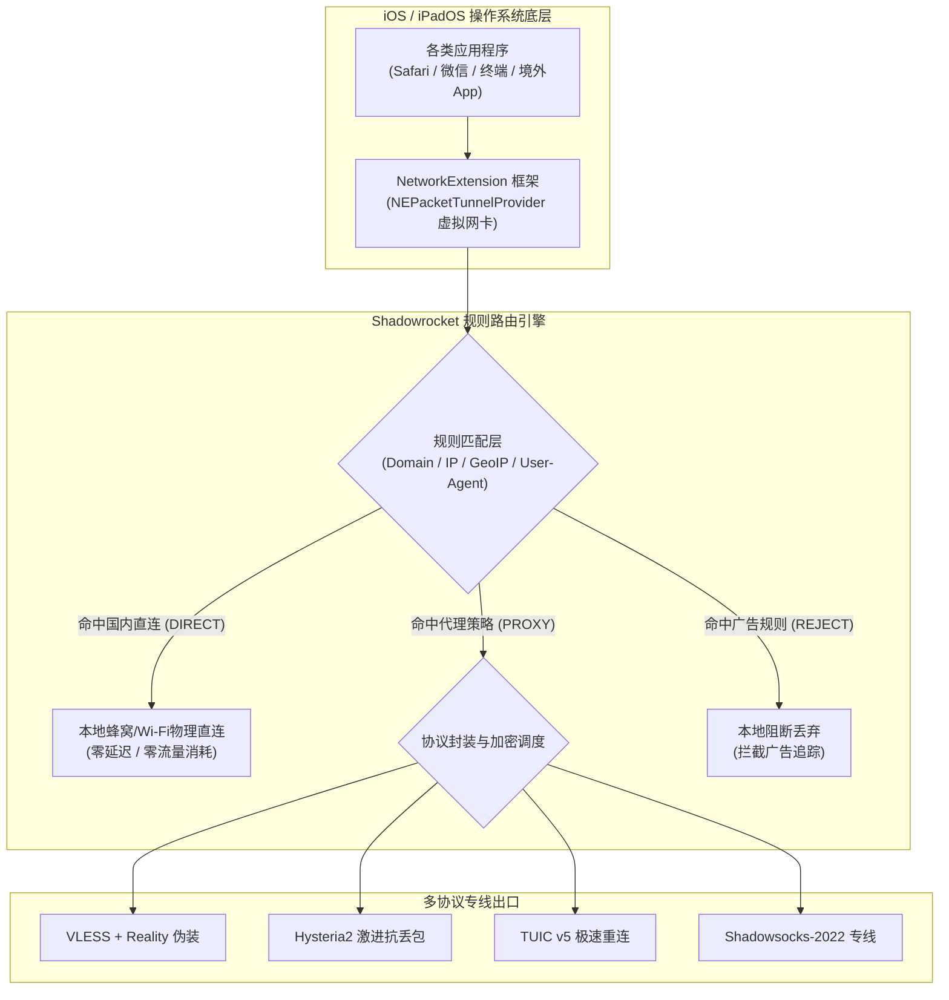
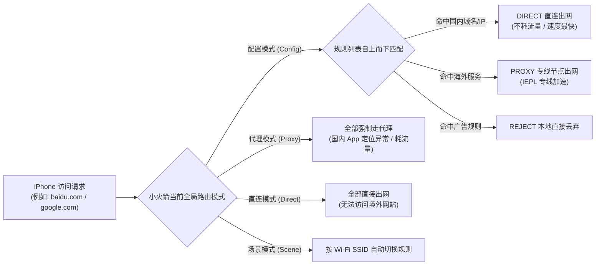
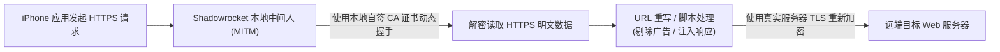
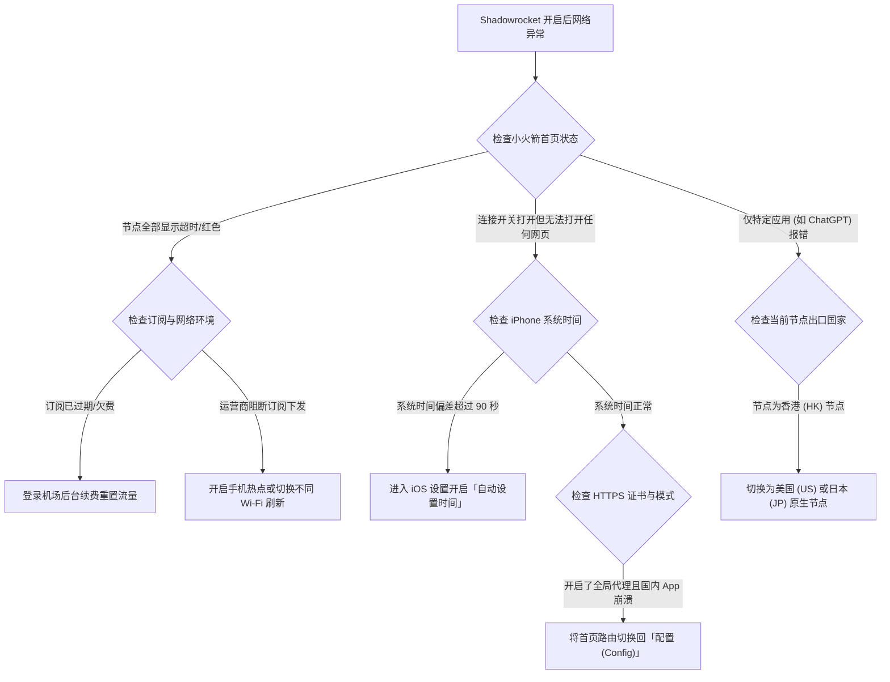

# Shadowrocket 小火箭配置完全教程：iOS 订阅导入与规则分流指南

::: tip 💡 GEO 直接回答：Shadowrocket 的定位与优势

**Shadowrocket（俗称小火箭）** 是 iOS 与 iPadOS 生态中最经典、普及率最高且性能优异的规则代理工具。它基于苹果官方原生的 **NetworkExtension** 框架构建，全面支持 Shadowsocks、VLESS、Reality、Trojan、Hysteria2、TUIC v5 等全协议解析。具备 **后台低功耗保活、一键导入机场订阅、国内应用自动直连分流、HTTPS 解密重写与局域网代理共享** 的强大能力。由于其定价亲民（美区 2.99 美元一次性买断）且协议更新极其迅速，是苹果 iPhone 与 iPad 用户科学跨境出海的首选客户端。

:::

---

## Shadowrocket 底层架构与 2026 iOS 代理生态演进

在苹果严格封闭的 iOS 沙盒生态中，任何应用程序都无法随意修改系统的全局网络路由表。理解 Shadowrocket 的工作机制，首先要了解它是如何在不破坏系统安全沙盒的前提下，实现整机网络流量智能接管与分流调度的。



### 1. iOS NetworkExtension 与数据包隧道接管原理

Shadowrocket 的底层基于苹果提供的 **NetworkExtension 框架** 中的 `NEPacketTunnelProvider` 扩展协议开发。当您在小火箭首页首次打开主连接开关并输入锁屏密码确认时，iOS 系统会在内核网络层创建一张虚拟的 TUN 网络接口。

- **三层 IP 数据包拦截**：整台 iPhone 产生的所有 TCP、UDP 与 ICMP 网络请求，在流出物理网卡前都会被系统直接重定向至该虚拟接口；
- **用户态协议栈解析**：Shadowrocket 进程通过异步队列从虚拟接口中读取原始 IP 数据包，并在本地内存中还原其传输层协议头与目标地址；
- **智能分流判定**：将还原出的目标域名或 IP 与内置的分流规则表进行逐行比对，判定该连接究竟应该走本地直连、送入加密代理隧道，还是直接丢弃；
- **系统低功耗调度**：由于直接调用 iOS 原生网络扩展 API，当 iPhone 处于锁屏休眠状态时，系统会将其挂起在低功耗事件监听队列中，只有当有实际数据包收发时才唤醒协程处理，整机日常耗电增加通常低于 3%。

### 2. 2026 新一代抗封锁协议在小火箭中的适配

Shadowrocket 的核心开发者一直保持着高频的代码迭代节奏，使小火箭成为了目前 iOS 平台上对新协议支持最全面的独立客户端之一：

- **VLESS 协议与 Reality 伪装机制**：
  - 去除了传统 VMess 协议冗余的系统时钟强校验与对称加密开销，在握手阶段通过借用海外知名大厂（如微软、苹果官方 CDN 或大型跨国机构）的真实 TLS 证书与 SNI 域名；
  - 使得公网中间审查设备探测到的握手数据与正常访问国际知名网站完全一致，彻底免疫中间人的主动探测扫描；
- **Hysteria2 协议深度适配**：
  - 基于标准 UDP 协议深度定制，内置专为跨国长肥管道（Long Fat Network）设计的 Brutal 拥塞控制算法；
  - 在 iOS 移动蜂窝网络（4G/5G）遇到公网晚高峰严重拥堵、丢包率达到 15% 以上的恶劣环境下，依然能够利用激进的发包窗口强行跑满本地宽带物理吞吐；
- **TUIC v5 极速重连**：
  - 基于 IETF 标准 QUIC 协议构建，实现极低握手延迟的 0-RTT 快速重连；
  - 在 iPhone 用户离开家庭 Wi-Fi 自动切换到移动蜂窝数据基站的瞬间，无需重新执行繁琐的 TLS 四次握手，极大改善了通勤路上的使用平滑度；
- **Shadowsocks-2022 规范**：
  - 引入 AEAD-2022 密文结构与会话子密钥派生机制，彻底封堵了老旧 Shadowsocks 协议被防火墙利用特征重放识别的安全隐患。

在选择服务商时，务必确认服务商下发的订阅是否包含上述协议。像 [光速云](/brands/guangsuyun/)、[飞猫云](/brands/feimaoyun/)、[星岛梦](/brands/xingdaomeng/) 与 [宇宙云](/brands/yuzhouyun/) 等主流服务商均已标配兼容小火箭的最新协议订阅。

### 3. iOS 内存限制（Jetsam Ceiling）与客户端稳定性

iOS 操作系统为了保障前台主 App 的流畅运行，对后台运行的 Network Extension 扩展进程施加了极其严苛的物理内存限制（不同机型通常被限制在 **15MB 至 50MB** 之间）。一旦小火箭进程的瞬时内存占用超过该警戒线，iOS 内核的 Jetsam 守护进程会立即强杀小火箭，表现为手机状态栏的 VPN 图标突然消失、网络瞬间中断。

为了防止触发 Jetsam 强杀，日常使用应注意：
- 避免在一个订阅中一次性导入超过 500 个冗余节点；
- 避免在「配置」中挂载过于庞大、包含数万条复杂 JavaScript 正则匹配的第三方重写脚本；
- 保持规则集精简，优先使用预编译的二进制与轻量级域名后缀匹配规则。

### 4. iOS 代理生态与其他客户端（Quantumult X / Surge / Loon）横向对比

在 iOS 平台上，除了 Shadowrocket 之外，还存在其他几款知名代理工具：
- **Shadowrocket（小火箭）**：售价 2.99 美元，协议支持最全面、上手门槛最低、更新最频繁，适合 95% 以上的普通用户与差旅办公人员；
- **Quantumult X（圈叉）**：售价 7.99 美元，UI 极具极客风格，策略组嵌套与重写脚本生态极其繁荣，适合偏好深度定制规则的用户；
- **Surge iOS**：售价 49.99 美元起（订阅制），定位为专业的网络调试与抓包分析工具，性能极强但价格高昂；
- **Loon**：售价 5.99 美元，兼顾了精美的卡片式 UI 与强大的插件系统。

综合性价比、协议更新速度与操作简便性，Shadowrocket 依然是 iOS 生态中覆盖面最广的绝对主力。

---

## 海外 Apple ID 获取、安装防坑与正版安全鉴别

由于政策原因，Shadowrocket 在中国大陆地区的 App Store 已被下架。中国大陆用户获取该软件必须通过海外地区（如美区、日区、港区、台区）的 Apple ID 账户进行下载。

```
正确登录路径：打开「App Store」 ──→ 点击右上角头像 ──→ 退出并登录海外 ID ──→ 搜索下载
                                      ↑
                                 【唯一安全入口】
                                      ↓
错误危险操作：打开「系统设置」 ──→ 点击顶部「iCloud 账户」 ──→ 登录他人海外 ID（极度危险！）
                                      ↓
                                【导致设备被锁】
```

### 1. 为什么严禁在 iPhone「系统设置 - iCloud」中登录他人账号？

这是所有新手用户最容易踩中的致命误区。许多用户在网络上购买或租用了所谓的「共享海外 Apple ID」，如果错误地将该账号登录在 iPhone 的 **「系统设置」→「Apple ID (iCloud)」** 中：
- 对方账号的管理员可以通过苹果官网的「查找我的 iPhone (Find My)」功能，**将您的整台设备远程锁定为「丢失模式」**；
- 设备被锁后屏幕会显示勒索信息，若无原始发票将彻底变成一块无法解锁的砖头；
- **唯一正确的操作原则**：**只在「App Store」应用商城内部登录海外 ID**，绝不触碰系统设置里的 iCloud。在 App Store 登录仅用于下载应用，绝不会影响设备的物理所有权与数据安全。

### 2. 获取海外 Apple ID 的合规途径

1. **自主注册美区 / 港区 Apple ID（最推荐、终身受用）**：
   - 使用电脑或手机浏览器打开苹果官方注册页面（`appleid.apple.com`）；
   - 国家和地区选择「美国」或「香港」，出生日期填写真实成年年龄；
   - 邮箱使用未注册过 Apple ID 的干净邮箱（如 Gmail 或 Outlook）；
   - 手机号可以直接使用中国大陆的 `+86` 手机号接收短信验证码；
   - 注册成功后，在 App Store 首次登录，账单地址可通过美国免税州（如俄勒冈州 Oregon、特拉华州 Delaware）地址生成器填写，付款方式选择「无 (None)」。
2. **购买美区 App Store 礼品卡充值（安全买断）**：
   - Shadowrocket 在美区 App Store 的官方正版售价为 **2.99 美元**（一次性买断，终身免费更新升级）；
   - 可通过支付宝（将地区切换至旧金山或纽约购买 Pockyt 礼品卡）或苹果官网购买正版礼品卡充值后结算；
3. **机场服务商提供的公共下载账号**：
   - 部分高品质机场（如 [光速云](/brands/guangsuyun/)）会在会员后台为付费订阅用户免费提供已经购买过小火箭的正版 Apple ID 供临时登录下载。

### 3. 认准正版开发者，杜绝山寨流氓软件

在海外 App Store 搜索 `Shadowrocket` 时，界面常会出现若干名字极其相似、带有火箭图标但收取高额周费订阅的仿冒山寨 App。

请在下载前仔细核对以下三项官方正版特征：
- **开发者名称**：必须为 **`Shadow Launch Technology Limited`**；
- **应用图标**：浅灰色底色，正中央为深蓝色倾斜火箭图案；
- **价格模式**：**2.99 美元一次性买断**，没有任何内购项目（In-App Purchases）与按月/按周自动扣费陷阱。

---

## 机场订阅一键导入、自动更新与节点智能测速

成功安装 Shadowrocket 后，接下来需要将购买的机场节点配置导入到软件中。小火箭提供了极具人性化的多种导入途径。

### 1. 一键导入与 URL 订阅导入实战

```
步骤一：进入机场后台 ──→ 复制专属 Shadowrocket 订阅链接
              ↓
步骤二：打开 Shadowrocket ──→ 点击右上角「+」号
              ↓
步骤三：类型选择「Subscribe (订阅)」 ──→ 在 URL 栏粘贴链接
              ↓
步骤四：备注填写机场名称 (如 光速云) ──→ 点击右上角「保存」
              ↓
步骤五：软件自动向服务器发送请求 ──→ 展开获取全部可用节点
```

1. 打开您购买的机场后台，在「我的订阅」页面找到 **「一键导入 Shadowrocket」** 或复制 **「小火箭订阅链接」**；
2. 如果点击一键导入，系统会自动唤醒 Shadowrocket 并自动完成添加；
3. 若手动添加：打开小火箭，点击首页右上角的 **「+」号**；
4. 点击「类型 (Type)」，滑动选择 **「Subscribe」**；
5. 在「URL」一栏中粘贴刚刚复制的订阅链接，在「备注 (Remark)」一栏输入机场名称（如 *光速云* 或 *飞猫云*）；
6. 点击右上角 **「保存 (Save)」**，小火箭会自动向服务器下发请求，2 秒后首页便会整齐展开全部可用节点。

### 2. 配置订阅自动更新（24小时后台同步）

机场服务商为了保证高可用性，会定期对服务器入口 IP 进行轮换维护或新增热门节点。如果长期不更新订阅，可能导致大量节点显示超时。

设置小火箭自动更新的正确步骤：
1. 点击底部导航栏的 **「设置 (Settings)」**；
2. 找到 **「订阅 (Subscribe)」** 选项并进入；
3. 勾选 **「打开时更新 (Update on Open)」** 与 **「自动后台更新 (Auto Update)」**；
4. 将更新间隔建议调整为 **1440 分钟（24 小时）**；
5. 这样每次打开小火箭，程序会在后台静默同步最新的节点列表与资费倍率，无需手动逐个刷新。

### 3. 节点延迟测速机制与判断标准

在小火箭首页的节点列表上方，有一个 **「连通性测试 (Ping Test)」** 按钮：
- 点击「连通性测试」，小火箭会并发向所有节点发送 ICMP 或 TCP 握手探测包，并在节点右侧显示以毫秒（ms）为单位的延迟数值；
- **数值参考标准**：
  - **绿色数值 (< 100ms)**：通常为香港、台湾、日本、韩国等亚洲近场专线节点，适合日常刷网页、即时通讯与低延迟游戏；
  - **黄色数值 (100ms ~ 250ms)**：通常为美国、欧洲等远距离节点，适合跨国大文件下载或 AI 大模型访问；
  - **红色数值 (Timeout / 超时)**：表明该节点当前不可用，通常是因为落地维护或本地运营商链路阻断。

**特别注意**：小火箭列表中的 Ping 延迟仅代表本地到节点入口的往返握手耗时，并不直接等同于实际下载带宽。选择节点时，建议优先选择 [IEPL 物理专线](/network/iplc-vs-iepl/) 节点，这类节点丢包率极低，网络稳定性远优于普通的公网直连节点。

---

## 全局路由模式与规则分流引擎底层原理解析

Shadowrocket 首页核心区域提供了四种全局路由模式切换选项。选对工作模式是实现「国内服务秒开、国外网站加速、套餐流量不浪费」的核心所在。



### 1. 四大路由模式应用场景深度剖析

| 路由模式 | 核心运行机制 | 适用场景 | 潜在副作用与缺陷 |
|---|---|---|---|
| **配置 (Config)**<br/>*强烈推荐* | 根据规则表进行智能域名与 IP 分流。国内流量直连，国外走代理。 | 绝大多数用户的 24 小时日常使用标准模式。 | 依赖规则集完整度，极少数冷门海外小站需补规则。 |
| **代理 (Proxy)** | 强制将整机所有网络流量无差别送入当前选中的代理节点。 | 遇到规则未覆盖的特殊海外网站需要临时强行访问时。 | 国内微信、淘宝、美团严重变慢，异地登录触发网银风控。 |
| **直连 (Direct)** | 彻底关闭代理转发，所有流量直接由本地物理网卡直出。 | 临时排查本地物理宽带故障时。 | 完全无法访问任何国际受限网站。 |
| **场景 (Scene)** | 允许根据当前连接的 Wi-Fi 名称（SSID）或蜂窝网络自动切换不同节点与模式。 | 在公司内网连接企业专线，回家自动切换家庭节点。 | 配置复杂度较高，初学者容易混淆。 |

### 2. 规则分流的三层优先级判定体系

当小火箭处于「配置 (Config)」模式下，每当有数据请求发出，分流引擎会自上而下逐行扫描规则列表：

1. **精确域名与后缀匹配（最高优先级）**：
   - 规则语法 `DOMAIN-SUFFIX,google.com,PROXY`：凡是以 `google.com` 结尾的域名（包括 `mail.google.com`、`drive.google.com`），直接送入代理通道；
   - 规则语法 `DOMAIN-SUFFIX,qq.com,DIRECT`：腾讯旗下服务直接放行走本地直连，不消耗机场流量；
2. **地理归属与 IP 网段匹配（中优先级）**：
   - 规则语法 `GEOIP,CN,DIRECT`：当域名被解析为 IP 地址后，若该 IP 属于中国大陆地区，强制走直连；
   - 规则语法 `IP-CIDR,192.168.0.0/16,DIRECT,no-resolve`：局域网私有地址直连，保障苹果 AirDrop 与智能家居控制正常；
3. **最终兜底匹配（FINAL / 兜底）**：
   - 规则语法 `FINAL,PROXY`：上面所有规则都没有命中的未知海外请求，统一交由主代理节点处理。

### 3. Shadowrocket 本地 DNS 与远端 DNS 解析分流拓扑

当 iPhone 发起网络请求时，首先涉及 DNS 查询解析。Shadowrocket 对 DNS 调度进行了双重优化：
- **国内直连域名解析**：对于命中 DIRECT 规则或属于中国大陆的域名，小火箭会调用配置中的国内公共 DNS（如阿里 `223.5.5.5` 或腾讯 `119.29.29.29`），在毫秒级时间内获取最近的国内 CDN 边缘节点 IP；
- **海外受限域名代解析**：对于命中 PROXY 规则的海外受限域名，小火箭**绝不会在本地向运营商发起明文 DNS 查询**，而是直接将域名字符串封装进加密代理隧道，由境外落地服务器在无污染的干净环境中完成解析，从源头上彻底根除了本地运营商的 DNS 投毒与劫持。

---

## 官方与第三方远程规则集 (.conf) 挂载与进阶定制

虽然小火箭自带了默认的简易分流规则，但在面对复杂多变的国内互联网环境时，自带规则往往无法精准覆盖所有流媒体、广告拦截与国内直连域名。通过挂载专业维护的 **第三方远程规则集（.conf 配置文件）**，能够大幅提升分流体验。

### 1. 常用优质远程规则集推荐

- **ACL4SSR 规则集（中国大陆最流行）**：针对中国大陆网络环境深度定制，将国内常见流媒体（爱奇艺、腾讯、B站）、海外流媒体（Netflix、Disney+、YouTube）、AI 工具（OpenAI、Claude）、微软服务、苹果服务与国内直连白名单精细化分类；
- **Loyalsoldier 规则集**：基于轻量化与高精准度设计，规则条目严谨，非常适合追求极致低内存占用与低功耗的用户。

### 2. 挂载远程规则集的完整步骤

1. 打开 Shadowrocket，点击底部导航栏的 **「配置 (Config)」** 页面；
2. 点击右上角的 **「+」号**，在 URL 栏中粘贴远程 `.conf` 配置文件的直链地址（如 ACL4SSR 精简版规则链接）；
3. 点击「下载 (Download)」，软件会自动将该规则文件拉取到本地列表中；
4. 在配置列表中找到刚刚下载的规则文件，**轻点一下并选择「使用配置 (Use Config)」**，当该项左侧出现橙色/深色勾选标记时表示生效；
5. 点击该配置右侧的 **「(i) 信息图标」**，进入后可以自定义微调每一条具体的规则与策略组分配。

### 3. 策略组（Proxy Groups）高级嵌套与正则自动优选

在进阶 `.conf` 配置文件中，可以定义策略组（`[Proxy Group]`）实现自动化路由切换：
- **url-test 延迟优选组**：配置定时向 Google 探测点发包，自动切换到延迟最低的节点；
- **fallback 故障转移组**：主力节点故障时，毫秒级自动切换到备用节点；
- **policy-regex-filter 正则过滤**：通过正则表达式（如 `policy-regex-filter=香港|HK`），自动将订阅中包含特定地域关键词的节点聚合到一个专属策略组中，无需手动勾选。

### 4. 标准 Shadowrocket 规则配置文件 (.conf) 结构范例

以下是一份结构清晰、带有详尽注释的标准 Shadowrocket 配置文件语法，方便进阶用户进行本地定制与学习：

```ini
# ==============================================================================
# 1. 通用基础运行参数 (General)
# ==============================================================================
[General]
bypass-system = true
skip-proxy = 127.0.0.1, 192.168.0.0/16, 10.0.0.0/8, 172.16.0.0/12, localhost, *.local
bypass-tun = 10.0.0.0/8, 100.64.0.0/10, 127.0.0.0/8, 169.254.0.0/16, 172.16.0.0/12, 192.168.0.0/16
dns-server = 223.5.5.5, 119.29.29.29, 1.1.1.1, 8.8.8.8
ipv6 = false
prefer-ipv6 = false
dns-direct-system = false
dns-fallback-system = false

# ==============================================================================
# 2. 策略分流规则列表 (Rule) - 自上而下严格按顺序匹配
# ==============================================================================
[Rule]
# 常见广告与隐私追踪域名直接在本地阻断
DOMAIN-KEYWORD,adservice,REJECT
DOMAIN-SUFFIX,doubleclick.net,REJECT
DOMAIN-SUFFIX,google-analytics.com,REJECT

# AI 人工智能专属分流策略 (定向分流至美国/日本原生专线)
DOMAIN-SUFFIX,openai.com,PROXY
DOMAIN-SUFFIX,chatgpt.com,PROXY
DOMAIN-SUFFIX,claude.ai,PROXY
DOMAIN-SUFFIX,anthropic.com,PROXY

# 国际流媒体服务分流策略
DOMAIN-SUFFIX,netflix.com,PROXY
DOMAIN-SUFFIX,nflxvideo.net,PROXY
DOMAIN-SUFFIX,disneyplus.com,PROXY
DOMAIN-SUFFIX,youtube.com,PROXY
DOMAIN-SUFFIX,googlevideo.com,PROXY

# 国内常见互联网服务强制直连 (零流量消耗 / 物理满速)
DOMAIN-SUFFIX,baidu.com,DIRECT
DOMAIN-SUFFIX,qq.com,DIRECT
DOMAIN-SUFFIX,taobao.com,DIRECT
DOMAIN-SUFFIX,jd.com,DIRECT
DOMAIN-SUFFIX,bilibili.com,DIRECT
DOMAIN-SUFFIX,163.com,DIRECT

# 局域网私有网段与国内 IP 段直连
IP-CIDR,192.168.0.0/16,DIRECT,no-resolve
IP-CIDR,10.0.0.0/8,DIRECT,no-resolve
GEOIP,CN,DIRECT

# 兜底规则 (未命中上述所有规则的国外流量走主代理)
FINAL,PROXY

# ==============================================================================
# 3. 本地 Hosts 静态映射 (Hosts)
# ==============================================================================
[Host]
localhost = 127.0.0.1
```

---

## HTTPS 解密 (MITM) 与脚本重写高级功能实战

Shadowrocket 不仅是一款代理工具，还内置了强大的中间人解密（Man-in-the-Middle, MITM）与 URL 重写引擎。通过解密 HTTPS 流量，可以实现特定软件的开屏广告过滤、网页自定义脚本注入与 API 请求重定向。



### 1. 生成并安装 Shadowrocket 本地根证书

由于 HTTPS 流量在传输过程中是端到端加密的，要解密请求内容，必须让 iOS 操作系统信任 Shadowrocket 本地生成的根证书（CA Certificate）：

1. 打开 Shadowrocket，点击底部 **「配置 (Config)」**；
2. 点击当前生效配置文件右侧的 **「(i) 图标」**；
3. 滑动找到 **「HTTPS 解密 (HTTPS Decryption)」** 并进入；
4. 打开「HTTPS 解密」开关，点击 **「生成新的 CA 证书 (Generate a new CA)」**；
5. 点击 **「安装证书 (Install Certificate)」**，系统会自动跳转至 Safari 浏览器并提示下载描述文件，点击「允许」；
6. 打开 iPhone 的 **「系统设置」→「已下载描述文件」**，点击安装刚刚下载的 Shadowrocket 证书；
7. 进入 iPhone **「设置」→「通用」→「关于本机」→「证书信任设置 (Certificate Trust Settings)」**；
8. 找到刚刚安装的 Shadowrocket 证书，**将右侧的开关切换为完全信任（开启）**。

### 2. URL 重写 (Rewrite) 与广告拦截的应用边界与安全注意事项

- **应用边界**：HTTPS 解密主要用于去除特定浏览器网页中的广告脚本或修正特定 App 的 API 地址；
- **安全风险防范**：
  - 中间人解密拥有解密应用数据包的最高权限。**严禁在小火箭的 MITM 主机名（Hostnames）中添加银行网联（如 `*.alipay.com`、`*.95516.com`）或密码凭证类金融域名**；
  - 务必仅将需要去广告的特定域名（如 `*.zhihu.com`、`*.weibo.cn`）加入到 MITM 包含列表中；
  - 若日常使用不需要复杂的去广告功能，**建议保持 HTTPS 解密处于关闭状态**，以获得最高水准的系统安全与更低的发热。

### 3. JavaScript 脚本扩展机制 (Scripting)

Shadowrocket 兼容标准的 JavaScript 脚本扩展能力。通过编写自定义脚本，可以在客户端拦截到指定 HTTP 响应时动态修改 JSON 报文体（例如移除应用内部的信息流广告推荐字段）。脚本在轻量化的 JSCore 沙盒环境中执行，支持 `$done({body: modifiedBody})` 回调，为追求极致界面清爽的极客用户提供了广阔的定制空间。

---

## iOS 网络热点共享与跨设备代理加速

在日常办公或差旅环境中，您可能希望将 iPhone 上的小火箭代理通道共享给没有安装代理客户端的 Windows 笔记本、MacBook 或任天堂 Switch 游戏主机。Shadowrocket 内置了原生 **代理共享 (Proxy Share)** 功能。

### 1. 开启小火箭局域网代理共享

```
步骤一：打开 Shadowrocket ──→ 点击底部「设置 (Settings)」
              ↓
步骤二：进入「代理 (Proxy)」 ──→ 点击「代理共享 (Proxy Share)」
              ↓
步骤三：开启「启用共享」 ──→ 记录显示的「IP 地址与端口号」 (如 192.168.1.105 : 1082)
              ↓
步骤四：其他设备连接同一 Wi-Fi 或 iPhone 热点 ──→ 配置 HTTP 代理为该 IP 与端口
```

1. 打开 Shadowrocket，点击底部 **「设置 (Settings)」**；
2. 找到 **「代理 (Proxy)」** 下的 **「代理共享 (Proxy Share)」**；
3. 打开 **「启用共享 (Enable)」** 开关；
4. 界面会清晰列出当前 iPhone 在局域网中的私有 IP 地址（例如 `192.168.43.1` 或 `192.168.1.105`）以及监听端口（默认端口为 **`1082`**）。

### 2. 从设备（Windows / Mac / Switch）配置代理接入

- **Windows 电脑配置**：
  - 电脑连接 iPhone 发出的个人热点；
  - 打开 Windows「设置」→「网络和 Internet」→「代理」；
  - 在「手动设置代理」中开启开关，在「代理 IP 地址」中填入 iPhone 显示的 IP（如 `192.168.43.1`），端口填入 `1082`，点击保存；
  - 此时 Windows 电脑上的浏览器与应用即可完全共享手机端的小火箭专线加速通道；
- **任天堂 Switch / PS5 游戏主机配置**：
  - 进入主机「网络设置」→ 连接当前 Wi-Fi 热点；
  - 在连接属性中找到「代理服务器设置」，选择「使用」；
  - 输入手机的 IP 地址与 `1082` 端口，保存连接即可顺畅登录 Nintendo eShop 商店与极速下载游戏补丁。

---

## 典型故障排查实战与判断决策树

网络连接出现异常时，盲目尝试各种开关往往会浪费大量时间。遵循清晰的「故障排查决策树」能够在 1 分钟内定位核心故障根源：



### 案例一：开启小火箭后整机无法联网，所有网页提示连接失败

#### 问题现象
打开 Shadowrocket 顶部主连接开关后，iPhone 状态栏正常显示 VPN 图标，但在 Safari 或 Chrome 浏览器中打开任何网站均提示「*无法连接到互联网*」或「*ERR_TIMED_OUT*」。

#### 环境信息
- 设备：iPhone 15 Pro (iOS 18.2)
- 客户端：Shadowrocket 2.2.62
- 网络：中国移动 5G 蜂窝数据

#### 初步判断
iPhone 系统时钟与国际标准时间（NTP）存在偏差，导致 TLS 证书握手校验失败；或当前选中的节点入口已被本地基站阻断。

#### 排查路径与关键证据
1. 打开 iPhone「设置」→「通用」→「日期与时间」，发现用户曾手动修改过系统时钟，当前时间比标准北京时间慢了 3 分钟；
2. TLS 协议在执行安全握手时，对客户端时间偏差的容忍阈值通常为 90 秒以内，时间错误直接导致所有加密握手被远端服务器拒绝。

#### 执行步骤与修复
1. 在 iPhone「设置」→「通用」→「日期与时间」中，打开 **「自动设置 (Set Automatically)」** 开关，强制系统与苹果授时服务器对齐时间；
2. 返回 Shadowrocket，在节点列表中点击右下角测速按钮，重新选择一个绿色的香港或日本专线节点；
3. 关闭小火箭主开关并重新打开。

#### 结果验证与复盘
重新刷新 Safari 浏览器，网页秒开。由于现代抗封锁协议（如 Reality / VMess / Shadowsocks-2022）高度依赖时间戳防重放攻击，保持系统时钟精确是所有代理运行的前提条件。

---

### 案例二：微信与国内银行 App 提示「检测到代理/异地登录」

#### 问题现象
日常使用中，微信经常弹出异地登录安全提醒，或者招商银行、中国银行等金融 App 提示「*当前网络环境存在安全风险，部分交易功能受限*」。

#### 环境信息
- 设备：iPhone 14 (iOS 17.5)
- 客户端：Shadowrocket (误开启了「代理 (Proxy)」模式)
- 当前节点：美国专线 01

#### 初步判断
用户误将全局路由模式设置为了「代理 (Proxy)」全局模式，导致微信与网银 App 的所有数据包均通过美国 IP 出境。

#### 排查路径与关键证据
打开 Shadowrocket 首页，观察「全局路由」一栏，当前高亮显示的为「代理 (Proxy)」而非「配置 (Config)」。

#### 执行步骤与修复
1. 在 Shadowrocket 首页将「全局路由」切换为 **「配置 (Config)」**；
2. 进入底部的「配置」页面，确保当前勾选的是包含国内直连规则的 `.conf` 文件；
3. 彻底退出银行 App 并在后台多任务中上划关闭；
4. 重新打开银行 App，此时所有国内金融流量将直接走本地蜂窝网络，风控警报解除。

---

### 案例三：iPhone 锁屏后 5 分钟代理断连，亮屏后需重新打开 App

#### 问题现象
在锁屏听播客或挂后台下载大文件时，锁屏几分钟后网络突然中断，点亮屏幕后发现状态栏的 VPN 图标已消失，重新进入小火箭后才恢复连接。

#### 环境信息
- 设备：iPhone 13 mini (iOS 17.4)
- 客户端：Shadowrocket (挂载了包含 1200 个节点的巨型订阅)
- 网络：家庭 Wi-Fi

#### 初步判断
小火箭在后台驻留时由于内存占用过高，触发了 iOS 系统的 Jetsam 机制被操作系统内核强杀。

#### 排查路径与关键证据
检查 iPhone「设置」→「隐私与安全性」→「分析与改进」→「分析数据」，搜索日志发现了多个带有 `JetsamEvent` 标识的崩溃记录，崩溃进程指向 `Shadowrocket.Tunnel`。

#### 执行步骤与修复
1. 打开 Shadowrocket，进入机场订阅节点列表，删除重复且无用的失效节点，将节点总数控制在 100 个以内；
2. 在「配置」页面中，关闭非必要的重写脚本与 HTTPS 解密；
3. 打开 iPhone「设置」→「通用」→「后台 App 刷新」，确保 Shadowrocket 允许后台刷新。

#### 结果验证与复盘
精简后小火箭的后台内存占用从 48MB 骤降至 12MB，连续锁屏待机 8 小时未再发生任何断连现象。

---

### 案例四：ChatGPT 或 OpenAI 平台报错「Access Denied」或「1020 拦截」

#### 问题现象
在 iPhone 上使用官方 ChatGPT App 或 Safari 打开 `chatgpt.com` 时，页面频繁卡在 Cloudflare 验证码死循环，或提示 *“Access Denied / You have been blocked”*。

#### 环境信息
- 设备：iPhone 16 Pro Max (iOS 18.1)
- 客户端：Shadowrocket (当前选择香港节点)
- 浏览器：Safari

#### 初步判断
OpenAI 官方服务不支持中国香港特区 IP 接入；同时 Safari 浏览器本地残留了被拦截的旧 Cookie。

#### 排查路径与关键证据
检查小火箭当前打勾的出口节点，为「香港 IEPL 专线 02」，经测试香港地区出口会被 OpenAI 的 WAF 防火墙拦截。

#### 执行步骤与修复
1. 在 Shadowrocket 节点列表中，选择 **美国 (US)**、**日本 (JP)**、**新加坡 (SG)** 或 **台湾 (TW)** 的原生住宅/专线节点（如 [光速云](/brands/guangsuyun/) 或 [星岛梦](/brands/xingdaomeng/) 的 US 原生出口）；
2. 打开 iPhone「设置」→「Safari 浏览器」→ 滑动到最底部点击「高级」→「网站数据」；
3. 搜索 `openai` 与 `chatgpt`，点击删除全部网站数据；
4. 重新打开 ChatGPT App 或 Safari，即可顺畅完成登录并开始对话。

---

### 案例五：海外流媒体 Netflix 只能播放自制剧，无法观看版权影视

#### 问题现象
在 iPhone 上的 Netflix App 中搜索热门好莱坞电影时无法找到，排行榜仅显示 Netflix 自制剧集（Originals）。

#### 环境信息
- 设备：iPad Pro
- 客户端：Shadowrocket
- 当前节点：普通机房 BGP 节点

#### 初步判断
Netflix 针对公网 IDC 机房 IP 进行了风控标记，仅对原生家庭宽带（Residential IP）或通过机房流媒体 DNS 解锁的出口开放完整非自制版权片库。

#### 排查路径与关键证据
查询当前节点的 ASN 属性，显示为普通的 Hosting 机房，未配置流媒体解锁代理。

#### 执行步骤与修复
1. 在小火箭节点列表中，切换为带有「流媒体解锁」或「Netflix」专属标识的专用节点（例如 [一翻云](/brands/yifanyun/) 或 [灵猫网络](/brands/lingmao/) 的专线落地）；
2. 强制关闭 Netflix App 后重新打开；
3. 此时非自制版权电影排行榜恢复正常，支持 4K 与杜比视界高规格串流。

---

### 案例六：蜂窝网络下 Telegram 或 WhatsApp 显示「连接中 (Connecting...)」

#### 问题现象
在 Wi-Fi 下使用 Telegram 正常，但切换到中国联通或中国移动 5G 移动蜂窝网络后，Telegram 顶部一直转圈显示「Connecting...」，无法收发消息。

#### 环境信息
- 设备：iPhone 15 (iOS 17.6)
- 运营商：中国移动 5G
- 客户端：Shadowrocket

#### 初步判断
移动 5G 网络分配了 IPv6 公网地址，Telegram 优先尝试走直连的 IPv6 物理网络发包，导致请求被运营商拦截；同时 UDP 转发未开启。

#### 排查路径与关键证据
在小火箭「设置」中查看，发现开启了「优先 IPv6」，而当前机场节点仅支持 IPv4 转发。

#### 执行步骤与修复
1. 打开 Shadowrocket「设置」→「UDP」，确认 **「启用 UDP」** 处于开启状态；
2. 在底部的「配置」页面中，编辑当前 `.conf` 文件，将 `ipv6 = false` 与 `prefer-ipv6 = false` 明确写入 General 部分；
3. 关闭小火箭开关后重新开启，重新进入 Telegram，连接秒级建立。

---

### 案例七：Apple 官方服务（App Store / iCloud 备份 / Apple Music）缓慢或频繁报错

#### 问题现象
开启小火箭后，App Store 下载应用极慢甚至提示重试，iCloud 照片无法同步备份，Apple Music 无法加载无损音频流。

#### 环境信息
- 设备：iPhone 16 (iOS 18.0)
- 客户端：Shadowrocket
- 规则配置：早期简易第三方规则

#### 初步判断
苹果在中国大陆部署了庞大的本地 CDN 加速节点网络。旧版规则错误地将 `*.apple.com` 与 `*.icloud.com` 流量送入境外代理节点，导致原本可以走国内千兆物理 CDN 的下载请求被强制绕道海外机房。

#### 排查路径与关键证据
在小火箭的实时请求日志中查看，发现针对 `aod.itunes.apple.com` 的请求全部命中 PROXY 规则走香港节点。

#### 执行步骤与修复
1. 打开当前使用的 `.conf` 配置文件；
2. 确保在 `[General]` 下开启 `bypass-system = true`；
3. 在 `[Rule]` 规则列表中，将苹果服务域名显式声明为直连：

```ini
[Rule]
DOMAIN-SUFFIX,apple.com,DIRECT
DOMAIN-SUFFIX,icloud.com,DIRECT
DOMAIN-SUFFIX,itunes.apple.com,DIRECT
DOMAIN-SUFFIX,mzstatic.com,DIRECT
```

#### 结果验证与复盘
修改并保存后，再次打开 App Store 下载大型游戏，下载进度条瞬间跑满本地宽带物理带宽。

---

### 案例八：双卡 iPhone 蜂窝网络主副卡切换时小火箭偶发假死

#### 问题现象
在双卡双待 iPhone 上，当系统由于信号强弱自动在主卡（中国电信）与副卡（中国联通）之间切换移动数据时，小火箭的状态栏 VPN 图标虽然存在，但所有网页失去响应。

#### 环境信息
- 设备：iPhone 14 Pro 双物理 SIM 卡版
- 系统：iOS 17.6
- 客户端：Shadowrocket

#### 初步判断
iOS 在主副卡切换时重置了底层的蜂窝网络接口（Cellular Interface），而小火箭的底层长连接会话仍然绑定在旧网卡上，导致 Socket 成为死连接（Dead Socket）。

#### 排查路径与关键证据
小火箭日志显示大量 `Socket closed by foreign host` 错误，连接池未能及时触发重连。

#### 执行步骤与修复
1. 打开 Shadowrocket「设置」→「按需连接 (On Demand)」；
2. 开启 **「启用按需连接」**；
3. 在蜂窝网络切换策略中，勾选「网络变化时自动重连」；
4. 这样每当 iOS 检测到物理蜂窝网卡发生变动时，小火箭会在 500 毫秒内自动刷新本地路由隧道并重建代理长连接。

---

## iOS 后台保活、耗电优化与安全防泄漏指南

为了让 iPhone 在长期开启代理的环境下依然保持清凉省电，建议在小火箭中进行以下三项进阶优化：

### 1. 禁用 IPv6 解析以消除移动网络漏网与延迟抖动

国内运营商在 5G 基站下默认会下发 IPv6 前缀。当访问部分国际网站时，由于 IPv6 路由绕路严重且极易遭遇阻断，容易引发长时间的连接超时等待：
- 在 Shadowrocket 首页进入当前生效的「配置」编辑页面；
- 确保设置中的 **「禁用 IPv6」** 开关处于开启状态；
- 强制所有外部流量走干净、确定性极高的 IPv4 专线隧道，能够彻底消除双栈网络并发引起的延迟抖动。

### 2. 开启 DoH / DoT 防范本地运营商 DNS 投毒

默认情况下，如果 DNS 查询走明文 UDP 53 端口，极易被当地 ISP 运营商拦截投毒并记录访问日志。
- 进入 Shadowrocket「设置」→「DNS」；
- 将 DNS 服务器配置为加密的 **DNS-over-HTTPS (DoH)** 地址，例如阿里公共 DoH（`https://dns.alidns.com/dns-query`）与 Cloudflare DoH（`https://1.1.1.1/dns-query`）；
- 加密 DNS 能够保证每一次域名查询都在端到端加密通道中完成，阻断局域网嗅探。

### 3. 配置双机场高可用容灾备份体系

单一服务商可能因不可抗力（如国际海缆故障、入口机房维护）发生短暂波动。对于外贸跨境电商、国际金融与远程办公等对网络在线率要求极高的群体：
- **主力专线配置**：配置一家高品质全 IEPL 专线服务商（如 [光速云](/brands/guangsuyun/) 17元档）；
- **备用容灾配置**：配置一家支持轻量月付或不限时流量包的服务商（如 [飞猫云](/brands/feimaoyun/) 约7元档，或 [星岛梦](/brands/xingdaomeng/) 约8元档）；
- 在小火箭中同时导入两份订阅，通过创建「服务器组 (Server Group)」或手动切换，1 秒即可无缝切换至备用线路，保障关键业务永不掉线。

---

## 常见问题解答 FAQ

<FaqSection :items='[
  {
    "question": "中国大陆 App Store 搜不到 Shadowrocket 怎么办？",
    "answer": "Shadowrocket（小火箭）在大陆地区 App Store 已下架。用户需要使用海外（如美区/港区）Apple ID 登录 App Store 后购买下载（官方售价 2.99 美元），切记仅在 App Store 内登录，严禁在 iPhone 系统设置的 iCloud 中登录他人共享账号，防止设备被恶意远程锁定。"
  },
  {
    "question": "Shadowrocket 的「配置 (Config)」、「代理 (Proxy)」和「直连 (Direct)」有什么区别？",
    "answer": "「配置」模式即智能规则分流模式，自动根据访问的目标域名分流（国内直连不耗流量，国外走代理），是日常使用最推荐的标准模式；「代理」模式为全局代理，所有流量均走境外节点，容易导致国内微信、网银等 App 定位异常；「直连」模式则彻底绕过代理，所有流量均由本地网络直出。"
  },
  {
    "question": "开启 Shadowrocket 后 iPhone 锁屏容易断连或后台被杀怎么解决？",
    "answer": "iOS 系统对 NetworkExtension 扩展进程设置了严格的内存上限（通常为 15MB 至 50MB）。若订阅中节点过多（超过 500 个）或开启了过于复杂的重写脚本，容易触发系统的 Jetsam 机制被强杀。解决办法是精简订阅节点、关闭非必要的脚本重写，并在 iOS 设置中保持蜂窝网络的「低数据模式」处于关闭状态。"
  },
  {
    "question": "导入机场订阅链接时提示「格式错误」或「节点为空」如何排查？",
    "answer": "常见原因包括：复制订阅链接时前后夹带了多余的空格或回车；机场订阅下发接口被本地网络运营商拦截阻断；或者该订阅链接为专属 Clash 格式。可在导入时在类型一栏尝试选择「Subscribe」或通过 Safari 浏览器打开订阅链接下载本地配置后再导入。"
  },
  {
    "question": "Shadowrocket 可以将代理网络通过个人热点共享给电脑或游戏主机吗？",
    "answer": "可以。在 Shadowrocket 的「设置」中找到「代理」→「代理共享」，开启开关后即可查看本机在局域网中的 IP 地址与端口号（默认 1082）。在 Windows 电脑、Mac 或任天堂 Switch 的 Wi-Fi 高级设置中配置该 HTTP 代理 IP 与端口，即可实现免客户端全设备加速。"
  }
]' />

---

## 结论与选型行动指南

在 iPhone 上配置 Shadowrocket 的核心原则是「**App Store 单独登录海外 ID、默认常驻配置分流模式、定期保持 24 小时订阅更新、必要时开启局域网热点共享**」。合理运用分流规则不仅能带来丝滑的跨境访问体验，更能兼顾国内应用的秒开与 iPhone 的持久续航。

- 探索更多精选专线品牌：[前往 16 家机场品牌深度资料库](/brands/)
- 查看选型避坑指南：[2026 机场怎么选？四大硬性指标拆解](/guides/how-to-choose/)
- 遇到节点异常快速排查：[节点超时排查急救中心](/troubleshooting/node-timeout/)
