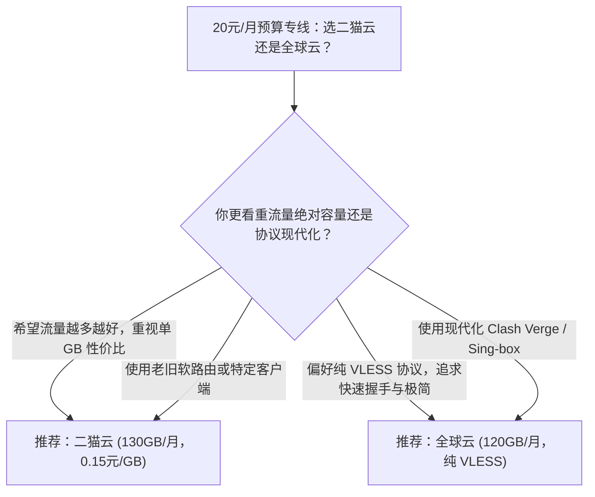

# 二猫云对比全球云：20元档位130GB与120GB月付专线平衡型深度横评

在机场市场中，**20元/月** 是一个极具代表性的“黄金分水岭”：向上它比十几元的入门产品拥有更充裕的冗余带宽，向下它比三四十元的高端定制套餐更具价格亲和力。在这一区间内，**二猫云**（20元/130GB）与 **全球云**（20元/120GB）是备受关注的两个主力选手。

---

## 一、核心规格与实测指标对照

| 评测维度 | 二猫云 (ErMaoCloud) | 全球云 (GlobalCloud) | 选型权衡点 |
|---|---|---|---|
| **入门月付价格** | **20 元/月** | **20 元/月** | 门槛一致，均坚持原生月付通道 |
| **基础月度流量** | **130 GB/月** | **120 GB/月** | 二猫云每月多出 10GB 流量冗余 |
| **平均单 GB 成本** | **约 0.15 元/GB** | **约 0.17 元/GB** | 二猫云单位流量性价比略微领先 |
| **骨干专线类型** | IEPL 物理专线 | IEPL 物理专线 | 晚高峰抗公网 QoS 丢包能力一致 |
| **传输协议支持** | 经典 Shadowsocks 专线 | **全量纯 VLESS 协议** | 全球云协议现代化程度与轻量性更佳 |
| **专属优惠代码** | `ermao888` | `quanqiu888` | 结账时均可输入优惠代码享受折抵 |
| **本站测速记录** | Measured (2026-08-11 实测) | Measured (2026-08-11 实测) | 均保留原始测速截图与测试环境 |

---

## 二、架构取向深度拆解：实用流量派 vs 极简协议派

### 1. 二猫云的优势：极致的单 GB 流量性价比

二猫云的产品设计思路非常务实——在确保 IEPL 物理专线底座的前提下，尽可能为用户提供更多的流量空间：
- **130GB 大容量设计**：在 20 元价格线上，130GB 已经能够覆盖绝大部分用户的全部日常场景，包括每日 2 小时 1080P/4K 视频、高频社交媒体刷新及开发代码推送。
- **协议兼容无门槛**：采用老牌稳定的协议组合，不论是 Windows/Mac 桌面端还是路由器 OpenWrt，都能一键导入运行。

### 2. 全球云的优势：纯 VLESS 协议的轻量敏捷

全球云则主打现代化极客审美：
- **纯粹的 VLESS 无冗余传输**：全节点剥离老旧协议，握手响应极快，在网络环境发生切换（如从 Wi-Fi 切换至 5G 蜂窝网络）时，断线重连速度更为迅速。
- **长连接抗阻断表现**：VLESS 优秀的现代封装在复杂网络阻断环境下具有出色的抗干扰韧性。

---

## 三、选型决策树

---

## 四、使用建议与事实说明

1. **两者均为正规 IEPL 专线**：本站实测数据显示两家在晚高峰时段的丢包率均处于低水平，基础连通性无明显本质断层。
2. **拒绝盲目年付**：两家均提供完备的单月订阅通道，请坚持“先月付体验、满意再续期”的稳妥原则。

<FaqSection title="常见问题解答 (FAQ)" />

  <SponsoredLink href="https://guangs.ermaovipaff.com/#/?code=3n69jT8E" class="jc-btn jc-btn--primary">
    前往 二猫云 官网 (券码 ermao888) →
  </SponsoredLink>
  <SponsoredLink href="https://guangs.globalcloudvip.com/#/?code=kP7W2X9b" class="jc-btn jc-btn--ghost">
    前往 全球云 官网 (券码 quanqiu888) →
  </SponsoredLink>

