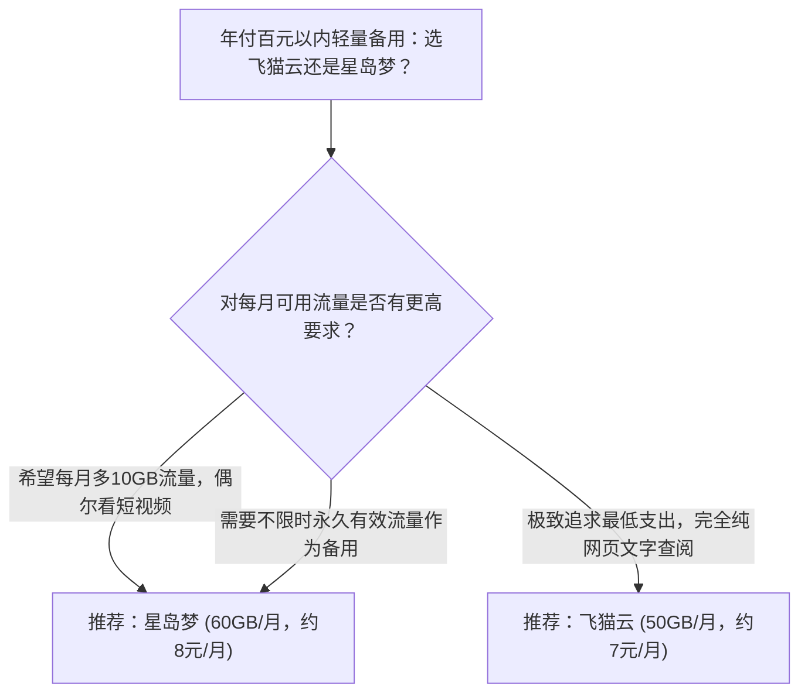

# 飞猫云对比星岛梦：月均7元与8元超低门槛年付轻量备用机场深度横评

在机场服务市场中，除了月付二三十元的高性能主力梯队外，还存在着一个庞大的刚需细分领域：**极致低成本的轻量级与备用级方案**。**飞猫云** 与 **星岛梦** 正是这一赛道中最受瞩目的两家代表性服务商，它们将年付方案的月均成本压低至 **7~8 元**，打破了专线网络高不可攀的心理门槛。

---

## 一、核心资费与配置参数对比表

| 对比维度 | 飞猫云 (FlyCat) | 星岛梦 (Xingdaomeng) | 选型权衡点 |
|---|---|---|---|
| **入门折算月费** | **约 7 元/月 (年付折算)** | **约 8 元/月 (年付折算)** | 飞猫云单月折算门槛更低 |
| **每月可用流量** | **50 GB/月** | **60 GB/月** | 星岛梦每月多出 10GB 冗余 |
| **计费结算机制** | 年付结算（一次性付清） | 年付结算（支持不限时套餐可选） | 均属长周期预付模式 |
| **网络传输链路** | IEPL 专线网络 | 企业级内网专线 | 均非廉价公网直连，具备专线底座 |
| **主流支持协议** | Shadowsocks | Shadowsocks | 协议成熟，全平台客户端导入方便 |
| **专属优惠代码** | `flycat888` | `nmw888` | 结账时输入专属优惠码享受立减 |
| **本站测速抽样** | Measured (2026-08-11 实测) | Measured (2026-08-11 实测) | 均附有本站保留的节点测速截图 |

---

## 二、产品哲学与定位差异深度对比

### 1. 飞猫云：极致压缩单客成本的极简主义

飞猫云将套餐规格做到了极致极简：
- **精准狙击低频刚需**：很多用户只是用来 Google 查学术论文、偶尔 GitHub 搜代码，每月真实消耗往往不足 30GB。飞猫云的 50GB 套餐刚好覆盖这部分群体，不浪费一分钱多余流量。
- **专线底座不缩水**：尽管单价极低，依然保持了 IEPL 专线传输，保障了晚高峰开网页不卡顿的基本底线。

### 2. 星岛梦：套餐生态丰富与备用容灾弹性

星岛梦在低价策略的基础上，提供了更具弹性的产品线：
- **流量冗余度更宽**：入门每月提供 60GB 流量，比飞猫云宽裕 20%，应对偶发的系统软件更新更为从容。
- **多阶梯与长期备用**：星岛梦不仅有低价年付方案，官方还提供不限时套餐选项，非常适合配置在路由器中作为“灾备备用线路”。

---

## 三、选型决策指南与使用建议

---

## 四、理性认知：低价年付的风险防范

1. **认清定位，勿作主力幻想**：不要期待 7~8 元的套餐能提供媲美几十元独立专线那样的无上限 8K 狂暴吞吐。其核心价值在于“低成本不断连、低预算查资料”。
2. **年付预付风控意识**：由于两款低价入门方案均需要一次性年付，建议用户严格根据自身预算规划，切勿盲目充值多年。

<FaqSection title="常见问题解答 (FAQ)" />

  <SponsoredLink href="https://guangs.flycataff.com/#/?code=6uq0Xe9y" class="jc-btn jc-btn--primary">
    访问 飞猫云 官网 (券码 flycat888) →
  </SponsoredLink>
  <SponsoredLink href="https://guangs.xingdaomeng.com/#/?code=1TynBYnR" class="jc-btn jc-btn--ghost">
    访问 星岛梦 官网 (券码 nmw888) →
  </SponsoredLink>

