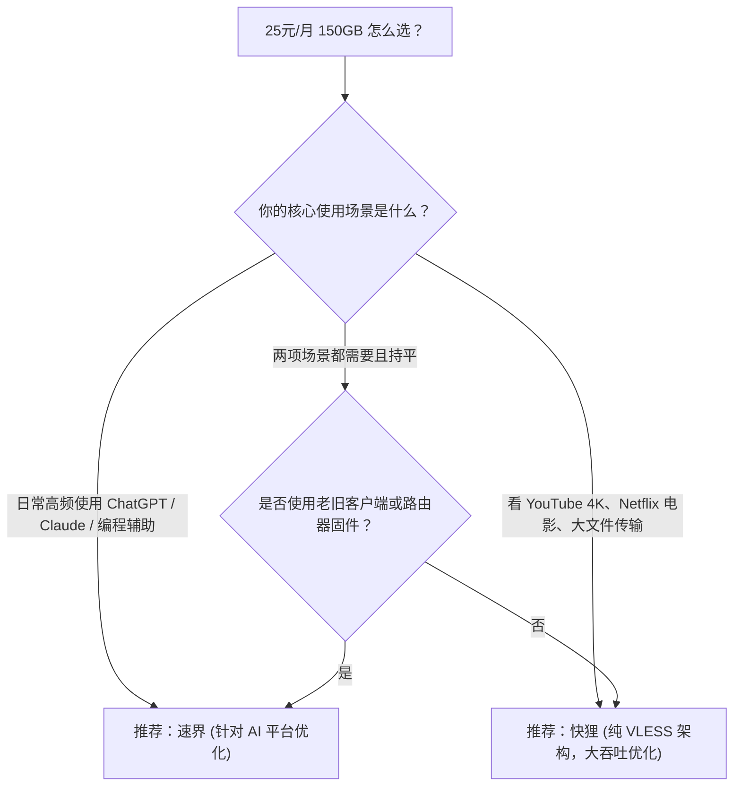

# 速界对比快狸：25元150GB高规格档位AI生产力与纯VLESS影音吞吐深度对比

在 **25元/月（150GB）** 的中高阶专线代理市场中，**速界** 与 **快狸** 是追求大容量与充沛带宽的重度用户经常对比的两个代表性产品。与平价小流量套餐不同，25 元档位的用户通常具备明确的刚需：或者是从事全天候跨国 AI 开发、远程办公的工程师，或者是追求 4K/8K 极致码率的流媒体影音爱好者。

---

## 一、核心规格与实测指标对照

| 对比维度 | 速界 (SpeedWorld) | 快狸 (KuailiCloud) | 选型权衡点 |
|---|---|---|---|
| **入门月付价格** | **25 元/月** | **25 元/月** | 原生月付无套路，支持按月续费 |
| **每月可用流量** | **150 GB/月** | **150 GB/月** | 充沛大流量，满足重度日用与生产力 |
| **单 GB 平均成本** | **约 0.16 元/GB** | **约 0.16 元/GB** | 兼具大容量与高质价比 |
| **底层专线类型** | IEPL 物理内网专线 | IEPL 物理内网专线 | 晚高峰抗骨干网 QoS 丢包能力强 |
| **协议架构选型** | VLESS / Shadowsocks 混合支持 | **全量纯 VLESS 协议** | 快狸协议更纯粹，速界兼顾老客户端 |
| **核心宣传侧重** | **AI 工具（ChatGPT / Claude）出口优化** | **高清流媒体高吞吐与缓冲调优** | 速界侧重开发交互，快狸侧重多媒体 |
| **专属优惠代码** | `sss1111` | `kkk2222` | 结账时输入专属优惠码享受立减折扣 |
| **本站测速记录** | Measured (2026-08-11 实测) | Measured (2026-08-11 实测) | 均保留原始测速截图与网络环境标注 |

---

## 二、场景定位深度解析：生产力交互 vs 持续吞吐

### 1. 速界的技术侧重点：长连接保活与 AI 平台出口信誉

与普通看视频的流量特征不同，AI 开发者在使用 ChatGPT、Claude、Cursor 或 GitHub Copilot 时，网络交互具有典型的“高频轻量、长连接长轮询、对 IP 跳变极度敏感”的特征：

- **会话持久性调优**：速界在节点出口侧针对 AI 常见机房 IP 进行了信誉维护，减少因节点出口 IP 频繁更换触发的风控验证码。
- **协议兼容广泛**：同时提供 VLESS 与经典协议，用户在不同的终端（包括终端命令行代理、IDE 插件与桌面客户端）上均能快速配置。

### 2. 快狸的技术侧重点：纯 VLESS 高吞吐与 4K 超清缓冲

快狸的设计理念更贴近大带宽吞吐型用户：

- **全链路纯 VLESS 协议**：摒弃传统的协议混淆层，采用极低数据封装开销的 VLESS 协议，在高并发下载与 4K 60fps 码率播放时，CPU 占用率更低，数据流推送更平滑。
- **大文件缓冲优化**：节点骨干带宽冗余充足，在测试工具高线程压测下拉升迅速，适合 YouTube、Netflix 等海外视频平台重度爱好者。

---

## 三、选型决策指南

---

## 四、理性消费提示

1. **AI 解锁是动态博弈**：任何机场对 AI 平台的优化均基于当前出口 IP 信誉，随 OpenAI/Anthropic 风控算法调整可能存在波动，请以实时使用为准。
2. **坚持按月订阅**：尽管两家均具备良好的专线架构，建议初次使用依然从 25 元单月套餐开始体验，跑通本地网络后再决定是否长期使用。

<FaqSection title="常见问题解答 (FAQ)" />

  <SponsoredLink href="https://guangs.speedworldaff.cc/#/register?code=xgXzEfZB" class="jc-btn jc-btn--primary">
    前往 速界 官网 (券码 sss1111) →
  </SponsoredLink>
  <SponsoredLink href="https://guangs.kuailicloud.cc/#/register?code=AiqyM8oG" class="jc-btn jc-btn--ghost">
    前往 快狸 官网 (券码 kkk2222) →
  </SponsoredLink>

