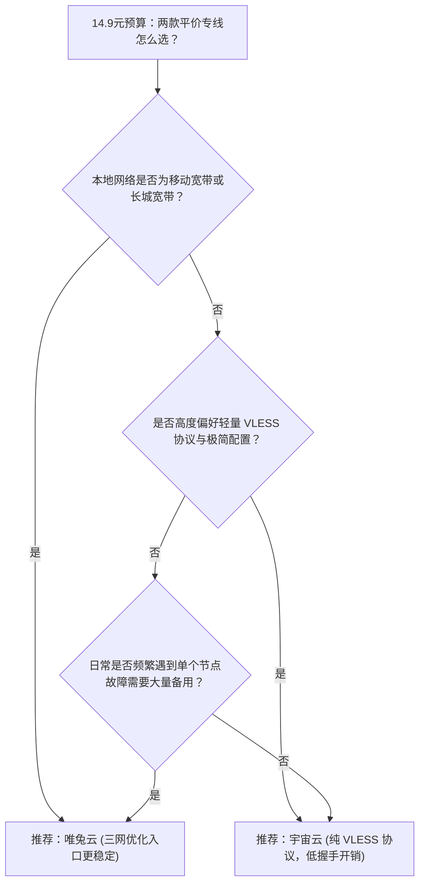

# 唯兔云对比宇宙云：14.9元平价档60+多节点调度与纯VLESS专线深度选型

在 **14.9元/月（100GB）** 的平价专线梯队中，**唯兔云** 与 **宇宙云** 是两款架构思路截然不同的典型代表。两者的月付资费与基础流量规格完全一致，但在底层网络调度逻辑、节点池宽度与协议选型上呈现出清晰的分野。

---

## 一、核心规格与参数指标对比

| 评测维度 | 唯兔云 (Weitu) | 宇宙云 (YuzhouCloud) | 选型影响分析 |
|---|---|---|---|
| **入门月付价格** | **14.9 元/月** | **14.9 元/月** | 两者门槛相同，均支持纯月付 |
| **基础月度流量** | **100 GB/月** | **100 GB/月** | 适合日常网页、技术查阅与中度视频 |
| **节点池规模** | **60+ 独立节点（大冗余池）** | 45+ 节点（精简配置） | 唯兔云节点数量更多，备选冗余度更充裕 |
| **骨干线路策略** | **三网优化 / 多线入口智能调度** | **纯 IEPL 专线直连** | 唯兔云擅长多运营商适配，宇宙云强调纯专线传输 |
| **传输协议支持** | VLESS / Shadowsocks 混合 | **纯 VLESS 协议** | 宇宙云协议纯度更高，抗干扰与轻量化表现突出 |
| **专属优惠码** | `rabbit` (9折立减) | `YUZHOU553` | 结算时均可输入优惠码享受折抵 |
| **本站实测状态** | Measured (2026-08-11 实测) | Measured (2026-08-11 实测) | 均附有本站保留的原始测速截图证据 |

---

## 二、架构差异深度剖析：节点池宽度 vs 协议纯度

### 1. 唯兔云的核心设计：三网优化与大冗余池

唯兔云的核心竞争力在于其**抵御本地运营商网络劣化的容灾能力**。由于国内不同地区宽带运营商（如移动 CMI、联通 169、电信 163）前往跨境机房的质量差异极大，单一入口往往容易在特定省份产生高丢包。

- **多节点自动容灾**：唯兔云部署了超过 60 个节点，当某个常用节点因临时维护或网络抖动响应变慢时，客户端可在策略组内秒级无缝漂移至同区域备用节点。
- **协议兼容性广泛**：同时兼顾了 VLESS 与经典 Shadowsocks 协议，老旧路由器或部分轻量客户端也能无障碍导入。

### 2. 宇宙云的核心设计：精简链路与纯 VLESS 专线

宇宙云则采取了“减法”哲学。它不盲目堆砌几百个虚假节点，而是将服务器资源集中在 40 余个核心落地机房上：

- **全量纯 VLESS 架构**：全节点剥离过时的冗余协议，全面采用轻量 VLESS 协议，握手数据包小、加解密开销极低，在低功耗移动设备或老旧手机上运行更为省电。
- **端到端 IEPL 专线保障**：数据跨境段严格走行物理专线光纤，在晚高峰 20:00~23:00 骨干网流量高峰期保持稳定的传输延迟。

---

## 三、网络延迟与实际场景选型指南

### 推荐选择【唯兔云】的典型场景：
1. **本地运营商为中国移动或广电宽带**：需要依靠多入口 BGP 调度弥补本地网络出口瓶颈。
2. **多设备共享或家庭局域网透明网关**：节点池大，单节点被风控时不影响其他家庭成员使用。
3. **查阅资料与日常跨境办公**：需要兼顾港、台、日、美、欧多区域长尾节点。

### 推荐选择【宇宙云】的典型场景：
1. **注重移动端续航与轻量体验**：喜欢 VLESS 的极简握手逻辑，追求客户端列表清爽干净。
2. **专注主流东亚常用节点**：主要高频连接香港、日本、新加坡等低延迟专线区域。
3. **预算严格控制在 15 元以内**：追求无套路单月续订，重视专线晚高峰实测数据。

---

## 四、购买前的事实核验与避坑建议

1. **避免单次测试定终身**：两家服务商的测速截图均记录于 2026-08-11 白天与晚高峰时段，代表该时间点的服务器承载能力，本地使用体验以实际运营商接入为准。
2. **坚持月付试用原则**：两款产品均提供成熟的 14.9 元单月账单周期，初次选型切勿直接盲目充值长期年费。

<FaqSection title="常见问题解答 (FAQ)" />

  <SponsoredLink href="https://guangs.v2yunvipaff.com/#/?code=xIutqOBA" class="jc-btn jc-btn--primary">
    访问 唯兔云 官网 (券码 rabbit) →
  </SponsoredLink>
  <SponsoredLink href="https://guangs.yuzoucloud.cc/#/register?code=yrThwMP1" class="jc-btn jc-btn--ghost">
    访问 宇宙云 官网 (券码 YUZHOU553) →
  </SponsoredLink>

