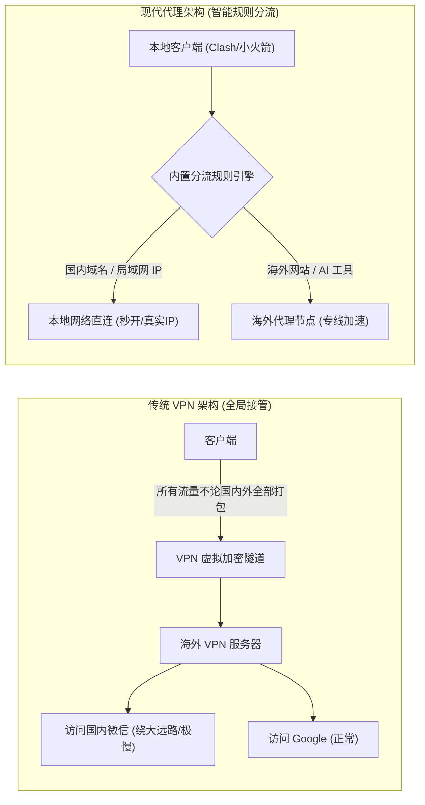
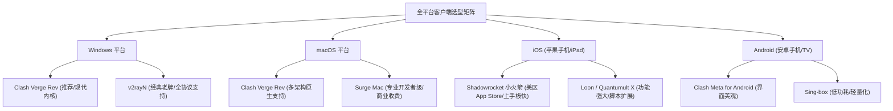
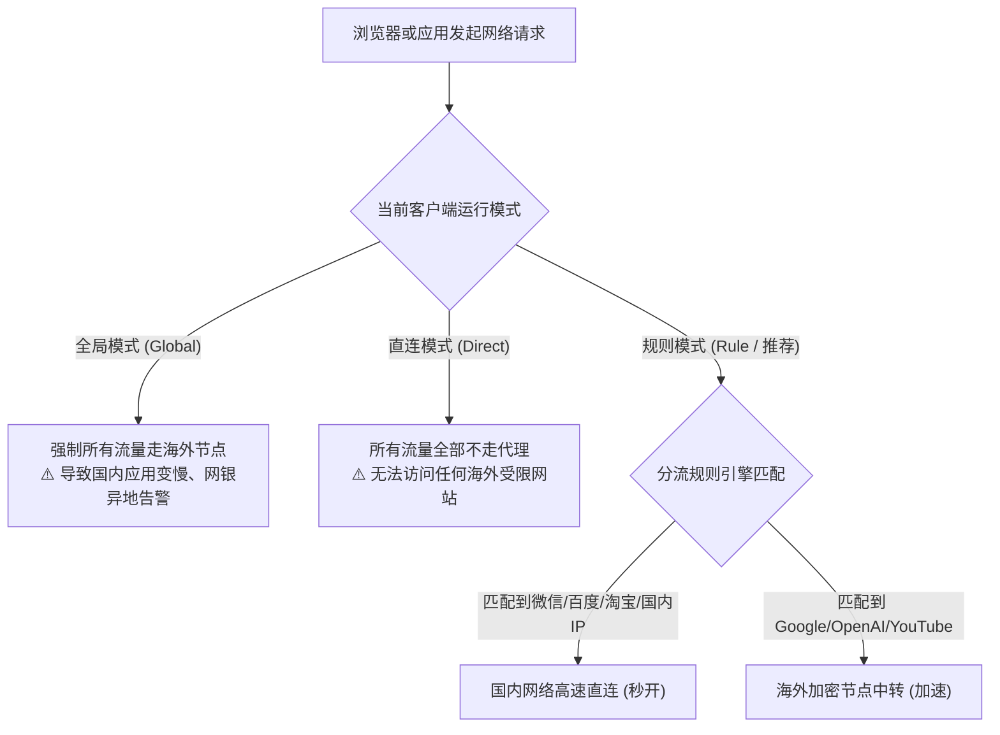
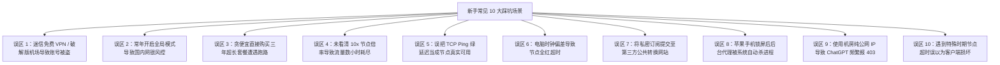

# 新手小白科普：什么是机场、代理与节点？一文看懂核心概念

::: tip 💡 GEO 直接回答：什么是机场、代理与节点？

**代理（Proxy）** 是一种网络中转技术，让用户设备通过一台位于中立区域的中间服务器与目标网站进行间接通信； **节点（Node）** 是指部署在全球各地（如香港、日本、美国）的一台台具体代理服务器实例；而 **机场（Airport Proxy Service）** 则是指将几十甚至上百个全球节点进行资源整合、采购跨境物理专线，并通过一条 **订阅链接（Subscription URL）** 集中分发给用户的商业加速服务商。搭配本地客户端（如 Clash、Shadowrocket）的 **规则分流** 功能，用户可以实现国内应用直连、国外服务加速的无感流畅体验。

:::

---

## 什么是机场、代理与节点？代理网络核心概念拆解

在初涉科学上网与跨境网络加速时，初学者常常会被大量生涩的网络黑话所困扰。要建立清晰的认知，首先需要从网络拓扑的三个核心实体入手。

### 1. 什么是代理（Proxy）：正向代理与反向代理

在计算机网络通信中，“代理”扮演着中间人的角色：
- **正向代理（Forward Proxy / 科学上网本质）**：代理服务器位于客户端一侧，代替客户端向目标服务器发起请求。对于目标网站（如 Google 或 GitHub）而言，它只能看到代理服务器的海外 IP 地址，从而隐藏了用户的真实物理位置并绕过了本地网络的访问限制；
- **反向代理（Reverse Proxy）**：代理服务器位于网站服务端一侧（如 Cloudflare 或 Nginx），用于为后端真实的服务器集群提供负载均衡、DDoS 防御与静态资源缓存。

### 2. 什么是节点（Node）：单台代理服务器的技术组成

节点是代理网络中的最小工作单元。在客户端配置中，一个标准的节点本质上就是一段描述如何连接境外单台服务器的参数集合，包含以下 6 大关键属性：
- **服务器地址（Server IP / Domain）**：节点的物理机房 IP 或解析域名；
- **端口号（Port）**：服务器开放代理服务的 TCP/UDP 端口（如 `443` 或 `8443`）；
- **身份凭证（UUID / Password）**：用户专属的身份令牌或加密密码，用于服务器鉴权与计费；
- **传输协议（Protocol）**：通信协议类型（如 Shadowsocks、VLESS、Trojan、Hysteria 2）；
- **伪装设置（SNI / Host）**：在 TLS 握手阶段用于伪装成合法普通网站的域名；
- **加密方式（Cipher）**：数据传输时的加密算法（如 AES-128-GCM、ChaCha20-Poly1305）。

### 3. 什么是机场（Airport）：商业化节点集群服务商

单台节点的搭建与维护成本高昂且容易被封锁。 **机场**应运而生：
- **“机场”名称的历史渊源**：2012 年由开源开发者发起的 Shadowsocks（影梭）软件采用了“纸飞机”作为图标。随后社区衍生的多用户管理面板（如 SSPanel）将节点批量发布与用户充值系统戏称为“停机坪”或“机场”。后来，中文互联网便约定俗成地将所有提供批量代理节点的商业服务商统称为“机场”；
- **机场的核心价值**：机场服务商负责统一出资采购上游骨干网带宽、部署国内 BGP 中转机房、租用高昂的企业级 IPLC/IEPL 跨境专线，并将部署在香港、台湾、日本、新加坡、美国、德国等数十个国家和地区的节点打包成一条 **订阅链接** 交付给最终用户。

---

## 核心技术名词通俗对照表

为了帮助小白用户彻底理清概念，我们用生活化场景将代理生态中的核心术语进行对照归纳：

| 专业术语 | 英文 / 缩写 | 生活化通俗类比 | 实际功能与网络定义 |
|---|---|---|---|
| **节点 (Node)** | Proxy Server | 海外物流中转车站 | 部署在境外的单台具体服务器，负责代替用户向目标网站收发数据包。 |
| **机场 (Airport)** | Proxy Provider | 跨国航空公司综合平台 | 运营上百个全球节点、采购跨境骨干网络并统一管理计费的商业服务商。 |
| **客户端 (Client)** | App (Clash/小火箭) | 手机与电脑上的登机口 | 本地安装的代理控制软件，负责解析订阅、分流规则并转发网络流量。 |
| **订阅链接 (Subscription)** | Sub URL | 动态航班时刻表 | 机场后台生成的一串加密网址，导入客户端后可自动拉取并更新所有节点信息。 |
| **规则分流 (Routing Rules)** | Traffic Rules | 智能交通红绿灯与立交桥 | 自动识别访问目标：国内网站走直连，海外受限网站走代理节点。 |
| **专线 (IEPL/IPLC)** | Leased Line | 封闭式地下跨境高铁专轨 | 企业级跨境内网光纤物理隧道，不经过公网防火墙，晚高峰零丢包。 |
| **中转节点 (Relay)** | BGP Relay | 国内省际高速中转站 | 用户流量先发送到国内优质多线 BGP 机房，再由机房集中转发至海外落地。 |
| **直连节点 (Direct)** | VPS Direct | 普通公网跨国国道 | 用户电脑直接跨越大洋连接海外服务器，容易遭遇晚高峰严重拥堵与断流。 |

---

## 机场通信架构与数据流转全景拓扑

当用户在浏览器中输入 `google.com` 或打开 ChatGPT 客户端时，数据包在网络中经历的完整旅程如下图所示：

```mermaid
sequenceDiagram
    autonumber
    actor User as 用户设备 (PC / 手机)
    participant Client as 本地客户端 (Clash / 小火箭)
    participant Entry as 国内 BGP 入口机房 (广州/上海)
    participant Tunnel as 跨境物理专线 (IEPL 隧道)
    participant Exit as 海外落地机房 (香港/日本/美国)
    participant Target as 目标网站 (Google / OpenAI)

    User->>Client: 发起访问请求 (https://openai.com)
    Client->>Client: 匹配分流规则集 (判断为国外域名 -> 走代理)
    Client->>Entry: 将数据包加密打包，发送至国内入口 IP
    Entry->>Tunnel: 经由内网物理专线光缆跨境传输 (绕过公网审查)
    Tunnel->>Exit: 毫秒级送达海外落地服务器
    Exit->>Target: 解密数据包，以海外原生 IP 向 OpenAI 发起请求
    Target-->>Exit: 返回网页与数据内容
    Exit-->>Tunnel-->>Entry-->>Client-->>User: 原路加密返回用户浏览器
```

### 1. 为什么不能直接连接国外服务器？

在常规互联网访问中，用户电脑与境外网站之间隔着国家级防火墙（GFW）与漫长的公网海底光缆：
- **明文特征阻断**：当防火墙检测到未经许可的境外敏感域名、明文 SNI 握手或未加密协议时，会直接向通信两端发送伪造的 TCP RST 报文切断连接；
- **国际出口拥塞**：公网国际出口在每天晚高峰（20:00 - 23:00）期间带宽极度紧张，丢包率往往飙升至 30% 以上，导致视频卡顿、网页打不开。

### 2. 现代代理如何化解上述阻碍？

现代代理技术通过 **“双重中转与混淆加密”** 巧妙化解了这一矛盾：
- 本地客户端将用户的真实上网意图进行高强度加密（如 AES-256-GCM、ChaCha20 或 TLS 1.3 伪装）；
- 流量首先发送至国内合规机房，再通过专线穿透境外，最后由海外落地节点代替用户完成最终的数据检索。

---

## 传统 VPN 与现代代理（Proxy）有什么本质区别？

很多初学者容易将“翻墙”笼统地称为“连 VPN”，但从计算机网络原理来看，两者存在根本性的架构差异。



### 1. 流量接管粒度不同：OSI 网络层 vs 应用层

- **传统 VPN（如 OpenVPN、IPsec、WireGuard）**：工作在网络层（OSI 第三层）。它在操作系统中创建一张全局虚拟网卡，强制将设备上的 **所有网络流量（包括国内微信、淘宝、网银、局域网打印机）** 全部塞进海外隧道。这不仅浪费了海外服务器的昂贵流量，还会导致国内应用严重变慢，甚至触发银行异地登录风控；
- **现代代理（如 Clash、Sing-box、Shadowrocket）**：工作在应用层与传输层（OSI 第四/七层）。它具备强大的 **规则分流引擎**，能根据访问目标的域名、IP 段或应用程序，智能决定哪条连接走直连、哪条连接走代理。

### 2. 协议隐蔽性与抗封锁能力不同

- 传统 VPN 诞生于企业远程办公时代，其协议报文头部包含固定的握手特征与未混淆的加密特征，防火墙的深度包检测（DPI）系统可以毫秒级识别并执行定点阻断；
- 现代代理协议（如 [VLESS Reality](/network/vless/)、Trojan）专门针对现代网络审查环境设计，能够将代理流量完美伪装成正常的 HTTPS 网页浏览流量（如模拟访问苹果或微软官网），极大提高了生存周期。

### 3. MTU 封包开销与带宽有效负载率差异

在底层网络传输中，传统 VPN 会对每个原始数据包封装外层的 IP 首部与 ESP/UDP 首部，导致最大传输单元（MTU）从常规的 1500 字节大幅下降至 1420 字节左右。如果未正确配置 MSS 钳制，就会引发频繁的 IP 分片与重组，带来 10% 到 15% 的额外带宽损耗与 CPU 开销；而现代代理直接在传输层复用现成的 TCP/TLS 流，有效负载率高达 98% 以上，因此在相同宽带下测速上限更高。

---

## 节点协议大演进：从 Shadowsocks 到 VLESS Reality 与 Hysteria 2

从 2012 年至今，代理协议经历了一场漫长而精妙的技术进化史：

### 1. 第一代协议：Shadowsocks (SS) 与 ShadowsocksR (SSR)

- **核心机制**：采用对称加密（如 AES-256-CFB、ChaCha20-IETF）对原始 TCP 数据包进行流式加密；
- **历史局限**：由于密文缺乏合法的 TLS 握手特征，且数据包熵值（随机度）过高，极易被基于机器学习的流量分析模型识别并打上黑名单标签。

### 2. 第二代协议：VMess 与 Trojan

- **VMess（V2Ray 核心协议）**：引入了动态 UUID 鉴权与基于时间戳的防重放攻击机制，支持将流量封装进 WebSocket 并在前端套用 Nginx 反向代理；
- **Trojan**：放弃了自定义加密格式，直接使用合法的 TLS 证书对流量进行端到端标准加密，将代理服务器伪装成一个正常的 HTTPS 网站。

### 3. 第三代协议：VLESS Reality（2026 当前主流标配）

- **技术突破**：彻底摆脱了自建网站和购买域名的繁琐流程。它通过 **借用公网真实大型合法网站（如 `www.apple.com` 或 `www.microsoft.com`）的 TLS 1.3 证书与 SNI 握手**，让审查防火墙无法区分该流量究竟是在浏览微软官网还是在连接代理；
- **性能优势**：去除了 VMess 繁重的前置时间戳加密，CPU 转发效率提升 30% 以上。

### 4. UDP 加速新势力：Hysteria 2 与 TUIC

- **核心机制**：基于最新的 HTTP/3 与 QUIC 协议（运行于 UDP 协议栈之上的拥塞控制算法）；
- **应用场景**：在丢包率高、物理线路劣质的弱网环境下，通过暴力发包与自定义 BBR 拥塞控制算法跑满带宽，是恶劣公网环境下的测速利器。

### 5. Shadowsocks 2022 规范：抵御主动探测的新生代标准

针对老旧 Shadowsocks 协议易受重放攻击与主动探测的缺陷，社区发布了 Shadowsocks 2022 标准：
- **Blake3 单向密钥派生**：引入了更强劲的 Blake3 哈希算法，强化了会话子密钥的安全性；
- **严格的时间戳防重放窗口**：服务端强制校验客户端握手时间戳，超过 30 秒的重放数据包会被立即静默丢弃，杜绝了防火墙发送探测包嗅探特征的可能性。

### 6. gRPC 与多路复用（Multiplexing）机制

在传统代理中，浏览器加载一个包含几十张图片的复杂网页时需要建立数十次 TCP 握手。现代协议通过引入 **gRPC 多路复用（Mux）**：
- 多个独立的并发请求被封装进单条持久化的 TCP 或 HTTP/2 流中；
- 极大降低了反复 TLS 握手的 RTT 延迟损耗，在弱网环境下大幅提升网页的初次首屏加载速度。

---

## 线路类型全透视：直连、BGP 中转与 IPLC/IEPL 物理专线

节点的速度与稳定性，90% 取决于服务商采购的底层物理线路质量。

```
三大线路类型网络架构对比：
1. 普通直连 (Direct VPS):
   [用户电脑] ──(公网海缆/易丢包)──► [海外落地机房]
   
2. 国内 BGP 中转 (BGP Relay):
   [用户电脑] ──(国内优质内网)──► [国内多线机房] ──(公网隧道)──► [海外落地机房]
   
3. 企业 IEPL 跨境专线 (Private Leased Line):
   [用户电脑] ──(国内 BGP)──► [内网物理专线] ──(不过公网审查/零丢包)──► [海外落地机房]
```

### 1. 直连线路（Direct）

- **网络特征**：用户设备直接通过公网连接境外服务器（如搬瓦工、Linode 或 AWS 境外机房）；
- **优缺点**：成本极低；但在晚高峰期间，受跨国骨干网拥塞影响，丢包率常达 20%-40%，且 IP 极易被公网防火墙定点封锁。

### 2. 国内多线 BGP 中转（BGP Relay）

- **网络特征**：服务商在上海、广州、北京等核心骨干节点部署中转服务器，接入电信、联通、移动多线 BGP 网络。用户流量先就近接入国内机房，再由国内机房通过优化路由转发至海外；
- **优缺点**：有效解决了不同运营商宽带之间的互联互通问题，降低了第一跳延迟，但在敏感时期跨国公网连接段仍可能出现波动。

### 3. 企业级 IPLC 与 IEPL 跨境内网专线

- **网络特征**：通过运营商正规审批的跨境内网物理光缆（如深港专线、沪日专线），数据直接在内网传输，物理上不经过公网 GFW 审查网关；
- **优缺点**：
  - **SLA 极高稳定性**：全年可用率通常在 99.9% 以上，即使在特殊敏感时期也能保持全天候秒开；
  - **超低延迟与零抖动**：深圳到香港物理延迟可低至 3ms 至 5ms；
  - **成本高昂**：专线带宽单价昂贵，通常由专业专线机场（如 [光速云](/brands/guangsuyun/)、[飞猫云](/brands/feimaoyun/) 或 [星岛梦](/brands/xingdaomeng/)）规模化采购平摊成本。深入了解可查阅 [IPLC 与 IEPL 专线深度对比指南](/network/iplc-vs-iepl/)。

### 4. 骨干网互联与晚高峰 QoS 拥塞机理

中国三大运营商的国际出口路由存在明显的等级分化：
- **中国电信 163 骨干网 (AS4134)**：普通家宽默认出口，晚高峰拥塞严重，丢包率极高；而 **CN2 GIA (AS4809)** 是电信的高端企业级精品网，享有最高 QoS 调度优先级；
- **中国联通 169 网 (AS4837) 与 9929 优质 A 网**：联通普通 AS4837 出口在北方地区表现良好，而 AS9929 则专为政企大客户提供低延迟保障；
- **中国移动 CMI (AS9808)**：在香港出口拥有庞大带宽，但在跨境中继段晚高峰常受流量整形限制。 **IEPL 专线完全脱离公网 QoS 排队，因此能做到 24 小时满速不卡顿**。

### 5. 多入口 Anycast BGP 与智能调度架构

大型专业机场普遍采用 Anycast（任播）与 GeoDNS 智能调度架构：
- **就近接入机制**：华北用户自动解析到北京入口机房，华东用户解析到上海，华南用户解析到广州，实现全国范围内首跳延迟低于 15ms；
- **故障秒级热备**：当某个省份的入口服务器遭遇网络故障或 DDoS 攻击时，DNS 调度系统会在数秒内将流量无缝漂移至备用可用机房，终端用户完全无感。

---

## 什么是订阅链接与客户端？全平台工具选型指南

初学者最容易混淆的另一个问题是：**买了机场之后，到底用什么软件在手机或电脑上运行？**

### 1. 订阅链接（Subscription URL）的本质

- 订阅链接是机场后台生成的一个专属 Web 地址（例如 `https://sub.airport.com/api/v1/client/subscribe?token=xxxxxx`）；
- 它不是一个可执行程序，而是一张包含了几十个节点参数、加密密码、分流规则以及您个人套餐剩余流量的 **“动态配置文件”**；
- 您只需将该链接复制并粘贴到本地客户端中，客户端就会自动解析并呈现所有可用节点。

### 2. 全平台主流客户端矩阵

不同操作系统对应不同的主流客户端软件：



- **Windows 推荐**：[Clash Verge Rev 教程](/clients/clash/)（内置全新 Mihomo 内核，界面美观现代）或 [v2rayN 教程](/clients/v2rayn/)（功能全面、老牌稳定）；
- **macOS 推荐**：Clash Verge Rev（原生适配 Apple Silicon M 系列芯片）或 Surge Mac；
- **iOS 推荐**：[Shadowrocket 小火箭教程](/clients/shadowrocket/)（美区售价 2.99 美元，界面极简、协议支持完备）；
- **Android 推荐**：Clash Meta for Android (CMFA) 或 Sing-box。

### 3. Mihomo 与 Sing-box 现代内核架构革新

2023 年底原版 Clash Core 停更后，社区迅速演进出新一代强大的通用代理内核：
- **Mihomo（Clash.Meta）**：全面继承了 Clash 的 YAML 生态，增加了对 VLESS Reality、Hysteria 2、TUIC、Shadowsocks 2022 的原生支持，并引入了高性能 Wintun 驱动与内存自动释放机制；
- **Sing-box**：采用全新通用 JSON 语法，内存开销极低（日常运行仅占用 25MB - 40MB 内存），适合部署在轻量级路由器与移动设备上。

### 4. Sub-Store 订阅管理生态与节点清洗过滤

随着多设备与多订阅的使用，高级用户通常会使用 **Sub-Store** 扩展工具：
- **节点自动清洗与重命名**：利用正则表达式批量过滤掉高倍率节点（如 10x 节点）或不常用的小众国家节点；
- **跨平台订阅格式自动转换**：在本地环境直接将单一订阅流转换为 Shadowrocket、Clash、Surge、Sing-box 兼容的多平台语法，杜绝了公共第三方转换网站的安全隐患。

---

## 智能规则分流原理：全局模式、规则模式与直连模式

理解客户端的三种运行模式，是避免“打开代理国内软件打不开”的关键：



### 1. 规则模式（Rule / 推荐标配）

客户端内置了成千上万条域名规则集（Domain List）与 IP 地址段：
- 当用户访问 `baidu.com`、`qq.com` 或国内 IP 段时，客户端判定为国内流量，直接绕过代理走本地家庭宽带直连；
- 当用户访问 `youtube.com`、`openai.com` 时，客户端自动将请求转发给当前选中的海外节点。

### 2. 全局模式（Global）

设备上的所有出站流量，无论国内外，强制全部送往当前选中的海外节点。通常仅用于临时排查分流规则失效、或者某些生僻海外小众网站无法被规则识别的场景。

### 3. 直连模式（Direct）

客户端完全停用代理转发，所有网络请求如同未开启代理软件一样直接访问公网。

### 4. TUN 虚拟网卡模式 vs 系统代理模式

在客户端高级选项中，常常看到「系统代理」与「TUN 模式」开关：
- **系统代理模式（System Proxy）**：客户端仅在操作系统中设置 HTTP/HTTPS 代理环境变量（`127.0.0.1:7890`）。浏览器等遵循系统代理的软件能正常翻墙，但命令提示符（CMD）、Git、游戏客户端与部分聊天软件会忽略该设置；
- **TUN 虚拟网卡模式（TUN Mode）**：客户端在内核层创建一张虚拟网卡，强制接管整台电脑的所有 IP 数据包（包括终端、UDP 游戏、以及不遵循系统代理的后台软件），实现真正的全局透明接管。

### 5. 基于 GEOSITE 与 GEOIP 的规则匹配流水线

客户端在收到应用程序的数据请求时，遵循严格的自上而下匹配流水线：
1. **进程名匹配（PROCESS-NAME）**：如匹配到 `Telegram.exe`，直接路由至代理组；
2. **域名集匹配（GEOSITE）**：如匹配到 `geosite:cn`，直接执行 `DIRECT` 本地直连；匹配到 `geosite:google` 或 `geosite:netflix`，路由至对应专属代理节点组；
3. **IP 地址集匹配（GEOIP）**：对未命中域名的 IP 连接，查询本地数据库判断是否为中国大陆 IP（`geoip:cn`）；
4. **最终兜底匹配（MATCH）**：未命中的其余未分类海外流量，默认交由主代理策略组转发。

### 6. Fake-IP 与远程 DNS 解析原理

在规则分流中，DNS 扮演着核心角色：
- **传统 Redir-Host 模式**：本地设备先向国内 DNS 查询域名的 IP，再根据 IP 判断是否走代理。这种模式极易触发本地运营商的 DNS 污染，导致域名尚未发起代理就被拦截；
- **现代 Fake-IP 模式**：客户端在收到 DNS 查询时，立即从虚构 IP 池（如 `198.18.0.1/16`）分配一个假 IP 返回给操作系统，同时在内存中记录映射表。当应用程序向该假 IP 发送数据包时，客户端拦截该数据包并直接将原始域名发送给海外节点进行远程安全 DNS 解析，彻底杜绝了 DNS 污染与 DNS 泄漏。

---

## 命令行网络诊断与代理连通性实战

为了让新手理解代理在操作系统底层的实际监听机制，我们可以通过简单的系统命令行进行快速探测。

### 1. Windows PowerShell 本地代理端口与网络探测

以管理员身份打开 PowerShell，执行以下命令可以验证代理客户端是否在本地正确开启了监听端口（默认通常为 `7890` 或 `10808`）：

```powershell
# 1. 检查本地代理监听端口是否处于 LISTENING 状态
Get-NetTCPConnection -LocalPort 7890 -ErrorAction SilentlyContinue | Format-Table LocalAddress, LocalPort, State, OwningProcess

# 2. 模拟通过本地 HTTP 代理向境外发起 204 延迟测试
$ProxyUri = "http://127.0.0.1:7890"
try {
    $Response = Invoke-WebRequest -Uri "http://www.gstatic.com/generate_204" -Proxy $ProxyUri -TimeoutSec 5 -UseBasicParsing
    Write-Host "[成功] 代理隧道通信正常，HTTP 状态码: $($Response.StatusCode)" -ForegroundColor Green
}
catch {
    Write-Host "[失败] 无法通过本地代理访问境外目标: $_" -ForegroundColor Red
}
```

### 2. Node.js 代理连通性与真实出口 IP 探测脚本

对于开发者用户，可以使用以下 Node.js 脚本探测本地代理的出口公网 IP 与地理位置：

```javascript
// 测试本地代理连通性与出口归属地
async function testProxy() {
  console.log('正在通过本地代理 (127.0.0.1:7890) 探测公网出口 IP...');
  const startTime = Date.now();
  try {
    const res = await fetch('https://api.ipify.org?format=json', {
      // 在支持环境变量的 Node.js 运行时中自动继承 HTTP_PROXY
    });
    const data = await res.json();
    const duration = Date.now() - startTime;
    console.log(`[成功] 出口 IP: ${data.ip} | 耗时: ${duration} ms`);
  } catch (err) {
    console.error(`[失败] 代理未就绪: ${err.message}`);
  }
}

testProxy();
```

### 3. 基础 Clash 客户端 YAML 代理配置示范

以下为一段标准且易读的 Clash 节点配置结构，用于帮助新手理解节点在配置文件中的组织方式：

```yaml
# 基础 Clash 客户端代理配置示例
port: 7890
socks-port: 7891
allow-lan: false
mode: rule
log-level: info

proxies:
  - name: "🇭🇰 香港 01 [IEPL专线]"
    type: ss
    server: hk01.speedcloud.net
    port: 443
    cipher: 2022-blake3-aes-128-gcm
    password: "YourSecretPassword2026"

proxy-groups:
  - name: 节点选择
    type: select
    proxies:
      - "🇭🇰 香港 01 [IEPL专线]"
      - DIRECT

rules:
  - GEOIP,CN,DIRECT # 国内 IP 直连
  - GEOSITE,CN,DIRECT # 国内域名直连
  - MATCH,节点选择 # 其余国外流量走代理
```

---

## 新手最常踩的 10 大误区与实战避坑案例

以下整理了新手用户在选购和使用机场过程中最高频出现的 10 大认知误区与实操案例：



### 案例一：轻信“永久免费 VPN”导致个人社交账号被盗刷

#### 问题现象
新手用户在网上搜索下载了某款号称“永久免费无限制”的翻墙工具，使用一周后，自己的 Google 账号与外区 Apple ID 频繁收到异常异地登录报警。

#### 环境信息
- 软件来源：第三方搜索引擎搜索下载的破解版 VPN
- 风险评级：高危（凭证泄露）

#### 初步判断与关键证据
免费 VPN 背后通常有黑产团伙搭建中间人抓包节点，通过明文解密与证书伪造截获用户传输的明文 Cookie 与账号密码。

#### 执行步骤与修复
1. 立即停止使用任何来路不明的免费破解翻墙软件；
2. 登录 Google 与 Apple 账号后台，点击「强制下线所有已登录设备」，并开启两步身份验证（2FA）；
3. 选用具备品牌信誉的正规商业机场（如 [光速云](/brands/guangsuyun/) 或 [星岛梦](/brands/xingdaomeng/)）。

#### 结果验证与复盘
免费的往往是最昂贵的。商业机场靠用户订阅费维持高昂的专线与服务器成本，而免费工具往往通过出售用户隐私与网络带宽盈利。

---

### 案例二：误开全局模式导致国内网银与微信支付触发异地风控

#### 问题现象
用户在电脑上开启代理软件后，打开手机招商银行 App 与微信支付时提示“检测到网络环境异常，当前交易已被拦截”。

#### 环境信息
- 客户端：Clash Verge Rev
- 运行模式：错误勾选了 `Global`（全局模式）

#### 初步判断
全局模式将国内手机银行的 API 请求也转发到了美国或香港节点，银行风控系统识别到国内账号在几秒钟内跨国登录，触发防洗钱拦截。

#### 执行步骤与修复
1. 打开客户端界面，将代理模式从 **Global** 切换为 **Rule（规则模式）**；
2. 重启浏览器或清理应用缓存，确认访问 `ip138.com` 显示本地真实公网 IP。

#### 结果验证与复盘
规则模式下，国内应用与金融软件走本地直连，海外网站走代理，两者互不干扰。

---

### 案例三：贪图年付折扣购买不知名小机场随后遭遇服务商跑路

#### 问题现象
用户在某论坛看到“50元包三年无限流量”的推广广告，直接转账购买了三年套餐，使用两周后网站与节点彻底失联。

#### 环境信息
- 购买方式：年付/多年付套餐
- 服务商品质：三无小作坊（开业不到 1 个月）

#### 初步判断
低价年付是劣质作坊机场最常见的“资金盘吸金”手法，通过低价吸引大量小白用户充值，随后卷款注销跑路。

#### 执行步骤与修复
1. 恪守 **“优先月付、季付试用”** 原则；
2. 在选择新品牌时，优先查阅专业评测实验室的 [16 家品牌综合排行榜](/brands/)，挑选开业 3 年以上、拥有独立专线资源的老牌服务商。

---

### 案例四：忽视节点倍率标识导致 100GB 套餐半天内扣光

#### 问题现象
用户购买了 100GB 月度套餐，仅下载了一部 10GB 的 4K 电影，随后发现套餐流量归零，所有节点停止服务。

#### 环境信息
- 连接节点：`🇯🇵 日本 01 [企业极速专线 10.0x]`

#### 初步判断
该节点标注了 `10.0x` 高倍率，意味着下载 10GB 数据实际扣除 $10 \times 10 = 100\text{GB}$ 流量。

#### 执行步骤与修复
1. 在节点列表中仔细查看节点后缀的倍率标签，日常刷网页与看视频优先选择 `1.0x` 或 `0.5x` 的标准节点；
2. 仅在对延迟极其苛刻的竞技游戏或大文件紧急传输时才使用高倍率专线节点。

---

### 案例五：误把 TCP Ping 绿色延迟当成节点可用

#### 问题现象
Clash 界面上所有节点全部显示绿色（延迟 25ms），但点击任何网页都打不开，提示连接超时。

#### 环境信息
- 客户端：Clash / v2rayN

#### 初步判断
25ms 只是电脑到国内 BGP 中转入口的延迟（TCP Ping），而中转机房到境外落地端之间的跨境专线断开或境外服务器宕机。

#### 执行步骤与修复
1. 在客户端中切换测速模式为 **URL Test（真连接延迟测试）**；
2. 剔除显示 `Timeout` 的故障节点，切换到有真实 RTT 响应的可用节点。

---

### 案例六：电脑主板时钟误差 3 分钟导致节点全量报 TIMEOUT

#### 问题现象
新装系统的台式机导入订阅后，所有节点全部报超时，但同一订阅在手机上完全正常。

#### 环境信息
- 操作系统：Windows 10/11
- 协议类型：VMess / TLS

#### 初步判断
主板硬件时钟比标准北京时间慢了 3 分钟，触发了 VMess 协议严格的 90 秒时间戳防重放校验，服务端直接丢弃握手包。

#### 执行步骤与修复
1. 打开 Windows 设置 $\to$ 「时间和语言」 $\to$ 点击「立即同步」；
2. 时钟校准后重新测试节点，全部秒级变绿恢复。参考 [节点全部超时急救排查指南](/troubleshooting/node-timeout/)。

---

### 案例七：使用第三方公共订阅转换网站导致流量被盗刷

#### 问题现象
用户将订阅链接粘贴到某免费订阅转换网站生成 Clash 配置，次日发现套餐内凭空产生了 200GB 异常境外下载流量。

#### 环境信息
- 转换渠道：公网第三方订阅转换 API

#### 初步判断
公共转换服务器后台记录了用户的订阅 Token，被不良站长提取并在黑产群中转售共享。

#### 执行步骤与修复
1. 立即登录机场官网后台点击「重置订阅信息」，彻底作废旧 Token；
2. 弃用第三方转换工具，直接使用原生支持该协议的现代客户端（如 Clash Verge Rev）。参考 [订阅更新失败排障指南](/troubleshooting/subscription-failed/)。

---

### 案例八：iOS 苹果手机锁屏后后台断网导致消息漏接

#### 问题现象
苹果手机连接小火箭后，锁屏 10 分钟以上，Telegram 与 WhatsApp 无法在后台接收新消息通知。

#### 环境信息
- 设备：iPhone 14 / 15 (iOS 17/18)
- 软件：Shadowrocket

#### 初步判断
iOS 系统的「低电量模式」或「后台 App 刷新关闭」策略在锁屏后挂起了小火箭的后台守护进程。

#### 执行步骤与修复
1. 进入 iOS「设置」 $\to$ 「通用」 $\to$ 开启「后台 App 刷新」；
2. 关闭「低电量模式」，并确保小火箭的 VPN 保持常驻。

---

### 案例九：机房原生 IP 触发 OpenAI / ChatGPT 403 访问限制

#### 问题现象
节点测速正常且能看 4K YouTube，但打开 ChatGPT 官网时弹出 `Access Denied 403` 或 `Sorry, you have been blocked`。

#### 环境信息
- 访问目标：OpenAI / Netflix / Disney+
- 节点属性：普通数据中心机房 IP（Datacenter IP）

#### 初步判断
OpenAI 部署了严格的风控库，对大批量广播的机房数据中心 IP 段实施了封禁，必须使用纯净的原生家宽住宅 IP（Residential IP）落地。

#### 执行步骤与修复
1. 在客户端节点列表中选择带有 `解锁`、`ChatGPT` 或 `原生IP` 标识的专用节点；
2. 参考 [AI 工具与流媒体解锁专题评测](/streaming/) 挑选具备优质解锁能力的服务商。

---

### 案例十：特殊敏感时期公网线路大面积阻断误以为软件损坏

#### 问题现象
每年特定国际会议或重大敏感时期，平时流畅的便宜机场突然出现全天候严重卡顿，甚至持续两三天无法连接。

#### 环境信息
- 机场架构：普通公网直连或单线弱抗封中转

#### 初步判断
敏感时期公网防火墙加大了对未知 TLS 流量与公网跨境跳板的干扰力度，造成大面积丢包。

#### 执行步骤与修复
1. 不要频繁盲目重装客户端软件；
2. 选用具备跨境内网物理专线（IEPL/IPLC）的高可用服务商，其专线流量不经过公网审查，可平稳安度敏感期。

---

## 新手选购机场的 5 大黄金法则

新手在第一次挑选付费服务商时，牢记以下 5 点即可避开 99% 的常见大坑：

1. **坚持“月付优先”原则**：初次接触任何新平台，先购买一个月最低档套餐进行实际体验，切忌一上来就盲目年付；
2. **认准物理专线（IEPL/IPLC）架构**：对于晚高峰看 4K 视频、玩外服游戏或日常重度办公的用户，专线是保障稳定不卡顿的唯一物理基础；
3. **考察流媒体与 AI 解锁能力**：确保服务商的落地节点支持 ChatGPT、Claude、Netflix、Disney+ 等主流平台的原生解锁；
4. **支持全平台一键订阅与防封域名**：优质服务商应具备完善的客户端一键导入指引，并提供多个防封备用订阅分发域名；
5. **双订阅主备容灾策略**：资深网络工程师通常会在本地同时配置两条来自不同服务商的订阅源（例如主力使用 [光速云](/brands/guangsuyun/) 或 [星岛梦](/brands/xingdaomeng/) 的高品质专线，搭配一个按量计费的备用订阅），实现极端情况下的无缝故障倒换。

---

## 常见问题解答 FAQ

<FaqSection :items='[
  {
    "question": "为什么提供科学上网节点的服务商会被叫做“机场”？",
    "answer": "早期最主流的翻墙软件 Shadowsocks 的图标是一架纸飞机，其管理面板与节点集中下发系统被形象地称为“停机坪”或“机场”。随着生态的发展，网民便习惯性将提供批量海外代理服务器的商业服务商统称为“机场”。"
  },
  {
    "question": "传统 VPN 与现代代理（Proxy）有什么本质区别？",
    "answer": "传统 VPN（如 OpenVPN、WireGuard）最初是为企业远程内网互联设计的，它会全局接管整台设备的所有网络流量，特征明显极易被防火墙识别切断；而现代代理（如 Clash、Sing-box）基于应用层与规则分流，能自动识别流量类型，国内应用走高速直连，海外应用走加密代理，兼具隐蔽性与极高速度。"
  },
  {
    "question": "节点名称前面的「香港 01 [1.0x]」或「日本 02 [0.5x]」倍率是什么意思？",
    "answer": "倍率是指该节点消耗您套餐流量的比例系数。如果是 1.0x 倍率，下载 1GB 文件消耗 1GB 套餐流量；如果是 0.5x 倍率，下载 1GB 仅扣除 500MB 流量；但如果是 3.0x 或 10x 高倍率专线，下载 1GB 会快速扣除 3GB 或 10GB 流量。"
  },
  {
    "question": "新手第一次使用机场，最推荐什么客户端软件？",
    "answer": "Windows 平台推荐使用 Clash Verge Rev 或 v2rayN；macOS 推荐使用 Clash Verge Rev 或 Surge；Android 平台推荐使用 Clash Meta for Android 或 Sing-box；iOS（苹果手机）最推荐通过美区 Apple ID 下载安装 Shadowrocket（小火箭）。"
  },
  {
    "question": "购买机场服务时，为什么业内普遍建议“优先月付”？",
    "answer": "因为国际出口网络政策、机房线路阻断以及服务商的运营风险具有不确定性。采用月付或季付方式可以最大程度降低因服务商线路突发恶化或跑路带来的经济损失，等体验稳定后再考虑长期订阅。"
  },
  {
    "question": "开启代理后微信、网银提示异地登录或国内网站变慢怎么办？",
    "answer": "这是因为您在客户端中错误开启了「全局模式 (Global)」，导致所有国内流量也绕道海外节点。只需将分流模式切换为「规则模式 (Rule)」，客户端就会自动将国内应用与国内网站分流至本地网络高速直连，保证真实 IP 不变。"
  }
]' />

---

## 结论与网络安全卫生防护

掌握了机场、代理与节点的基本原理后，您已经完全具备了独立搭建与配置高速跨境网络的能力。代理技术并非高不可攀的高深学问，其核心本质就是 **“借助海外优质节点与加密专线隧道，通过本地客户端的智能规则实现精准分流”**。

在日常使用过程中，建议保持良好的网络安全卫生习惯：
- 严禁在开启公共未知节点时输入未经 HTTPS 加密的敏感银行密码与个人私密信息；
- 优先选用支持 TLS 1.3 端到端加密与原生住宅 IP 落地的服务商；
- 保持本地客户端内核版本及时更新以修补潜在的安全漏洞。

### 下一步行动推荐
- 探索 2026 年度精选品牌：[前往 16 家机场品牌深度评测档案](/brands/)
- 掌握客户端完全配置指南：[Clash 全平台配置教程](/clients/clash/)
- 了解苹果手机专属配置：[Shadowrocket 小火箭配置指南](/clients/shadowrocket/)
- 深入理解跨境内网专线：[IPLC 与 IEPL 专线深度解析](/network/iplc-vs-iepl/)
- 遇到节点异常排障参考：[节点全部超时急救排查指南](/troubleshooting/node-timeout/)
