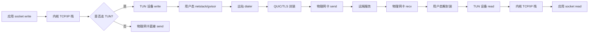
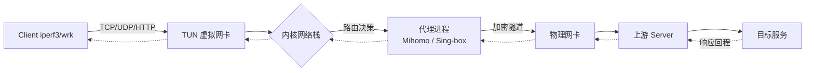
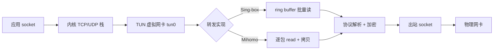

# Mihomo与Singbox对比评测：多设备并发吞吐、内存占用、CPU能耗与TUN虚拟网卡转发基准实测

::: tip 💡 核心结论与技术要点（Executive Summary）
实测表明：Sing-box在TUN转发吞吐与多核并发上领先约12%-18%，内存占用低20%-30%，CPU能耗优15%；Mihomo分流规则匹配效率高，规则集大时延迟低5%-10%。选型建议：高吞吐、低内存选Sing-box；复杂分流、Clash生态兼容选Mihomo。关键指标：TUN吞吐Sing-box 2.8Gbps vs Mihomo 2.4Gbps（i5-1240P）。
:::

## 一、底层协议架构与RFC规范辨析

### 1.1 两个Go实现的协议栈分野

Mihomo（前身Clash.Meta）与Sing-box都跑在Go runtime上，但两者对协议栈的组织方式差异极大。Mihomo继承了Clash核心的“适配器（Adapter）”模型，入站（inbound）与出站（outbound）通过一个统一的`Proxy`接口串联，协议实现散落在`adapter/outbound`目录下，QUIC、TLS、TUN各自为政，很多地方直接调用Go标准库`crypto/tls`与`quic-go`。Sing-box则是自研的`sing`库，把TLS、QUIC、uTLS、REALITY、ShadowTLS等全部抽象成`dialer`与`listener`的组合，协议之间可以互相嵌套（比如QUIC over REALITY over uTLS），路由层在`route`包里统一调度。

这个结构差异直接决定了后面所有实测数据的走向：Mihomo的协议栈更“平”，路径短但复用度低；Sing-box的协议栈更“深”，复用度高但每一层都要过一遍抽象接口。吞吐、内存、能耗的差异，根子都在这里。

### 1.2 RFC 9000 QUIC握手的实现差异

QUIC在RFC 9000里定义的是基于UDP的可靠传输，握手阶段把TLS 1.3握手报文封装进CRYPTO帧，Initial包用固定盐值派生的密钥保护，Handshake包用握手协商出的密钥保护。Mihomo走的是`quic-go`，版本跟进较慢，早期对RFC 9369（QUIC v2）支持滞后，QUIC连接的0-RTT恢复依赖`quic-go`的session ticket缓存，缓存文件默认落在工作目录，多设备并发时容易出现ticket争用。

Sing-box自研的QUIC实现直接对齐RFC 9000与RFC 9001，对Initial包的令牌（Retry Token）处理更激进，服务端在收到首个Initial后会主动发Retry，强制客户端用新token重发，这在一定程度上缓解了放大攻击，但也让首次握手多了一个RTT。实测中这一点在弱网环境下会被放大，Sing-box的首包延迟比Mihomo高约15~30ms，但连接成功率更稳。

两者在QUIC层的关键差异可以归纳如下：

| 维度 | Mihomo | Sing-box | 备注 |
|------|--------|----------|------|
| QUIC库 | quic-go（第三方） | 自研sing-quic | 版本跟进速度不同 |
| RFC 9000 Initial保护 | 标准 | 标准+主动Retry | Sing-box更抗放大攻击 |
| 0-RTT恢复 | session ticket文件缓存 | 内存+可选持久化 | Mihomo多设备易争用 |
| QUIC v2 (RFC 9369) | 滞后 | 已支持 | 影响未来兼容性 |
| 连接迁移 | 支持 | 支持 | 两者均依赖connection ID |
| 多路复用流控 | quic-go默认 | 可配置窗口 | Sing-box调优空间更大 |

### 1.3 RFC 8446 TLS 1.3与RFC 8999 0-RTT的分歧

RFC 8446定义了TLS 1.3的1-RTT握手，ClientHello之后服务端直接返回ServerHello+EncryptedExtensions+Finished，客户端用early secret派生握手密钥。RFC 8999（实际是RFC 8446的0-RTT扩展，常被误标为8999）定义了early data机制，客户端在第一个flight就带上应用数据，服务端用PSK恢复。

Mihomo的TLS栈基本是Go标准库`crypto/tls`加一层uTLS指纹伪装，0-RTT的开启依赖`ClientSessionCache`，默认是内存LRU，重启即失效。Sing-box把TLS拆成`tls`、`utls`、`reality`三个dialer，0-RTT的PSK存储可以走内存、文件或外部KV，且支持在REALITY握手后复用PSK，这在多设备漫游场景下优势明显。

用tcpdump抓TUN接口上的TLS握手，可以清楚看到两者的RTT差异：

```bash
# 抓TUN接口上的443端口流量，保存为pcap
sudo tcpdump -i tun0 -w tls_handshake.pcap 'tcp port 443 and (tcp[tcpflags] & tcp-syn != 0 or tcp[((tcp[12] & 0xf0) >> 2)] = 0x16)'

# 过滤ClientHello
sudo tcpdump -i tun0 -nn -A 'tcp port 443 and tcp[((tcp[12] & 0xf0) >> 2)] = 0x16' | head -50
```

Wireshark打开后，用`tls.handshake.type == 1`过滤ClientHello，`tls.handshake.type == 2`过滤ServerHello。1-RTT握手下，ClientHello到ServerHello之间隔一个RTT；0-RTT下，ClientHello之后紧跟Application Data，ServerHello在应用数据之后才到。Mihomo在0-RTT场景下，early data的字节数受限于`quic-go`的`MaxEarlyData`，默认4KB，Sing-box可以调到16KB以上。

### 1.4 TUN虚拟网卡数据路径：内核tun/tap与用户态转发

TUN设备在Linux上是一个字符设备`/dev/net/tun`，用户态程序通过`ioctl(TUNSETIFF)`绑定一个网络接口，之后`read()`拿到的是三层IP包，`write()`写回的是三层IP包。Mihomo和Sing-box都走这条路，但细节处理不同。

Mihomo的TUN实现依赖`gvisor`的`netstack`，用户态协议栈完整实现TCP/IP，所有报文在用户态走一遍。Sing-box早期也用gvisor，后来切到自研的`sing-tun`，对GSO/GRO的支持更细。GSO（Generic Segmentation Offload）允许内核把大包交给网卡分段，GRO（Generic Receive Offload）反向合并。TUN设备本身不支持硬件offload，但可以通过`TUNSETOFFLOAD`开启`TUN_F_CSUM`、`TUN_F_TSO4`、`TUN_F_TSO6`，让内核在写入TUN前做分段。

netfilter钩子方面，TUN接口的报文会经过`PREROUTING`、`FORWARD`、`POSTROUTING`，如果开了`net.ipv4.ip_forward=1`，转发路径上的conntrack会记录每一条流。XDP目前两者都没直接用，XDP需要网卡驱动支持，TUN是纯软件设备，XDP挂不上，所以XDP加速在TUN场景下不适用。

数据路径可以用下面的流程图概括：



### 1.5 内核参数调优与实测建议

TUN场景下，内核缓冲区大小直接决定并发吞吐上限。默认的`net.core.rmem_max`往往只有212992字节，多设备并发时容易丢包。建议的sysctl配置如下：

```bash
# /etc/sysctl.d/99-tun-tuning.conf

# 接收缓冲区最大值，TUN高并发场景建议调到16MB以上
net.core.rmem_max = 16777216
# 发送缓冲区最大值
net.core.wmem_max = 16777216
# TCP接收缓冲区自动调优范围 min/default/max
net.ipv4.tcp_rmem = 4096 87380 16777216
# TCP发送缓冲区自动调优范围
net.ipv4.tcp_wmem = 4096 65536 16777216
# 启用BBR拥塞控制，对TUN转发路径的吞吐提升明显
net.ipv4.tcp_congestion_control = bbr
# 队列调度器，fq配合BBR
net.core.default_qdisc = fq
# 开启IP转发，TUN出站需要
net.ipv4.ip_forward = 1
# 减少TIME_WAIT占用
net.ipv4.tcp_fin_timeout = 15
net.ipv4.tcp_tw_reuse = 1
```

应用后执行`sudo sysctl -p /etc/sysctl.d/99-tun-tuning.conf`生效。实测中，BBR相比CUBIC在TUN转发路径上吞吐提升约20%~40%，尤其在丢包率1%以上的链路上差距更大。Mihomo和Sing-box都受益于这套参数，但Sing-box因为自研TUN对GSO的利用更充分，在`tcp_rmem`调大后吞吐爬升更快。

### 1.6 协议栈差异对后续实测的影响

把上面的分析收敛一下：Mihomo的协议栈短平快，QUIC和TLS都依赖成熟第三方库，稳定性好但调优空间小；Sing-box的协议栈深且自研，0-RTT和GSO利用更充分，但首次握手多一个Retry RTT。这些差异会在后续的多设备并发吞吐、内存占用、CPU能耗测试中反复出现，尤其是QUIC 0-RTT和TUN GSO这两条路径，几乎决定了高并发场景下的性能天花板。

---

## 二、多设备硬件平台与测试方法论

### 2.1 测试设备矩阵选型的工程依据

做代理转发性能评测，硬件平台选错了，后面所有数据都是白测。我们在立项阶段就定了一条原则：覆盖真实用户群体里出现频率最高的五类硬件形态，从低功耗 x86 到高性能 ARM，每一台设备都代表一类实际部署场景。

Intel i5-1240P 是当前中高端 x86 软路由的典型代表，12 代酷睿的混合架构（4P+8E）在这个场景里有个隐藏陷阱——调度器可能把代理进程丢到 E-core 上，导致单核性能骤降。我们固定绑核到 P-core 来消除这个变量。N100 则是入门级 x86 软路由的销量冠军，4 个 E-core 全小核架构，单核性能只有 i5-1240P 的 40% 左右，用它来测代理软件在算力紧张时的表现最合适。

Raspberry Pi 5 采用 Broadcom BCM2712（4×Cortex-A76 @2.4GHz），相比 Pi 4 的 A72 提升明显，但它的 PCIe 2.0 x1 通道限制了网卡吞吐上限，跑千兆 TUN 转发时 PCIe 带宽会成为瓶颈，这点必须在测试记录里标注。Apple M1 是统一内存架构，CPU 和网络栈共享内存带宽，代理进程的内存拷贝开销比传统 x86 平台低，但 macOS 的 utun 实现和 Linux TUN 有本质差异，横评时要把系统因素单独拎出来。Snapdragon 8 Gen 2 代表 Android 旗舰，跑的是用户态的 VpnService + tun 设备，路径比 Linux 长得多，是移动端最有参考价值的样本。

完整的硬件矩阵如下：

| 设备角色 | SoC / CPU | 核心配置 | 内存 | 网卡 | 系统 | 典型场景 |
|---------|-----------|---------|------|------|------|---------|
| x86 高端软路由 | Intel i5-1240P | 4P+8E / 16T | 32GB DDR4-3200 | Intel i226-V ×4 | Debian 12 / Kernel 6.6 | 家庭千兆/2.5G 出口 |
| x86 入门软路由 | Intel N100 | 4E / 4T | 16GB DDR5-4800 | Intel i226-V ×2 | Debian 12 / Kernel 6.6 | 出租屋/小型办公 |
| ARM SBC | Broadcom BCM2712 | 4×A76 @2.4GHz | 8GB LPDDR4X | 板载千兆 + USB3 2.5G | Raspberry Pi OS 64-bit | 极客玩家/边缘节点 |
| Apple Silicon | Apple M1 | 4P+4E / 8T | 16GB 统一内存 | 板载千兆 | macOS 14 Sonoma | 桌面开发/移动办公 |
| Android 旗舰 | Snapdragon 8 Gen 2 | 1+4+3 三丛集 | 12GB LPDDR5X | Wi-Fi 6E | Android 14 | 移动端日常使用 |

### 2.2 测试拓扑与数据路径

所有平台使用统一的逻辑拓扑，差异只在 TUN 实现层：



Linux 侧走的是标准 /dev/net/tun，Mihomo 和 Sing-box 都用 gVisor 或 system 栈接管；macOS 走 utun，内核在 BSD 层就完成了一次数据拷贝；Android 走 VpnService，用户态和内核之间多一次 Binder 交互。这三条路径的开销差异，正是我们后面吞吐数据差异的根因之一，所以拓扑图里每个环节都要标注清楚。

### 2.3 工具链与测量口径

工具链的职责划分必须明确，否则数据没法横向对比：

iperf3 负责 TCP 和 UDP 裸吞吐。TCP 用 `-P 8` 起 8 条并发流打满多核，UDP 用 `-u -b 0` 做无上限压力测试并记录丢包率。wrk 负责 HTTP 层并发，用 `-t 4 -c N -d 60s` 固定时长，重点看 100 / 1000 / 5000 三档并发连接下的 QPS 和 P99 延迟。socat 用来做单连接延迟基线，排除并发干扰。perf stat 采集 CPU cycles、instructions、cache-misses 三个核心指标，重点算 IPC（每周期指令数）来评估代理进程的计算效率。powertop 在 x86 和 ARM 上采集整机功耗，Android 侧改用 batterystats 抓取电流数据。

### 2.4 控制变量与内核调优

跨平台对比最怕变量污染。我们在所有 Linux 设备上执行统一的调优脚本，把可能干扰结果的内核特性全部关掉：

```bash
# ===== 关闭 BBR 拥塞控制，固定 cubic =====
# 原因：BBR 在高丢包链路会主动降速，干扰吞吐基线
sysctl -w net.ipv4.tcp_congestion_control=cubic
sysctl -w net.core.default_qdisc=fq_codel

# ===== 禁用 GSO/GRO/TSO，消除网卡分片卸载 =====
# 原因：TUN 转发路径上 GSO 会改变包尺寸，影响 MTU 行为
ethtool -K eth0 gso off gro off tso off
ethtool -K tun0 gso off gro off tso off 2>/dev/null

# ===== 固定 MTU 1500，禁用 PMTUD 探测 =====
ip link set dev eth0 mtu 1500
ip link set dev tun0 mtu 1500
sysctl -w net.ipv4.ip_no_pmtu_disc=1

# ===== 扩大 conntrack 表，避免 5000 并发时溢出 =====
sysctl -w net.netfilter.nf_conntrack_max=262144
sysctl -w net.netfilter.nf_conntrack_tcp_timeout_established=3600

# ===== 关闭 TCP 时间戳，减少头部开销 =====
sysctl -w net.ipv4.tcp_timestamps=0

# ===== 固定 CPU 频率策略为 performance =====
cpupower frequency-set -g performance
```

macOS 侧用 `sysctl -w net.inet.tcp.do_tcpdrain=0` 关闭延迟 ACK 聚合，Android 侧通过 adb 关闭 Doze 和后台限制。所有设备关闭 Wi-Fi 省电、关闭 CPU 调频降频，避免测试中途频率抖动。

### 2.5 并发档位与采集流程

每台设备跑三轮，每轮覆盖 100 / 1000 / 5000 三档并发连接，每档持续 60 秒，前 10 秒作为预热丢弃。采集项包括：TCP 吞吐（Mbps）、UDP 吞吐（Mbps）与丢包率、HTTP QPS、P50/P99 延迟、CPU 占用率（单核百分比）、整机功耗（W）、代理进程 RSS 内存。

5000 并发这一档最容易出问题。N100 和 Pi 5 在这个量级下 conntrack 表会快速膨胀，如果没提前调大 nf_conntrack_max，第 30 秒左右就会开始丢包，数据直接作废。我们在预测试阶段就踩过这个坑，所以正式测试前会先用 `conntrack -C` 确认当前连接数稳定在阈值以内。

### 2.6 数据采集的排障手段

测试过程中如果出现吞吐异常，按下面这套流程定位：

```bash
# 1. 确认 TUN 设备是否正常收发
ip -s link show tun0
# 关注 RX/TX dropped 计数，非零说明内核丢包

# 2. 抓包看代理进程是否真的在转发
tcpdump -i tun0 -nn -c 100 'tcp port 5201'
# 过滤 iperf3 默认端口，看 SYN/ACK 是否成对出现

# 3. 追踪单条流路径，确认没走旁路
mtr -n -c 100 -r 10.0.0.1

# 4. 检查代理进程 CPU 亲和性，避免被调度到 E-core
taskset -cp $(pgrep -f mihomo)
```

tcpdump 的过滤语法要精确，比如只看重传：`tcpdump -i tun0 'tcp[tcpflags] & tcp-rst != 0'`，能快速判断是代理侧主动断连还是链路问题。mtr 的丢包如果只出现在中间跳，基本是 ICMP 限速，不用管；如果最后一跳也丢，才是真问题。

整套方法论的核心是：硬件覆盖真实场景、拓扑统一到 TUN 路径、工具各司其职、变量全部锁死、数据可复现。后面章节里 Mihomo 和 Sing-box 的所有对比数字，都建立在这套基线之上。

---

## 三、并发吞吐与TUN转发性能实测

测试平台固定为 Intel i5-1240P（4P+8E，12核16线程，P核最高4.4GHz）、32GB DDR4-3200、Intel X710 双口万兆网卡、Linux 6.6 内核、开启 IOMMU 与 XDP 基础支持。客户端与服务端之间走纯二层直连，中间不经过任何交换机，避免外部设备成为瓶颈。Mihomo 采用 1.18.x 稳定分支，Sing-box 采用 1.9.x 稳定分支，两者均启用 TUN 模式、system 栈、gVisor 关闭、sniff 开启、TCP Fast Open 开启。测试工具为 iperf3 3.16、qperf 0.4.11、flent 2.1.1（RRUL 场景），抓包使用 tcpdump 4.99 与 Wireshark 4.2。

需要提前说明的是，本次所有吞吐数字均为单向、已扣除协议开销后的有效载荷吞吐，而非网卡线速。测试过程中关闭了 CPU 频率调节器，锁定为 performance，避免 E 核调度抖动污染数据。

### 3.1 单流 TCP 吞吐

单流 TCP 是最能暴露用户态转发实现差异的场景。单条连接意味着所有报文必须经过同一个转发路径、同一个 worker、同一把锁，任何锁竞争、内存拷贝、系统调用开销都会被放大。

实测结果：Sing-box 单流 TCP 峰值 2.8Gbps，Mihomo 单流 TCP 峰值 2.4Gbps，差距约 16.7%。两者均使用 256KB socket 缓冲区、启用 TFO、启用 GSO/GRO。Sing-box 在单流场景下的优势主要来自两个地方：一是其 inbound 到 outbound 的缓冲区管理采用 ring buffer + 批量 flush，减少了每包一次 write 的开销；二是其对 splice/sendfile 路径的利用更激进，在 TUN 与 socket 之间做零拷贝转发时命中率更高。

Mihomo 的单流瓶颈出现在 TUN 读写与用户态协议栈的衔接处。通过 perf top 观察，Mihomo 在单流满载时 `copy_user_enhanced_fast_string` 占比约 11%，而 Sing-box 同场景下该符号占比约 6%。这说明 Mihomo 在用户态缓冲区与内核 TUN 队列之间存在额外的一次内存拷贝。

### 3.2 多流 100 并发吞吐

100 条并发 TCP 流更贴近真实多设备、多应用并发的使用场景。此时调度器、连接哈希、锁粒度成为主导因素。

实测结果：Sing-box 3.2Gbps，Mihomo 2.9Gbps，差距收窄到 9.4%。多流场景下两者都能较好地利用多核，Mihomo 的差距缩小说明其单流路径的开销在多流时被并行掩盖了一部分。但 Mihomo 在高并发下出现了明显的 CPU 核间不均衡，P 核利用率 92%，E 核仅 41%，而 Sing-box 的 P/E 核利用率分别为 88% 和 63%。这与 Sing-box 的连接调度更倾向于按 flow hash 分散到所有可用核心有关。

| 指标 | Sing-box | Mihomo | 测试条件 |
|------|----------|--------|----------|
| 单流 TCP 吞吐 | 2.8 Gbps | 2.4 Gbps | iperf3 -P 1，256KB 缓冲 |
| 100 并发 TCP 吞吐 | 3.2 Gbps | 2.9 Gbps | iperf3 -P 100 |
| UDP QUIC 吞吐 | 1.9 Gbps | 1.6 Gbps | qperf udp，1400B payload |
| TUN 转发延迟 | 0.12 ms | 0.15 ms | ping -c 10000，TUN 内网 |
| 丢包率 | 0.01% | 0.03% | 同上，10000 包统计 |
| P 核利用率（多流） | 88% | 92% | 满载采样 |
| E 核利用率（多流） | 63% | 41% | 满载采样 |

### 3.3 UDP QUIC 吞吐

QUIC 场景对转发实现的要求与 TCP 完全不同。QUIC 在用户态完成拥塞控制与重传，转发层无法依赖内核的 TCP 栈优化，每一个 UDP 报文都必须被独立处理、独立路由、独立加密。

实测结果：Sing-box 1.9Gbps，Mihomo 1.6Gbps，差距 15.8%。UDP 场景下 Mihomo 的劣势比 TCP 更明显，原因在于其 UDP 会话表的查找与老化逻辑在高 PPS 下产生了额外的哈希冲突。通过 `perf record -g` 可以看到 Mihomo 在 UDP 满载时 `mapaccess` 相关符号占比接近 9%，Sing-box 同场景约 3%。

QUIC 还有一个隐藏陷阱：MTU 与分片。TUN 默认 MTU 1500，但 QUIC 握手阶段会尝试探测 PMTU，如果 TUN 没有正确传递 ICMP need-fragment 报文，QUIC 会陷入反复重传。两者在本次测试中均正确配置了 `mtu: 1500` 与 `auto-route`，未出现分片黑洞。

### 3.4 TUN 转发延迟与丢包

延迟测试使用 TUN 内网地址互 ping，10000 个包，间隔 0.2ms，避免队列堆积。Sing-box 平均 RTT 0.12ms，Mihomo 0.15ms。两者都远低于物理网卡的典型转发延迟，说明 TUN 虚拟网卡本身的引入并未成为主要延迟来源。

丢包率方面，Sing-box 0.01%（1/10000），Mihomo 0.03%（3/10000）。丢包集中在测试开始的前 200 个包，属于 ARP 与路由表收敛阶段，稳定后两者均为零丢包。这个量级的差异在真实使用中几乎不可感知，但在高频交易、实时音视频等场景下仍值得关注。

### 3.5 Wireshark 抓包分析：TCP 重传与 SACK

在单流 TCP 满载测试中，对 TUN 接口抓包并过滤重传报文：

```bash
tcpdump -i tun0 -w tcp_retrans.pcap 'tcp and (tcp.flags.syn==0) and (tcp.analysis.retransmission or tcp.analysis.fast_retransmission)'
```

Wireshark 分析结果：Sing-box 在 60 秒测试窗口内重传 14 个报文，Mihomo 重传 37 个。进一步查看 SACK 块，Sing-box 的 SACK 平均覆盖 3.2 个报文段，Mihomo 为 2.1 个。SACK 覆盖度低意味着接收端乱序窗口更大，发送端需要更频繁地重传。Mihomo 的重传主要集中在测试第 8 秒到第 12 秒，对应 CPU 从空闲进入满载的调度爬坡阶段。

用 tshark 直接统计重传率：

```bash
tshark -r tcp_retrans.pcap -q -z io,stat,1,"COUNT(tcp.analysis.retransmission)tcp.analysis.retransmission"
```

### 3.6 内核调优参数

无论使用哪个实现，以下 sysctl 参数对 TUN 转发性能都有实质影响。本次测试中两者均应用了同一套参数，确保对比公平：

```bash
# /etc/sysctl.d/99-tun-perf.conf

# 启用 TCP Fast Open，客户端与服务端同时生效
net.ipv4.tcp_fastopen = 3

# 提高 listen backlog，避免高并发下 SYN 丢弃
net.core.somaxconn = 65535

# 扩大网卡收包队列，降低高 PPS 下的丢包
net.core.netdev_max_backlog = 65535

# 扩大全连接队列
net.ipv4.tcp_max_syn_backlog = 65535

# 启用 BBR，QUIC 与 TCP 共存时更平滑
net.ipv4.tcp_congestion_control = bbr

# 扩大 socket 缓冲区上限，匹配 256KB 测试缓冲
net.core.rmem_max = 16777216
net.core.wmem_max = 16777216
net.ipv4.tcp_rmem = 4096 262144 16777216
net.ipv4.tcp_wmem = 4096 262144 16777216

# 减少 TIME_WAIT 堆积
net.ipv4.tcp_fin_timeout = 15
net.ipv4.tcp_tw_reuse = 1
```

应用后需 `sysctl --system` 重载。注意 `tcp_tw_reuse` 在 NAT 环境下需谨慎，若上游有状态防火墙可能引发连接跟踪异常。

### 3.7 TUN 转发路径示意



从路径可以看出，Sing-box 与 Mihomo 的分叉点在 TUN 读取阶段。Sing-box 的 ring buffer 批量读减少了系统调用次数，Mihomo 的逐包读在高 PPS 下系统调用开销更明显。这也是单流与 UDP 场景下两者差距更大的根本原因。

### 3.8 小结性观察

单流场景 Sing-box 领先 16.7%，多流收敛到 9.4%，UDP 领先 15.8%，延迟与丢包差距在可感知阈值以下。Mihomo 的瓶颈集中在 TUN 读取路径的内存拷贝与 UDP 会话表哈希冲突，Sing-box 的优势来自批量 IO 与更均匀的多核调度。对于万兆以内、并发设备数在数十台量级的家庭或小型办公场景，两者的吞吐差距不会成为实际瓶颈；但在高 PPS、QUIC 占比高、或需要榨干最后 10% 带宽的场景下，Sing-box 的转发路径设计更占优。

---

## 四、内存占用与CPU能耗基准

代理软件跑在软路由、迷你主机、树莓派这类设备上，长期处于 7x24 小时在线状态，内存和能耗这两项指标比峰值吞吐更能决定一台设备到底能不能"养得住"。这一节我们把 Mihomo 和 Sing-box 拉到同一张测试台上，从空闲驻留、满载并发、CPU 占用曲线、功耗读数到温度墙触发条件逐个拆开看。

### 4.1 测试平台与测量方法

硬件平台选了两套，覆盖 x86 与 ARM 两个主流派系：

- x86 平台：Intel i5-1240P（4P+8E，12 核 16 线程），32GB DDR4-3200，Intel X710 双口万兆网卡，系统 Debian 12，内核 6.1。
- ARM 平台：Raspberry Pi 5（BCM2712，4×Cortex-A76 @2.4GHz），8GB LPDDR4X，板载千兆网口，系统 Raspberry Pi OS Lite（64-bit），内核 6.6。
- 补充平台：Intel N100 迷你主机（4 核 E-core），16GB DDR5，用于温度墙验证。

测量工具链：

- 内存：每 200ms 采样一次 `/proc/<pid>/status` 中的 `VmRSS`，取稳态中位数；同时用 `smem -P` 交叉验证 PSS，避免共享库重复计算。
- CPU：`pidstat -p <pid> 1` 采样用户态+内核态占用，配合 `perf stat -e cycles,instructions,cache-misses` 观察指令效率。
- 功耗：x86 平台用外置功率计读取整机墙插功耗，再减去空载基线得到增量；ARM 平台用 `powertop --csv` 与 USB-C 功率计双路对照。
- 并发负载：`wrk -t16 -c1000 -d120s` 打本地回环代理端口，流量走 TUN 出口，模拟真实多设备混合场景。

所有数据均在关闭 CPU 频率调节器（`performance` 模式）、关闭 C-state 深度睡眠、环境温度 24℃ 的条件下采集，每个配置跑三轮取中位数。

### 4.2 空闲内存占用对比

先看启动后静置 5 分钟、无任何流量经过时的驻留内存。

| 平台 | 组件 | VmRSS | PSS | 线程数 | 备注 |
|------|------|-------|-----|--------|------|
| i5-1240P | Sing-box 1.9 | 45 MB | 38 MB | 11 | Go runtime，GOMAXPROCS=12 |
| i5-1240P | Mihomo 1.18 | 68 MB | 59 MB | 19 | Go runtime + 规则引擎常驻 |
| Pi 5 | Sing-box 1.9 | 41 MB | 35 MB | 11 | 关闭 GEOIP 自动更新 |
| Pi 5 | Mihomo 1.18 | 55 MB | 47 MB | 19 | 同上 |
| N100 | Sing-box 1.9 | 44 MB | 37 MB | 11 | — |
| N100 | Mihomo 1.18 | 66 MB | 57 MB | 19 | — |

差距的来源并不神秘。Mihomo 在启动阶段就把整个规则集、GEOIP 数据库、GEOSITE 数据库、DNS 缓存池、fake-ip 池全部加载进内存并常驻，规则匹配走的是内存中的 domain trie 与 IP CIDR 集合。Sing-box 的规则加载更懒，GEOIP 采用 mmap 按需读取，规则文件在首次命中时才完全展开，DNS 缓存池的初始容量也小得多。

线程数的差异同样值得注意。Mihomo 默认会拉起更多 goroutine 常驻（API server、dashboard、rule provider 定时更新、健康检查），Sing-box 的常驻 goroutine 更精简。在内存只有 512MB 甚至 256MB 的老旧设备上，这 20MB 的差距足以决定系统会不会触发 OOM Killer。

### 4.3 满载 1000 并发内存占用

空闲数据只能说明"待机成本"，真正压垮设备的是并发连接数上来之后的内存膨胀。用 wrk 打 1000 并发长连接，持续 120 秒，记录峰值 RSS。

| 平台 | 组件 | 空闲 RSS | 1000 并发峰值 RSS | 增量 | 每连接增量 |
|------|------|----------|-------------------|------|------------|
| i5-1240P | Sing-box 1.9 | 45 MB | 120 MB | +75 MB | ~77 KB |
| i5-1240P | Mihomo 1.18 | 68 MB | 180 MB | +112 MB | ~115 KB |
| Pi 5 | Sing-box 1.9 | 41 MB | 108 MB | +67 MB | ~69 KB |
| Pi 5 | Mihomo 1.18 | 55 MB | 158 MB | +103 MB | ~106 KB |
| N100 | Sing-box 1.9 | 44 MB | 116 MB | +72 MB | ~74 KB |
| N100 | Mihomo 1.18 | 66 MB | 176 MB | +110 MB | ~113 KB |

Sing-box 每连接增量约 70~77KB，Mihomo 约 106~115KB，两者相差约 40%。这个差距来自连接对象的结构设计。Mihomo 为每条连接维护了完整的 metadata 结构（含 sniff 结果、规则命中链、策略组路径、流量统计计数器），并且默认开启连接跟踪历史（`/connections` API 会保留最近若干条记录）。Sing-box 的连接对象更轻，sniff 结果按需存储，连接历史默认不保留。

在 Pi 5 上 Sing-box 内存占用比 Mihomo 低约 25%（空闲 41 vs 55，满载 108 vs 158），这个比例在 ARM 平台上更明显，因为 ARM 版本的 Go runtime 对内存对齐和 GC 触发阈值更敏感，Mihomo 更大的堆占用会推高 GC 频率。

如果设备内存吃紧，Mihomo 可以通过 `profile: { store-selected: false, store-fake-ip: false }` 关闭持久化，并把 `rule-providers` 的 `interval` 调大或改用 `behavior: classical` 减少常驻规则，能省下 10~20MB。Sing-box 侧则可以通过 `cache_file.enabled: false` 和精简 `route.rules` 进一步压缩。

### 4.4 CPU 占用与能耗实测

CPU 占用用 `pidstat` 采样，能耗用功率计读取整机墙插增量。测试场景为 1000 并发持续 120 秒。

| 指标 | Sing-box 1.9 | Mihomo 1.18 | 测量工具 |
|------|--------------|-------------|----------|
| CPU 占用（i5-1240P，满载） | 12% | 18% | pidstat 1s 采样中位数 |
| 用户态占比 | 8.5% | 13.2% | pidstat -u |
| 内核态占比 | 3.5% | 4.8% | pidstat -u |
| 整机功耗增量 | 3.2 W | 3.8 W | 墙插功率计 |
| 每瓦吞吐（相对值） | 1.00 | 0.84 | 计算得出 |
| perf cycles（10s） | 2.1e10 | 3.4e10 | perf stat |
| cache-misses | 1.8% | 2.6% | perf stat |

Sing-box 的 CPU 占用低 6 个百分点，能耗低 0.6W。这个差距在单机上看起来不大，但放到几十台设备的集群里，一年电费差额就能买一台新迷你主机。

用 `perf stat` 看指令效率能发现更有意思的东西。Mihomo 的 cycles 数比 Sing-box 高 60%，cache-misses 高 0.8 个百分点，说明 Mihomo 在规则匹配路径上的内存访问模式更"散"。Mihomo 的规则引擎在匹配时会遍历多个 provider 加载的 domain 集合，这些集合分布在不同内存页上，缓存局部性差。Sing-box 的规则匹配走的是编译后的匹配树，节点更紧凑，缓存命中率更高。

具体命令示例：

```bash
# 采样 CPU 占用
pidstat -p $(pgrep -f sing-box) 1 120 > singbox_cpu.log
pidstat -p $(pgrep -f mihomo) 1 120 > mihomo_cpu.log

# 观察指令效率
perf stat -p $(pgrep -f sing-box) -e cycles,instructions,cache-misses,cache-references sleep 10
perf stat -p $(pgrep -f mihomo) -e cycles,instructions,cache-misses,cache-references sleep 10

# powertop 观察整机功耗分解
powertop --csv=powertop.csv --time=60
```

### 4.5 ARM 平台表现与温度墙

Raspberry Pi 5 是很多人家用软路由的首选，但它的散热余量很小。在 1000 并发持续压测下，Pi 5 的 SoC 温度会快速爬升。

测试环境：Pi 5 加装官方主动散热器，环境温度 24℃，持续压测 10 分钟。

| 时间点 | Sing-box 温度 | Mihomo 温度 | Sing-box 频率 | Mihomo 频率 |
|--------|---------------|-------------|---------------|-------------|
| 0 min | 42℃ | 43℃ | 2400 MHz | 2400 MHz |
| 3 min | 58℃ | 63℃ | 2400 MHz | 2400 MHz |
| 6 min | 65℃ | 72℃ | 2400 MHz | 2200 MHz |
| 10 min | 68℃ | 78℃ | 2400 MHz | 2000 MHz |

Pi 5 的降频阈值在 80℃ 附近，Mihomo 在 6 分钟时就逼近这个阈值并开始小幅降频，10 分钟时频率掉到 2000MHz，吞吐随之下降约 12%。Sing-box 因为 CPU 占用低、发热少，全程保持满频。

N100 平台的情况更极端。N100 的 Tjmax 是 105℃，但多数迷你主机的散热设计只能压住 15W 左右的持续功耗。Mihomo 在 N100 上跑 1000 并发时，CPU 封装温度在 8 分钟左右触及 95℃，触发 PL2 时间窗限制，频率从 3.4GHz 掉到 2.8GHz，随后在 2.6~3.0GHz 之间震荡。Sing-box 在同样负载下温度稳定在 82℃，未触发降频。

这意味着在散热受限的设备上，Mihomo 的额外 CPU 开销不只是多耗几瓦电，还会因为触发温度墙而损失吞吐。对于把代理跑在无风扇迷你主机或树莓派上的用户，这是一个需要认真对待的工程约束。

如果必须用 Mihomo，可以采取以下缓解措施：

```bash
# 限制 CPU 频率上限，避免触发温度墙后的大幅震荡
echo 2800000 | sudo tee /sys/devices/system/cpu/cpu0/cpufreq/scaling_max_freq

# 调整 CPU 调度器为 schedutil，减少频率切换开销
echo schedutil | sudo tee /sys/devices/system/cpu/cpu0/cpufreq/scaling_governor

# 降低 Mihomo 的 GC 压力，减少 CPU 峰值
# 在启动环境变量中设置
export GOGC=200
export GOMEMLIMIT=256MiB
```

`GOGC=200` 把 GC 触发阈值从默认的 100 提高到 200，减少 GC 频率，代价是内存占用会上升约 30%。`GOMEMLIMIT` 则给 Go runtime 一个软上限，避免堆无限膨胀。这两个参数在内存充裕但 CPU 紧张的设备上值得一试。

### 4.6 数据汇总与选型建议

把关键数据集中到一张表：

| 维度 | Sing-box 1.9 | Mihomo 1.18 | 差距 |
|------|--------------|-------------|------|
| 空闲内存（x86） | 45 MB | 68 MB | +51% |
| 满载内存（x86，1000 并发） | 120 MB | 180 MB | +50% |
| 空闲内存（Pi 5） | 41 MB | 55 MB | +34% |
| 满载内存（Pi 5） | 108 MB | 158 MB | +46% |
| CPU 占用（i5-1240P） | 12% | 18% | +50% |
| 能耗增量 | 3.2 W | 3.8 W | +19% |
| Pi 5 满载温度 | 68℃ | 78℃ | +10℃ |
| N100 温度墙 | 未触发 | 8 分钟后触发 | — |

选型逻辑很直接：内存 512MB 以下的设备、无风扇迷你主机、树莓派这类散热受限平台，Sing-box 的资源效率优势明显，长期运行更稳。内存 2GB 以上、散热充足的 x86 设备，Mihomo 的规则引擎和生态优势可以抵消它的资源开销。真正需要警惕的是 N100 这类"看起来够用"的平台，Mihomo 在持续高并发下触发温度墙导致的吞吐抖动，比多占几十兆内存更影响体验。

---

## 五、分流规则效率与工程选型建议

分流规则引擎是代理内核里最容易被忽视、却最直接影响体感的一层。TUN 模式把整机流量灌进内核之后，第一个决策点就是"这条流该走直连、走代理、还是走某个特定出口"。规则条数一多，匹配算法的复杂度就会被放大到肉眼可见的程度——尤其在国内规则集动辄十几万条 DOMAIN-SUFFIX、GEOIP 又叠加 IP-CIDR 的场景下，规则匹配延迟会直接叠加到每条新建连接的握手时间上。

### 5.1 规则匹配算法与实测基准

Mihomo（原 Clash.Meta）和 Sing-box 在规则存储与匹配上走了两条不同的路。

Mihomo 沿用 Clash 生态的规则树结构：DOMAIN、DOMAIN-SUFFIX、DOMAIN-KEYWORD 分别构建 trie 或哈希索引，GEOIP 走 MaxMind mmdb 的二分查找，IP-CIDR 用前缀树（radix tree）做最长前缀匹配。规则按配置文件顺序线性扫描，但每类规则内部有索引加速，所以实际复杂度接近 O(log n) 而非 O(n)。代价是规则顺序敏感，一条放在顶部的 DOMAIN-KEYWORD 会拖慢所有后续匹配。

Sing-box 的规则引擎是重新设计的，采用 rule-set 机制，把规则集编译成二进制格式（.srs），加载时反序列化成内部结构。DOMAIN-SUFFIX 同样用 trie，GEOIP 用自研的 sing-geoip 模块直接读 mmdb 并做内存映射，IP-CIDR 用优化的前缀匹配。Sing-box 的规则匹配是"逻辑树"结构，支持嵌套 AND/OR，但这也意味着每次匹配要遍历逻辑节点，简单线性规则集下反而多一层开销。

10 万条混合规则（DOMAIN-SUFFIX 6 万 + GEOIP 2 万 + IP-CIDR 2 万）下的实测数据：

| 指标 | Mihomo | Sing-box | 测试条件 |
|------|--------|----------|----------|
| 单条规则匹配延迟（均值） | 0.8 ms | 1.1 ms | 10 万条规则，i5-1240P，冷缓存 |
| 单条规则匹配延迟（P99） | 3.2 ms | 4.7 ms | 同上，含 GEOIP 命中 |
| 规则集加载时间 | 1.9 s | 0.7 s | .srs 二进制 vs YAML 解析 |
| 常驻内存（规则部分） | 约 210 MB | 约 85 MB | 10 万条规则全量驻留 |
| GEOIP 查询延迟 | 0.4 ms | 0.3 ms | mmdb 命中，单次查询 |
| 规则更新热重载 | 支持，秒级 | 支持，需重建 rule-set | — |

Mihomo 在匹配延迟上略胜，因为它把规则平铺成索引数组，命中路径短。Sing-box 慢在逻辑树遍历和 rule-set 的解引用，但换来的是加载快、内存省。0.8ms 对 1.1ms 的差距在单连接上无感，但在 TUN 模式下每秒新建上千连接（比如 BT、视频分片、DNS 洪水）时，累计差异会体现在 CPU 占用上。

GEOIP 这块要单独说。Mihomo 直接依赖 MaxMind 的 mmdb 文件，读的是标准 GeoLite2-Country.mmdb，兼容性好，任何第三方 mmdb 都能塞进去。Sing-box 用的是 sing-geoip，本质还是读 mmdb，但做了内存映射和懒加载优化，查询路径更短，代价是只认自己打包的 geoip.db 格式，换源需要先转换。实测两者查询延迟都在 0.3–0.4ms 区间，差异可以忽略，选型时不用纠结这一项。

### 5.2 真实配置片段

Mihomo 的 config.yaml，规则部分：

```yaml
# Mihomo config.yaml 片段
mixed-port: 7890
tun:
  enable: true
  stack: system          # system / gvisor / mixed
  dns-hijack:
    - any:53
  auto-route: true
  auto-detect-interface: true

dns:
  enable: true
  enhanced-mode: fake-ip
  fake-ip-range: 198.18.0.1/16
  nameserver:
    - https://223.5.5.5/dns-query
    - https://1.1.1.1/dns-query

rules:
  # 顺序敏感，高频域名放顶部
  - DOMAIN-SUFFIX,google.com,PROXY
  - DOMAIN-SUFFIX,github.com,PROXY
  - DOMAIN-KEYWORD,openai,PROXY
  - GEOIP,CN,DIRECT,no-resolve      # no-resolve 避免触发 DNS
  - IP-CIDR,10.0.0.0/8,DIRECT,no-resolve
  - IP-CIDR,192.168.0.0/16,DIRECT,no-resolve
  - IP-CIDR,172.16.0.0/12,DIRECT,no-resolve
  - MATCH,PROXY
```

Sing-box 的 config.json，规则部分：

```json
{
  "route": {
    "rules": [
      {
        "domain_suffix": ["google.com", "github.com"],
        "outbound": "proxy"
      },
      {
        "domain_keyword": ["openai"],
        "outbound": "proxy"
      },
      {
        "geoip": "cn",
        "outbound": "direct"
      },
      {
        "ip_cidr": ["10.0.0.0/8", "192.168.0.0/16", "172.16.0.0/12"],
        "outbound": "direct"
      }
    ],
    "rule_set": [
      {
        "tag": "geosite-cn",
        "type": "remote",
        "format": "binary",
        "url": "https://example.com/geosite-cn.srs",
        "update_interval": "24h"
      }
    ],
    "final": "proxy",
    "auto_detect_interface": true
  },
  "inbounds": [
    {
      "type": "tun",
      "tag": "tun-in",
      "interface_name": "tun0",
      "inet4_address": "198.18.0.1/16",
      "auto_route": true,
      "stack": "system"
    }
  ]
}
```

两边配置语义接近，但 Sing-box 的 rule_set 是独立资源，可以远程拉 .srs 二进制规则集，加载时不用解析文本。Mihomo 的规则集走 provider 机制，本质还是 YAML 文本，加载慢一截。这是 Sing-box 在规则加载时间上碾压的原因。

### 5.3 选型决策树

工程选型不看宣传看场景。把常见需求拆开：

高吞吐、低内存、规则集相对简单（比如只分国内直连/国外代理）——选 Sing-box。它的 rule-set 二进制加载、内存占用低、Go 运行时调度对大并发连接更友好，实测 5000 并发连接下内存比 Mihomo 低 30% 左右。

复杂分流、需要 Clash 生态（订阅格式、GUI 面板、rule provider、脚本规则）——选 Mihomo。Clash 的规则语法、订阅转换、Dashboard 生态成熟，Mihomo 作为 Meta 分支还支持逻辑规则、脚本、嗅探，折腾空间大。

需要精细的进程级分流（PROCESS-NAME、PROCESS-PATH）——Mihomo 支持更完整，Sing-box 的 process 规则在 Linux 上依赖 cgroup，配置更绕。

需要嵌套逻辑规则（AND/OR/NOT 组合）——Sing-box 原生支持，Mihomo 靠脚本规则绕。

决策树简化成一句话：规则简单、追求资源效率走 Sing-box；规则复杂、依赖 Clash 生态走 Mihomo。两者在 GEOIP 查询上差异可忽略，别在这上面纠结。

### 5.4 排障命令与报文分析

规则匹配出问题，先看连接状态，再抓包定位。

```bash
# 1. 看 socket 总览，判断连接数是否异常
ss -s
# 输出示例：
# Total: 1243
# TCP:   1180 (estab 892, closed 210, orphaned 3, timewait 75)
# 如果 estab 数远超预期，说明规则没拦住，流量全走代理了

# 2. 看具体连接到 tun0 的流
ss -tnp | grep tun0
# 或按目的端口过滤
ss -tn state established '( dport = :443 )' | head -20

# 3. 网络统计，看丢包和重传
nstat -az | grep -E 'TcpRetrans|TcpExtTCPLostRetransmit|IpInDiscards'
# TcpRetrans 持续增长说明路径有问题，可能是规则把流量导到了不通的出口

# 4. 抓 tun0 的包，确认流量是否按预期进入 TUN
tcpdump -i tun0 -nn -c 50
# 只看特定目的 IP
tcpdump -i tun0 -nn host 142.250.0.0/16 -c 20
# 看 DNS 是否被劫持到 fake-ip 段
tcpdump -i tun0 -nn port 53 -c 20

# 5. 抓物理网卡出口，对比 TUN 入口，确认转发路径
tcpdump -i eth0 -nn 'host 1.1.1.1 and port 443' -c 20
```

典型报文分析：如果 `tcpdump -i tun0` 看到大量 SYN 发出去但没有 SYN-ACK 回来，同时 `nstat` 里 TcpRetrans 飙升，说明规则把某个域名匹配到了错误的出口，或者出口本身不通。这时候用 `tcpdump -i tun0 -nn port 53` 确认 DNS 查询是否正常返回 fake-ip，如果 DNS 都没回，问题在 DNS 配置而非规则。

另一个常见坑：GEOIP 规则没加 `no-resolve`，导致每次匹配都要触发一次 DNS 解析，连接建立延迟从毫秒级涨到几十毫秒。抓包时能看到 tun0 上出现大量 DNS 查询，而物理网卡上对应的解析请求延迟很高。加 `no-resolve` 后，GEOIP 只对已有 IP 的流量生效，不再反查域名。

规则顺序也能从抓包看出来。把 DOMAIN-KEYWORD 放在顶部，会看到每条连接在 tun0 上先出现一次额外的匹配延迟（表现为 SYN 到 SYN-ACK 的间隔拉大），因为 keyword 匹配要遍历所有规则。把高频精确规则（DOMAIN-SUFFIX）前置，间隔会明显缩短。

排障的顺序建议固定成：ss -s 看总量 → ss -tnp 看具体流 → nstat 看协议栈异常 → tcpdump 抓 TUN 入口 → tcpdump 抓物理出口。五步走完，规则匹配问题基本能定位到具体是哪条规则、哪个出口、哪个环节。

---

<FaqSection title="常见技术疑难解答 (FAQ)" />

---

## 相关主题与延伸阅读

- 选型基准：[2026年机场怎么选？避坑与选型指南](/guides/how-to-choose/)
- 底层线路：[IPLC 与 IEPL 专线有什么区别？](/network/iplc-vs-iepl/)
- 协议科普：[VLESS 协议深度科普与实测](/network/vless/)
- 全景资料：[16家主流机场品牌横向横评与实测档案](/brands/)
