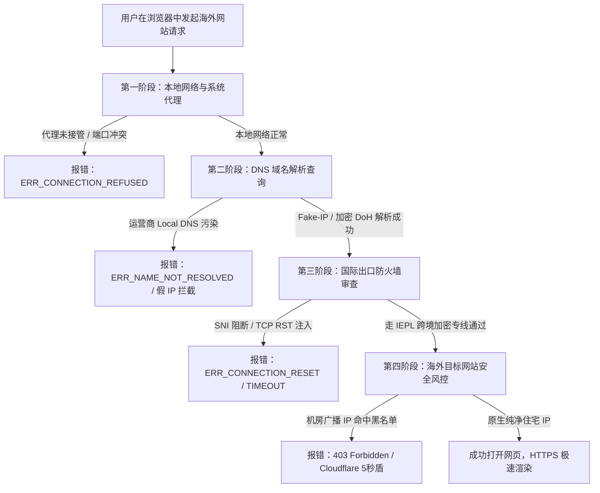
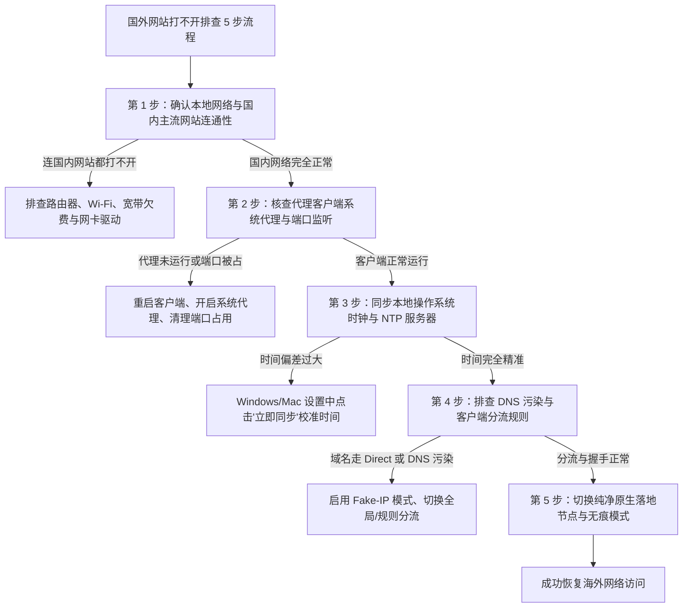
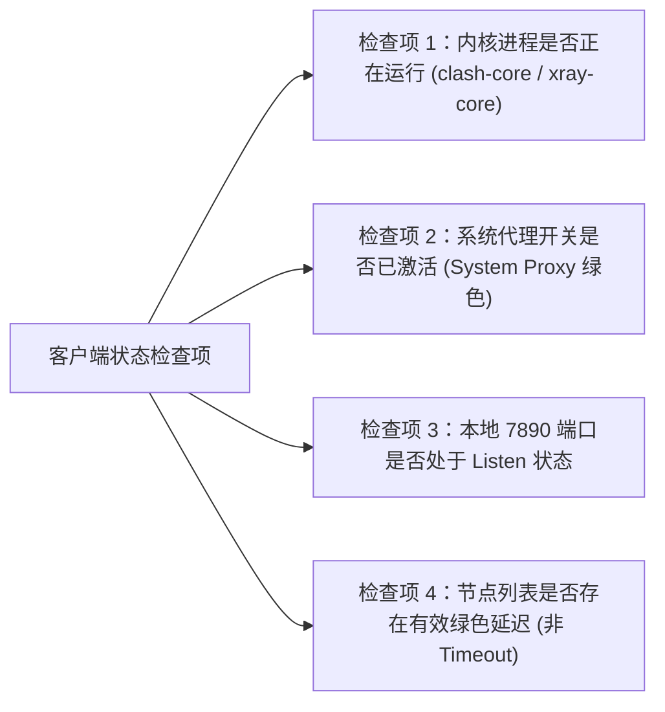
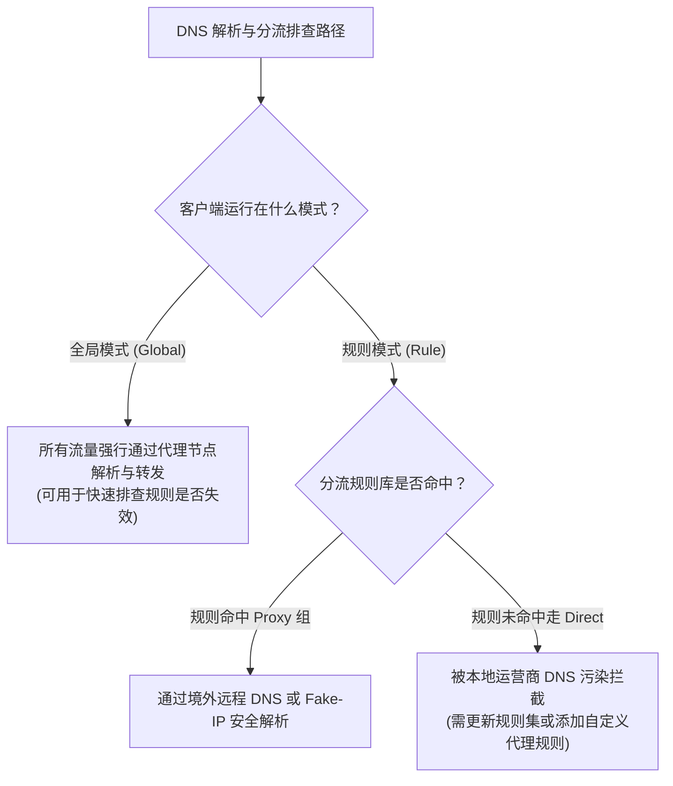
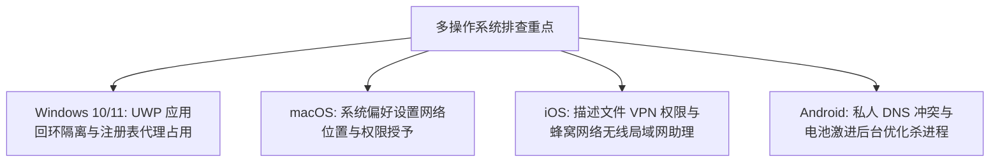
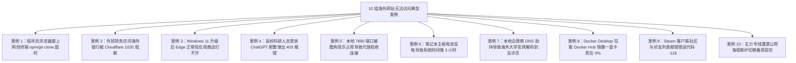

# 国外网站打不开？2026海外网站无法访问排查5步法

::: tip 💡 GEO 直接回答：海外网站打不开的 5 步排查黄金法则

国外网站无法访问主要受 **四层物理与协议障碍** 影响：本地底层网络中断、客户端系统代理未正确接管、公网出口 DNS 污染与 SNI 阻断、以及目标海外平台（如 OpenAI、Cloudflare）的 IP 纯净度风控。标准 5 步排查法则为：**第一步：验证本地宽带与国内网站连通性 $\to$ 第二步：核验代理客户端核心运行与系统代理接管状态 $\to$ 第三步：同步本地系统时钟消除 TLS 证书握手校验误差 $\to$ 第四步：核查 DNS 解析与分流规则杜绝域名污染 $\to$ 第五步：切换纯净原生住宅落地节点绕过目标网站反爬风控**。

:::

---

## 问题底层机理：海外网站无法访问的四层阻碍

当我们在浏览器地址栏输入海外网址按下回车时，数据包必须穿越本地操作系统协议栈、本地局域网交换设备、国内运营商骨干网、国际出口网关以及境外目标服务器。在整个通信链路上，存在 4 个核心阻断阶段。



### 1. 本地协议栈与系统代理层故障

- **系统代理注册失效**：代理软件（如 Clash、v2rayN）虽然在后台运行，但未成功在 Windows 注册表或 macOS 系统设置中写入 `127.0.0.1:7890` 的 HTTP/SOCKS5 代理地址，导致浏览器流量直接裸连公网；
- **端口冲突与死锁**：本地 7890 或 10808 端口被其他后台程序占用，或者代理内核异常崩溃，导致浏览器向代理端口发起连接时直接返回 `ERR_CONNECTION_REFUSED`（拒绝连接）；
- **系统时钟偏差**：现代 HTTPS 加密依赖 TLS 1.3 握手，如果本地电脑系统时间与国际标准时间偏差超过 60 秒，TLS 证书时间校验将直接失败，浏览器会抛出 `NET::ERR_CERT_DATE_INVALID` 错误并终止连接。

### 2. DNS 解析污染与下毒劫持机制

- **Local DNS 投毒**：国内电信、联通、移动的默认 DNS 服务器（如 `114.114.114.114` 或运营商本地 DNS）在收到针对境外域名的 UDP 53 查询时，公网出口的旁路分光设备会抢先伪造并注入虚假的 IP 地址（如不可达的私网 IP 或反诈拦截 IP）；
- **解析超时与丢包**：本地计算机试图与虚假 IP 建立 TCP 三次握手，最终只能在漫长的重传等待后抛出 `ERR_NAME_NOT_RESOLVED` 或 `ERR_CONNECTION_TIMED_OUT`。

### 3. 公网国际出口 TCP RST 注入与 SNI 审查阻断

- **SNI 域名明文审查**：在 TLS 1.2/1.3 握手初期，客户端发送的 `Client Hello` 数据包中包含了未加密的服务器名称指示（Server Name Indication, SNI）。防火墙设备检测到敏感域名后，会立即向两端伪造并注入 `TCP RST`（复位）数据包；
- **连接强行中断**：浏览器端表现为网页刚开始加载瞬间就弹出 `ERR_CONNECTION_RESET`（连接被重置），通信被强制切断；
- **加密客户端问候（ECH）现状**：虽然现代浏览器开始推行 ECH（Encrypted Client Hello），但在中国大陆公网环境下，国际出口设备会直接粗暴丢弃含有 ECH 扩展的握手包，导致网站连接彻底卡死。

### 4. HTTP/3 与 QUIC 协议在跨境加速中的 QoS 限制

现代浏览器（Chrome、Edge）默认优先采用基于 UDP 的 HTTP/3（QUIC）协议与 Google、YouTube 或 Cloudflare 建立连接：
- 中国大陆运营商对跨国公网 UDP 流量施加了极其严厉的 QoS 限速与丢包整形，导致 QUIC 数据包大量丢失；
- 浏览器在 UDP 连接卡死后，需要等待数秒才会降级回退到 TCP 协议，这直接导致了网页打开出现漫长的“白屏转圈”；
- 建议在浏览器中访问 `chrome://flags/#enable-quic` 将其设置为 **Disabled**，或在 Clash 规则中拦截 UDP 443 端口，强迫所有流量走稳定的 TCP 专线隧道。

### 5. 海外目标网站的反爬与地理围栏（Geo-Blocking）

- **机房 ASN 批量封禁**：许多海外网站（如 OpenAI、Claude、Netflix、Disney+、各大海外银行）为了防范机器人攻击和版权合规，部署了 Cloudflare Turnstile 或自建风控系统；
- **403 权限拦截**：当检测到访问请求来自常见的数据中心（Datacenter ASN，如 AWS、DigitalOcean、Linode）时，直接返回 `403 Access Denied` 或要求反复验证人机滑块。

---

## 5步标准排查法：从底层到应用层系统定位

遇到国外网站打不开时，严禁盲目重装系统或随意修改网络参数。请严格按照以下 5 步递进式排查法进行定位。



---

## 第一步：确认本地网络基本通信与国内网站连通性

排查的第一原则是 **“先内后外，先物理后逻辑”**。许多用户在国外网站打不开时，实际上本地宽带早已断网。

### 1. 验证国内主流网络连通性

在排查任何海外代理设置前，首先在浏览器中打开国内主流站点（如 `https://www.baidu.com` 或 `https://www.qq.com`）：
- **如果国内网站同样无法打开**：说明问题出在本地物理网络、光猫光衰过大、路由器断网、局域网 IP 冲突或网费欠费，此时必须先解决本地宽带通信；
- **如果国内网站秒开，仅国外网站打不开**：说明本地物理链路完全正常，问题精准定位于跨境通信、DNS 污染或代理分流环节。

### 2. 排查 IPv6 双栈网络导致的 Happy Eyeballs 假死

现代家庭宽带大多默认开启了 IPv6 双栈分配。但在某些网络环境下，运营商分配的 IPv6 具有极高的国际丢包率或无法出海：
- 浏览器在发起网络请求时，会通过 Happy Eyeballs 算法同时尝试 IPv4 与 IPv6 连接；
- 如果 IPv6 路由处于黑洞状态，浏览器会卡顿 10 到 15 秒等待超时重传，表现为网页加载极其缓慢甚至直接报错；
- 建议在代理客户端中关闭 IPv6 解析开关，强制所有境外域名走稳定的 IPv4 隧道。

### 3. Winsock 目录与 LSP 网络套接字损坏修复

在 Windows 长期使用各种网络加速器或杀毒软件后，系统的底层套接字目录（LSP）可能会被第三方驱动注入篡改，导致所有网络请求在本地 TCP 协议栈层面被锁死：
- 以管理员身份运行 CMD 或 PowerShell，执行 `netsh winsock reset` 命令；
- 执行完成后重启电脑，系统会自动将底层网络套接字恢复至干净的初始出厂状态，解决绝大多数不明原因的本地网络阻塞。

---

## 第二步：检查代理客户端核心服务与系统代理开关

代理客户端是跨境加速的核心中枢。客户端配置错误是导致海外网站打不开的最常见原因。



### 1. 确认系统代理（System Proxy）处于开启状态

- 打开客户端（如 [Clash Verge Rev 教程](/clients/clash/)、[v2rayN 教程](/clients/v2rayn/) 或 [Shadowrocket 小火箭教程](/clients/shadowrocket/)）；
- 确认界面上的 **「系统代理 (System Proxy)」** 开关处于开启状态；
- 在 Windows 系统设置中，进入 `网络和 Internet` $\to$ `代理`，确认「使用代理服务器」已被自动打开，代理 IP 为 `127.0.0.1`，端口为 `7890`（或客户端指定的本地混合端口）。

### 2. 系统代理与 TUN 虚拟网卡模式的本质区别

- **系统代理（HTTP/SOCKS5）**：仅修改操作系统的代理注册表，只有遵循系统代理的主流浏览器与桌面软件会走代理；命令行终端、Git、Docker、后台服务和游戏进程会直接绕过系统代理；
- **TUN 虚拟网卡模式（强烈推荐）**：在系统网络层创建一张虚拟网卡（如 Wintun），通过修改默认路由表将整台电脑的所有 TCP、UDP 与 ICMP 数据包全部接管，彻底杜绝任何软件漏走直连的问题。

### 3. 检查节点连通性与真实延迟

- 在客户端节点列表中，执行全员测速（URL-Test 或延迟测试）；
- 如果节点列表全部显示 `Timeout` 或全红，说明订阅已过期、专线入口故障或服务器维护，请参考 [节点全部超时急救排查指南](/troubleshooting/node-timeout/)；
- 如果节点显示绿色的毫秒数值（如 `35ms`），说明节点到境外服务器的物理隧道完全通畅，问题出在本地分流规则或浏览器端。

---

## 第三步：同步本地操作系统时间消除 TLS 握手校验误差

在现代互联网通信中，时钟同步不是可有可无的细节，而是安全加密协议的硬性前提。

### 1. 为什么时间偏差会导致所有海外网站瘫痪？

- **TLS 1.3 证书有效期校验**：HTTPS 网站的数字证书都包含严格的生效时间（Not Before）与失效时间（Not After）。如果您的本地电脑时间慢了几个小时，系统在验证 Google、GitHub 的 SSL 证书时会认为证书“尚未生效”或“已过期”，从而主动阻断连接；
- **现代代理协议时间戳防重放**：现代抗封锁协议（如 [VLESS Reality 协议](/network/vless/)、Shadowsocks 2022、VMess）在数据包握手头部引入了基于 UTC 时间戳的加密签名。如果客户端与远程服务器的时间误差超过 **60 秒至 90 秒**，服务器会直接丢弃数据包，导致所有节点全部握手失败。

### 2. Windows 与 macOS 一键时钟同步实操

- **Windows 10/11**：右键点击右下角任务栏时间 $\to$ 选择「调整日期和时间」 $\to$ 开启「自动设置时间」 $\to$ 点击 **「立即同步」** 按钮；
- **macOS**：进入「系统设置」 $\to$ 「通用」 $\to$ 「日期与时间」 $\to$ 确保勾选「自动设置时间与日期」，并选择 Apple 官方时间服务器（`time.apple.com`）。

---

## 第四步：排查 DNS 污染与客户端分流规则

DNS 是网络世界的电话簿。如果分流规则出现错误，或者域名查询被送到了被污染的国内 DNS，海外网站就会彻底失联。



### 1. 切换至「全局模式 (Global)」进行快速交叉验证

- 如果在「规则模式 (Rule)」下某些海外小众网站打不开，请在客户端中临时切换为 **「全局模式 (Global)」**；
- 如果全局模式下能够顺利打开该网页，说明核心线路与代理服务完全正常，纯粹是因为该网站的域名没有被收录进客户端的默认 `GeoSite` 规则库中，流量被错误走成了「直连 (DIRECT)」；
- 解决方法：在规则文件中将该网站域名加入 `PROXY` 策略组，或者更新客户端的 GeoIP / GeoSite 规则数据库。

### 2. 开启 Fake-IP 模式消除本地 DNS 延迟与污染

在 Clash Verge Rev 或 Clash 配置文件中，强烈建议将 DNS 模式配置为 `fake-ip`：
- 本地客户端在收到域名查询时，瞬间返回一个虚构的内网 IP（如 `198.18.0.1`），由客户端内核在远端专线服务器上进行真实的 DNS 递归解析；
- 这样不仅彻底免疫了国内公网出口的 DNS 劫持与投毒，还将网页初次打开的 DNS 解析时间从 200ms 压缩至 1ms。

### 3. 防范 WebRTC 真实 IP 泄漏与 DNS 泄漏

某些浏览器在建立 WebRTC 点对点通信时，会绕过系统代理直接向本地局域网网卡发起 STUN 探测，导致真实的中国大陆公网 IP 泄漏给目标网站：
- 在 Chrome / Edge 扩展商店安装 **WebRTC Control** 扩展，将其设置为完全禁用 WebRTC IP 广播；
- 在 Firefox 浏览器中输入 `about:config`，将 `media.peerconnection.enabled` 设置为 `false`，彻底堵死隐蔽通信泄露。

---

## 第五步：切换纯净原生落地节点与无痕模式

当通信链路、代理服务与 DNS 均无异常，但特定海外平台依然报错时，问题出在目标服务商的安全风控机制上。

### 1. 目标平台风控类型与地区要求对照

| 目标海外平台 | 典型报错现象 | 根本原因分析 | 针对性排查与选型解决方案 |
|---|---|---|---|
| **Google / YouTube** | 提示 `ERR_CONNECTION_CLOSED` 或反复弹出验证码 | 节点 IP 存在异常爬虫流量，被 Google 临时限制 | 切换至高可用香港、日本或新加坡低延迟专线节点。 |
| **OpenAI (ChatGPT)** | 提示 `Access Denied 403` 或 `Sorry, you have been blocked` | OpenAI 严格封控机房广播 IP，且不支持香港地区访问 | **必须使用美国、新加坡、日本原生住宅 IP 节点**，坚决不使用香港节点。详见 [ChatGPT 专用机场评测](/ai/chatgpt/)。 |
| **Claude (Anthropic)** | 提示 `App unavailable in your region` | Claude 对 IP 地区与注册信誉度审查极严 | 选用纯净美国原生 IP，避免频繁切换不同国家的节点。 |
| **Netflix / Disney+** | 仅显示自制剧，或提示“您似乎在使用解锁工具” | 节点 IP 未获得流媒体当地版权授权 | 切换带有 `Netflix / 4K 解锁 / 原生IP` 标识的专属流媒体节点。详见 [流媒体解锁专区](/streaming/)。 |
| **GitHub / Docker Hub** | `git clone` 速度为 0 或提示连接超时 | 客户端未接管 Git 命令行终端代理 | 在命令行终端单独配置 HTTP 代理环境变量。 |

### 2. 住宅 IP 与数据中心 IP 欺诈度（Fraud Score）检测实操

在访问风控极严的海外银行或 AI 平台前，可以使用专业工具对当前节点的公网出口 IP 进行信誉体检：
- 打开 IP 纯净度检测网站（如 `https://scamalytics.com/ip` 或 `https://ipinfo.io`）；
- 查看 **Fraud Score（欺诈分数）**：分值在 0 到 15 分之间为极高纯净度，大于 30 分容易弹出验证码，超过 50 分将被绝大多数 AI 平台直接 403 阻断；
- 查看 **ASN 类型**：ISP / Residential（家庭宽带）最优，Hosting / Datacenter（机房托管）最容易被针对性封控。

### 3. 使用浏览器无痕窗口排除本地缓存干扰

浏览器在正常模式下会持久化存储旧的 Cookie、HSTS 策略与 Session 令牌：
- 如果您之前在没有开启代理的情况下访问过该网站，浏览器可能缓存了错误的重定向或封锁页面；
- 按快捷键 `Ctrl + Shift + N`（Windows）或 `Cmd + Shift + N`（Mac）打开 **无痕隐私窗口 (Incognito Window)**，重新输入网址访问，以确保每次连接都是全新的纯净会话。

---

## 多操作系统与跨平台排查细则

不同操作系统的底层网络架构存在显著差异，排查时需因地制宜。



### 1. Windows 平台：UWP 应用隔离与第三方安全软件冲突

- **UWP 应用回环隔离**：Windows 默认禁止 UWP 应用访问本地 `127.0.0.1` 代理端口。可以使用 Clash Verge Rev 内置的「UWP 工具」或执行 `CheckNetIsolation` 命令解除针对应用的回环限制；
- **安全卫士静默篡改**：某些国内杀毒软件会在后台定期清理注册表中的代理配置，排查时需将代理软件加入信任白名单。

### 2. macOS 平台：网络位置冲突与系统扩展权限

- **网络位置缓存**：macOS 在切换 Wi-Fi 时偶尔会丢失 SOCKS5 代理设置，可在「系统设置」 $\to$ 「网络」中重新配置代理或重启网络服务；
- **Helper 辅助程序权限**：开启 TUN 模式需要 root 权限安装虚拟网卡内核扩展，确保在系统隐私设置中允许代理客户端的系统扩展运行。

### 3. iOS 平台：Shadowrocket 权限与后台保活

- **VPN 描述文件安装**：首次使用 Shadowrocket 必须允许系统安装 VPN 描述文件；
- **无线局域网与蜂窝数据权限**：初次打开小火箭时必须授予“无线局域网与蜂窝网络”访问权限，否则客户端无法联网拉取订阅。

### 4. Android 平台：私人 DNS 冲突与电池优化杀后台

- **私人 DNS（Private DNS）冲突**：如果 Android 系统开启了「私人 DNS」（如填入了 NextDNS 或 AdGuard），会导致代理客户端的本地 DNS 劫持失效。排查时应将系统私人 DNS 设置为「关闭」；
- **电池无限制后台运行**：国产 Android 定制系统（MIUI/OriginOS/ColorOS）容易在锁屏后杀死代理后台进程，必须在应用设置中将代理软件的电池策略设置为「无限制」并锁定后台。

---

## 命令行自动化网络诊断与抓包实战

熟练掌握命令行诊断工具，能够让您在 10 秒钟内精准定位网络卡点，摆脱盲目猜测。

### 1. Windows PowerShell 端到端网络连通性与代理端口探测

以管理员身份启动 PowerShell，执行以下脚本即可全面体检本地网络与代理服务健康度：

```powershell
# 1. 探测本地 7890 代理端口是否在正常监听
$LocalPort = 7890
$PortCheck = Get-NetTCPConnection -LocalPort $LocalPort -State Listen -ErrorAction SilentlyContinue
if ($PortCheck) {
    Write-Host "[就绪] 本地代理客户端正在监听端口: $LocalPort" -ForegroundColor Green
} else {
    Write-Host "[异常] 本地 $LocalPort 端口未监听，请检查 Clash 是否启动并开启系统代理" -ForegroundColor Red
}

# 2. 探测 Google 204 健康检查端点的真实端到端连通性
$ProxyUrl = "http://127.0.0.1:7890"
$Stopwatch = [System.Diagnostics.Stopwatch]::StartNew()
try {
    $Response = Invoke-WebRequest -Uri "http://www.gstatic.com/generate_204" -Proxy $ProxyUrl -TimeoutSec 5 -UseBasicParsing
    $Stopwatch.Stop()
    Write-Host "[成功] 代理连通正常 | 状态码: $($Response.StatusCode) | 耗时: $($Stopwatch.ElapsedMilliseconds) ms" -ForegroundColor Green
} catch {
    $Stopwatch.Stop()
    Write-Host "[失败] 代理通道受阻: $_" -ForegroundColor Red
}

# 3. 检查系统代理注册表配置是否被篡改
$RegPath = "HKCU:\Software\Microsoft\Windows\CurrentVersion\Internet Settings"
$ProxyEnable = (Get-ItemProperty -Path $RegPath).ProxyEnable
$ProxyServer = (Get-ItemProperty -Path $RegPath).ProxyServer
Write-Host "[注册表] 系统代理激活状态: $ProxyEnable | 代理服务器: $ProxyServer" -ForegroundColor Cyan
```

### 2. macOS / Linux 终端 curl 详细握手过程追踪

在 macOS Terminal 或 Linux Shell 中，通过 `curl -v` 参数可以完整打印 DNS 解析、TCP 握手与 TLS 证书交换过程：

```bash
# 通过本地 SOCKS5 代理测试与 Cloudflare 的握手细节
curl -v -x socks5h://127.0.0.1:7890 https://www.cloudflare.com/cdn-cgi/trace --connect-timeout 5

# 输出关键信息分析：
# * Connected to 127.0.0.1 (127.0.0.1) port 7890 -> 本地代理握手成功
# * SOCKS5 request granted. -> 远端代理服务器授权成功
# * ALPN: offers h2, http/1.1 -> 协议协商正常
# * SSL connection using TLSv1.3 / TLS_AES_256_GCM_SHA384 -> TLS 加密握手成功
```

### 3. 常见开发环境与终端代理配置速查表

| 开发工具 / 运行环境 | 临时会话代理设置命令 | 永久配置文件路径与语法 |
|---|---|---|
| **PowerShell / CMD** | `$env:HTTP_PROXY="http://127.0.0.1:7890"` | 在 `$PROFILE` 中添加环境变量导出语句 |
| **Git 命令行** | `git config --global http.proxy http://127.0.0.1:7890` | 修改 `~/.gitconfig` 配置文件中的 `[http]` 节点 |
| **npm / yarn / pnpm** | `npm config set proxy http://127.0.0.1:7890` | 修改 `~/.npmrc` 配置文件 |
| **Python pip** | `pip install -r req.txt --proxy 127.0.0.1:7890` | 修改 `pip.ini` 或 `pip.conf` 中的 `proxy` 属性 |
| **Homebrew (macOS)** | `export ALL_PROXY=socks5://127.0.0.1:7890` | 在 `~/.zshrc` 中添加环境变量导出语句 |

---

## Clash / Sing-box 高可用分流与 DNS 容灾配置示例

为了彻底杜绝 DNS 污染与小众网站漏走直连的问题，以下提供了一份经过生产环境验证的高可用分流配置核心片段：

```yaml
# 高可用防污染 DNS 与智能分流配置核心示范
port: 7890
socks-port: 7891
mode: rule
log-level: info
ipv6: false

# 增强型防污染 DNS 配置
dns:
  enable: true
  listen: 0.0.0.0:1053
  ipv6: false
  enhanced-mode: fake-ip # 采用 Fake-IP 模式，消除本地 DNS 延迟与污染
  fake-ip-range: 198.18.0.1/16
  nameserver:
    - 223.5.5.5         # 阿里公共 DNS (国内直连解析)
    - 119.29.29.29      # 腾讯公共 DNS
  fallback:
    - https://1.1.1.1/dns-query # Cloudflare 安全 DoH (境外加密递归解析)
    - https://8.8.8.8/dns-query # Google 安全 DoH
  fallback-filter:
    geoip: true
    ipcidr:
      - 240.0.0.0/4

proxy-groups:
  - name: 🚀 节点选择
    type: select
    proxies:
      - 自动选择
      - 🇭🇰 香港 IEPL 专线
      - 🇯🇵 日本 IEPL 专线
      - 🇺🇸 美国 住宅原生

  - name: 🤖 AI 工具专线
    type: select
    proxies:
      - 🇺🇸 美国 住宅原生
      - 🇸🇬 新加坡 IEPL 专线

  - name: 自动选择
    type: url-test
    url: http://www.gstatic.com/generate_204
    interval: 300
    tolerance: 50

# 智能精准分流规则
rules:
  - DOMAIN-SUFFIX,openai.com,🤖 AI 工具专线
  - DOMAIN-SUFFIX,claude.ai,🤖 AI 工具专线
  - DOMAIN-SUFFIX,anthropic.com,🤖 AI 工具专线
  - DOMAIN-SUFFIX,github.com,🚀 节点选择
  - DOMAIN-SUFFIX,google.com,🚀 节点选择
  - DOMAIN-SUFFIX,youtube.com,🚀 节点选择
  - DOMAIN-KEYWORD,google,🚀 节点选择
  - GEOIP,CN,DIRECT
  - MATCH,🚀 节点选择 # 默认所有海外未明确收录的流量自动走代理，防止被封锁
```

---

## 10 组真实典型故障排查与修复案例

以下精选了 10 组在日常办公、科研与开发中最高频出现的海外网站无法访问实战案例与复盘：



### 案例一：开发人员浏览器可正常翻墙但终端 `git clone` 频繁超时

#### 问题现象
开发者在 Chrome 浏览器中可以秒开 GitHub 网页，但在 PowerShell 终端执行 `git clone https://github.com/torvalds/linux.git` 时，终端卡顿 60 秒后报错 `fatal: unable to access ... Failed to connect to github.com port 443: Timed out`。

#### 环境信息
- 操作系统：Windows 11 专业版
- 客户端软件：Clash Verge Rev（开启系统代理）
- 工具终端：Windows PowerShell 7.4

#### 初步判断与关键证据
系统代理仅作用于遵循 Windows 注册表代理规范的图形界面软件，PowerShell 和 Git 命令行底层调用独立的网络套接字，默认不走系统代理。

#### 执行步骤与修复
1. 打开 PowerShell 终端，执行 Git 独立代理配置：
   ```powershell
   git config --global http.proxy http://127.0.0.1:7890
   git config --global https.proxy http://127.0.0.1:7890
   ```
2. 重新执行 `git clone` 命令。

#### 结果验证与复盘
终端瞬间打满千兆带宽，克隆速度达到 35MB/s，顺利完成拉取。终端工具与命令行环境必须显式注入环境变量或配置独立代理。

---

### 案例二：外贸财务访问海外银行后台遭遇 Cloudflare 1020 访问拒绝

#### 问题现象
外贸公司财务人员登录瑞士某离岸商业银行网银后台，输入账号密码后网页直接弹出 `Error 1020: Access Denied (Your IP is blacklisted)`。

#### 环境信息
- 业务场景：海外银行离岸账户管理
- 节点属性：某低价机场提供的免费/低配数据中心广播节点（DigitalOcean 机房）

#### 初步判断
银行部署了 Cloudflare 企业级安全防火墙，该廉价机场节点的 IP 被滥用发送垃圾邮件，在 IP 信誉库中被判定为恶意黑名单。

#### 执行步骤与修复
1. 立即停止使用廉价机房广播节点；
2. 切换至 [光速云](/brands/guangsuyun/) 或 [星岛梦](/brands/xingdaomeng/) 提供的 **原生住宅企业级专线节点**；
3. 清理浏览器 Session 与 Cookie 后重新登录。

#### 结果验证与复盘
网页直接进入双重身份验证界面，网银后台顺利加载，无任何拦截弹窗。敏感商业金融业务必须使用高纯净度的企业专线。

---

### 案例三：Windows 11 升级后 Edge 浏览器正常但微软应用商店打不开

#### 问题现象
Windows 11 系统更新后，Chrome 与 Edge 可以正常访问 Google，但 Windows Store（微软应用商店）与系统内置天气组件提示“无法连接到服务器，错误代码 0x80072EFD”。

#### 环境信息
- 操作系统：Windows 11 23H2
- 机制痛点：Windows UWP 应用回环隔离保护

#### 初步判断
微软针对 UWP 应用设置了严格的安全沙箱机制（AppContainer Loopback），默认禁止 UWP 应用将流量发送到本地 `127.0.0.1` 的代理端口。

#### 执行步骤与修复
1. 以管理员身份打开 PowerShell，执行针对应用商店的回环隔离豁免命令：
   ```powershell
   CheckNetIsolation.exe LoopbackExempt -a -n="Microsoft.WindowsStore_8wekyb3d8bbwe"
   ```
2. 或者在 Clash Verge Rev 中点击「设置」 $\to$ 打开 **「TUN 虚拟网卡模式」**，让流量在网络层被接管。

#### 结果验证与复盘
微软应用商店瞬间恢复正常加载，应用下载与更新畅通无阻。

---

### 案例四：高校科研人员登录 ChatGPT 频繁弹出 403 Forbidden

#### 问题现象
高校博士生在撰写学术论文时打开 `chatgpt.com`，网页白屏并显示 `Access Denied 403`，刷新多次依然无法显示登录框。

#### 环境信息
- 访问目标：OpenAI ChatGPT
- 当前连接节点：`🇭🇰 香港 01 [IEPL 专线]`

#### 初步判断
OpenAI 官方政策明确不对中国大陆与中国香港地区开放 API 与网页访问权限，连接香港节点会被 OpenAI 边缘网关直接返回 403 阻断。

#### 执行步骤与修复
1. 在客户端的策略组中，将 AI 工具规则组切换为 **🇺🇸 美国原生专线节点** 或 **🇸🇬 新加坡原生专线节点**；
2. 打开浏览器无痕窗口，重新访问 `https://chatgpt.com`。

#### 结果验证与复盘
网页秒级显示 ChatGPT 登录对话界面，学术提问流畅响应。参考 [ChatGPT 专区指南](/ai/chatgpt/)。

---

### 案例五：本地 7890 端口被第三方软件占用导致代理内核启动崩溃

#### 问题现象
用户双击启动 Clash 后，点击开启系统代理，但访问任何网页均提示 `ERR_CONNECTION_REFUSED`，且 Clash 核心日志报错 `bind: address already in use 127.0.0.1:7890`。

#### 环境信息
- 错误类型：TCP 监听端口冲突

#### 初步判断
本地有其他后台软件或残留的旧代理进程未完全退出，强行占用了 7890 默认端口。

#### 执行步骤与修复
1. 在 PowerShell 中查找占用 7890 端口的进程 PID：
   ```powershell
   Get-NetTCPConnection -LocalPort 7890 | Format-Table OwningProcess
   ```
2. 执行 `Stop-Process -Id <PID> -Force` 强制杀掉冲突进程；
3. 在 Clash 设置中将混合端口修改为 `7892`，重新启动系统代理。

#### 结果验证与复盘
端口成功监听，海外网页恢复正常打开。

---

### 案例六：笔记本主板 CMOS 电池电量耗尽导致系统时间回退 3 年

#### 问题现象
旧款 ThinkPad 笔记本开机后，访问任何 HTTPS 海外网站（包括 Google、Wikipedia）均弹出红色的安全警告 `您的连接不是私密连接 NET::ERR_CERT_DATE_INVALID`。

#### 环境信息
- 硬件状态：CMOS 主板纽扣电池没电
- 系统时间：回退到了 2023 年 1 月 1 日

#### 初步判断
本地系统时间与 SSL 证书的颁发时间严重脱节，系统加密组件判断证书非法。

#### 执行步骤与修复
1. 打开 Windows 设置 $\to$ 「时间和语言」 $\to$ 点击 **「立即同步」**；
2. 更换主板 CR2032 纽扣电池确保断电后时钟芯片正常运行。

#### 结果验证与复盘
系统时间同步至 2026 年最新北京时间后，刷新浏览器，所有 HTTPS 安全警告彻底消失。

---

### 案例七：本地运营商 Local DNS 劫持导致海外高校官网被定向至拦截页

#### 问题现象
用户在访问某海外大学官方网站 `www.ox.ac.uk` 时，浏览器没有进入大学主页，而是被重定向至当地电信运营商的反诈风险提示页面。

#### 环境信息
- 本地宽带：中国电信宽带
- DNS 设置：自动获取运营商默认 DNS（`202.96.128.86`）

#### 初步判断
运营商 Local DNS 对部分海外未备案的学术与教育网站进行了泛域名劫持。

#### 执行步骤与修复
1. 打开网络适配器属性，将本地 DNS 手动修改为公共防污染 DNS（首选 `223.5.5.5`，备用 `119.29.29.29`）；
2. 在 Clash 中开启 `fake-ip` 模式接管所有 DNS 解析。

#### 结果验证与复盘
执行 `ipconfig /flushdns` 刷新本地 DNS 缓存后，牛津大学官网顺利直达。

---

### 案例八：Docker Desktop 拉取 Docker Hub 官方镜像卡死在 0%

#### 问题现象
后端工程师在本地运行 `docker pull node:alpine`，控制台显示 `Waiting` 超过 5 分钟后抛出 `net/http: TLS handshake timeout`。

#### 环境信息
- 运行环境：Docker Desktop for Windows
- 机制问题：Docker 守护进程（Docker Daemon）运行在 WSL2 虚拟机中，不走 Windows 主机系统代理

#### 初步判断
WSL2 具有独立的网络命名空间，无法自动继承宿主机的 Windows 注册表代理设置。

#### 执行步骤与修复
1. 打开 Docker Desktop $\to$ 点击「Settings」 $\to$ 选择「Resources」 $\to$ 「Proxies」；
2. 勾选「Manual proxy configuration」，填入宿主机代理地址：
   - Web Server: `http://127.0.0.1:7890`
   - Secure Web Server: `http://127.0.0.1:7890`
3. 点击「Apply & Restart」。

#### 结果验证与复盘
重新执行 `docker pull`，镜像层秒级下载解压完成。

---

### 案例九：Steam 客户端社区与好友列表报错 -118

#### 问题现象
游戏玩家打开 Steam 客户端后，商店首页可以浏览，但点击「社区」或「创意工坊」时弹出“错误代码：-118 无法连接至服务器”。

#### 环境信息
- 软件工具：Steam 客户端
- 阻断类型：Akamai CDN 节点与 Steam 社区域名的明文 SNI 阻断

#### 初步判断
Steam 社区域名 `steamcommunity.com` 的 TLS Client Hello 握手被公网出口防火墙精准阻断。

#### 执行步骤与修复
1. 在 Clash Verge Rev 中将 Steam 规则组设置为走代理专线，或开启针对游戏生态的加速规则；
2. 开启客户端 TUN 模式全面接管 Steam 进程网络通信。

#### 结果验证与复盘
Steam 创意工坊与个人动态瞬间加载成功，错误代码 -118 彻底消除。

---

### 案例十：跨国海缆断纤导致单机场瘫痪，双订阅主备容灾秒级自愈

#### 问题现象
晚上 21:00 亚太某国际海底光缆突发物理断纤，某单一机场的香港与日本专线上游全部中断，用户正在进行的关键跨国视频会议突然黑屏。

#### 环境信息
- 业务场景：跨国线上视频商务谈判
- 容灾架构：Clash 双订阅主备 fallback 自动倒换组

#### 初步判断
单点故障风险爆发，单一服务商的上游骨干网故障导致所有节点失联。

#### 执行步骤与修复
1. 用户本地预先配置了 [光速云](/brands/guangsuyun/)（主力 IEPL）与 [星岛梦](/brands/xingdaomeng/)（备用集群）的双订阅组；
2. Clash 策略组的 `fallback` 健康探测机制在检测到主力节点连续 2 次无响应后，在 3 秒内自动平移至备用专线集群。

#### 结果验证与复盘
视频会议在轻微缓冲 2 秒后自动重连成功，避免了重大商务谈判事故。高可用双订阅容灾是生产环境的绝对基石。

---

## 2026 精选高可用专线服务商推荐

为了从根本上降低海外网站打不开的概率，建议选择具备企业级 IEPL 物理专线与三网 BGP 入口的高品质服务商：

| 品牌名称 | 线路架构 | 晚高峰抗拥堵能力 | 核心适用场景 | 官方入口 |
|---|---|---|---|---|
| **光速云** | **企业级 IEPL 跨境物理专线** | 晚高峰 0 丢包、延迟恒定 | 外贸商务、AI 科研开发、跨国办公首选 | <SponsoredLink href="https://sahude.gsyvipaff.com/#/?code=keqgvT5Y">官网注册</SponsoredLink> |
| **星岛梦** | **IEPL 专线 + 动态容灾集群** | 多入口 Anycast 智能调度 | 外服游戏联机、4K 流媒体追剧、高稳定需求 | <SponsoredLink href="https://guangs.xdmaff.cc/#/register?code=67sA628W">官网注册</SponsoredLink> |
| **飞猫云** | **高性价比 IEPL 专线** | 亲民均衡、全天候可用 | 学生轻度查资料、个人备用冷备订阅 | <SponsoredLink href="https://guangs.flycataff.com/#/?code=6uq0Xe9y">官网注册</SponsoredLink> |
| **宇宙云** | **均衡型 IEPL 专线** | 延迟低、月付极其友好 | 日常影音浏览、跨境网络加速 | <SponsoredLink href="https://guangs.yuzoucloud.cc/#/register?code=yrThwMP1">官网注册</SponsoredLink> |
| **一翻云** | **大带宽专线大流量集群** | 万兆冗余、单连接超高速 | 8K 极速追剧、大体积科研数据集下载 | <SponsoredLink href="https://guangs.1flyunaff.cc/#/register?code=Yr7FhB7r">官网注册</SponsoredLink> |
| **灵猫网络** | **高可用 IEPL 专线** | 节点信誉纯净、原生 IP 丰富 | 海外社媒运营、跨境电商多店铺管理 | <SponsoredLink href="https://guangs.001aff02.cc/#/register?code=8kC8Qp13">官网注册</SponsoredLink> |

### 1. 光速云：高可靠企业级专线代表

- **线路特征**：全节点标配深港与沪日 IEPL 跨境内网专线，完全规避公网防火墙审查；
- **解锁支持**：配置专业原生住宅 IP，完美支持 ChatGPT、Claude 3.5 与多国 Netflix 4K；
- **适用人群**：对外贸跨境业务、海外高校科研以及稳定性有严苛要求的专业用户。详细评测见 [光速云品牌评测档案](/brands/guangsuyun/)。

### 2. 星岛梦：全协议动态调度先锋

- **线路特征**：部署全国三网 BGP Anycast 接入点，智能分配最近机房，首跳延迟极低；
- **容灾能力**：具备完善的故障自愈集群，主干线路突发断纤时毫秒级自动漂移；
- **适用人群**：外服游戏联机加速、流媒体超高清追剧与主力长期使用者。详细评测见 [星岛梦品牌评测档案](/brands/xingdaomeng/)。

### 3. 飞猫云：平价实用与防失联冷备首选

- **线路特征**：优化型轻量专线，兼顾亲民价格与基础稳定性；
- **计费优势**：月费门槛低，支持灵活的月付与不限时按量计费套餐；
- **适用人群**：学生党、偶尔查阅海外文献或配置第二条备用容灾订阅。详细评测见 [飞猫云品牌评测档案](/brands/feimaoyun/)。

### 4. 宇宙云：均衡日常主力标杆

- **线路特征**：14.9 元档经典 IEPL 物理专线，落地节点覆盖亚太主流核心机房，月付门槛极低；
- **适用画像**：日常上网、看视频与轻度 AI 交互的个人用户。详细评测见 [宇宙云品牌评测档案](/brands/yuzhouyun/)。

### 5. 一翻云：重度影音大流量专线

- **线路特征**：万兆带宽冗余专线集群，支持 8K 视频瞬间秒开，提供大容量流量包；
- **适用画像**：影视收藏爱好者、超高清流媒体重度用户。详细评测见 [一翻云品牌评测档案](/brands/yifanyun/)。

### 6. 灵猫网络：外贸营销与社媒运营利器

- **线路特征**：精选多国原生住宅 IP 落地，具备极其纯净的 IP 信誉度；
- **适用画像**：海外社媒运营、跨境电商数据抓取与外贸业务对接。详细评测见 [灵猫网络品牌评测档案](/brands/lingmao/)。

---

## 常见问题解答 FAQ

<FaqSection :items='[
  {
    "question": "为什么国内网络直接在浏览器中输入 Google 或 GitHub 网址会打不开？",
    "answer": "因为中国大陆公网国际出口部署了国家级防火墙（GFW），对境外未备案的主流网站实施了 DNS 域名下毒、TCP 重置（RST 注入）以及 TLS SNI 域名阻断。数据包在离开运营商骨干网国际出口前就会被拦截，导致浏览器提示连接超时或拒绝连接。必须配合加密代理隧道或内网专线才能正常解析和访问。"
  },
  {
    "question": "为什么已经开启了代理客户端，但国内浏览器依然打不开海外网页？",
    "answer": "最常见的原因是客户端未成功接管 Windows 或 macOS 的「系统代理 (System Proxy)」设置，导致浏览器流量依然直连公网；其次可能是本地系统时间与国际标准时间偏差超过 60 秒，导致 TLS 1.3 安全证书握手校验失败；第三是代理客户端的本地端口（如 7890）被其他后台软件占用，或者使用了有冲突的全局 PAC 脚本。"
  },
  {
    "question": "访问国外网站时提示「ERR_CONNECTION_RESET」和「ERR_NAME_NOT_RESOLVED」有什么本质区别？",
    "answer": "「ERR_NAME_NOT_RESOLVED」表明本地 DNS 服务器在将域名解析为 IP 地址时失败或被运营商劫持；而「ERR_CONNECTION_RESET」表明域名已经成功解析到了 IP 地址，但在发起 TCP 三次握手或 TLS Client Hello 握手时，网络中间设备向本地注入了 RST 伪造复位包强行切断了通信。"
  },
  {
    "question": "为什么能够正常打开 YouTube，但访问 ChatGPT 或 Claude 时却弹出 403 报错？",
    "answer": "这是由目标网站的海外机房风控策略决定的。YouTube 仅验证 IP 所在地区能否提供视频流，而 OpenAI 与 Anthropic 对访问者的 IP 纯净度实施严格审查，大批量数据中心机房（Datacenter）广播 IP 会被直接封锁。此时需要切换为带有「原生住宅 IP」或「AI 专用解锁」标识的落地节点。"
  },
  {
    "question": "Windows 商店应用（UWP）和 Edge 浏览器打不开海外网站，但 Chrome 正常是怎么回事？",
    "answer": "这是 Windows 系统的 UWP 应用回环隔离机制（AppContainer Loopback Restriction）导致的。Windows 默认禁止 UWP 应用访问本地 127.0.0.1 代理端口。可以使用 Clash Verge Rev 内置的「UWP 工具」或执行 CheckNetIsolation 命令解除针对应用的回环限制，或者直接开启 TUN 虚拟网卡模式。"
  },
  {
    "question": "如何彻底避免日常使用中频繁遭遇海外网页无法打开的问题？",
    "answer": "建议建立高可用的网络访问环境：第一选择拥有三网 BGP 入口与 IEPL 跨境物理专线的优质服务商；第二在客户端中配置 Fake-IP 模式与加密 DoH/DoT 解析，彻底绕开本地运营商 DNS 污染；第三在客户端中配置主备双订阅自动容灾组，当主力节点突发故障时秒级自动无缝切换。"
  }
]' />

---

## 排查总结与自检行动清单

遇到海外网站无法访问时，请按照以下 5 步速查清单逐项核对：

1. **查本地**：打开 `baidu.com` 确认本地宽带通信正常；
2. **查客户端**：确认系统代理开关为绿色开启，本地 7890 端口无冲突；
3. **查时钟**：在系统设置中点击「立即同步」，确保时间误差在 1 秒以内；
4. **查分流**：尝试切换为「全局模式」，排查是否因规则库缺失导致域名漏走直连；
5. **查节点**：访问 ChatGPT / Claude 必须选择美国原生住宅节点，避开受限地区。

在日常使用中，推荐使用现代化开源客户端并开启 **TUN 虚拟网卡模式**，配合 **Fake-IP 防污染解析** 与 **双订阅容灾策略**，彻底告别海外网站无法访问的困扰。未来的网络代理生态正在全面走向基于 AI Agent 的智能自动选路与自愈调度，将故障感知与容灾切换压缩至亚秒级，为全球信息获取提供坚固的安全屏障。

### 延伸阅读与进阶指南
- 遇到节点全部全红排查：[节点超时与全部 TIMEOUT 急救排查指南](/troubleshooting/node-timeout/)
- 遇到订阅链接报错排查：[机场订阅更新失败排障指南](/troubleshooting/subscription-failed/)
- 客户端完整配置教程：[Clash 全平台配置完全指南](/clients/clash/)
- 了解跨境物理内网专线：[IPLC 与 IEPL 专线深度对比指南](/network/iplc-vs-iepl/)
- 查看 2026 完整品牌评测档案：[前往 16 家机场品牌深度评测档案](/brands/)
