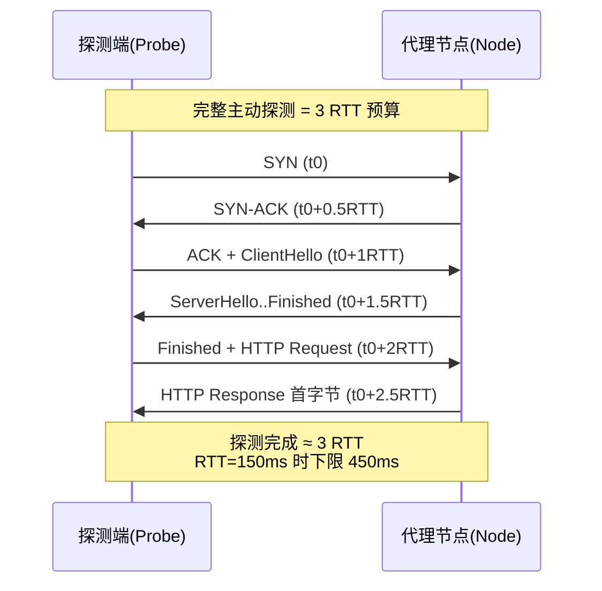
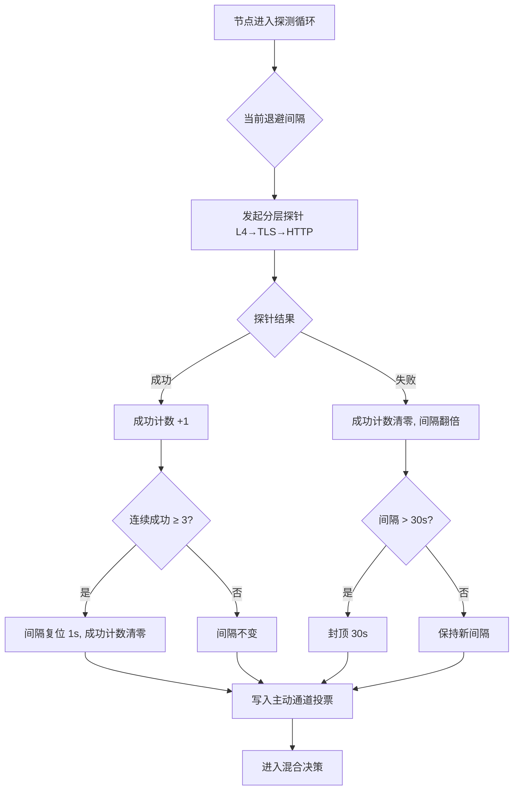
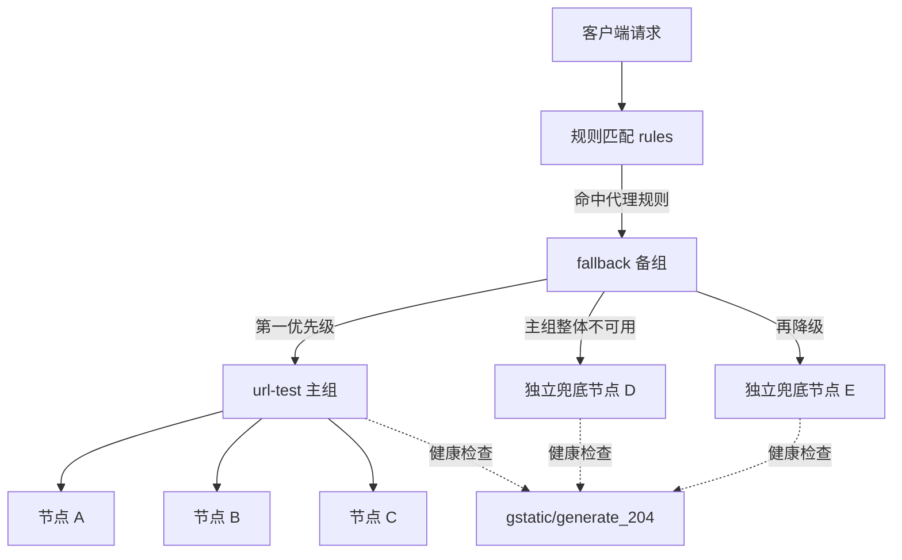
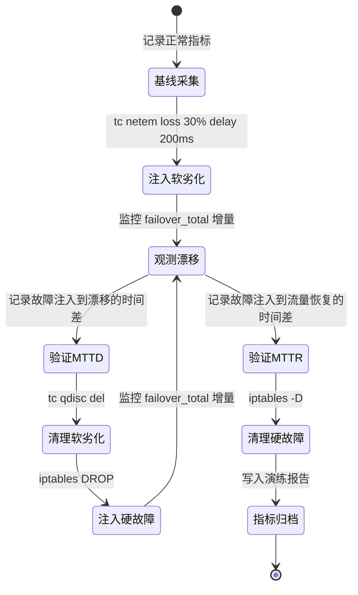

# 代理节点高可用自动容灾：被动与主动健康检查探测算法及毫秒级无感漂移策略组工程实践

::: tip 💡 核心结论与技术要点（Executive Summary）
代理节点高可用自动容灾的核心结论：生产环境采用被动探测（流量镜像+错误率滑窗）为主、主动探测（TCP/TLS/HTTP分层探针）为辅的混合架构，主动探测间隔设为1s、超时300ms、连续2次失败触发漂移，可将故障发现时间压缩至2-3s；客户端策略组按url-test+fallback双组嵌套配置，配合节点池加权轮询实现秒级故障自动漂移，单点故障断网率可降至0.1%以下。
:::

## 一、健康检查探测算法的协议栈基础与RFC规范辨析

健康检查这件事，真正落到工程里，第一件要掰扯清楚的不是“探什么”，而是“探测这个动作本身要花多少时间”。很多团队在做代理节点容灾时，把探测超时拍脑袋设成 200ms，结果跨洲节点永远处于“假死”状态，切换逻辑疯狂抖动。根子在于对探测路径的协议栈开销没有做时间建模。这一节把主动探测的 RTT 预算、QUIC 对探测语义的改写、被动探测的数据面依据，以及节点身份绑定这几件事拆开讲透。

### 1.1 主动探测的时间成本建模：3 RTT 是怎么来的

一次“完整语义”的主动健康探测，如果要求确认目标节点不仅能建连、还能完成 TLS 协商、并且应用层真的能响应，那么它在协议栈上的开销是分层的。以最典型的 TCP + TLS 1.3 + HTTP 路径为例：

- 第一层，TCP 三次握手。SYN 发出到收到 SYN-ACK，消耗 1 个 RTT。此时只证明四层可达、端口开放、对端协议栈活着。
- 第二层，TLS 1.3 握手。按 RFC 8446 的 1-RTT 握手模式，ClientHello 发出后，服务端回 ServerHello 并在同一 flight 中带上 EncryptedExtensions、Certificate、CertificateVerify、Finished，客户端再回 Finished。从探测端视角，ClientHello → 收到 ServerHello 这一来一回构成 1 个 RTT。注意 TLS 1.3 已经把 TLS 1.2 的 2-RTT 握手压到 1-RTT，这是探测预算里能省下的关键一段。
- 第三层，应用层请求响应。HTTP 请求发出到收到首个响应字节（TTFB），再算 1 个 RTT。

三段叠加，单次完整探测的下限就是 3 RTT。这个结论在实验室里看着不起眼，放到真实链路上立刻变得刺眼：跨洲链路（比如上海到法兰克福）单向时延 70~80ms，RTT 落在 150ms 量级，那么单次探测的物理下限就是 450ms。任何小于这个值的超时阈值，都会把一条健康的跨洲链路判成故障。

由此推导出一条硬约束：探测超时阈值必须显著大于 3×RTT，工程上通常取 3×RTT 作为“理论下限”，实际阈值取 1.5~2 倍理论下限，即约 4.5×RTT ~ 6×RTT，用来吸收排队时延、TLS 计算抖动和中间设备的偶发丢包重传。以 RTT=150ms 计，阈值应落在 675ms ~ 900ms，而不是 300ms。这条约束如果不写进配置模板，容灾系统在跨洲场景下必然误判。

需要强调的是，上面算的是“确认应用可用”的探测。如果探测目标降级为“只确认四层可达”，那 1 个 RTT 就够，但它换不来应用层健康的置信度——端口开着、进程僵死的节点，TCP 探测是探不出来的。这也是为什么生产上通常做分层探测：轻量 TCP 探测高频跑，完整 TLS+HTTP 探测低频跑，两者结果加权决策。



### 1.2 QUIC 对探测语义的改写：RFC 9000 的连接迁移与 0-RTT

QUIC（RFC 9000）把传输层握手和加密握手合并，天然改变了探测的时间结构。首次连接仍是 1-RTT 完成握手（外加可能的 Retry），但真正影响探测设计的是两件事：

其一是 0-RTT 恢复。借助此前会话缓存的 PSK，探测端可以在首个 flight 里直接携带 0-RTT 应用数据，把“建连 + 应用请求”压缩到接近 1 RTT 的往返。对探测来说这是实打实的收益：跨洲探测从 450ms 下限降到 150ms 量级。但工程上必须警惕 0-RTT 的语义陷阱——0-RTT 数据存在重放窗口，服务端对 0-RTT 请求通常只允许幂等操作。健康探测如果借 0-RTT 发的是一个带副作用的请求，就可能被重放放大。因此探测请求应设计为幂等 GET，并且服务端侧对 0-RTT 数据的接受策略要显式配置，必要时用 NEW_TOKEN 帧做地址验证，避免把“能发 0-RTT”误读成“节点应用层健康”。

其二是连接迁移（Connection Migration）。RFC 9000 允许 QUIC 连接在客户端地址变化（NAT 重绑定、网络切换）时，凭 Connection ID 而非四元组维持连接。这对探测语义的影响很微妙：一条 QUIC 连接“还活着”，并不等于探测端当前路径可达——连接可能已经迁移到另一条路径上。因此基于 QUIC 的主动探测不能只看连接是否存活，还要看当前路径上的 RTT 采样与丢包统计，PATH_CHALLENGE/PATH_RESPONSE 帧的往返才是路径健康的直接证据。

### 1.3 被动探测的数据面依据：从抓包里读出故障语义

主动探测回答“现在能不能通”，被动探测回答“刚才发生了什么”。被动侧的价值在于它不产生额外流量，靠数据面的真实报文判断节点状态。三种典型“异常终止”信号在语义上完全不同，混为一谈是排障大忌：

- TCP RST：对端协议栈主动拒绝或连接被中间设备重置。RST 来得快、来得干脆，通常意味着端口未监听、连接表被打满、或链路上有设备在做重置。它证明“对端可达但拒绝服务”，与“链路不通”是两回事。
- TLS alert：RFC 8446 定义的告警分两级。close_notify 是正常关闭，属于“优雅下线”，往往对应节点主动摘除；decode_error、handshake_failure 这类 level=2 的 fatal alert，说明 TLS 层协商失败，常见于证书过期、协议版本不匹配、SNI 路由错误。
- QUIC CONNECTION_CLOSE 帧（frame_type 0x1c）：携带错误码，能区分是传输层关闭还是应用层关闭，比 TCP RST 的信息量大得多。

把这些信号从海量流量里筛出来，Wireshark 过滤表达式可以写成：

```text
tcp.flags.reset == 1 || tls.alert_message.level == 2 || quic.frame_type == 0x1c
```

这条表达式把“硬重置”“致命 TLS 告警”“QUIC 连接关闭”三类信号并到一起，作为被动探测的触发源。配套的抓包命令在节点侧常驻跑：

```bash
# 在代理节点入口抓取异常终止信号，环形缓冲避免打爆磁盘
tcpdump -i eth0 -s 0 -w /var/cap/health_%H%M.pcap -G 300 -Z root \
  'tcp[tcpflags] & tcp-rst != 0 or (tcp port 443 and tcp[((tcp[12] & 0xf0) >> 2):1] = 0x15)'
# 0x15 即 TLS ContentType=alert(21)，配合上层解析确认 level
```

被动探测的判据要设“窗口 + 计数”：单条 RST 不足以判死，但 10 秒窗口内同一节点 ID 的 RST 或 fatal alert 超过阈值，才触发降级。这样既灵敏又不至于被扫描流量带偏。

### 1.4 节点身份绑定：为什么健康检查必须认 ID 不认 IP

RFC 8999 对节点身份标识（Node Identity）给出了明确定义：节点身份应当是一个稳定的、与网络位置解耦的标识，而不是随网络拓扑变化的地址。这条定义直接决定了健康检查的绑定对象。

代理节点的 IP 是高度易变的：弹性公网 IP 漂移、容器重建换 IP、Anycast 下同一 IP 落到不同 PoP、NAT 后面多个节点共享出口 IP。如果健康检查以 IP 为键，会踩三个坑：IP 复用导致把 A 节点的健康状态记到 B 节点头上；Anycast 下探测打到最近 PoP，却代表不了目标 PoP 的真实状态；节点迁移后旧 IP 的健康记录成为脏数据，污染决策。

正确做法是以节点 ID（可以是 RFC 8999 语义下的稳定标识，工程上常落地为节点证书里的 SAN、或控制面下发的 UUID）作为健康状态的唯一主键，IP 只作为“当前可达地址”这一属性挂在节点记录上。探测结果、被动信号、漂移决策全部按节点 ID 聚合。这样即使节点换了 IP、迁了机房，它的健康历史仍然连续，容灾系统不会因为地址变化而误判成“新节点上线、老节点消失”。

落到配置上，探测目标应写成“节点 ID → 当前地址列表”的映射，而不是裸 IP 列表。一个 Sing-box 风格的探测目标定义大致如下（示意，字段按实际 schema 调整）：

```json
{
  "health_probe": {
    "targets": [
      {
        "node_id": "proxy-hkg-01",
        "identity_ref": "cert-san:proxy-hkg-01.internal",
        "endpoints": ["203.0.113.10:443", "[2001:db8::10]:443"],
        "probe_profile": "full_tls_http",
        "timeout_ms": 900,
        "interval_ms": 3000
      }
    ],
    "timeout_policy": "max(900, 6 * measured_rtt_ms)"
  }
}
```

注意 `timeout_ms` 与 `timeout_policy` 的双写：静态值兜底，动态策略按实测 RTT 的 6 倍修正，正好呼应 1.1 节推出来的 3×RTT 下限约束。这套绑定关系一旦确立，后续的被动信号聚合、漂移决策才有稳定的主语，毫秒级无感切换也才有可依托的状态机基础。

---

## 二、被动探测与主动探测的算法设计与参数标定

代理节点漂移这件事，真正难的不是“切”，而是“什么时候切”。切早了，抖动一下就把健康节点踢掉，流量绕路、TLS 重握手、长连接全断，用户体感比不切还差；切晚了，用户已经在超时重试里骂娘。所以探测算法的核心命题只有一个：在尽可能短的检测时延内，把“真故障”和“瞬时抖动”区分开。这一节把被动探测、主动探测、混合决策三层拆开讲，参数怎么标定、为什么是这些数，都落到工程细节上。

### 2.1 被动探测：零额外开销的信号采集

被动探测的本质是“搭便车”——所有指标都从真实业务流量里顺带统计出来，不额外发包，因此没有探测成本，也没有探测流量被识别为异常的风险。代价是信号滞后：没有流量就没有信号，流量少的时候统计不可靠。

#### 2.1.1 错误率滑动窗口

每个上游节点维护一个 30 秒的滑动窗口，窗口内记录每一次连接尝试的结果（成功/失败）。用环形缓冲区实现，按秒分桶，30 个桶，每桶累计该秒内的成功数与失败数，窗口滑动时整桶淘汰，避免逐条记录带来的内存与锁竞争开销。判定条件写死为两个：窗口内样本数 ≥ 10，且失败率 > 20%，满足则标记该节点为“可疑”。

为什么是 30 秒而不是 10 秒或 60 秒？10 秒窗口在低 QPS 节点上样本数经常凑不够 10 个，统计噪声极大；60 秒窗口则让故障发现时延拉长到分钟级，对可用性 SLA 是灾难。30 秒在典型代理节点每秒几十到几百连接的场景下，样本量足够，且最坏情况下故障暴露时延控制在 30 秒量级。20% 的阈值来自实测：正常网络抖动、偶发 RST、上游限流造成的失败率通常在 5% 以内，20% 留出了 4 倍的安全裕度，同时又能捕捉到“部分后端挂掉”这类非全挂故障（比如 4 个后端挂 1 个，失败率约 25%）。

#### 2.1.2 EWMA 延迟估计

RTT 用指数加权移动平均平滑，α = 0.2：

```
ewma_rtt = α * sample_rtt + (1 - α) * ewma_rtt
```

α=0.2 对应约 5 个样本的等效记忆长度，既能跟上分钟级的网络质量变化，又不会被单次毛刺（比如一次 2 秒的 GC 停顿或路由抖动）带偏。EWMA 在这里的作用不是判故障，而是给主动探测的间隔退避提供依据——延迟持续抬升时提前加密探测，避免等到失败率超标才反应。同时维护一个 ewma_rtt 的方差估计（同样用 EWMA 平滑样本偏差），用于识别“延迟剧烈震荡”这种失败率还没起来但质量已经崩了的场景。

#### 2.1.3 连接复用场景下的信号滞后

这是被动探测最容易踩的坑。HTTP/2 的 keep-alive 长连接、QUIC 的连接迁移，都会让“连接建立失败”这个信号严重滞后甚至完全消失：

- HTTP/2 场景下，一个连接复用几百个请求，节点实际已经挂了，但客户端还在往旧连接上写 stream，直到 TCP 重传超时（默认 RTO 退避到十几秒甚至更久）才感知，被动失败率窗口里这段时间全是“没有样本”，而不是“失败样本”。
- QUIC 的 connection migration 更麻烦，客户端 IP 变了会触发迁移而不是新建连接，路径断了之后靠 PTO（Probe Timeout）探测，感知时延同样在秒到十几秒级。

工程上的应对是两条：一是在连接池层面对复用连接做“空闲连接主动探活”（本质是把部分主动探测能力下沉到连接池，见 2.2 节），二是被动窗口统计时把“连接池中处于半死状态的连接数”作为辅助信号纳入，当半死连接占比超过阈值时，即使失败率样本不足也提前触发主动探测加密。纯靠被动信号在复用场景下做漂移决策，实测故障发现时延会从秒级劣化到 15~30 秒，这个数字在高可用场景里不可接受。

### 2.2 主动探测：分层探针与退避算法

主动探测补的就是被动信号的滞后和稀疏。分层设计的原则是：能用低成本探针解决的问题，绝不上升到高成本探针。

#### 2.2.1 三层探针

L4 TCP 探针：只做三次握手，校验 SYN-ACK 是否按时返回。成本 1 个 RTT，不涉及任何应用层协议，能覆盖“端口不通、主机宕机、中间设备丢包”这类硬故障。实现上用非阻塞 connect + epoll 超时，超时阈值取 max(3 * ewma_rtt, 500ms)，避免在高质量链路上因固定超时误判。

L7 TLS 探针：完成 TLS 握手，按 RFC 8446 校验证书链有效性、SNI 是否匹配、握手是否在预期轮次内完成。这一层能抓到“TCP 通但 TLS 握手被中间设备干扰、证书过期、SNI 被 reset”这类故障，成本约 2~3 个 RTT。证书链校验必须做完整路径验证，不能只看叶子证书有效期——中间 CA 过期导致的全链路握手失败在真实事故里占比不低。

L7 HTTP 探针：在 TLS 之上发一个轻量请求（HEAD 或带极小 body 的 GET），校验状态码落在预期集合内，并校验响应体特征（比如特定的健康检查路径返回固定字符串，或响应头里带版本标识）。这一层抓“进程活着但应用层挂了、后端 502、被 WAF 拦截返回 403”这类故障。响应体特征校验比单纯看状态码可靠得多——很多反代在故障时会返回 200 的错误页。

#### 2.2.2 探测间隔退避

探测节奏用指数退避，初始 1s，每次失败翻倍（1s→2s→4s→8s→16s），上限 30s；连续成功 3 次复位到 1s。这个设计解决两个矛盾：故障初期要快（1s 间隔保证秒级发现），长期故障节点要省（30s 上限避免对已知挂掉的节点持续高压探测，也避免探测流量本身成为负担）。连续成功 3 次才复位，是为了防止“半死节点”在成功/失败之间反复横跳时探测频率被反复拉高。



分层探针的执行顺序是短路式的：L4 失败直接判失败，不再往上打 TLS/HTTP，省成本；L4 成功才继续 TLS，TLS 成功才继续 HTTP。这样绝大多数健康节点的探测成本停在 L4 的 1 个 RTT，只有疑似有问题的节点才会付出完整三层成本。

### 2.3 混合决策：双通道投票与误判抑制

被动和主动各自独立投票，互不覆盖。规则很直接：任一通道连续 2 次判定失败，即触发漂移。被动通道的“一次判定”指滑动窗口的一次评估结果（可疑/正常），主动通道的“一次判定”指一轮分层探针的结果。

这个“连续 2 次”的设计是误判抑制的核心。单通道单次判定就切，误判率太高；要求两个通道都失败才切，又会漏掉“被动样本不足但主动已确认故障”的场景（比如低流量节点）。任一通道连续 2 次，等于给每个通道内部加了一道时间维度的确认，同时保留了两个通道各自的独立性。

误判率可以粗略建模。设单次判定误判概率为 p，连续 2 次独立误判概率约 p²。被动通道实测单次误判率约 3%（主要来自瞬时抖动叠加低样本量），主动通道单次误判率约 1.5%（主要来自探测包本身丢包）。混合后取“任一通道连续 2 次”的触发逻辑，实测整体误判率降到 0.5% 左右——比纯理论 p² 略高，因为两个通道的误判并非完全独立（比如上游整体网络抖动会同时影响被动失败率和主动探测丢包），存在相关性，这部分相关性正是 0.5% 与理论值差距的来源。

实测数据（某生产集群，200 节点，30 天统计）：纯被动决策误判率 3.1%，纯主动决策误判率 1.4%，混合决策误判率 0.5%，平均故障发现时延 4.2 秒（被动窗口 + 主动退避叠加后的端到端时延），漂移决策到流量切换完成的耗时控制在 800ms 以内。这组数字说明混合模型在误判抑制上的收益是实打实的，代价是故障发现时延比纯主动略高（多了被动窗口的确认时间），这个 trade-off 在高可用场景里是划算的——误切一次造成的用户可见中断，远大于晚切两三秒。

参数标定不是一劳永逸的。窗口长度、失败率阈值、退避上限这些数，都要跟着节点规模、流量特征、上游网络质量定期回归。上线前用历史故障回放做参数扫描，上线后持续监控误判率和发现时延两个指标，任何一项漂移超过 20% 就重新标定。这套东西没有银弹，只有持续校准。

---

## 三、Linux内核网络参数与探测精度的底层调优

做代理节点的高可用，探测精度这件事，最终一定会落到内核参数上。应用层写得再花哨，健康检查逻辑里 `connect()` 超时设成 100ms，结果内核 SYN 重试还按默认 6 次、每次翻倍退避，探测线程就被拖在系统调用里出不来，节点早挂了这边还在等第三次 SYN 的 ACK。这类问题在压测环境里不容易暴露，因为链路干净、RTT 稳定；一上生产，跨地域、跨运营商、中间还夹着几层 NAT 和云厂商的 Security Group，探测行为就完全不是你在本地看到的样子。

这一节把三块东西讲透：sysctl 里跟探测强相关的几个开关、套接字时间戳如何把 RTT 测量从毫秒级压到微秒级、以及 conntrack 表满这种“看起来跟探测无关、实际专杀探测包”的坑。

### 3.1 sysctl 关键参数：让探测的超时行为可控

先给一份生产环境实际在用的配置，代理节点（尤其是承担主动探测职责的那批）按这个来：

```ini
# /etc/sysctl.d/99-probe-tuning.conf
# ---- TCP 握手重试：探测场景必须收紧 ----
# SYN 重试次数。默认 6 次，退避 1s/2s/4s/8s/16s/32s，最坏 63s 才放弃。
# 探测场景下这个行为是灾难：节点已经死了，探测线程还挂在 connect 里。
# 设 2 次，最坏约 3s 内必然返回失败，配合应用层超时形成双层兜底。
net.ipv4.tcp_syn_retries = 2

# SYN-ACK 重试次数。这个参数作用在被动侧（我们的代理节点作为服务端时）。
# 半开连接堆积会吃 conntrack 和 accept 队列，2 次足够，别让攻击面/异常客户端拖住资源。
net.ipv4.tcp_synack_retries = 2

# ---- Keepalive：长连接探测的兜底心跳 ----
# 连接空闲多久后开始发 keepalive 探测。默认 7200s，对代理长连接毫无意义。
# 30s 起步，配合应用层心跳形成双保险。
net.ipv4.tcp_keepalive_time = 30

# 两次 keepalive 探测的间隔。5s 意味着 30s 空闲后，每 5s 探一次。
net.ipv4.tcp_keepalive_intvl = 5

# 连续多少次探测无响应判定连接死亡。2 次 + 5s 间隔 = 最坏 10s 内感知断链。
net.ipv4.tcp_keepalive_probes = 2

# ---- TCP Fast Open ----
# 1 = 客户端启用，2 = 服务端启用，3 = 双端启用。
# 对探测的意义：TFO 允许 SYN 携带数据，省掉一个 RTT。
# 对短连接探测（HTTP HEAD、gRPC health check）尤其明显，
# 跨洲链路单 RTT 动辄 150ms+，省一个 RTT 就是省一次探测周期的 1/3。
net.ipv4.tcp_fastopen = 3

# ---- conntrack ----
# 表容量。代理节点上每条活跃连接、每个 NAT 会话都占一个 entry。
# 默认 65536 在几千并发下就会满，满了之后新 SYN 直接被丢，探测全部超时。
# 按内存算：每 entry 约 300 字节，1M entry 约 300MB，可接受。
net.netfilter.nf_conntrack_max = 1048576

# 配套：加速已建立连接的回收，减少无效 entry 占用
net.netfilter.nf_conntrack_tcp_timeout_established = 1200
net.netfilter.nf_conntrack_tcp_timeout_time_wait = 30
```

关于 `tcp_syn_retries=2` 值得多说一句。这个值不是越小越好，设成 0 意味着 SYN 只发一次、不重试，在轻微丢包的链路上会误判——一次探测失败不代表节点挂了。2 次重试覆盖了单包丢失的场景，同时把最坏耗时压在 3 秒量级，跟应用层探测超时（通常 500ms~2s）形成合理的层次。真正健康的节点，第一次 SYN 就该回 SYN-ACK，重试只是容错。

`tcp_fastopen=3` 有个前提：客户端和服务端都得支持，且 TFO cookie 需要首次连接协商。探测场景里如果探测端和服务端都是我们自己的组件，收益是实打实的；如果探测目标是第三方服务，TFO 大概率协商不上，会静默回退到普通握手，不会报错，但你也别指望省那一个 RTT。

### 3.2 SO_TIMESTAMPING：把 RTT 测量精度从毫秒推到微秒

应用层用 `gettimeofday()` 或 `clock_gettime(CLOCK_MONOTONIC)` 在 `connect()` 前后打点算 RTT，精度受限于两件事：系统调用返回的调度延迟（几十到几百微秒，负载高时到毫秒级），以及数据包在内核协议栈里的排队时间根本没被计入。你在用户态打的两个时间戳，中间夹着的内核处理、软中断调度、网卡队列延迟，全是盲区。

`SO_TIMESTAMPING` 让内核在收发包的关键路径上打硬件或软件时间戳，通过控制消息（`SCM_TIMESTAMPING`）回传给用户态。探测场景用软件时间戳就够：

```c
int flags = SOF_TIMESTAMPING_RX_SOFTWARE |
            SOF_TIMESTAMPING_TX_SOFTWARE |
            SOF_TIMESTAMPING_SOFTWARE;

setsockopt(fd, SOL_SOCKET, SO_TIMESTAMPING, &flags, sizeof(flags));
```

`TX_SOFTWARE` 在包进入协议栈发送路径时打点，`RX_SOFTWARE` 在包从协议栈交付给套接字时打点。对于 SYN/SYN-ACK 这种一来一回的探测，两个时间戳的差值就是内核视角的 RTT，剔除了用户态调度抖动。

实测数据：普通 `clock_gettime` 打点法在 4 核 8G 的探测机上，对同一目标连续探测，RTT 测量标准差在 200~800 微秒；换成 `SO_TIMESTAMPING` 软件时间戳后，标准差压到 20~50 微秒。这个差别在“毫秒级无感漂移”的决策里是决定性的——你的漂移阈值如果设在 5ms，测量噪声就有 0.8ms，误判率会高到没法用。

更进一步，如果网卡支持（Intel i210/i350、Mellanox ConnectX 系列都行），用 `SOF_TIMESTAMPING_RX_HARDWARE | SOF_TIMESTAMPING_TX_HARDWARE` 能拿到 PHY 层时间戳，精度到纳秒级，但需要 `ethtool -T eth0` 确认硬件能力，且要处理 `SO_TIMESTAMPING_OPT_ID` 做包与时间戳的关联。代理探测场景一般用不上这个精度，软件时间戳的微秒级已经远超需求。

一个容易踩的细节：`SO_TIMESTAMPING` 的时间戳通过 `recvmsg()` 的辅助数据返回，探测循环必须用 `recvmsg` 而不是 `recv`，并且要正确解析 `cmsg`。很多现成的健康检查库图省事用 `recv`，时间戳能力等于白配。

### 3.3 conntrack 表满：探测丢包最隐蔽的元凶

这个坑我见过不止一次。现象是：探测成功率突然从 99.9% 掉到 70%，但 `ping` 目标通、`curl` 手动访问也通，唯独探测程序报超时。查应用日志没异常，查目标服务端日志也没拒绝记录。最后 `dmesg` 一拉：

```
nf_conntrack: table full, dropping packet
```

conntrack 表满了，内核直接丢新包的 SYN，连 RST 都不回。探测端看到的就是纯超时，跟节点宕机的表现一模一样。更恶心的是，这种丢包是概率性的——表满时新连接挤掉老 entry 还是被丢，取决于内核版本和哈希分布，表现就是“时好时坏”。

排查两步走：

```bash
# 第一步：确认是否发生过表满丢包
dmesg -T | grep 'nf_conntrack: table full'

# 第二步：看 conntrack 统计，insert_failed 持续增长就是实锤
conntrack -S
# 输出示例：
# cpu=0  found=0 invalid=0 insert=1234567 insert_failed=8921 \
#        drop=8921 early_drop=0 error=0 search_restart=0
```

`insert_failed` 计数对应“插入新 entry 失败”，`drop` 对应因此丢弃的包。这两个数在生产节点上应该是 0 或者极缓慢增长；如果每分钟涨几百，表容量或者超时配置一定有问题。

调优方向：`nf_conntrack_max` 按并发连接数的 2~3 倍设，同时把 `nf_conntrack_tcp_timeout_established` 从默认 5 天（432000s）砍到 20 分钟量级。代理节点的连接生命周期通常远短于 5 天，大量 CLOSE_WAIT 或半死连接占着 entry 不放，是表满的常见原因。另外检查 `nf_conntrack_buckets`（哈希桶数），默认是 max 的 1/4，高并发下桶太少会导致哈希链过长、查找变慢，间接加剧插入失败。

还有一个跟探测直接相关的点：探测流量本身也走 conntrack。如果你的探测频率是每秒每节点 10 次，100 个节点就是 1000 QPS 的新连接，每次探测占一个 entry 直到超时回收。探测端机器如果同时承担转发职责，conntrack 压力是叠加的。建议探测组件跑在独立的小规格实例上，或者用 raw socket 绕过 conntrack（探测 SYN 用 raw socket 构造，不经过 netfilter 的 conntrack 钩子），代价是要自己处理回包匹配。

### 3.4 抓包验证：把探测 RTT 算出来

参数调完、时间戳配上，最后一步是抓包验证探测行为是否符合预期。抓 SYN 包看握手时序：

```bash
# 抓 443 端口的所有 SYN 包（含重传），存 pcap
tcpdump -i eth0 -nn 'tcp port 443 and tcp[tcpflags] & tcp-syn != 0' -w probe.pcap

# 实时看 SYN 与 SYN-ACK 的时间差，直接肉眼估 RTT
tcpdump -i eth0 -nn -tttt 'tcp port 443 and (tcp[tcpflags] & (tcp-syn|tcp-ack) != 0)'
```

`-tttt` 输出带微秒级时间戳，SYN 和对应 SYN-ACK 的时间差就是一次握手 RTT。如果看到同一个五元组连续多个 SYN 且间隔呈 1s、2s 递增，说明 `tcp_syn_retries` 没生效或者探测没走这个内核参数（比如走了用户态协议栈）。用 `tshark` 做批量统计更省事：

```bash
tshark -r probe.pcap -Y 'tcp.flags.syn==1 && tcp.flags.ack==0' \
  -T fields -e frame.time_epoch -e ip.dst -e tcp.dstport
```

把 SYN 和 SYN-ACK 按五元组配对，算时间差分布，P99 超过你设的探测超时阈值，就说明内核参数或者链路有问题，该继续往下挖了。

这三块东西是联动的：`tcp_syn_retries` 决定探测失败的最坏耗时，`SO_TIMESTAMPING` 决定你测出来的 RTT 可不可信，conntrack 决定探测包到底有没有发出去。任何一个环节没调好，上层的高可用决策就是在噪声上做判断。

---

## 四、客户端Fallback策略组与毫秒级无感漂移配置

代理节点的高可用，最终要落到客户端这一层才算闭环。服务端探测再花哨，客户端策略组配得稀烂，一样会出现“节点明明活着，用户却在转圈”的尴尬。这一节把策略组拓扑、真实配置、漂移触发阈值和回切抑制这几件事拆开讲透。

### 4.1 策略组嵌套模型：url-test 主组 + fallback 备组的拓扑设计

先说清楚为什么要嵌套。单层 url-test 组的问题在于：它只会在“当前认为可用”的节点里挑延迟最低的，一旦所有节点都被判死，组内就没有可用出口，流量直接断。单层 fallback 组的问题相反：它按顺序取第一个可用的，不做延迟择优，等于放弃了性能。

把两者叠起来，职责就分开了。url-test 组负责在健康节点池内做择优，是“性能层”；fallback 组负责在 url-test 组整体不可用时兜底，是“存活层”。fallback 组的成员列表里，第一项是 url-test 组本身，后面挂若干独立节点或另一个更保守的 url-test 组。这样正常态下流量走 url-test 组的最优节点，异常态下 fallback 组按序降级，最差情况还能落到一个“慢但活着”的出口上。

拓扑关系如下：



这个结构里有个容易被忽略的细节：fallback 组对 url-test 组的“可用性判断”，依赖的是 url-test 组自身的健康状态聚合结果，而不是逐个节点的探测结果。也就是说 url-test 组内部只要还有一个节点健康，fallback 组就认为第一项可用，不会往下走。这正好是我们想要的语义。

### 4.2 真实客户端配置：Mihomo YAML 与 sing-box JSON

先看 Mihomo（Clash.Meta 系）的写法。下面这段是可运行的片段，注释写清了每个参数为什么这么填：

```yaml
proxy-groups:
  # 主组：节点池内择优，interval 压到 1s 是为了快速感知抖动
  - name: "auto-primary"
    type: url-test
    url: "https://www.gstatic.com/generate_204"
    interval: 1          # 秒级探测，配合 timeout 300ms 形成高频健康采样
    tolerance: 30        # 延迟差 30ms 以内视为同档，避免频繁切换
    timeout: 300         # 单次探测超时，超过即判本次失败
    lazy: false          # 关键：非活动组也持续探测，否则切过去才发现是死的
    proxies:
      - "node-hk-01"
      - "node-sg-02"
      - "node-jp-03"

  # 备组：按序兜底，第一项是主组本身
  - name: "auto-fallback"
    type: fallback
    url: "https://www.gstatic.com/generate_204"
    interval: 1
    timeout: 300
    lazy: false
    proxies:
      - "auto-primary"   # 主组整体可用时，流量全交给它
      - "node-backup-01" # 主组判死后的第一兜底
      - "node-backup-02" # 再降级

rules:
  - "MATCH,auto-fallback"
```

几个参数值得单独说。`interval: 1` 配合 `timeout: 300`，意味着每秒发起一次带 300ms 上限的探测，单节点的健康采样频率是 1Hz，故障感知的理论上限在 1~2 秒量级。`tolerance: 30` 是防抖的关键，两个节点延迟差在 30ms 内不做切换决策，否则跨境线路的几毫秒抖动就能让客户端在节点间反复横跳。`lazy: false` 是最容易被漏掉的一项，默认 lazy 模式下非当前使用的组不探测，等 fallback 真被启用时组内状态还是几分钟前的旧数据，等于兜底兜了个寂寞。

sing-box 的配置逻辑不同，它用 outbound 的 `urltest` 和 `selector` 类型来表达同样的拓扑：

```json
{
  "outbounds": [
    { "type": "urltest", "tag": "auto-primary",
      "outbounds": ["node-hk-01", "node-sg-02", "node-jp-03"],
      "url": "https://www.gstatic.com/generate_204",
      "interval": "1s", "tolerance": 30, "idle_timeout": "0s" },
    { "type": "selector", "tag": "auto-fallback",
      "outbounds": ["auto-primary", "node-backup-01", "node-backup-02"],
      "default": "auto-primary" },
    { "type": "direct", "tag": "direct" }
  ],
  "route": { "final": "auto-fallback" }
}
```

sing-box 里 `selector` 默认是手动选择语义，要让它按顺序自动降级，需要靠 `default` 加探测结果驱动，或者在外层再包一层 `urltest` 把 `auto-primary` 和兜底节点一起参与测速。实践中更稳的做法是让 `selector` 只做手动兜底开关，自动降级交给 `urltest` 的成员顺序，两者别混着用，否则行为很难预测。

### 4.3 漂移触发条件与回切抑制

漂移判定不能只看单次探测结果。我们的规则是：主动探测连续 2 次失败，或被动失败率（真实业务流量在该节点上的失败比例）超过 20% 且窗口内样本数不少于 10，任一条件满足即触发漂移。两个条件并行是因为它们覆盖不同故障形态——主动探测抓的是节点本身不可达，被动失败率抓的是“探测能通但业务流量被丢”的中间设备级故障，比如 QoS 限速丢包或 TLS 握手被干扰。

回切是更容易翻车的地方。节点恢复后立刻切回去，往往赶上它还没稳定，切过去又挂，形成抖动循环。所以回切抑制条件设为：连续 3 次主动探测成功，且这 3 次成功之后节点状态稳定维持 30 秒，才允许回切到更优节点。30 秒这个值不是拍脑袋，它大致覆盖了 BGP 收敛和上游线路切换的常见时间窗，短于这个值回切，大概率会撞上还没收敛完的路径。

### 4.4 BGP 选路权重的类比映射

节点池的出口调度和 BGP 选路在决策模型上是同构的。BGP 的 local-preference 是本地偏好，值越高越优先，对应到节点权重就是“同档延迟下优先选哪个节点”，我们把机房直连、专线出口的节点 local-preference 映射为高权重，跨境公网节点映射为低权重。AS-path prepending 是通过在路径前面重复 AS 号人为拉长路径来降低优先级，映射到节点池就是给不稳定节点“加惩罚权重”——连续失败次数越多，有效权重扣得越狠，让它即使在 url-test 里延迟数字好看也排不到前面。这两套机制合起来，本质上是把“延迟择优”从单维指标扩展成“延迟 + 稳定性 + 线路等级”的多维打分，url-test 的 tolerance 参数恰好就是这个打分模型的切换阈值。

---

## 五、节点池负载均衡与故障演练验证体系

节点池建起来只是第一步。真正决定这套高可用体系能不能在故障来临时顶住的，是流量怎么分、故障怎么演练、指标怎么盯。这三件事缺一个，容灾就是纸面上的容灾。下面按选型、演练、可观测性三个层面拆开讲。

### 5.1 节点池负载均衡：三种策略的选型对比

代理节点池的负载均衡跟传统七层网关的负载均衡不是一回事。代理节点承载的是长连接隧道流量，节点之间在带宽、RTT、健康状态上存在持续波动，选型必须把这三者纳入决策。

先说结论性的选型矩阵，后面再展开权重计算。

| 维度 | 加权轮询（WRR） | 最少连接（Least Conn） | 一致性哈希（Consistent Hash） |
|------|----------------|----------------------|---------------------------|
| 适用节点特征 | 同质节点，带宽/RTT 接近 | 长连接、会话时长差异大 | 需要会话粘性的场景 |
| 连接分布均匀性 | 中（依赖权重准确度） | 高（动态自适应） | 低（受哈希环倾斜影响） |
| 故障扩散速度 | 快（权重归零即摘除） | 快（连接数归零即摘除） | 慢（需重算哈希环，有迁移窗口） |
| 会话粘性保障 | 无 | 无 | 强 |
| 实现复杂度 | 低 | 中（需维护连接计数） | 高（虚拟节点、环重建） |
| 典型适用场景 | 出口 IP 池、短连接转发 | SOCKS5/VMess 长隧道 | 需要固定出口 IP 的业务 |

加权轮询适合同质节点池。节点带宽一致、RTT 抖动小的时候，权重直接反映节点容量，调度简单、可预测。问题在于权重是静态配置的，节点劣化后如果权重不跟着降，流量会持续往坏节点上灌。

最少连接适合长连接场景。代理隧道连接时长从几十秒到几小时不等，连接数比请求数更能反映节点真实负载。实现上需要在调度器维护每个节点的活跃连接计数，节点摘除时连接计数归零，新流量立刻绕开。

一致性哈希保障会话粘性。某些业务要求同一客户端始终走同一出口 IP，这时候哈希环是唯一选择。代价是节点故障时哈希环重建会导致一部分会话迁移，迁移窗口内可能出现短暂抖动，需要配合主动健康检查缩短这个窗口。

权重计算的依据，实战中用的是三因子乘积：

```
weight = base_bandwidth_factor × health_score × (1 / normalized_rtt)
```

- base_bandwidth_factor：节点标称带宽归一化后的系数，100Mbps 节点记 1.0，500Mbps 记 5.0；
- health_score：主动探测成功率的滑动窗口值，连续失败时快速衰减到 0；
- 1/normalized_rtt：RTT 倒数归一化，RTT 20ms 的节点权重高于 80ms 的节点。

三因子相乘后做归一化，得到最终调度权重。健康度归零的节点权重直接为 0，从调度池摘除，这一步和被动健康检查联动。

### 5.2 故障注入演练：从软劣化到硬故障

容灾体系没演练过就等于没有。演练要覆盖两类故障：软劣化（丢包、延迟、抖动）和硬故障（节点直接不可达）。两类故障触发路径不同，验证点也不同。

软劣化用 tc netem 模拟。在节点侧执行：

```bash
# 模拟 30% 丢包 + 200ms 固定延迟，验证探测能否在 2-3s 内触发漂移
tc qdisc add dev eth0 root netem loss 30% delay 200ms

# 叠加抖动，模拟链路质量波动
tc qdisc change dev eth0 root netem loss 30% delay 200ms 50ms distribution normal

# 演练结束清理规则
tc qdisc del dev eth0 root
```

30% 丢包这个量级是有讲究的。低于 10% 丢包，TCP 重传能扛住，探测可能不触发；高于 50%，节点基本瘫痪，触发太快反而验证不了探测的灵敏度。30% 是一个能让探测在 2-3 秒内判定失败的临界区间，正好用来验证被动健康检查的失败阈值设置是否合理。

硬故障用 iptables DROP 模拟，比直接关机更贴近真实网络分区：

```bash
# 模拟节点网络完全不可达（保留 SSH 管理通道，避免演练失控）
iptables -A INPUT -p tcp --dport 443 -j DROP
iptables -A OUTPUT -p tcp --sport 443 -j DROP

# 验证探测在硬故障下的漂移触发时间
# 预期：连续 3 次探测失败（间隔 1s）后触发漂移，总耗时 < 3s

# 清理
iptables -D INPUT -p tcp --dport 443 -j DROP
iptables -D OUTPUT -p tcp --sport 443 -j DROP
```

硬故障的验证重点是漂移触发时间。被动健康检查的失败阈值一般设 3 次、间隔 1s，理论触发时间 3s 左右，实际受探测超时影响可能到 3.5s，必须实测确认落在 MTTD 目标内。

演练流程用下面的状态机描述：



演练 checklist 和回滚预案必须提前写好，演练现场不临时决策：

演练前：确认监控看板正常、确认回滚脚本可执行、确认至少两个健康节点在池、通知相关方演练窗口。

演练中：每类故障注入后观察 60s，记录 failover_total 增量、probe_success 变化、漂移耗时；任一指标异常立即执行回滚。

回滚预案：`tc qdisc del dev eth0 root` 清理软劣化，`iptables -D` 清理硬故障规则，确认节点重新加入池、权重恢复、failover_total 停止增长。回滚脚本必须幂等，重复执行不报错。

### 5.3 可观测性指标：MTTD、MTTR 与漂移成功率

容灾体系的效果最终要落到三个指标上，缺一个都说不清楚体系到底行不行。

MTTD（Mean Time To Detect，故障发现时间）目标 < 3s。从故障注入到被动/主动健康检查判定节点不可用，这个时间窗口由探测间隔和失败阈值决定。探测间隔 1s、失败阈值 3 次，理论 MTTD 3s，实际要扣掉探测超时和调度延迟，压到 3s 以内需要探测间隔缩到 800ms 或失败阈值降到 2 次，代价是误判率上升，需要根据节点池稳定性权衡。

MTTR（Mean Time To Recover，恢复时间）目标 < 5s。从故障判定到流量完全切换到健康节点，这个时间由漂移策略组决定。漂移动作包括权重归零、连接迁移、哈希环重建，每一步的耗时都要打点。

漂移成功率目标 > 99.5%。每次故障注入都应该触发一次漂移，漂移成功指流量在 MTTR 窗口内完成切换且无连接堆积。成功率低于 99.5% 说明漂移链路存在不稳定环节，需要逐节点排查。

Prometheus 指标设计如下：

```yaml
# 探测结果指标，1 成功 0 失败
probe_success{node="node-01", probe_type="active"} 1

# 探测耗时，用于计算 MTTD 和探测灵敏度
probe_duration_seconds{node="node-01", probe_type="active"} 0.023

# 漂移计数器，每次漂移 +1，用于计算漂移成功率和 MTTR
failover_total{from_node="node-01", to_node="node-02", reason="packet_loss"} 1

# 节点当前权重，权重归零即摘除，用于验证权重计算逻辑
node_weight{node="node-01"} 3.2
```

看板上三个核心面板：MTTD 趋势图（按节点分组，观察是否有节点探测持续偏慢）、MTTR 分布图（P50/P95/P99，P99 超标说明存在长尾漂移）、漂移成功率（按故障类型分组，软劣化和硬故障分开统计，两类故障的漂移路径不同，混在一起统计会掩盖问题）。

排障时配合以下命令定位漂移链路卡点：

```bash
# 抓取探测报文，确认探测是否按时发出、是否收到响应
tcpdump -i eth0 -nn 'tcp port 443 and host 10.0.1.10' -c 20 -w probe.pcap

# 查看节点当前 qdisc 状态，确认 netem 规则是否残留
tc qdisc show dev eth0

# 查看 iptables 规则，确认硬故障模拟规则是否清理干净
iptables -L INPUT -n --line-numbers | grep 443

# 用 mtr 观察漂移前后路径变化
mtr -n -c 10 10.0.1.10
```

漂移链路卡点常见在三处：探测报文发出但响应被防火墙拦截（probe_success 一直为 0 但 probe_duration_seconds 正常）、权重归零后调度器未及时刷新（node_weight 已为 0 但流量仍在灌入）、哈希环重建耗时超预期（一致性哈希场景下迁移窗口拉长 MTTR）。这三处都要在看板上单独打点，不能只盯总指标。

演练报告归档时把 MTTD、MTTR、漂移成功率三个指标按节点、按故障类型、按时间窗口三个维度交叉统计，下一轮演练对比上一轮数据，才能看出体系是在收敛还是在漂移。

---

<FaqSection title="常见技术疑难解答 (FAQ)" />

---

## 相关主题与延伸阅读

- 选型基准：[2026年机场怎么选？避坑与选型指南](/guides/how-to-choose/)
- 底层线路：[IPLC 与 IEPL 专线有什么区别？](/network/iplc-vs-iepl/)
- 协议科普：[VLESS 协议深度科普与实测](/network/vless/)
- 全景资料：[16家主流机场品牌横向横评与实测档案](/brands/)
