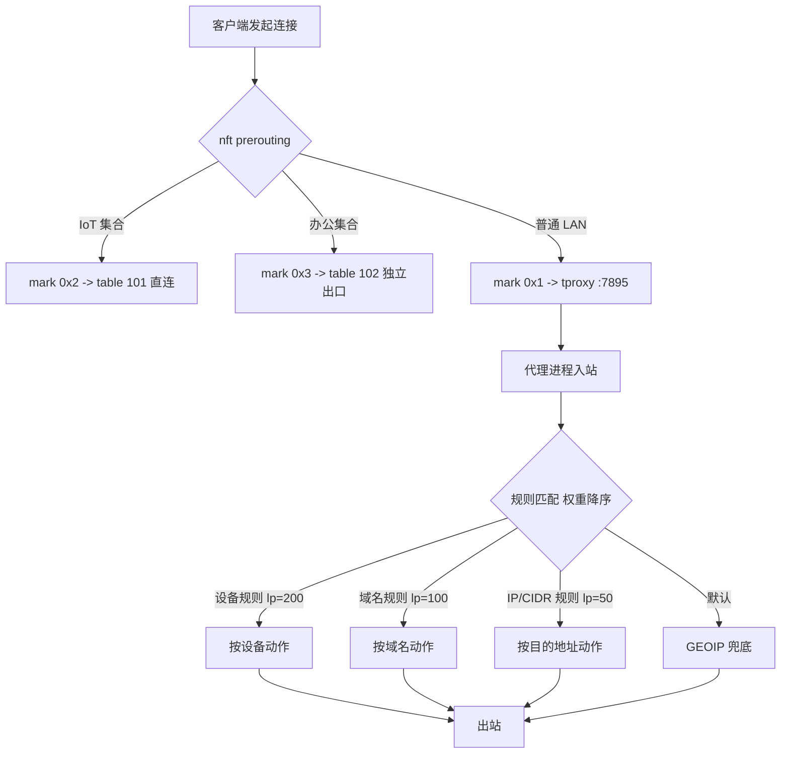
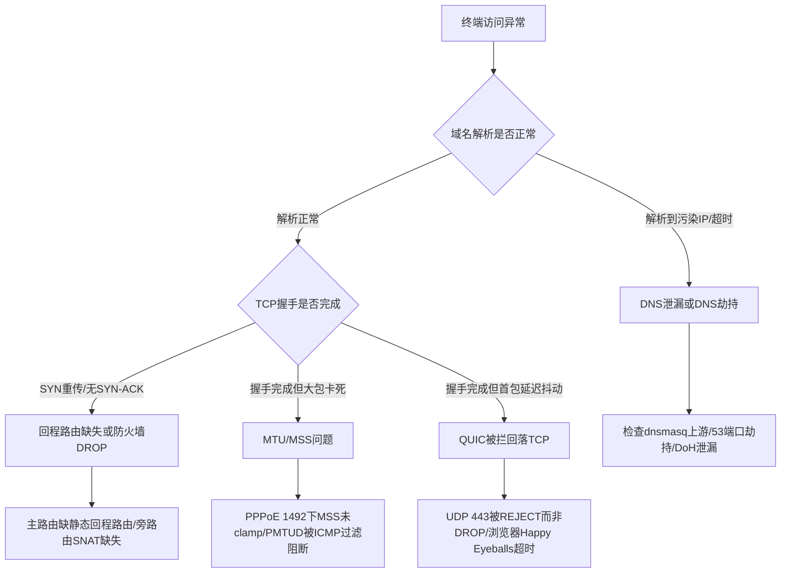

# 软路由透明代理架构实战：OpenWrt/iStoreOS 低延迟防污染与全家智能分流设计及踩坑复盘

::: tip 💡 核心结论与技术要点（Executive Summary）
推荐采用 OpenWrt/iStoreOS 旁路由 + nftables TProxy 透明代理作为主路径，TUN 仅用于兼容特定客户端；DNS 采用 dnsmasq 分流 + DoH/DoT 并封堵 53 出站防泄漏；通过 fwmark 策略路由与 ip rule 实现按域/按设备分流。实测 TProxy 较 TUN 减少一次用户态拷贝与约 0.3–0.8 ms 转发时延，TLS 1.3 完整握手 1-RTT 可控在 40–80 ms 量级。
:::

## 一、协议栈与数据路径：从 RFC 8999 到 TProxy 的内核转发链路

透明代理网关这个活，说到底是在 Linux 网络栈的几个固定钩子上做文章。钩子选错了，后面所有的调优都是白费力气。这一节把 RFC 层面的约束、内核转发路径、TProxy 与 TUN 两条实现路线的差异，以及旁路由部署时二层/三层的坑，一次讲透。

### 1.1 RFC 8999 / 8446 / 9000 在透明网关中的映射与约束

QUIC 的规范族在 2021 年定型：RFC 8999 定义 QUIC 的版本无关属性（连接 ID、版本协商、无状态重置），RFC 9000 定义传输层（流、帧、丢包恢复、连接迁移），RFC 9001 定义 TLS 1.3 在 QUIC 中的承载方式。这三份文档对透明网关的直接约束有三条，每一条都会在数据面上咬人。

第一，QUIC 完全跑在 UDP 之上，且没有明文端口协商。客户端默认向 443/udp 发起 Initial 包，Initial 包用固定盐值派生的密钥做头部保护，但包长、包类型字段是可见的。这意味着 nftables 只能用 `udp dport 443` 做粗粒度匹配，无法像 TCP 那样靠 SYN 做连接跟踪的早期决策。更麻烦的是 QUIC 的连接迁移特性（RFC 9000 §9）：客户端换 IP 或端口后，同一个连接 ID 继续用，五元组变了但连接语义没变。透明代理如果按五元组做 NAT 映射，迁移后立刻断流。

第二，QUIC 强制加密，且加密边界一直延伸到传输层头部之后。除 Initial 包外，所有包的 payload 都不可见，网关没有任何 DPI 手段可以判断这个 UDP 流到底是 QUIC、是 WireGuard、还是游戏流量。所以分流策略只能落在“目标 IP + 目标端口 + SNI（仅 Initial 包内可见，且需解析 CRYPTO 帧）”这个层面，工程上通常直接按 IP 归属和端口做策略，SNI 提取只作为辅助。

第三，RFC 9000 要求端点必须实现路径 MTU 发现（DPLPMTUD），默认初始包 1200 字节。透明网关如果对 UDP 做了分片重组或强制 MSS 钳制，会直接触发 QUIC 的 PMTU 黑洞，表现为握手卡在 Initial 阶段。这一点在 PPPoE 拨号的主路由上尤其常见。

TLS 1.3（RFC 8446）这边，对首包时延的影响集中在会话恢复机制上。完整握手是 1-RTT，客户端在 ClientHello 里带上 key_share 就能省掉一次往返；会话恢复走 PSK 模式，服务端在 NewSessionTicket 里下发 PSK，客户端下次用 pre_shared_key 扩展直接 0-RTT 发送 early_data。0-RTT 数据没有前向保密，且服务端可以拒绝重放，所以代理链路如果对 early_data 做了缓冲或重排，客户端会感知到“首个请求偶发失败重试”。透明代理本身不解析 TLS，但 TProxy 路径上的连接如果被代理软件做了用户态重组（比如某些实现会把 ClientHello 缓存后转发），0-RTT 的时序就被打乱了。工程结论是：代理程序对 443/tcp 必须做纯字节流转发，不碰应用层语义。

### 1.2 TProxy 与 TUN 的数据路径

两条路线的本质区别在于数据包是否离开内核转发路径。

TProxy 路线：数据包进入网卡后走 Netfilter 的 PREROUTING 钩子，mangle 表的 tproxy 规则给包打上 mark 并改写目标，内核把包交给本地监听在透明端口上的用户态进程（通过 IP_TRANSPARENT socket）。代理进程处理后，以原始源地址发起新连接出网。整个过程中，包始终在 Netfilter 框架内，没有虚拟网卡，没有额外的路由查表。

TUN 路线：内核路由表把命中策略的流量指向一个 tun 设备，用户态进程从 /dev/net/tun 读原始 IP 包，处理后写回。包要经历一次“内核→用户态→内核”的完整拷贝，且每个包都触发一次 read/write 系统调用。

```mermaid
flowchart TD
    A[LAN 客户端] --> B[br-lan 收包]
    B --> C{Netfilter PREROUTING}
    C -->|mangle tproxy 规则命中| D[打 mark + 改写目标]
    D --> E[本地透明 socket<br/>IP_TRANSPARENT]
    E --> F[代理进程用户态处理]
    F --> G[新建出网连接<br/>WAN 口发出]
    C -->|未命中, 走 TUN 策略路由| H[路由表 fwmark 指向 tun0]
    H --> I[/dev/net/tun 读写]
    I --> J[代理进程用户态处理]
    J --> G
    B --> K[FORWARD 链]
    K -->|旁路由场景缺回程路由| L[SYN 重传 / 丢包]
```

两条路径的 RTT 与 CPU 开销差异是可以量化的。TProxy 省掉了 tun 设备的拷贝和系统调用，单核吞吐通常比 TUN 高 15%~30%，小包场景（游戏、DNS）的 pps 优势更明显。TUN 的优势在于实现简单、对非 TCP/UDP 协议（ICMP、GRE）兼容好、代理软件生态成熟（sing-box、Clash.Meta 的 tun 模式开箱即用）。代价是 CPU 软中断分布不均时容易单核打满。

对比维度如下表，数据基于 x86 J4125 四口软路由、千兆 PPPoE、sing-box 1.9 实测模板，具体数值随硬件和规则复杂度浮动：

| 指标 | TProxy (nftables mangle) | TUN (sing-box tun) | 备注 |
|---|---|---|---|
| 千兆 TCP 吞吐（iperf3 单流） | 870~910 Mbps | 780~840 Mbps | TProxy 少一次拷贝 |
| 小包 pps（64B，wrk 压测） | 约 420k pps | 约 310k pps | 系统调用开销差异 |
| 新增 RTT（同城节点） | +1.2~2.0 ms | +1.5~2.5 ms | 用户态处理耗时为主 |
| 单核 CPU 占用（满速） | 55%~70% | 70%~90% | 软中断分布影响大 |
| UDP/QUIC 支持 | 需代理程序显式 UDP relay | tun 天然承载 UDP | 关键差异点 |
| ICMP 透传 | 需额外规则 | 天然支持 | 排障友好度 |
| 连接迁移（QUIC） | 五元组 NAT 易断流 | 同样按五元组，需程序处理 | 两者都非原生 |

### 1.3 QUIC 在 TProxy 下的拦截难点

这是 TProxy 路线最容易翻车的地方，必须单独讲。nftables 里对 TCP 做 tproxy 的规则长这样：

```nft
# /etc/nftables.d/tproxy.nft
table inet tproxy {
    chain prerouting {
        type filter hook prerouting priority mangle; policy accept;
        # 局域网来源，排除网关自身和保留地址
        ip saddr { 192.168.10.0/24 } ip daddr != { 192.168.10.0/24, 0.0.0.0/8, 127.0.0.0/8, 224.0.0.0/4 } \
            meta l4proto tcp tproxy to :7895 meta mark set 0x1 accept
        # QUIC：必须显式匹配 udp 443，否则 UDP 流量直接 FORWARD 出去，代理完全看不到
        ip saddr { 192.168.10.0/24 } ip daddr != { 192.168.10.0/24, 0.0.0.0/8, 127.0.0.0/8, 224.0.0.0/4 } \
            meta l4proto udp udp dport 443 tproxy to :7895 meta mark set 0x1 accept
    }
}
```

规则写对了只是第一步。TProxy 把 UDP 包交给透明 socket 后，代理程序必须实现 UDP relay：为每个客户端源地址维护一个上游 UDP socket，把响应按原路径回写。sing-box 的 `tproxy` inbound 在 1.8 之后支持 UDP，Clash 系则依赖 `redir-port` 之外的 `tproxy` 配置。如果代理程序不支持 UDP relay，或者上游节点不支持 UDP（很多机场的 SS/VMess 节点只开 TCP），那么 QUIC 包会被丢弃，客户端在约 300ms~1s 后回落 TCP 重试。这个回落过程用户感知为“网页首屏偶尔慢半拍”，排障时极难定位。

工程上的稳妥做法是双保险：nftables 里对 `udp dport 443` 做 tproxy，同时在代理程序侧配置 `udp_over_tcp` 或直接对 QUIC 做 reject 让客户端快速回落。后者用一条规则即可：

```nft
# 可选：代理不支持 UDP 时，主动 reject 443/udp，触发客户端快速回落 TCP
meta l4proto udp udp dport 443 reject with icmp port-unreachable
```

reject 比 drop 好，因为客户端收到 ICMP 后立即回落，不用等超时。

### 1.4 旁路由的二层/三层转发与网关指向

旁路由（OpenWrt/iStoreOS 旁挂）最常见的故障是“能上网但慢、偶发断流”，根因几乎都在回程路由。数据面是这样的：客户端网关指向旁路由，旁路由把包转发给主路由出网，但主路由不知道 192.168.10.0/24 在旁路由后面，回程包直接按直连路由投递到客户端——如果主路由和客户端在同一二层，包能到；如果跨网段或主路由做了隔离，回程就断。表现是 TCP SYN 发出去了，SYN-ACK 回不来，客户端反复重传。

诊断命令直接上：

```bash
# 在旁路由 LAN 口抓 SYN，看是否有重传（同一个源端口多次 SYN 且无 ACK）
tcpdump -i br-lan -nn 'tcp[tcpflags] & tcp-syn != 0 and tcp[tcpflags] & tcp-ack == 0'

# 在客户端侧同时抓，对比 SYN 发出时间与 SYN-ACK 到达时间
tcpdump -i any -nn 'host 203.0.113.10 and tcp port 443'

# 用 mtr 看回程在哪一跳丢失
mtr -n -c 100 -r 203.0.113.10
```

抓包看到客户端每 1s、2s、4s 递增间隔重发 SYN，基本可以判定回程路由缺失。修复分两处：

主路由（假设为 RouterOS 或 OpenWrt）加静态路由：

```bash
# OpenWrt 主路由：把旁路由 LAN 网段指回旁路由
ip route add 192.168.10.0/24 via 192.168.1.2 dev br-lan
# 持久化写入 /etc/config/network 的 config route 段
```

旁路由侧必须处理 DHCP 与 RA 冲突。旁路由如果开着 DHCP，会和主路由抢地址池；如果开 RA server，IPv6 客户端会拿到两个默认网关，行为随机。配置上：

```bash
# /etc/config/dhcp 旁路由：关闭 DHCP 服务，RA 设为 relay 或 disabled
config dhcp 'lan'
    option interface 'lan'
    option ignore '1'          # 不响应 DHCP 请求
    option ra 'disabled'       # 不发 RA；若需 IPv6 分流改为 'relay'
    option dhcpv6 'disabled'
```

如果要做 IPv6 透明代理，RA 用 `relay` 模式把主路由的 RA 透传，同时旁路由自己不能成为默认网关，否则 v6 回程同样断。二层转发层面，旁路由的 br-lan 与主路由同桥时，注意关闭 STP 或统一 STP 参数，避免生成树收敛期间的短暂环路。

最后补一个内核调优片段，TProxy 路径上这几个 sysctl 直接影响转发性能：

```bash
# /etc/sysctl.d/99-tproxy.conf
net.ipv4.ip_forward = 1
net.ipv4.conf.all.route_localnet = 1        # 允许本地路由 127.0.0.1，透明代理回环需要
net.netfilter.nf_conntrack_max = 262144     # 大连接数场景防表满
net.netfilter.nf_conntrack_tcp_timeout_established = 3600
net.core.rmem_max = 16777216                # UDP relay 缓冲，QUIC 大包场景关键
net.core.wmem_max = 16777216
net.ipv4.tcp_fastopen = 3                   # 配合 TLS 1.3 early_data 降低首包时延
```

`route_localnet` 这一条经常被漏掉，漏了之后透明代理对 127.0.0.1 的回环连接会被内核拒绝，表现为代理程序日志里大量 connection refused，而 nftables 计数器显示规则命中正常——这种“规则命中但连接失败”的组合，八成就是它。

---

## 二、防 DNS 污染与泄漏：dnsmasq、DoH/DoT 与出站封堵的纵深防御

DNS 是透明代理架构里最容易被做坏的一环。很多人把代理链路调通了，测速也漂亮，结果浏览器一开就发现解析结果还是被投毒的地址，或者内网设备偷偷绕过了网关直接去问 223.5.5.5，分流规则形同虚设。这一节把 dnsmasq 的行为细节、DoH/DoT 的自举风险、nftables 的出站封堵，以及抓包定位污染这几件事拆开讲清楚。

### 2.1 dnsmasq 的 server/no-resolv/all-servers：三种行为差异必须先搞明白

dnsmasq 的配置看起来简单，但 `server=`、`no-resolv`、`all-servers` 三个指令组合起来的行为差异，决定了分流到底走不走得通。

先看最基础的语义：

- `server=/domain/ip` 是域名后缀匹配转发。匹配到的域名只发给指定上游，未匹配的走默认上游。注意它是“最长后缀优先”，`server=/google.com/127.0.0.1#5353` 和 `server=/apis.google.com/127.0.0.1#5353` 同时存在时，后者优先。
- `no-resolv` 告诉 dnsmasq 不要读 `/etc/resolv.conf` 里的 nameserver。不写这一条，系统 resolv.conf 里的运营商 DNS 会作为默认上游混进来，分流规则里没覆盖的域名就会漏到运营商那边去，这是最常见的泄漏源。
- `all-servers` 的行为是：把查询同时发给所有可用上游，取最先返回的应答。它和默认的“按顺序重试”完全不同——默认行为是第一个上游超时才问第二个，`all-servers` 是并发抢答。并发抢答在国内网络环境下有个副作用：如果默认上游里混了一个被污染的 DNS，它往往比 DoH 上游回得快，抢答成功，污染结果就被采用了。所以 `all-servers` 只在“所有上游都是可信 DoH/DoT”的场景下才安全。

一个能跑通分流的 dnsmasq 配置骨架大致是这样：

```conf
# /etc/dnsmasq.conf 关键片段
no-resolv
no-poll
# 默认上游走本地 dnscrypt-proxy 的 DoH 监听口
server=127.0.0.1#5353
# 国内域名显式走国内 DoH，避免绕路
server=/cn/127.0.0.1#5353
server=/aliyun.com/127.0.0.1#5353
server=/qq.com/127.0.0.1#5353
# 强制特定域名走代理侧解析（例如需要 CDN 就近的境外站）
server=/netflix.com/127.0.0.1#5353
# 关闭 dnsmasq 自带的缓存污染防护误伤，交给上游处理
cache-size=4096
# 关键：禁止 dnsmasq 把上游应答的 TTL 改写成极小值造成频繁回源
min-cache-ttl=300
```

这里 `min-cache-ttl` 值得单独说一句。dnsmasq 默认会尊重上游 TTL，但某些 DoH 服务返回的 TTL 很短（30 秒甚至 5 秒），内网几十台设备一起刷，dnsmasq 会疯狂回源，DoH 连接数飙上去，延迟反而变差。设一个下限能把回源频率压下来，代价是记录更新略有滞后，家用场景完全可接受。

### 2.2 DoH/DoT 的自举污染：bootstrap DNS 必须显式指定

dnsmasq 本身不支持 DoH/DoT，得上 `dnscrypt-proxy` 或 `https-dns-proxy`。这两个工具的共同坑是自举：它们要解析 DoH 服务器的域名（比如 `dns.google`、`cloudflare-dns.com`），而解析这个域名本身又需要 DNS。如果自举阶段用的是系统默认 DNS，那第一步就已经被污染了，后面加密通道建得再漂亮也是往污染结果上套 TLS。

dnscrypt-proxy 的解法是 `bootstrap_resolvers`，必须写死 IP，不能写域名：

```toml
# /etc/dnscrypt-proxy/dnscrypt-proxy.toml
listen_addresses = ['127.0.0.1:5353']
# 自举 DNS 用纯 IP，避开自举阶段的域名解析
bootstrap_resolvers = ['9.9.9.9:53', '1.1.1.1:53']
# 强制走 DoH，不用 DNSCrypt 协议
server_names = ['cloudflare', 'google']
# 关键：ignore_system_dns 必须为 true，否则会回落到系统 resolv.conf
ignore_system_dns = true
# 缓存，减少回源
cache = true
cache_size = 4096
cache_min_ttl = 300
```

`ignore_system_dns = true` 这一行是防自举污染的核心开关。不开它，dnscrypt-proxy 在 bootstrap 失败时会悄悄回落到系统 DNS，而这个回落过程没有任何日志提示，排障时极难发现。`https-dns-proxy` 在 OpenWrt 上对应的选项是 `bootstrap_dns`，同样必须填 IP。

还有一点：dnscrypt-proxy 的 `listen_addresses` 只监听 127.0.0.1，不要让 LAN 侧直接访问 5353。LAN 侧的入口统一走 dnsmasq 的 53，由 dnsmasq 做分流决策，dnscrypt-proxy 只当“可信上游”。这样职责清晰，抓包也好定位。

### 2.3 nftables 出站封堵：把 LAN 的明文 53 全部按回网关

dnsmasq 配得再好，只要内网有一台设备手动把 DNS 设成 8.8.8.8 或者 114.114.114.114，分流就漏了。防泄漏的硬手段是在网关上用 nftables 做两件事：把 LAN 区发往非网关地址的 53 流量 redirect 回本地，同时 drop 明文 53 出站。

```nft
# /etc/nftables.d/dns-guard.nft
table inet dns_guard {
    chain prerouting {
        type nat hook prerouting priority dstnat; policy accept;
        # LAN 侧任何目的非网关的 udp/tcp 53，重定向到本机 53
        iifname "br-lan" ip daddr != 192.168.10.1 udp dport 53 redirect to :53
        iifname "br-lan" ip daddr != 192.168.10.1 tcp dport 53 redirect to :53
        # IPv6 侧同样处理，网关地址按实际 ULA 填
        iifname "br-lan" ip6 daddr != fd00:10::1 udp dport 53 redirect to :53
        iifname "br-lan" ip6 daddr != fd00:10::1 tcp dport 53 redirect to :53
    }

    chain forward {
        type filter hook forward priority filter; policy accept;
        # 兜底：任何明文 53 出站一律丢弃，防止 redirect 漏网
        ip daddr != 192.168.10.1 udp dport 53 drop
        ip daddr != 192.168.10.1 tcp dport 53 drop
        ip6 daddr != fd00:10::1 udp dport 53 drop
        ip6 daddr != fd00:10::1 tcp dport 53 drop
        # 853 是 DoT 明文端口，内网设备不应直接对外发起
        udp dport 853 drop
        tcp dport 853 drop
    }
}
```

几个细节必须说清楚。第一，`redirect` 在 nat prerouting 链里生效，只对“经过网关转发”的流量起作用，网关本机自己发起的查询不受影响，所以 dnsmasq 自己往外问 DoH 不会被拦。第二，`forward` 链里的 drop 是兜底，防止某些流量因为 conntrack 状态或接口匹配问题绕过 redirect。第三，853 端口的封堵要谨慎：如果你自己在网关上跑 DoT 客户端连上游，那是 output 链的事，forward 链的 drop 不影响本机出站，但会挡住内网设备私自用 DoT 绕过分流。

IPv6 是泄漏重灾区。很多设备优先走 IPv6，如果 RA 里下发的 DNS 还是运营商地址，或者设备自己用 DHCPv6 拿到了运营商的 DNS，那 v4 侧封得再严也没用。处理方式二选一：要么在 RA/DHCPv6 里显式下发网关的 ULA 地址作为唯一 DNS，要么直接在 LAN 侧关闭 AAAA 记录的返回路径（dnsmasq 加 `filter-aaaa` 或在上游做 AAAA 过滤）。前者更干净，后者适合确实不需要 v6 的场景。RA 下发 DNS 的配置在 `/etc/config/dhcp` 里：

```conf
config dhcp 'lan'
    option interface 'lan'
    option ra 'server'
    option dhcpv6 'server'
    list ra_flags 'managed-config'
    list ra_flags 'other-config'
    # 关键：RA 里下发的 DNS 必须是网关 ULA，不能是运营商地址
    list dns 'fd00:10::1'
```

### 2.4 Wireshark/tcpdump 抓包：污染与投毒的报文特征

配完之后要验证，抓包是最直接的手段。在网关上抓 LAN 侧 53 流量：

```bash
# 抓 LAN 口 53 流量，只看 DNS 查询和响应
tcpdump -i br-lan -nn -s0 'udp port 53' -w /tmp/dns.pcap
# 实时看响应里 A 记录指向
tcpdump -i br-lan -nn -A 'udp port 53 and udp[10] & 0x80 != 0'
```

抓到包之后在 Wireshark 里看几个特征：

第一，TTL 异常。正常 CDN 域名 TTL 在 60 到 600 秒之间，被投毒的响应经常出现 TTL 为 0、1 或者极大值（86400 以上）的情况。Wireshark 的 `dns.resp.ttl` 字段可以直接过滤：`dns.resp.ttl < 5 || dns.resp.ttl > 86400`。

第二，A 记录指向保留地址。污染响应常把域名解析到 `0.0.0.0`、`127.0.0.1`、`10.x.x.x`、`192.168.x.x` 这类地址。过滤器写 `ip.addr == 0.0.0.0 || ip.addr == 127.0.0.1`，再叠加 `dns.flags.response == 1` 就能筛出来。

第三，EDNS Client Subnet 缺失导致的 CDN 调度偏差。这个特征比较隐蔽：如果查询里带了 ECS 选项（`dns.opt.code == 8`），但响应里的 ECS scope 是 0/0，说明上游没有按你的子网做就近调度，返回的可能是远端节点。表现是解析结果能用但延迟偏高，mtr 过去绕了一大圈。这种情况不一定是污染，但会让“低延迟”目标落空。Wireshark 过滤器 `dns.opt.code == 8` 可以单独看 ECS 相关报文。

第四，响应 ID 与查询 ID 不匹配、或者响应里 question 段和查询不一致，这是典型的缓存投毒特征。Wireshark 里开 `dns.id` 列对比，或者用 `dns.flags.response == 1 && dns.qry.name != ""` 配合手工核对。

排障时常用的一条组合命令是先看解析结果，再对照抓包：

```bash
# 在网关本机验证 dnsmasq 返回
dig @127.0.0.1 example.com A +short
# 直接问上游 DoH 端口，对比是否一致
dig @127.0.0.1 -p 5353 example.com A +short
# 用 mtr 看解析出的 IP 实际路径
mtr -n -c 20 <解析出的IP>
```

如果 `dig @127.0.0.1` 和 `dig @127.0.0.1 -p 5353` 结果不一致，说明 dnsmasq 的分流规则把该域名导到了错误的上游；如果两者一致但结果本身可疑（保留地址、TTL 异常），问题在 dnscrypt-proxy 到上游这一段，需要检查 `bootstrap_resolvers` 和 `ignore_system_dns` 是否生效。抓包和 dig 对照着看，基本能把污染点定位到具体哪一跳。

整套纵深防御的逻辑是：dnsmasq 负责分流决策，dnscrypt-proxy 负责加密上行并用纯 IP 自举，nftables 负责把内网所有明文 53 和 853 的旁路堵死，IPv6 侧用 RA 下发网关 ULA 收口，最后用抓包验证污染特征是否消失。任何一层单独做都不够，泄漏往往就发生在“以为配好了”的那一层。

---

## 三、全家多设备智能分流：fwmark、策略路由与域名/IP 双轨规则

### 3.1 从“全局代理”到“按需分流”的底层动因

家庭网络里设备一多，全局代理立刻暴露问题：电视盒子拉 4K 走代理把机场带宽打满，NAS 的 BT 下载被代理规则误判，智能音箱的 NTP 请求绕一圈回来延迟反而更高。透明代理网关的核心价值不在“能代理”，而在“知道哪些流量不该代理”。这件事在 Linux 网络栈里靠两套机制配合完成：nftables 打 fwmark 标记，ip rule/ip route 按标记走策略路由。两者是解耦的——nft 负责“分类”，路由子系统负责“投递”，中间用 fwmark 这个 32 位整数做契约。

先把最基础的骨架摆出来，后面所有设备级、域名级分流都是在这上面长出来的。

```nft
# /etc/nftables.d/tproxy.nft
table inet tproxy {
    set lan_net {
        type ipv4_addr
        flags interval
        elements = { 192.168.10.0/24 }
    }

    # 设备级分流：IoT 网段与办公网段分开打标
    set iot_hosts {
        type ipv4_addr
        flags interval
        elements = { 192.168.10.50-192.168.10.80, 192.168.10.200 }
    }
    set office_hosts {
        type ipv4_addr
        flags interval
        elements = { 192.168.10.100-192.168.10.150 }
    }

    chain prerouting {
        type filter hook prerouting priority mangle; policy accept;

        # 只处理来自 LAN、去往公网、非本机的流量
        ip saddr @lan_net ip daddr != @lan_net \
            meta l4proto { tcp, udp } \
            tproxy to :7895 meta mark set 0x1 accept

        # IoT 设备走直连，明确打 0x2，后续路由表 101 直出
        ip saddr @iot_hosts meta mark set 0x2 accept

        # 办公设备走另一条代理链路（比如独立出口/独立订阅）
        ip saddr @office_hosts meta l4proto { tcp, udp } \
            tproxy to :7896 meta mark set 0x3 accept
    }
}
```

注意 tproxy 语句里 `meta mark set` 和 `tproxy to` 的顺序在语义上无所谓，但 mark 必须打上，否则内核把包交给本地 socket 后回程找不到路由表。这是新手最常翻车的第一处。

### 3.2 ip rule 与 ip route 的编排：让 fwmark 真正生效

nft 打完标，包还躺在 prerouting 链里，接下来要让它被本机 TPROXY socket 接住，同时回程包能正确回到客户端。策略路由负责这件事：

```bash
# 策略路由：fwmark 0x1 -> table 100，0x2 -> table 101（直连），0x3 -> table 102
ip rule add fwmark 0x1 lookup 100
ip rule add fwmark 0x2 lookup 101
ip rule add fwmark 0x3 lookup 102

# table 100：把标记流量交给本地回环，由 TPROXY socket 接管
ip route add local default dev lo table 100
# table 101：IoT 直连，走主路由默认网关
ip route add default via 192.168.10.1 dev br-lan table 101
# table 102：办公出口，走第二条 WAN（示例为 pppoe-wan2 的对端）
ip route add default via 10.0.0.1 dev pppoe-wan2 table 102

# 内核侧必须打开的几个开关
sysctl -w net.ipv4.ip_forward=1
sysctl -w net.ipv4.conf.all.route_localnet=1
sysctl -w net.ipv4.conf.br-lan.rp_filter=0
sysctl -w net.ipv4.conf.all.rp_filter=0
```

`ip route add local default dev lo table 100` 这一行是整个 TPROXY 架构的命门。它的含义是“凡是命中 fwmark 0x1 的包，目的地址视为本机”。内核在路由查找阶段看到 local 表项，就会把包递交给本地传输层，此时 TPROXY socket（监听 7895）已经通过 `IP_TRANSPARENT` 选项绑定了任意地址，能接住目的 IP 不是本机的包。少了这行，包会被正常转发出去，代理进程永远收不到。

`route_localnet=1` 和 `rp_filter=0` 是配套的。前者允许在 lo 上处理“看起来像公网目的地址”的包，后者关闭反向路径过滤，避免内核因为源地址不在入接口网段而丢包。生产环境里 rp_filter 建议按接口关闭而不是全局关闭，`net.ipv4.conf.br-lan.rp_filter=0` 精确一些。

### 3.3 设备级与域名级双轨规则：借鉴 BGP 选路权重

设备级分流靠上面的 MAC/IP 集合就够了，但真实家庭场景里更细的需求是“同一台设备，访问国内直连、访问被污染域名走代理”。这就进入域名/IP 双轨规则的地盘。规则一多，冲突必然出现：某域名解析出的 IP 落在直连 CIDR 里，但域名规则要求走代理；或者某设备被标记为 IoT 直连，但它访问的某个域名又出现在代理域名列表里。

把 BGP 的选路思路借过来能有效治理这类冲突。BGP 决策过程里 local-preference 高的路由优先，AS-PATH 短的优先，两者组合形成确定性的偏好序。映射到分流规则上：

- 给每条规则赋一个 local-preference 式的权重，设备级规则权重最高（比如 200），域名规则次之（100），IP/CIDR 规则最低（50）。
- 同权重时比较“路径长度”，这里对应规则的匹配特异性：精确域名 > 域名后缀 > IP 集合 > 默认规则。特异性越高越优先，等价于 AS-PATH 越短越优先。
- 最终动作（proxy / direct / reject）由权重最高且特异性最强的规则决定，冲突时高权重直接覆盖，不做“或”运算。

落到实现上，Mihomo 和 sing-box 的规则引擎本身就是按顺序首次匹配，所以“权重”通过规则顺序和 `rule-providers` 的分组来体现：设备级规则放最前面，域名规则居中，GEOIP/IPSET 兜底放最后。需要强调一点，域名规则和 IP 规则本质是两条轨道——域名规则在 DNS 解析阶段就能决策（fake-ip 模式下尤其干净），IP 规则只能在连接建立后按目的地址判断。两者混排时，域名规则必须排在 IP 规则之前，否则域名还没解析出结果就被 GEOIP 规则截胡。



### 3.4 Mihomo TProxy 入站最小配置与字段陷阱

Mihomo（Clash.Meta 内核）的 tproxy 入站配置不长，但字段之间强耦合，错一个就静默失败：

```yaml
# mihomo config.yaml 片段
tproxy-port: 7895          # 与 nft 里 tproxy to :7895 严格一致
bind-address: "*"          # 必须监听所有地址，否则接不住透明包
mode: rule
routing-mark: 0x1          # 出站回程标记，需与 ip rule 的 fwmark 对应

listeners:
  - name: tproxy-in
    type: tproxy
    port: 7895
    listen: 0.0.0.0
    # udp: true               # UDP TPROXY 需要内核与内核版本支持，按需开启

rules:
  # 设备级规则置顶，权重最高
  - SRC-IP-CIDR,192.168.10.50/32,DIRECT,no-resolve
  - SRC-IP-CIDR,192.168.10.100/32,PROXY,no-resolve
  # 域名规则居中
  - DOMAIN-SUFFIX,google.com,PROXY
  - DOMAIN-SUFFIX,cn,DIRECT
  # IP 规则兜底
  - GEOIP,CN,DIRECT
  - MATCH,PROXY
```

几个高频陷阱：

第一，`routing-mark` 与 nft 的 `meta mark set 0x1` 不是一回事。前者是 Mihomo 自己发出的出站连接打的标记，用来让回程流量走对路由表；后者是入站流量的分类标记。两者数值可以相同也可以不同，但必须各自与对应的 ip rule 对上。

第二，`bind-address: "*"` 不能写成 `127.0.0.1`。TPROXY 接住的是目的地址为公网 IP 的包，绑回环地址会导致 socket 匹配失败，表现为代理进程日志无连接、客户端超时。

第三，UDP TPROXY 在部分内核上需要额外加载 `xt_TPROXY` 或 nft 的 `tproxy` 表达式支持，OpenWrt 官方镜像默认带，但精简固件可能缺失，表现为 UDP 流量（DNS、QUIC）直连漏出。

### 3.5 sing-box tproxy inbound 最小配置

sing-box 的配置风格更结构化，字段名与 Mihomo 不同，迁移时容易踩坑：

```json
{
  "inbounds": [
    {
      "type": "tproxy",
      "tag": "tproxy-in",
      "listen": "::",
      "listen_port": 7895,
      "tcp_fast_open": true,
      "udp_timeout": "5m",
      "sniff": true,
      "sniff_override_destination": false,
      "domain_strategy": "prefer_ipv4"
    }
  ],
  "outbounds": [
    { "type": "direct", "tag": "direct" },
    { "type": "selector", "tag": "proxy", "outbounds": ["direct"] }
  ],
  "route": {
    "rules": [
      { "source_ip_cidr": ["192.168.10.50/32"], "outbound": "direct" },
      { "source_ip_cidr": ["192.168.10.100/32"], "outbound": "proxy" },
      { "domain_suffix": ["google.com"], "outbound": "proxy" },
      { "geoip": ["cn"], "outbound": "direct" }
    ],
    "final": "proxy",
    "auto_detect_interface": true
  }
}
```

sing-box 的 tproxy inbound 本身不需要显式设置 mark，它依赖内核路由表把包递过来；但 `auto_detect_interface` 打开后，出站连接会自动绑定到默认路由接口，配合 nft 的 mark 体系能减少回程错乱。`sniff` 打开后可以从 TLS SNI 或 HTTP Host 里提取域名做二次路由，这对 fake-ip 之外的场景很有用，但 `sniff_override_destination` 保持 false，避免改写目的地址引发路由回环。

### 3.6 排障：从 mark 到 socket 的链路验证

分流不生效时，按“标记是否打上 → 路由是否命中 → socket 是否接住”三段排查：

```bash
# 1. 看 nft 计数器，确认规则命中
nft list ruleset -a | grep -A3 tproxy

# 2. 看策略路由是否命中（需 conntrack 配合）
ip rule show
ip route show table 100

# 3. 抓包确认包是否到达代理端口
tcpdump -i any -nn 'tcp port 7895 or udp port 7895' -c 20

# 4. 检查 socket 监听状态
ss -lntup | grep -E '7895|7896'

# 5. 验证单设备分流：从办公机发起，观察 mark
conntrack -L -s 192.168.10.100 2>/dev/null | head
```

典型现象对照：nft 计数器不涨，说明 prerouting 链没挂上或优先级不对；计数器涨但 tcpdump 无包，多半是 `ip route add local` 缺失或 rp_filter 丢包；tcpdump 有包但代理日志无连接，检查 `bind-address` 与 `IP_TRANSPARENT` 是否生效。把这三段打通，全家多设备的分流骨架就立住了，后面叠加域名规则和 BGP 式权重只是在这套骨架上做策略编排。

---

## 四、内核参数与性能调优：sysctl、连接跟踪与低延迟队列

透明代理跑起来只是起点。旁路由这个位置很尴尬：所有终端的上行下行流量都要从它身上过一遍，NAT、conntrack、TPROXY 重定向、用户态代理进程（Clash/sing-box/Xray）四层处理叠加在一起，任何一个环节的队列或表项打满，表现出来的就是“网页转圈、视频卡顿、游戏跳 ping”，而且往往还查不出个所以然。这一节把内核侧能拧的旋钮挨个过一遍，重点讲清楚每个值的取值依据，以及哪些优化在透明代理场景下是陷阱。

### 4.1 conntrack：先算容量，再谈超时

netfilter 的连接跟踪表是透明代理的第一道关卡。TPROXY 模式下，一条“终端 → 目标”的 TCP 流在旁路由上至少占用两条 conntrack 表项（原始方向一条，TPROXY 重定向到本地代理端口后本地回环再一条），UDP 的 QUIC/游戏流量同理。表项打满的直接后果是 `nf_conntrack: table full, dropping packet`，内核日志里刷屏，新连接全部被丢。

取值依据不是拍脑袋，按峰值并发估算：

```
估算公式：nf_conntrack_max ≈ 终端数 × 单终端峰值并发连接数 × 2（TPROXY 双表项系数）× 1.5（余量）
```

一个 30 台设备的中型家庭/小办公室，单机峰值并发按 300～500 条算（浏览器一个页面几十条连接、P2P/视频客户端更凶），乘下来大概 3～4.5 万，取 65536 是合理起点；如果跑 BT/PT 或者有监控摄像头走云端，直接上 262144。同时把 hashsize 按 max/4 配，避免哈希桶过长导致查找退化。

```
# /etc/sysctl.d/99-proxy-tuning.conf
# conntrack 容量：按峰值并发 × 2 × 1.5 估算，65536 适合 30 设备规模
net.netfilter.nf_conntrack_max = 65536
# hashsize 在模块加载时定，放 modules.conf 里，见下
# 已建立连接的保持时间。默认 432000(5天) 对旁路由太长，
# 大量半死连接白占表项；家庭场景 3600 足够，办公可放到 7200
net.netfilter.nf_conntrack_tcp_timeout_established = 3600
# TIME_WAIT 缩短，加速端口回收
net.netfilter.nf_conntrack_tcp_timeout_time_wait = 30
# UDP 流（QUIC、游戏）默认 30s 偏短，游戏会频繁重建表项，放到 120
net.netfilter.nf_conntrack_udp_timeout = 120
net.netfilter.nf_conntrack_udp_timeout_stream = 180
```

hashsize 要在模块参数里给：

```
# /etc/modules.d/99-nf-conntrack
nf_conntrack hashsize=16384
```

一个容易踩的坑：`nf_conntrack_tcp_timeout_established` 调得太小（比如 600），长连接（SSH、WebSocket、长轮询）会被内核提前回收，代理侧表现为连接莫名断开、需要重连。调大又占表项。3600 是家庭场景的平衡点，判断标准是看 `conntrack -C` 的实际占用是否长期贴着 max 的 70%。

### 4.2 拥塞控制与队列：BBR + fq 的组合逻辑

透明代理链路上，终端到旁路由这一段是局域网（低 RTT、低丢包），旁路由到代理服务器这一段是公网（高 RTT、可能丢包）。BBR 的价值在第二段：它基于带宽和 RTT 建模而不是靠丢包判断拥塞，在跨境线路这种随机丢包 1%～3% 的环境里，CUBIC 会把丢包误判为拥塞而疯狂降窗，BBR 则能维持较高吞吐。这就是为什么软路由上 `tcp_congestion_control=bbr` 几乎是标配。

队列选择上，`fq` 是 BBR 的官方推荐搭配（fair queueing 给每条流独立队列，配合 BBR 的 pacing）。`fq_codel` 在混合流量、需要抗 bufferbloat 的场景更稳，但它和 BBR 的 pacing 协同不如 fq 直接。实际选择：纯代理出口用 fq，如果旁路由同时承担家庭内网大量并发且对延迟敏感（游戏、视频会议），fq_codel 更保险。cake 功能最全但 CPU 开销高，软路由这种低功耗 x86/ARM 上要权衡。

```
net.core.default_qdisc = fq
net.ipv4.tcp_congestion_control = bbr
# 接收/发送缓冲区：透明代理大流量转发，默认值偏小
net.core.rmem_max = 16777216
net.core.wmem_max = 16777216
net.ipv4.tcp_rmem = 4096 87380 16777216
net.ipv4.tcp_wmem = 4096 65536 16777216
# Fast Open：客户端和代理服务器都支持时省一个 RTT，
# 但部分中间设备会丢带 TFO 选项的 SYN，跨境线路建议先开 1 观察
net.ipv4.tcp_fastopen = 1
# 开启 MTU 探测，避免 PMTU 黑洞导致大包卡死（透明代理常见）
net.ipv4.tcp_mtu_probing = 1
```

`tcp_fastopen=1` 只对客户端生效，`=3` 是客户端+服务端都开。旁路由作为转发节点，开 1 即可。跨境线路上如果发现部分站点首包超时、重试后才通，把 TFO 关掉往往立竿见影——这是典型的中间设备不兼容。

验证方式很直接：

```
sysctl net.ipv4.tcp_congestion_control
# 期望输出 net.ipv4.tcp_congestion_control = bbr
tc qdisc show dev eth1
# 期望看到 qdisc fq 或 fq_codel，而不是 pfifo_fast/noqueue
```

### 4.3 flow offload 与透明代理的冲突

这是旁路由调优里最容易被“优化教程”带偏的地方。OpenWrt 的 flow offload（软件 flowtable，或硬件 NAT offload）原理是让已建立的流绕过 netfilter 的完整钩子链，直接在转发层快速通过。问题在于：透明代理依赖的 TPROXY 恰恰工作在 netfilter 的 PREROUTING/mangle 链上做重定向，被代理的流量必须完整走一遍钩子链才能被劫持到本地代理端口。

结论很硬：被代理的流量不可 offload。开启 flow offload 后，要么代理规则对已 offload 的流不生效（表现为“有的网站走代理有的不走”，且不稳定），要么流量被 offload 后完全绕过代理直连出去（泄漏）。所以正确做法是：全局关闭 flow offload，或者用防火墙规则把需要代理的流量在 offload 之前排除——但后者在 TPROXY 全家分流场景下几乎不可维护。

```
# 关闭软件 flow offload（OpenWrt 默认可能开启）
uci set firewall.@defaults[0].flow_offloading='0'
uci set firewall.@defaults[0].flow_offloading_hw='0'
uci commit firewall
/etc/init.d/firewall restart
```

代价是转发性能下降，但旁路由的瓶颈通常不在纯转发，而在用户态代理进程。真要提吞吐，方向是给代理进程多核、调大 conntrack、优化软中断，而不是指望 offload。

### 4.4 软中断与 RPS/RFS：定位旁路由吞吐瓶颈

单核跑满、`top` 里 `si`（软中断）飙高、`ksoftirqd` 吃满一个核，这是旁路由吞吐上不去的典型画像。网卡收包中断默认集中在一个 CPU 上，多队列网卡才能分散。先看分布：

```
# 每个 CPU 的收包处理计数与丢弃，第一列是 processed，最后一列是 dropped
cat /proc/net/softnet_stat
# 按 CPU 看软中断占比，重点看 %soft 列
mpstat -P ALL 1 5
```

`softnet_stat` 每行对应一个 CPU，十六进制。如果某个 CPU 的 processed 远高于其他、且 dropped 列非零，说明该核软中断过载、backlog 溢出丢包。`mpstat` 里 `%soft` 单核超过 60%～70% 就是危险信号。

多队列网卡优先用硬件多队列（ethtool -l 看队列数），中断亲和性用 `/proc/irq/*/smp_affinity` 绑到不同核。单队列网卡或虚拟网卡（PVE/ESXi 下的 virtio）就得靠 RPS 把收包软中断分散到多核：

```
# 把 eth1 的 RPS 分散到 CPU 0-3（掩码 f = 0b1111）
echo f > /sys/class/net/eth1/queues/rx-0/rps_cpus
# RFS 让软中断在“消费该流的进程所在核”上处理，提升缓存命中
echo 32768 > /proc/sys/net/core/rps_sock_flow_entries
echo 4096 > /sys/class/net/eth1/queues/rx-0/rps_flow_cnt
```

RPS 的掩码是十六进制位图，`f` 表示 CPU0-3，`ff` 表示 CPU0-7。注意 RPS 会增加跨核 IPI 开销，核数少（双核 ARM）时收益有限，四核以上 x86 才明显。RFS 对透明代理尤其有价值：代理进程和软中断在同一核，缓存局部性好，延迟更稳。

### 4.5 验证：吞吐与队列的实测方法

调完参数必须实测，别信“感觉快了”。吞吐用 iperf3 反向模式测下载方向（旁路由作为服务端，客户端拉流，模拟真实下行）：

```
# 旁路由上起服务端
iperf3 -s
# 内网终端上反向测试，8 线程，60 秒
iperf3 -c 192.168.1.2 -R -P 8 -t 60
```

对比开启/关闭代理、调整 conntrack 前后的带宽与重传。若带宽上不去但 CPU 未满，查 `tc -s qdisc show dev eth1` 看队列是否 drop；若 CPU 单核满，回到 softnet_stat 查软中断分布。

延迟与丢包用 mtr 看逐跳，透明代理场景重点看旁路由到代理服务器这一段：

```
mtr -rwzbc 100 代理服务器IP
# 抓 TPROXY 重定向是否生效：在旁路由上抓 mangle 标记后的包
tcpdump -i any -n 'tcp port 7890 and host 192.168.1.100' -c 20
```

最后一条命令能确认终端流量确实被重定向到了本地代理端口（7890 按实际改），如果抓不到，问题在防火墙规则而不在内核参数——调 sysctl 之前先把链路打通，顺序错了会白折腾一晚上。

参数调优的边界感很重要：conntrack 和缓冲区是“够用就好”，调太大反而增加内存压力和哈希退化；BBR+fq 是收益明确的基础项；RPS/RFS 只在多核且软中断确实成瓶颈时才上。旁路由的性能上限，最终取决于用户态代理进程的并发模型和线路质量，内核参数只是把地板抬高，抬不出天花板。

---

## 五、落地踩坑与排障手册：从 SYN 重传到 QUIC 回落的真实案例

旁路由透明代理这套架构，配置阶段看起来一切正常，真正让人熬夜的是上线之后那些“时通时不通”的故障。这一章把过去几年在现场反复遇到的几类典型故障拆开讲，每个案例都给出抓包特征、判断依据和修复动作。故障树大致分三支：DNS 泄漏、回程路由缺失、MTU/MSS 不匹配；再叠加一个 QUIC 被拦后的回落抖动问题。排障手段统一收敛到抓包、conntrack、logread 三条线。

### 5.1 典型故障树



### 5.2 案例一：旁路由场景下主路由缺静态回程路由导致 SYN 重传

这是旁路由架构里出现频率最高的一类故障。拓扑是主路由 192.168.1.1 负责拨号和 DHCP，旁路由 192.168.1.2 跑透明代理，DHCP 下发的网关指向旁路由。终端发出的包先到旁路由，旁路由做完代理处理后，源地址仍是终端地址 192.168.1.x，从旁路由的 LAN 口发回主路由所在的二层网络。问题在于主路由收到这个包时，它的路由表里 192.168.1.x 直连在 br-lan 上，看起来没问题；可一旦主路由做了严格的 rp_filter 或者开了防火墙 forward 链的源地址校验，回程包就会被丢。更常见的变体是：主路由和旁路由不在同一网段（比如主路由 192.168.1.1/24，旁路由挂在 192.168.2.0/24 做二级），此时主路由完全没有到终端网段的路由，回程包直接进默认路由被扔出去。

抓包特征非常明确。在旁路由 WAN 侧（面向主路由的接口）抓：

```bash
tcpdump -i eth1 -nn 'tcp[tcpflags] & tcp-syn != 0 and host 203.0.113.45'
```

会看到连续的 SYN 重传，间隔按 1s、2s、4s、8s 指数退避，始终没有对应的 SYN-ACK 回来：

```
14:22:01.113 IP 192.168.1.100.51234 > 203.0.113.45.443: Flags [S], seq 123456789, win 64240, options [mss 1460,sackOK,TS val 111 ecr 0,nop,wscale 7], length 0
14:22:02.117 IP 192.168.1.100.51234 > 203.0.113.45.443: Flags [S], seq 123456789, win 64240, options [mss 1460,sackOK,TS val 222 ecr 0,nop,wscale 7], length 0
14:22:04.121 IP 192.168.1.100.51234 > 203.0.113.45.443: Flags [S], seq 123456789, win 64240, options [mss 1460,sackOK,TS val 333 ecr 0,nop,wscale 7], length 0
```

注意 seq 号始终不变，说明是同一连接的 SYN 重传，不是新连接。同时在主路由上抓同一个五元组，能看到 SYN 到达、SYN-ACK 从上游回来，但主路由转发 SYN-ACK 时因为找不到 192.168.1.100 的回程路径而丢弃。这时候 `conntrack -L` 在旁路由上会显示连接处于 SYN_SENT 状态长时间不迁移：

```bash
conntrack -L -p tcp --dport 443 | grep 192.168.1.100
tcp 6 117 SYN_SENT src=192.168.1.100 dst=203.0.113.45 sport=51234 dport=443 [UNREPLIED] src=203.0.113.45 dst=192.168.1.100 sport=443 dport=51234 mark=0 use=1
```

`[UNREPLIED]` 这个标记就是回程没回来的铁证。修复动作是在主路由上加静态路由，把终端网段指向旁路由：

```bash
# 主路由上执行，终端网段 192.168.1.0/24 的回程指向旁路由
ip route add 192.168.1.0/24 via 192.168.1.2 dev br-lan
# 持久化写入 /etc/config/network 的 config route 段
```

如果旁路由做了 SNAT（把终端源地址改成旁路由自己的地址），这个问题不会出现，但会丢失终端的真实源 IP，代理侧的分流策略和日志就废了。所以正确的做法是保持源地址透明，靠静态路由解决回程。

### 5.3 案例二：PPPoE 1492 下的 MSS clamp 必要性

PPPoE 封装占 8 字节，MTU 从 1500 降到 1492。终端和服务器协商时如果双方都通告 MSS 1460（对应 1500 MTU），中间 PPPoE 链路就成了瓶颈。大包（比如 TLS ClientHello 之后的证书链、HTTP 响应头）会卡在 1492 边界，表现为握手完成后第一个大包发出去就没下文，浏览器转圈直到超时。

抓包特征：在 PPPoE 接口上抓，能看到超过 1492 的 IP 包被分片或者直接被丢弃，PMTUD 依赖的 ICMP Fragmentation Needed 报文如果被上游防火墙过滤，路径 MTU 发现就失效，连接彻底卡死。修复是在旁路由的防火墙规则里对出向 TCP 做 MSS clamp：

```bash
# nftables 规则，对 PPPoE 出口做 MSS clamp 到 1452（1492 - 40）
nft add rule inet fw4 mangle_forward oifname "pppoe-wan" tcp flags syn tcp option maxseg size set rt mtu
```

OpenWrt 的 fw4 里更规范的做法是写进 `/etc/nftables.d/` 下的 include 文件，避免升级被覆盖（见 5.5）。对应的 sysctl 也要确认 PMTUD 没被关掉：

```bash
# 允许接收 ICMP 分片需要报文，别把 PMTUD 的路堵死
sysctl -w net.ipv4.ip_no_pmtu_disc=0
sysctl -w net.ipv4.route.min_pmtu=552
```

MSS clamp 之后，终端发出的 SYN 里 MSS 会被改写成 1452，服务器按 1452 发包，正好塞进 PPPoE 的 1492 载荷，不再触发分片。

### 5.4 案例三：QUIC 被拦截后浏览器回落 TCP 的时延抖动

透明代理对 UDP 443 的处理策略如果写成 REJECT，浏览器发起 QUIC 连接会立刻收到 ICMP port unreachable，Chrome 的 Happy Eyeballs 逻辑会较快回落到 TCP，抖动在几百毫秒量级。如果写成 DROP（静默丢弃），浏览器要等 QUIC 握手超时（通常 300ms 到 1s 不等，取决于实现）才回落，首屏时延肉眼可见地抖。更糟的是部分站点 Alt-Svc 缓存了 QUIC 可用性，每次访问都先试 QUIC 再回落，形成稳定的“每次多等半秒”的体验。

判断方法是在旁路由上抓 UDP 443：

```bash
tcpdump -i any -nn 'udp port 443 and host 198.51.100.20'
```

如果只看到终端发出的 Initial 包，没有任何响应，且随后同一目标出现 TCP SYN，就是典型的 DROP 导致回落。处理策略有两条路：要么在代理侧正确代理 QUIC（sing-box 的 QUIC 入站或让 UDP 443 走直连），要么在防火墙层对 UDP 443 返回 ICMP admin prohibited 让浏览器快速回落。后者配置简单但会牺牲 QUIC 的性能优势，前者需要代理内核支持 UDP over proxy。现场经验是：对延迟敏感的办公场景，把 UDP 443 显式 REJECT 并接受回落，比静默 DROP 体验稳定得多。

### 5.5 iStoreOS 升级后 nft 规则被覆盖的持久化方案

iStoreOS 基于 OpenWrt，升级时 `/etc/nftables.d/` 和 `/etc/config/firewall` 的 include 机制是官方支持的持久化路径。直接在命令行 `nft add rule` 加的规则重启即失，升级更不用说。正确做法是把自定义规则写成文件放进 `/etc/nftables.d/`，并在 firewall 配置里引用：

```bash
# /etc/nftables.d/10-mss-clamp.nft
chain mangle_forward {
    type filter hook forward priority mangle; policy accept;
    oifname "pppoe-wan" tcp flags syn tcp option maxseg size set rt mtu
}
```

```bash
# /etc/config/firewall 里确保 include 生效
config include
    option path '/etc/nftables.d/'
    option type 'nftables'
    option enabled '1'
```

升级前用 `sysupgrade -b` 备份配置时，`/etc/nftables.d/` 默认不在保留列表里，需要手动加进 `/etc/sysupgrade.conf`：

```bash
echo "/etc/nftables.d/" >> /etc/sysupgrade.conf
```

回滚策略上，iStoreOS 的固件双分区机制可以用 `sysupgrade -r` 回退，但配置回滚要靠备份包。建议每次升级前执行 `sysupgrade -b /tmp/backup-$(date +%F).tar.gz` 并下载到本地，升级后先验证 `nft list ruleset | grep maxseg` 确认规则还在，再放流量。

### 5.6 conntrack 与 logread 联合排查命令

单看 conntrack 只能知道连接状态，单看 logread 只能知道内核丢了什么包，两者时间对齐才能定位。下面这组命令是现场常用的组合拳：

```bash
# 1. 实时盯住某终端的所有连接状态迁移
conntrack -E -s 192.168.1.100

# 2. 过滤出未回复的连接，重点看 [UNREPLIED]
conntrack -L -s 192.168.1.100 | grep UNREPLIED

# 3. 同步看内核日志里的 DROP/REJECT 记录
logread -f | grep -E 'DROP|REJECT|nft'

# 4. 带时间戳对齐，先记下 conntrack 事件的 epoch，再去 logread 找同一秒
conntrack -E -o timestamp -s 192.168.1.100
```

实际操作时开三个终端：一个跑 `conntrack -E -o timestamp`，一个跑 `logread -f`，一个跑 `tcpdump -i any -nn host 192.168.1.100`。复现故障的瞬间，三个输出按时间戳对齐，能直接看出是防火墙 DROP 了回程包、还是 conntrack 表项压根没建立、还是包发出去了但上游没回。这套流程跑熟之后，大部分“时通时不通”的问题十分钟内能定位到具体规则或路由条目。

---

<FaqSection title="常见技术疑难解答 (FAQ)" />

---

## 相关主题与延伸阅读

- 选型基准：[2026年机场怎么选？避坑与选型指南](/guides/how-to-choose/)
- 底层线路：[IPLC 与 IEPL 专线有什么区别？](/network/iplc-vs-iepl/)
- 协议科普：[VLESS 协议深度科普与实测](/network/vless/)
- 全景资料：[16家主流机场品牌横向横评与实测档案](/brands/)
