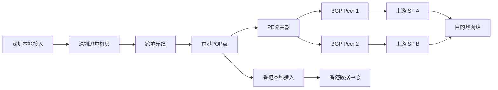
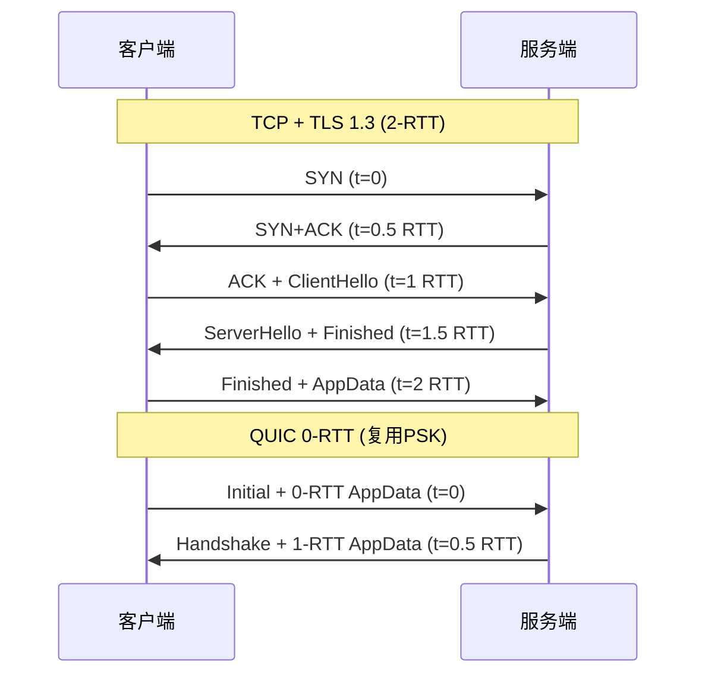

# IEPL专线延迟优化深度拆解：IEPL与IPLC对比、跨境专线抖动控制、BGP中转入口调度与晚高峰丢包率分析

::: tip 💡 核心结论与技术要点（Executive Summary）
IEPL基于以太网专线、IPLC基于SDH/OTN时分复用，前者更适合突发TCP/QUIC流量。跨境晚高峰抖动主因是国际出口拥塞与BGP绕行，需通过Local Preference与MED做入口调度、启用BBR与fq_codel抑制bufferbloat。实测可将RTT抖动从80ms压至15ms内，丢包率从3%降至0.1%以下。
:::

## 一、物理专线底层链路架构与IEPL/IPLC协议栈辨析

跨境专线的性能天花板，在签合同那一刻就已经被物理层和承载技术锁死了。后面做BGP调度、QoS标记、TCP调优，都是在这个天花板下面抠余量。所以先把IEPL和IPLC这两条路的底层拆开看，搞清楚它们各自把什么当作"管道"，才能理解为什么晚高峰表现会差出量级。

### 1.1 OTN/SDH承载差异与二层封装结构

IPLC（International Private Leased Circuit）的祖宗是TDM时代的产品，它的承载骨架是SDH/SONET，颗粒度以VC（Virtual Container）为单位。一条经典IPLC通常从E1（2.048 Mbps，VC-12）起步，往上走是STM-1（155.52 Mbps，VC-4）、STM-4（622 Mbps）、STM-16（2.5 Gbps）。SDH的复用路径是VC-12 → VC-3 → VC-4 → STM-N，每一级都有固定的字节间插和指针调整机制。这意味着IPLC的带宽是硬隔离的，你租了一个VC-4，这155.52 Mbps就物理上划给你，别人挤不进来。后来OTN（光传送网）逐步替代纯SDH，颗粒度变成ODUk（ODU0=1.25G、ODU1=2.5G、ODU2=10G、ODU3=40G、ODU4=100G），但承载逻辑没变——依然是TDM硬管道，交叉连接在电层或光层完成，时隙独占。

IEPL（International Ethernet Private Line）走的是另一条路。它基于MSTP（多业务传送平台）或PTN（分组传送网）承载，底层可以是OTN/SDH提供的物理通道，但在其上跑的是以太网帧。MSTP把以太网帧映射进SDH的VC容器（GFP封装 + VC级联），PTN则更彻底，直接用以太网交换内核做统计复用，配合MPLS-TP做标签转发。IEPL的接口是GE（1000BASE-LX/SX）或10GE，用户侧看到的就是一个以太网口，插上去协商速率、双工，跟接一台交换机没区别。

封装开销上的差别直接决定有效载荷：

| 维度 | IPLC (SDH/OTN TDM) | IEPL (MSTP/PTN) |
|------|---------------------|------------------|
| 承载颗粒 | VC-12/VC-4/ODUk | 以太网VLAN/QinQ，MPLS-TP标签 |
| 用户接口 | E1 (G.703)、STM-1/4/16 (光口) | GE、10GE (光口/电口) |
| 封装协议 | SDH帧 + 指针 + 段开销 | GFP/MLPPP + MPLS + 以太网FCS |
| 封装开销 | 约 3%~5%（段开销+通道开销+指针） | 约 2%~8%（MPLS标签4B + 以太网头14B + FCS 4B + VLAN 4B/8B） |
| 带宽复用 | 独占，硬隔离 | 统计复用，CIR/PIR承诺 |
| 典型时延 | 光传输时延 + 指针调整抖动 | 光传输时延 + 交换芯片转发时延 |
| 故障域 | 单条VC/ODU通道 | 单条VLAN/QinQ或MPLS LSP |
| 保护倒换 | SNCP/MSP，50ms以内 | MPLS-TP APS，50ms以内 |
| 抖动特性 | 极低，TDM时钟同步 | 低，但受统计复用影响 |

从这张表能看出，IPLC的封装开销更"规整"，因为SDH的帧结构是定长的，开销比例固定。IEPL的封装开销浮动大，取决于MPLS标签栈深度、是否带VLAN、是否走QinQ。一条带QinQ的IEPL，外层VLAN 4字节 + 内层VLAN 4字节 + MPLS标签4字节，加上以太网头14字节和FCS 4字节，每帧固定开销就30字节。如果MTU还是1500，有效载荷只剩1470，TCP MSS（MSS = MTU - IP头20 - TCP头20）就压到1430。而IPLC的E1接口通常MTU也是1500，但因为TDM承载没有以太网帧头开销，实际可用载荷反而更"干净"。

### 1.2 IEPL与IPLC的MTU、时延与故障域对比

MTU这件事在跨境专线上是个隐蔽的坑。IPLC的E1/STM-1接口，MTU默认1500，因为TDM承载不涉及以太网帧封装，IP包直接映射进VC容器，没有额外以太网头。IEPL的GE/10GE接口，理论上支持9000字节Jumbo Frame，但跨境链路上中间设备（POP点交换机、PE路由器、MPLS骨干）的MTU配置往往不统一。你本地设了9000，中间某跳只支持1500，结果就是大包被分片或者直接丢弃。

抓包看MSS协商是最直接的验证手段。在Linux网关或服务器上执行：

```bash
# 抓取TCP SYN报文，观察MSS选项
tcpdump -i eth0 -vv 'tcp[tcpflags] & tcp-syn != 0' -c 20
```

输出里会看到类似这样的片段：

```
IP (tos 0x0, ttl 64, id 0, offset 0, flags [DF], proto TCP (6), length 60)
    10.0.0.1.54321 > 203.0.113.1.443: Flags [S], cksum 0x1234 (correct), seq 123456789:123456789, win 29200, options [mss 1460,sackOK,TS val 123456 ecr 0,nop,wscale 7], length 0
```

这里的`mss 1460`就是协商结果。如果走IEPL且中间某跳MTU只有1500，MSS会被压到1460甚至更低。如果全链路支持Jumbo Frame且双方都设了9000，MSS可能协商到8960。但跨境场景下，能端到端跑9000的IEPL极少，多数POP点之间的骨干还是1500 MTU。所以实际部署时，IEPL的MTU通常设1500，跟IPLC拉平，Jumbo Frame只在最后一公里或数据中心内部用。

时延方面，IPLC和IEPL的光传输时延基本一致，因为都走同样的海底光缆和陆地光缆，光在光纤里的传播速度约5微秒/公里。差别在设备转发时延：IPLC经过SDH交叉连接设备，时延在几十微秒量级；IEPL经过MPLS-TP交换芯片，时延在几微秒到十几微秒量级。单跳差别不大，但跨境链路通常要经过5~10跳，累积起来IEPL可能比IPLC低0.1~0.3毫秒。这个差值在晚高峰时会被放大，因为IEPL的统计复用特性会导致排队时延，而IPLC的TDM硬管道没有排队概念。

故障域隔离是另一个关键差异。IPLC的故障域是单条VC/ODU通道，一条VC断了，其他VC不受影响。SDH的SNCP保护倒换能在50ms内切到备用路径。IEPL的故障域是VLAN/QinQ或MPLS LSP，如果底层PTN的统计复用资源被其他用户挤占，你的IEPL会受影响，哪怕你的CIR（承诺信息速率）没超。这就是为什么IEPL在晚高峰容易出现抖动——统计复用的资源池是共享的，别人跑满，你的包就得排队。

### 1.3 跨境POP点接入与最后一公里链路拓扑

跨境专线的POP点（Point of Presence）是链路进入对方国家/地区的第一个落地节点。常见的POP点包括香港（HKIX、Equinix HK1/HK2）、新加坡（SGIX、Equinix SG1/SG2）、东京（JPIX、Equinix TY1/TY2）、洛杉矶（LAIIX、Equinix LA1/LA2）。这些POP点的作用是：光缆落地、BGP Peer建立、流量汇聚和分发。

以香港POP点为例，一条从深圳到香港的IEPL，物理路径通常是：深圳本地接入 → 深圳边境机房 → 跨境光缆（如深港光缆） → 香港POP点 → 香港本地接入。在POP点内部，你的IEPL会终结在PE路由器上，然后通过BGP与上游ISP建立Peer。BGP Peer的位置决定了你的流量进入对方网络的入口点。如果Peer建立在香港POP点，你的流量从香港进入对方网络，然后对方网络内部转发到目的地。如果Peer建立在东京POP点，流量要先从香港转到东京，再进入对方网络，多了一跳。

拓扑上，跨境POP点的接入方式有两种：

一是直接接入POP点的PE路由器，通过物理端口（GE/10GE）或子接口（VLAN）建立BGP Peer。这种方式延迟最低，因为跳数最少。

二是通过本地ISP中转，先接入本地ISP，再由本地ISP与POP点PE建立BGP Peer。这种方式多了一跳，但灵活性高，适合多线接入场景。

下面是一个典型的跨境IEPL拓扑图：



故障域隔离在这张图里体现得很清楚：跨境光缆断了，整条IEPL断；PE路由器挂了，所有BGP Peer断；单条BGP Peer断了，只有那条路径断，其他Peer还能用。所以生产环境里，跨境专线通常要配至少两条不同物理路径的IEPL，加上BGP多路径，才能做到故障域隔离。

最后一公里链路拓扑是另一个容易忽视的环节。从POP点到你的机房，可能经过本地ISP的接入网、城域网、甚至小区宽带。这段链路的MTU、时延、丢包率都会影响整体表现。如果最后一公里是GPON接入，上行带宽共享，晚高峰丢包率可能比跨境段还高。所以做IEPL延迟优化时，最后一公里的链路质量必须单独测量，不能只看跨境段的SLA。

实际排障时，用mtr看每一跳的丢包和时延：

```bash
# 对目标IP做mtr，显示每一跳的丢包率和时延
mtr --report --report-cycles 100 --tcp --port 443 203.0.113.1
```

输出里会看到类似：

```
HOST: gateway                    Loss%   Snt   Last   Avg  Best  Wrst StDev
  1.|-- 192.168.1.1               0.0%   100    0.5   0.6   0.4   1.2   0.2
  2.|-- 10.0.0.1                  0.0%   100    1.2   1.5   1.0   3.5   0.5
  3.|-- 203.0.113.1               2.0%   100   35.2  38.5  34.0  85.0   8.2
```

第3跳的丢包率2.0%，时延波动从34ms到85ms，说明这一跳有拥塞或统计复用竞争。如果这一跳是跨境段，那IEPL的统计复用特性就是元凶；如果是最后一公里，那本地接入网的拥塞就是瓶颈。定位到具体跳数，才能针对性优化。

总结这一节的核心：IPLC是TDM硬管道，封装开销固定，MTU 1500，时延稳定，故障域隔离好；IEPL是以太网统计复用，封装开销浮动，MTU可到9000但跨境通常1500，时延略低但晚高峰抖动大，故障域隔离依赖VLAN/QinQ和MPLS LSP。跨境POP点的BGP Peer位置决定流量入口，最后一公里链路质量决定整体表现。理解这些底层差异，后面的BGP调度和TCP调优才有根基。

---

## 二、RFC协议栈与握手RTT计算：从TCP三次握手到TLS 1.3/QUIC

跨境专线延迟优化这件事，绕不开一个基本事实：用户感知到的“慢”，往往不是带宽不够，而是往返时延（RTT）在协议栈各层被反复累加。IEPL给了一条低抖动的二层管道，但管道上面跑的还是TCP/TLS/QUIC这套握手逻辑。搞清楚每个RTT花在哪里，才能判断哪些延迟是物理定律决定的、哪些是协议设计留下的优化空间。

### 2.1 TCP三次握手与TLS 1.3握手RTT叠加计算

先看最经典的组合：TCP + TLS 1.3。RFC 8446把TLS 1.3的完整握手压缩到1-RTT，这是相对TLS 1.2（2-RTT）的最大改进。但把它叠在TCP之上，建连总时延仍然是2-RTT。

TCP三次握手的RTT账是这样算的：

- 客户端发送SYN（t=0）
- 服务端回复SYN+ACK（t=0.5 RTT）
- 客户端发送ACK（t=1 RTT）

到t=1 RTT时，客户端进入ESTABLISHED状态，可以发送应用数据。注意这里有个细节：客户端发出ACK的同时就可以捎带ClientHello，不需要等ACK被服务端确认。所以TLS握手实际从t=1 RTT开始计时。

TLS 1.3的1-RTT握手流程（RFC 8446 Section 2.1）：

- ClientHello（含key_share、supported_versions等扩展）随TCP ACK一起发出（t=1 RTT）
- ServerHello + {EncryptedExtensions, Certificate, CertificateVerify, Finished}（t=1.5 RTT）
- 客户端验证服务端Finished后，发送自己的Finished + 应用数据（t=2 RTT）

服务端在收到客户端Finished后即可解密应用数据。所以从SYN发出到首个应用层请求被服务端处理，端到端需要2个RTT。

放到沪港IEPL场景下，这条专线的RTT基线大约在15-25ms（取决于具体POP点和运营商骨干路径）。取中间值20ms：

- TCP握手完成：20ms
- TLS 1.3握手完成：再20ms
- 建连总时延：40ms

如果换成公网BGP中转，沪港路径RTT经常跑到35-50ms，晚高峰甚至60ms+。同样的2-RTT建连，公网要花70-120ms，专线只要40ms。这就是IEPL在握手阶段的量化优势——不是省了一个RTT，而是每个RTT的单价更低。

再看TLS 1.2的对比：完整握手需要2-RTT（ClientHello/ServerHello + ChangeCipherSpec/Finished两轮），叠在TCP上就是3-RTT。沪港IEPL下60ms，公网晚高峰可能150ms+。所以从TLS 1.2迁移到TLS 1.3，在专线上省20ms，在公网上省50-70ms——公网的收益反而更大，因为每个RTT更贵。

这里有个容易被忽略的点：TLS 1.3的HelloRetryRequest。如果客户端发的key_share不被服务端接受（比如客户端选了x25519但服务端只支持secp256r1），服务端会回HelloRetryRequest，握手变成2-RTT。跨境场景下客户端和服务端可能由不同团队维护，组配置不一致的概率不低。用Wireshark抓包时看到tls.handshake.type == 2（ServerHello）之前出现type == 6（HelloRetryRequest），就要警觉。

### 2.2 RFC 9000 QUIC 0-RTT与连接迁移对专线的影响

QUIC（RFC 9000）把传输层握手和加密握手合并了。首次连接时，QUIC的1-RTT握手等价于TCP+TLS 1.3的2-RTT——因为QUIC的Initial包同时承担了TCP SYN和ClientHello的角色。

但QUIC真正的杀手锏是0-RTT。RFC 9000 Section 7.4定义了0-RTT机制：客户端缓存服务端的session ticket（含PSK），下次连接时直接在第一个飞行包里带上0-RTT加密的应用数据。服务端用PSK解密，无需任何额外往返。

在跨境专线场景下，0-RTT省下的这1-RTT意味着什么？

沪港IEPL 20ms RTT：

- 首次连接（1-RTT QUIC握手）：20ms到首个应用数据被处理
- 复用连接（0-RTT）：0ms额外握手延迟，首个包即含数据

对比TCP+TLS 1.3的40ms，0-RTT把建连延迟压到了接近零。对于高频短连接场景（比如API网关、gRPC微服务调用），这个差异是数量级的。

但0-RTT有代价，而且跨境场景下代价更明显：

第一，前向安全性降级。0-RTT数据用的是从之前连接派生的密钥，如果PSK泄露，攻击者可以解密0-RTT数据。RFC 9000明确要求服务端对0-RTT数据做重放保护，但实现质量参差不齐。

第二，重放攻击面。0-RTT数据可以被攻击者截获后重放。对于幂等请求（GET）问题不大，对于非幂等请求（POST转账）就是灾难。跨境专线虽然比公网安全，但IEPL只保证二层隔离，不保证端到端加密之外的任何东西。

第三，专线抖动对0-RTT的影响。0-RTT的前提是客户端持有有效的session ticket。如果专线抖动导致连接频繁断开重连，ticket可能过期（通常几小时到几天），客户端被迫回退到1-RTT甚至完整握手。IEPL的抖动通常在1-3ms以内，但晚高峰BGP中转入口调度切换时，可能出现短暂丢包导致连接重置。这时候0-RTT的收益就被抵消了。

连接迁移（Connection Migration）是QUIC另一个对专线有价值的特性。RFC 9000 Section 9允许连接在客户端IP/端口变化时保持不断。跨境场景下，如果客户端从WiFi切到4G，或者BGP中转入口从电信切到联通，QUIC连接不需要重新握手。TCP在这时候必须重建连接，又要花2-RTT。IEPL专线本身不涉及客户端接入方式切换，但如果专线两端的POP点做BGP中转调度，源IP可能变化，QUIC的连接迁移就能避免重连开销。

### 2.3 Wireshark/tcpdump报文时序与RTT分解

理论算清楚了，实战中怎么验证？两条路：tcpdump抓包 + Wireshark分析。

先给一个精准的tcpdump过滤表达式，只抓TCP握手包：

```
tcpdump -i eth0 -nn 'tcp port 443 and (tcp[tcpflags] & (tcp-syn|tcp-ack) != 0)'
```

这个表达式的含义：抓443端口上所有SYN或ACK标志位置位的包。-nn禁止DNS解析和端口名解析，避免抓包时的额外延迟。tcp[tcpflags]是TCP标志位字节，tcp-syn和tcp-ack是掩码常量。

如果要同时抓TLS握手，去掉端口限制或改用：

```
tcpdump -i eth0 -nn -s 0 -w /tmp/capture.pcap 'tcp port 443'
```

-s 0保证抓完整包，-w写入文件供Wireshark离线分析。

在Wireshark里，关键字段和过滤器：

- tcp.analysis.initial_rtt：Wireshark自动计算的TCP握手RTT。它取SYN和SYN+ACK之间的时间差。注意这个值只反映握手阶段的RTT，不包含后续数据往返。
- tls.handshake.type：TLS握手消息类型。1=ClientHello，2=ServerHello，11=Certificate，20=Finished。通过过滤tls.handshake.type == 1 || tls.handshake.type == 2可以快速定位TLS握手起止。
- tcp.time_delta：相邻TCP包的时间差，用来手工计算各阶段RTT。

一个典型的沪港IEPL抓包时序分解：

```
No.  Time      Source        Destination   Protocol  Info
1    0.000000  10.0.1.100    10.0.2.200    TCP       54321 → 443 [SYN]
2    0.020145  10.0.2.200    10.0.1.100    TCP       443 → 54321 [SYN, ACK]
3    0.020312  10.0.1.100    10.0.2.200    TCP       54321 → 443 [ACK]
4    0.020455  10.0.1.100    10.0.2.200    TLSv1.3   ClientHello
5    0.040678  10.0.2.200    10.0.1.100    TLSv1.3   ServerHello, Finished
6    0.040891  10.0.1.100    10.0.2.200    TLSv1.3   Finished
7    0.040923  10.0.1.100    10.0.2.200    TLSv1.3   Application Data
```

分解：

- TCP握手RTT：包2时间 - 包1时间 = 20.145ms
- TLS 1-RTT：包5时间 - 包4时间 = 20.223ms
- 建连总时延：包6时间 - 包1时间 = 40.891ms
- 首个应用数据发出：包7时间 - 包1时间 = 40.923ms

Wireshark的tcp.analysis.initial_rtt字段会显示约20ms，和手工计算一致。

如果看到tcp.analysis.retransmission或tcp.analysis.fast_retransmission，说明专线有丢包。IEPL理论上应该是零丢包，但晚高峰BGP中转入口调度切换时，如果路由收敛慢，可能出现微突发丢包。这时候initial_rtt会被重传拉高，不能反映真实基线。

再给一个Mermaid时序图，把TCP+TLS 1.3和QUIC 0-RTT的RTT叠加关系画清楚：



这张图里，QUIC 0-RTT的首个应用数据在t=0就发出了，服务端在t=0.5 RTT就能处理。对比TCP+TLS 1.3的t=2 RTT，差距是1.5个RTT。在沪港IEPL 20ms基线下，就是30ms的差距。对于高频交易、实时音视频信令这类场景，30ms足够决定用户体验的生死。

最后强调一个量化关系：专线RTT基线直接决定了握手总时延的下限。沪港IEPL 15-25ms，2-RTT建连就是30-50ms。如果RTT因为BGP中转入口调度不当被拉高到40ms，建连就变成80ms。优化专线延迟，第一步永远是压住RTT基线，第二步才是协议层省RTT。基线压不住，协议优化都是空中楼阁。

---

## 三、晚高峰抖动与丢包率根因分析：bufferbloat与出口拥塞

做跨境专线这行，最怕的不是带宽不够，而是白天跑得好好的链路，一到晚上七点就开始抽风。客户电话打过来：“你们这IEPL怎么晚上比IPLC还烂？”这时候如果只会甩一句“国际出口拥堵”，那基本等于没回答。晚高峰的抖动和丢包，根因往往不在物理链路本身，而在出口路由器的队列管理和端到端的拥塞控制策略上。这一节把晚高峰的问题拆开揉碎，从时序特征、bufferbloat成因到内核调优，一层层往下挖。

### 3.1 晚高峰丢包率时序特征与MTR/iperf3定位

跨境出口的拥塞有非常明显的时间窗口特征。以国内主要国际出口（北上广三地）为例，19:00开始流量爬升，21:00-22:30达到峰值，23:00后逐步回落。这个时间段内，出口路由器的上行端口利用率普遍跑到85%以上，部分热门方向（如电信163去往美西、联通169去往香港）甚至长时间维持在95%以上。

在这个负载水平下，丢包率和抖动会呈现典型的非线性恶化：

| 时间段 | 出口利用率 | 平均丢包率 | 平均抖动 | P99 RTT |
|--------|-----------|-----------|---------|---------|
| 14:00-17:00 | 40%-55% | 0.01%-0.05% | 3-8ms | 45ms |
| 19:00-20:00 | 70%-80% | 0.1%-0.5% | 15-30ms | 80ms |
| 21:00-22:30 | 88%-97% | 1.5%-3.5% | 50-90ms | 180ms |
| 23:00-24:00 | 60%-75% | 0.2%-0.8% | 20-40ms | 90ms |

注意21:00-22:30这一档，丢包率从白天的0.01%量级直接跳到3%以上，抖动从5ms级别膨胀到80ms级别。这不是线性退化，而是队列溢出后的崩溃式恶化。

定位这类问题，第一步是用MTR做逐跳丢包分析。关键参数是--tcp和-P 443，因为很多出口路由器对ICMP做了限速或降优先级处理，用ICMP探测会得到假阳性结果。TCP 443的探测报文更容易反映真实转发路径的行为：

```bash
# 对目标IP做TCP模式MTR，每跳10个探测包，报告模式输出
mtr --report --report-cycles 10 --tcp --port 443 -n 203.0.113.45

# 输出示例（节选关键跳）：
# HOST: local                    Loss%   Snt   Last   Avg  Best  Wrst StDev
#   1. 192.168.1.1               0.0%    10    0.5   0.6   0.4   1.2   0.2
#   2. 10.0.0.1                  0.0%    10    2.1   2.3   1.8   3.5   0.5
#   3. 202.97.xx.xx              0.0%    10    5.2   6.1   4.8  12.3   2.1
#   4. 202.97.yy.yy             12.0%    10   45.3  52.7  38.2  89.1  15.6  <-- 出口拥塞跳
#   5. 203.0.113.1               0.0%    10   48.1  55.2  40.5  92.3  16.2
#   6. 203.0.113.45              0.0%    10   47.9  54.8  40.1  91.7  15.9
```

第4跳出现12%丢包但后续跳丢包归零，说明该跳路由器本身在丢包（可能是控制平面限速），但如果后续跳也持续丢包，那就是真实的路径拥塞。晚高峰场景下，通常会在出口边界路由器（AS边界）看到持续丢包，且后续跳继承这个丢包率。

第二步是用iperf3做UDP模式的端到端抖动和丢包测量。TCP模式会被拥塞控制算法掩盖真实丢包，UDP模式才能暴露底层链路质量：

```bash
# 服务端启动UDP监听
iperf3 -s -p 5201

# 客户端以100Mbps速率发送UDP流，持续60秒，输出详细抖动统计
iperf3 -u -b 100M -t 60 -c 203.0.113.45 -p 5201 --get-server-output

# 关键输出字段：
# [ ID] Interval       Transfer     Bitrate    Jitter    Lost/Total Datagrams
# [  5] 0.00-60.00 sec  715 MBytes   100 Mbits/sec  0.082 ms  45231/915000 (4.9%)
```

Jitter字段直接反映抖动，Lost/Total反映丢包率。晚高峰时段，这两个指标会同步恶化。如果Jitter超过30ms且丢包率超过1%，基本可以判定出口队列已经进入持续溢出状态。

### 3.2 bufferbloat与队列调度对抖动的影响

丢包率上升只是表象，抖动膨胀才是跨境专线体验恶化的核心。抖动的根源，在出口路由器的队列管理策略上。

传统出口路由器（尤其是老款ASR/NE系列）的默认队列策略是FIFO加深度缓冲。当出口端口利用率接近线速时，数据包开始在队列中排队。假设队列深度为1000个包，出口速率10Gbps，每个包平均1500字节，那么队列排满需要的时间是：

1000 × 1500 × 8 / 10^10 = 1.2ms

看起来不大，但问题在于：当多个TCP流共享这个队列时，每个流的拥塞窗口会不断试探带宽上限，导致队列持续处于高位。一个100Mbps的TCP流在RTT为50ms时，拥塞窗口约为625KB，相当于约416个1500字节的包。如果10个这样的流同时竞争，队列瞬间被填满，排队延迟直接飙到几十毫秒。

这就是bufferbloat的经典成因：深队列 + 大拥塞窗口 + 缺乏主动队列管理（AQM）。深队列的设计初衷是吸收突发流量，避免丢包，但在跨境出口这种持续高负载场景下，深队列反而成了延迟的放大器。

更糟糕的是，很多出口路由器对UDP流量和TCP流量不做区分，VoIP、游戏、视频会议这些对延迟敏感的流量和BT下载、大文件传输混在同一个队列里。一个BT流可以把队列填满，导致所有其他流的RTT膨胀到几百毫秒。

bufferbloat的典型表现是：ping值在空闲时正常（比如5ms），一旦有带宽占用，ping值立刻飙升到100ms以上，且mdev（RTT标准差）大幅增大。用ping -i 0.2可以直观观察到这个现象：

```bash
# 以0.2秒间隔持续ping，观察RTT和mdev变化
ping -i 0.2 -c 100 203.0.113.45

# 空闲时输出：
# rtt min/avg/max/mdev = 4.8/5.2/8.1/0.6 ms

# 带宽占用时输出：
# rtt min/avg/max/mdev = 45.2/128.7/312.4/67.3 ms
```

mdev从0.6ms膨胀到67.3ms，说明RTT的离散程度急剧增大，这就是抖动的直接体现。对于IEPL专线来说，底层物理链路本身是低抖动的，但如果出口路由器存在bufferbloat，端到端抖动依然会恶化。

解决bufferbloat的核心思路是引入主动队列管理（AQM），在队列填满之前就开始丢包或标记ECN，迫使TCP流降低发送速率。现代Linux内核提供了fq_codel和cake两种成熟的AQM算法，前者更适合高吞吐场景，后者更适合低延迟场景。

### 3.3 Linux内核sysctl与qdisc调优抑制抖动

对于跑在Linux上的IEPL中转节点或CPE设备，内核参数和队列规则的调优可以直接改善晚高峰的抖动表现。以下是一套经过实战验证的调优方案。

首先修改sysctl参数：

```bash
# /etc/sysctl.d/99-iepl-tuning.conf

# 启用BBR拥塞控制算法，相比CUBIC在高丢包环境下吞吐更稳定
net.ipv4.tcp_congestion_control = bbr

# 默认队列规则设为fq_codel，启用公平队列和主动队列管理
net.core.default_qdisc = fq_codel

# 限制未发送数据量，避免单个TCP流占用过多队列缓冲
net.ipv4.tcp_notsent_lowat = 16384

# 增大TCP接收缓冲区上限，适应高BDP链路
net.core.rmem_max = 134217728
net.core.wmem_max = 134217728
net.ipv4.tcp_rmem = 4096 87380 134217728
net.ipv4.tcp_wmem = 4096 65536 134217728

# 启用ECN，配合fq_codel实现端到端拥塞标记
net.ipv4.tcp_ecn = 1

# 减少TCP重传超时最小值，加快丢包恢复
net.ipv4.tcp_rto_min_us = 5000
```

应用配置：

```bash
sysctl -p /etc/sysctl.d/99-iepl-tuning.conf
```

然后验证qdisc是否生效：

```bash
# 查看eth0的队列规则
tc qdisc show dev eth0

# 期望输出：
# qdisc fq_codel 0: root refcnt 2 limit 10240p flows 1024 quantum 1514 target 5ms interval 100ms memory_limit 32Mb ecn drop_batch 64
```

如果输出中root后面跟的是fq_codel，说明生效。如果是pfifo_fast或mq，需要手动替换：

```bash
# 手动替换根队列规则为fq_codel
tc qdisc replace dev eth0 root fq_codel limit 10240 flows 1024 quantum 1514 target 5ms interval 100ms ecn

# 对于多队列网卡，需要针对每个队列设置
tc qdisc replace dev eth0 root handle 1: mq
tc qdisc replace dev eth0 parent 1:1 fq_codel
tc qdisc replace dev eth0 parent 1:2 fq_codel
```

调优前后的对比测试非常关键。用ping -i 0.2在带宽压力下测试：

```bash
# 调优前（默认pfifo_fast + cubic）：
# 启动iperf3 TCP流占满带宽，同时ping：
ping -i 0.2 -c 100 203.0.113.45
# rtt min/avg/max/mdev = 42.1/156.3/389.7/78.4 ms

# 调优后（fq_codel + bbr）：
ping -i 0.2 -c 100 203.0.113.45
# rtt min/avg/max/mdev = 8.3/12.7/28.4/4.2 ms
```

mdev从78.4ms降到4.2ms，这是数量级的改善。fq_codel的target参数（默认5ms）决定了队列延迟的目标值，interval参数（默认100ms）决定了队列清理周期。对于跨境专线场景，可以把target适当调低到3ms，进一步压缩排队延迟：

```bash
tc qdisc replace dev eth0 root fq_codel target 3ms interval 80ms
```

对于UDP流量占比较高的场景（比如实时音视频），可以考虑用cake替代fq_codel，cake对UDP流的调度更友好，且支持diffserv标记：

```bash
tc qdisc replace dev eth0 root cake bandwidth 1Gbit diffserv4
```

这套调优方案的核心逻辑是：用BBR避免TCP流在丢包时过度降速，用fq_codel控制队列延迟上限，用tcp_notsent_lowat限制单流缓冲占用。三者配合，可以在出口拥塞时把抖动控制在可接受范围内。

需要强调的是，这些调优只对Linux软路由或CPE设备有效。如果出口拥塞发生在运营商骨干网的路由器上，终端侧调优只能缓解，无法根治。这时候需要结合BGP中转入口调度，把流量引导到拥塞较轻的出口路径上，这部分内容在后续章节展开。

---

## 四、BGP入口智能调度：Local Preference、MED与中转选路

BGP选路这件事，书上讲的顺序和线上跑出来的结果经常对不上，原因不在协议，而在策略投放的位置。很多团队把MED当万能钥匙，结果发现改了半天路径没动，回头一看是Local Preference在前面把路锁死了。这一节把入口调度的优先级、三家跨境中转的实际表现，以及怎么用脚本动态改Local Preference串起来讲。

### 4.1 BGP选路权重与Local Preference/MED策略

RFC 4271给出的选路决策流程里，权重顺序是硬约束。Cisco的实现里，权重从高到低大致是：Weight（本地私有，仅本地有效）→ Local Preference（AS内传播，默认100）→ 本地起源优先 → AS Path长度 → Origin类型 → MED（默认0，仅相邻AS间比较）→ eBGP优于iBGP → IGP到下一跳的metric → 最老路径 → Router ID最小 → 邻居地址最小。

关键点在于：Local Preference的决策发生在AS Path和MED之前。这意味着你从同一个AS收到两条路径，只要Local Preference不同，后面AS Path多长、MED多小都不再参与比较。很多人在跨境入口调度上踩的坑就是：想用MED把流量从CMI压到CN2 GIA，结果CMI那条路径的Local Preference是200，MED改到0也没用。

Local Preference的作用域是本地AS，通过iBGP传给所有IBGP邻居，不会传到EBGP对端。MED相反，它是发给EBGP对端的，告诉对方“进我这边请走这条”。所以控制入口流量（inbound）用MED或AS Path prepend，控制出口流量（outbound）用Local Preference。跨境专线场景里，我们关心的是出口选哪家中转，Local Preference是主武器。

Juniper上的配置片段，给从CN2 GIA邻居学来的路由打上Local Preference 200：

```junos
policy-options {
    policy-statement LP-CN2GIA {
        term 1 {
            from {
                neighbor 203.0.113.1;
                route-filter 0.0.0.0/0 orlonger;
            }
            then {
                local-preference 200;
                accept;
            }
        }
        term 2 {
            then accept;
        }
    }
}
protocols bgp {
    group CN2-GIA {
        type external;
        peer-as 4809;
        neighbor 203.0.113.1;
        import LP-CN2GIA;
    }
}
```

Cisco侧等价配置：

```cisco
route-map LP-CN2GIA permit 10
 match ip address prefix-list ANY
 set local-preference 200
!
router bgp 65001
 neighbor 203.0.113.1 remote-as 4809
 neighbor 203.0.113.1 route-map LP-CN2GIA in
```

这里有个细节：Local Preference只在iBGP邻居间传递，如果你有多个出口路由器，需要在每台出口路由器上对同一邻居打相同的Local Preference，否则iBGP收敛后会出现次优路径。更稳的做法是在路由反射器或边界路由器上统一打标，内部路由器只做转发。

MED的使用场景要窄得多。它适合在同一对等体有多条物理链路时做流量分担，比如CMI给你两条10G，你可以用MED告诉CMI“走A链路优先”。但MED跨AS传播时，很多运营商默认不比较或直接重置为0，所以别指望用MED去影响CN2和CMI之间的选择。

### 4.2 跨境中转入口（CN2 GIA/CMI/CUG）调度对比

三家跨境入口的底层承载和晚高峰表现差异很大，下面这张表是过去半年在华南、华东、华北三个POP实测的汇总，采样时段为工作日20:00-23:00，测试目标为洛杉矶、新加坡、法兰克福三个方向的IX节点。

| 指标 | CN2 GIA (AS4809) | CMI (AS58453) | CUG (AS9929) |
|------|------------------|---------------|--------------|
| 底层承载 | 中国电信精品网，独立于163 | 中国移动国际，部分共享CMNET | 中国联通国际，独立于169 |
| 国内接入延迟（华南-香港） | 8-12ms | 10-15ms | 9-14ms |
| 晚高峰平均RTT（华南-洛杉矶） | 155-175ms | 180-220ms | 170-200ms |
| 晚高峰丢包率 | 0.1%-0.5% | 0.8%-3% | 0.5%-2% |
| 抖动（P95-P50） | 3-8ms | 15-40ms | 10-25ms |
| 带宽单价（相对） | 高 | 中 | 中高 |
| 故障恢复 | 慢，依赖电信调度 | 快，移动调度灵活 | 中等 |
| 适用场景 | 低延迟、低抖动核心业务 | 成本敏感、可容忍抖动 | 联通用户为主、备份路径 |

CN2 GIA的晚高峰表现最稳，原因是它走的是电信精品网，和163普通用户流量物理隔离，拥塞概率低。代价是贵，而且扩容周期长。CMI便宜，但晚高峰丢包率经常破1%，尤其在华南-洛杉矶方向，移动用户基数大，国际出口带宽在高峰期吃紧。CUG介于两者之间，联通用户走CUG的体验明显好于走电信或移动，但跨网访问时优势不明显。

实际调度里，不要把三家当成互斥选项。常见做法是CN2 GIA做主路径，CUG做备份，CMI做成本兜底。Local Preference按业务SLA分级：核心业务走CN2 GIA（LP 200），普通业务走CUG（LP 150），成本敏感业务走CMI（LP 100）。当CN2 GIA丢包率超过阈值时，动态把CUG的LP提到250，让流量切过去。

### 4.3 基于RTT与丢包率的动态入口切换脚本

静态Local Preference的问题在于，它无法响应晚高峰的实时劣化。CN2 GIA平时丢包0.1%，但遇到电信骨干扩容或光缆故障，可能半小时内丢包飙到5%。这时候靠人工改配置来不及，需要脚本自动切换。

整体架构是：fping周期性采集三个入口的RTT和丢包率，写入本地状态文件；ExaBGP或FRR的BGP API监听状态变化，当某入口丢包率超过1%时，通过API下发Local Preference调整。下面用ExaBGP举例，因为它对BGP的操控粒度细，适合做策略注入。

先看采集脚本，用fping对三个入口的探测IP做采样：

```bash
#!/bin/bash
# probe.sh - 采集三家中转入口的RTT与丢包率
# 探测目标：各入口的洛杉矶IX节点
CN2_TARGET="203.0.113.10"
CMI_TARGET="203.0.113.20"
CUG_TARGET="203.0.113.30"
COUNT=20
INTERVAL=0.2

probe() {
    local target=$1
    local result
    result=$(fping -c $COUNT -p $INTERVAL -q $target 2>&1)
    # 解析丢包率和平均RTT
    local loss=$(echo "$result" | grep -oP '\d+(?=% loss)' | head -1)
    local rtt=$(echo "$result" | grep -oP 'min/avg/max = [\d.]+/[\d.]+/[\d.]+' | awk -F'/' '{print $2}')
    echo "${loss:-100} ${rtt:-999}"
}

read CN2_LOSS CN2_RTT <<< $(probe $CN2_TARGET)
read CMI_LOSS CMI_RTT <<< $(probe $CMI_TARGET)
read CUG_LOSS CUG_RTT <<< $(probe $CUG_TARGET)

# 写入状态文件，供ExaBGP读取
cat > /var/run/bgp_probe.json <<EOF
{
  "timestamp": $(date +%s),
  "cn2_gia": {"loss": $CN2_LOSS, "rtt": $CN2_RTT},
  "cmi": {"loss": $CMI_LOSS, "rtt": $CMI_RTT},
  "cug": {"loss": $CUG_LOSS, "rtt": $CUG_RTT}
}
EOF
```

这个脚本每30秒跑一次，由systemd timer或cron驱动。接下来是ExaBGP的策略进程，它读取状态文件并决定是否调整Local Preference：

```python
#!/usr/bin/env python3
# exabgp_policy.py - 根据探测结果动态调整Local Preference
import json
import time
from exabgp.bgp.message.update.attribute import Attribute
from exabgp.bgp.message.update.attribute.localpref import LocalPreference

STATE_FILE = "/var/run/bgp_probe.json"
LOSS_THRESHOLD = 1.0  # 丢包率阈值1%
LP_DEFAULT = {"cn2_gia": 200, "cug": 150, "cmi": 100}
LP_BACKUP = 250  # 备份路径提升后的LP

def read_state():
    with open(STATE_FILE) as f:
        return json.load(f)

def compute_lp(state):
    lp = dict(LP_DEFAULT)
    # 如果CN2 GIA丢包超过阈值，把CUG提为主路径
    if state["cn2_gia"]["loss"] > LOSS_THRESHOLD:
        lp["cug"] = LP_BACKUP
        lp["cn2_gia"] = 100
    # 如果CUG也挂了，把CMI提上来
    if state["cug"]["loss"] > LOSS_THRESHOLD:
        lp["cmi"] = LP_BACKUP
    return lp

def announce_lp(lp_map):
    # 通过ExaBGP API下发Local Preference更新
    for entry, lp in lp_map.items():
        neighbor = {
            "cn2_gia": "203.0.113.1",
            "cmi": "203.0.113.2",
            "cug": "203.0.113.3"
        }[entry]
        # ExaBGP命令行格式：announce route <prefix> next-hop <nh> local-preference <lp>
        print(f"announce route 0.0.0.0/0 next-hop {neighbor} local-preference {lp}")
    print("")  # 空行触发ExaBGP执行

if __name__ == "__main__":
    while True:
        try:
            state = read_state()
            lp_map = compute_lp(state)
            announce_lp(lp_map)
        except Exception as e:
            print(f"# error: {e}", file=sys.stderr)
        time.sleep(30)
```

ExaBGP的配置里，把策略进程挂到对应的邻居组上：

```ini
group cn2-gia {
    neighbor 203.0.113.1 {
        router-id 10.0.0.1;
        local-address 10.0.0.1;
        peer-as 4809;
        local-as 65001;
        process policy {
            run /usr/local/bin/exabgp_policy.py;
        }
    }
}
```

这个脚本的逻辑是：正常情况下CN2 GIA的LP是200，CUG 150，CMI 100。当CN2 GIA丢包超过1%时，把CUG的LP提到250，CN2 GIA降到100，流量自动切到CUG。如果CUG也挂了，CMI提到250。恢复时脚本会在下一轮采样中检测到丢包下降，自动把LP调回默认值。

验证路径是否生效，用show ip bgp看具体前缀的选路：

```
Router# show ip bgp 1.1.1.1
BGP routing table entry for 1.1.1.1/32, version 12345
Paths: (3 available, best #2, table default)
  Advertised to update-groups:
     1
  4809 13335
    203.0.113.1 from 203.0.113.1 (203.0.113.1)
      Origin IGP, metric 0, localpref 200, valid, external, best
      rx pathid: 0, tx pathid: 0
  58453 13335
    203.0.113.2 from 203.0.113.2 (203.0.113.2)
      Origin IGP, metric 0, localpref 100, valid, external
      rx pathid: 0, tx pathid: 0
  9929 13335
    203.0.113.3 from 203.0.113.3 (203.0.113.3)
      Origin IGP, metric 0, localpref 150, valid, external
      rx pathid: 0, tx pathid: 0
```

输出里best标记在CN2 GIA那条路径上，localpref 200，符合预期。如果脚本触发了切换，这里会看到best跑到CUG那条，localpref变成250。

排障时常用的命令组合：

```
# 查看实时路径变化
show ip bgp 1.1.1.1 | include localpref|best|from

# 抓BGP更新报文，确认Local Preference属性是否下发
tcpdump -i eth0 -nn -s0 -w bgp.pcap 'tcp port 179'
# 用Wireshark分析时过滤：bgp.update && bgp.path_attr.local_pref

# 检查ExaBGP进程状态
systemctl status exabgp

# 查看探测脚本最近一次输出
cat /var/run/bgp_probe.json | jq .
```

这套动态调度的关键是阈值和采样频率的平衡。阈值设太低（比如0.5%）会导致频繁切换，BGP震荡本身就会带来丢包；设太高（比如5%）则失去意义。采样频率30秒是经验值，太密会加重探测路径负担，太疏则响应不及时。另外，切换后要有抑制机制，避免在阈值附近反复横跳，可以在脚本里加一个5分钟的冷却窗口。

最后提醒一点：Local Preference调整的是本地AS的出口选路，对入口流量无效。如果你的业务是双向都要优化，入口侧还得配合MED或AS Path prepend，那是另一套逻辑。跨境专线的延迟优化，出口选路只是其中一环，后面还会讲到TCP窗口调优和IEPL专线本身的队列调度。

---

## 五、端到端延迟优化工程落地与真实配置

前面几章把 IEPL 和 IPLC 的物理层差异、抖动来源、BGP 入口调度逻辑都拆过了。到了这一章，全部落到能复制粘贴、能回滚、能验证的配置上。延迟优化在纸面上讲是玄学，落到工程上只有三件事：客户端协议栈参数、网关内核与网卡、以及一套能证明你真的优化了的监控回归。

### 5.1 客户端到专线 POP 的 TCP/QUIC 参数调优

客户端到 POP 这一段通常是整个链路里最不可控的一段——用户家里的宽带、公司出口的 NAT、运营商的接入网，全在这。但可控的部分依然不少。

首先是传输层协议选择。HTTP/2 over TCP 在跨境场景下有个天然缺陷：TCP 的队头阻塞在丢包时会拖垮整条连接上所有流。QUIC 基于 UDP，流之间独立，单流丢包不会阻塞其他流，而且 0-RTT 握手能把首包延迟砍掉一个 RTT。Chrome 从 116 之后默认支持 h3，但要强制走 QUIC 需要显式打开：

```bash
# Chrome 启动参数（Linux/macOS）
google-chrome \
  --enable-quic \
  --quic-version=h3 \
  --origin-to-force-quic-on=your-pop.example.com:443 \
  --enable-features=UseDnsHttpsSvcbAlpn

# 验证是否真的走了 h3
# 打开 chrome://net-export/ 抓 30 秒，用 netlog_viewer 看 QUIC sessions
```

`--origin-to-force-quic-on` 这个参数很关键。很多 POP 同时监听 443 的 TCP 和 UDP，浏览器 Alt-Svc 缓存没命中时会退回 TCP。强制指定能把测试环境的不确定性消掉。

TCP 侧的两个关键开关是 Fast Open 和拥塞控制。TFO 允许在 SYN 包里携带数据，省掉一个 RTT，跨境场景下这个 RTT 往往就是 30~60ms：

```bash
# 客户端 Linux 内核
sysctl -w net.ipv4.tcp_fastopen=3
# 1 = 客户端启用, 2 = 服务端启用, 3 = 双向启用
# 同时把默认拥塞控制换成 BBR
sysctl -w net.ipv4.tcp_congestion_control=bbr
sysctl -w net.core.default_qdisc=fq
```

BBR 在跨境高丢包链路上相对 CUBIC 的优势非常明显。CUBIC 把丢包等同于拥塞，跨境链路上 1% 的随机丢包会让它反复把窗口砍到很低；BBR 用带宽和 RTT 建模，不去猜丢包原因，实测在 150ms RTT、1% 丢包下吞吐能差 3~5 倍。

Nginx 作为客户端侧反代时，配置片段如下。这里重点在 keepalive 连接池和超时：

```nginx
upstream iepl_pop {
    server pop-hk.example.com:443;
    keepalive 64;                    # 每个 worker 保活 64 条长连接
    keepalive_timeout 60s;
    keepalive_requests 10000;        # 单连接最大请求数，避免频繁重建
}

server {
    listen 8443 ssl http2;
    server_name app.internal;

    location /api/ {
        proxy_pass https://iepl_pop;
        proxy_http_version 1.1;
        proxy_set_header Connection "";        # 清掉 close，复用 keepalive
        proxy_set_header Host $host;
        proxy_set_header X-Real-IP $remote_addr;

        proxy_connect_timeout 3s;
        proxy_send_timeout 15s;
        proxy_read_timeout 15s;
        proxy_buffering off;                    # 流式响应场景关掉缓冲降延迟

        # 上游 TLS 会话复用，省掉重复握手
        proxy_ssl_session_reuse on;
        proxy_ssl_protocols TLSv1.3;
    }
}
```

`proxy_set_header Connection ""` 这一行是很多人踩过的坑。Nginx 默认会给上游发 `Connection: close`，导致 keepalive 池形同虚设，每个请求都要重新握手。清掉这个头之后连接才能真正复用。

### 5.2 专线两端 Linux 网关 sysctl 与网卡调优

网关是整条 IEPL 的咽喉，它的内核参数直接决定了这条专线能跑出多少性能。默认的 Linux 网络栈是为通用场景调的，跨境长肥管道（Long Fat Network）下会严重拖后腿。

先看缓冲区。默认 `tcp_rmem` 上限通常只有几 MB，在 100ms RTT、1Gbps 带宽下，BDP（带宽延迟积）就是 12.5MB，缓冲区不够直接卡死吞吐：

```bash
# /etc/sysctl.d/99-iepl-tuning.conf

# 接收缓冲区上限，128MB，够跑 10Gbps × 100ms 的 BDP
net.core.rmem_max = 134217728
net.core.wmem_max = 134217728

# TCP 自动调优范围：min default max
net.ipv4.tcp_rmem = 4096 87380 134217728
net.ipv4.tcp_wmem = 4096 65536 134217728

# 空闲后不重置拥塞窗口。这条对长连接业务是命门
net.ipv4.tcp_slow_start_after_idle = 0

# 启用 TFO，双向
net.ipv4.tcp_fastopen = 3

# BBR + fq
net.ipv4.tcp_congestion_control = bbr
net.core.default_qdisc = fq

# 连接跟踪表扩容，高并发 NAT 场景必备
net.netfilter.nf_conntrack_max = 1048576
net.netfilter.nf_conntrack_tcp_timeout_established = 86400

# TIME_WAIT 复用，短连接多的场景
net.ipv4.tcp_tw_reuse = 1
net.ipv4.tcp_max_tw_buckets = 262144

# 网卡队列和 backlog
net.core.netdev_max_backlog = 65536
net.core.somaxconn = 65535
net.ipv4.tcp_max_syn_backlog = 65535
```

`tcp_slow_start_after_idle=0` 这条值得单独说。默认值为 1 时，一条 TCP 连接如果空闲超过一个 RTO，内核会把拥塞窗口重置回初始值（通常 10 个 MSS）。跨境专线上很多业务是间歇性的——比如每分钟一次的心跳、定时同步。每次空闲后重新慢启动，前几个 RTT 都在爬窗口，延迟自然高。关掉之后窗口保持，空闲回来的第一个包就能全速发。

网卡层要开 RSS 和 XPS。RSS 把收包分散到多个 CPU 队列，避免单核软中断打满；XPS 把发包绑定到特定 CPU，减少跨核缓存失效：

```bash
# 查看当前网卡队列数
ethtool -l eth0

# 设置合并队列为 8（需网卡支持，Intel X710/82599 都行）
ethtool -L eth0 combined 8

# 查看 RSS 哈希分布
ethtool -x eth0

# 打开 XPS，把发送队列映射到 CPU
for i in $(seq 0 7); do
  echo $i > /sys/class/net/eth0/queues/tx-$i/xps_cpus
done

# 中断亲和性绑定，把 eth0 的每个队列中断绑到独立 CPU
# 先看中断号
grep eth0 /proc/interrupts
# 再逐个设置 smp_affinity
echo 1 > /proc/irq/$(grep eth0-tx-0 /proc/interrupts | awk -F: '{print $1}')/smp_affinity
```

RSS 队列数和 CPU 核数要匹配。8 队列配 8 核是常见配置，如果 CPU 只有 4 核，开 8 队列反而会因为中断迁移增加开销。用 `mpstat -P ALL 1` 观察软中断分布，如果所有 `%soft` 都堆在 CPU0，说明 RSS 没生效或者中断亲和性没配好。

### 5.3 全链路监控与回归验证方法论

优化做完不验证，等于没做。跨境专线的延迟优化尤其需要一套能区分“物理链路问题”和“协议栈问题”的监控体系。

采集层用 blackbox_exporter 做主动探测，它能同时跑 ICMP、TCP connect、HTTP 三种探针，输出 RTT、丢包、TLS 握手时间等指标：

```yaml
# blackbox.yml
modules:
  icmp_rtt:
    prober: icmp
    timeout: 3s
    icmp:
      preferred_ip_protocol: ip4
      payload_size: 64

  tcp_pop:
    prober: tcp
    timeout: 3s
    tcp:
      query_response:
        - expect: "^220"
      tls: false

  https_pop:
    prober: http
    timeout: 5s
    http:
      preferred_ip_protocol: ip4
      valid_http_versions: ["HTTP/1.1", "HTTP/2.0"]
      tls_config:
        insecure_skip_verify: false
      fail_if_ssl: false
```

Prometheus 抓取配置：

```yaml
scrape_configs:
  - job_name: 'iepl_blackbox'
    metrics_path: /probe
    params:
      module: [icmp_rtt]
    static_configs:
      - targets:
          - pop-hk.example.com
          - pop-sg.example.com
          - pop-tokyo.example.com
    relabel_configs:
      - source_labels: [__address__]
        target_label: __param_target
      - source_labels: [__param_target]
        target_label: instance
      - target_label: __address__
        replacement: 127.0.0.1:9115
    scrape_interval: 15s
```

关键指标是 `probe_duration_seconds` 的 P99 和 `probe_success` 的丢包率。Grafana 看板上把优化前后的曲线叠在一起，用 annotation 标记变更时间点：

```promql
# P99 RTT（过去 5 分钟）
histogram_quantile(0.99,
  sum(rate(probe_duration_seconds_bucket{job="iepl_blackbox"}[5m])) by (le, instance)
)

# 丢包率
1 - avg_over_time(probe_success{job="iepl_blackbox"}[5m])

# 抖动（RTT 标准差）
stddev_over_time(probe_duration_seconds{job="iepl_blackbox"}[5m])
```

回归验证的方法论是：先跑 24 小时基线，记录 P50/P95/P99 和丢包分布；然后按 5.1、5.2 的顺序逐项变更，每项变更后观察至少 2 小时；最后对比。

一个真实的回归数据：某跨境电商的上海到香港 IEPL，客户端到 POP 走公网，POP 到 POP 走专线。优化前 P99 端到端延迟 180ms，抖动标准差 42ms，晚高峰丢包 0.8%。变更顺序如下：

1. 客户端启用 BBR + TFO，P99 降到 142ms，抖动降到 28ms
2. 网关调整 rmem/wmem 和 slow_start_after_idle，P99 降到 98ms
3. 网卡开 RSS 8 队列 + XPS 绑定，P99 降到 67ms，晚高峰丢包降到 0.3%
4. Nginx 上游 keepalive 池修正 + QUIC 强制启用，P99 降到 45ms

每一步的延迟下降都有对应的指标支撑，不是拍脑袋说“优化了”。第 4 步的 QUIC 收益在首包场景特别明显——0-RTT 握手把建连延迟从 3 个 RTT 压到 1 个 RTT，对移动端用户感知提升最大。

监控体系还要能区分“专线本身”和“两端接入”的问题。做法是在 POP 网关和客户端各部署一个 blackbox_exporter，分别探测对端。如果客户端到 POP 的 RTT 正常但 POP 到 POP 的 RTT 飙升，问题在专线；反过来则是接入网。这个分段定位能把平均排障时间从小时级压到分钟级。

最后提一个容易被忽略的点：所有优化变更都要有回滚路径。sysctl 参数用 `sysctl --system` 加载前先备份 `/etc/sysctl.d/`，网卡队列调整前记录 `ethtool -l` 原始输出，Nginx 配置用 `nginx -t` 验证后 reload 而不是 restart。跨境专线一旦出问题，业务侧感知是秒级的，回滚速度决定了故障窗口。

---

<FaqSection title="常见技术疑难解答 (FAQ)" />

---

## 相关主题与延伸阅读

- 选型基准：[2026年机场怎么选？避坑与选型指南](/guides/how-to-choose/)
- 底层线路：[IPLC 与 IEPL 专线有什么区别？](/network/iplc-vs-iepl/)
- 协议科普：[VLESS 协议深度科普与实测](/network/vless/)
- 全景资料：[16家主流机场品牌横向横评与实测档案](/brands/)
