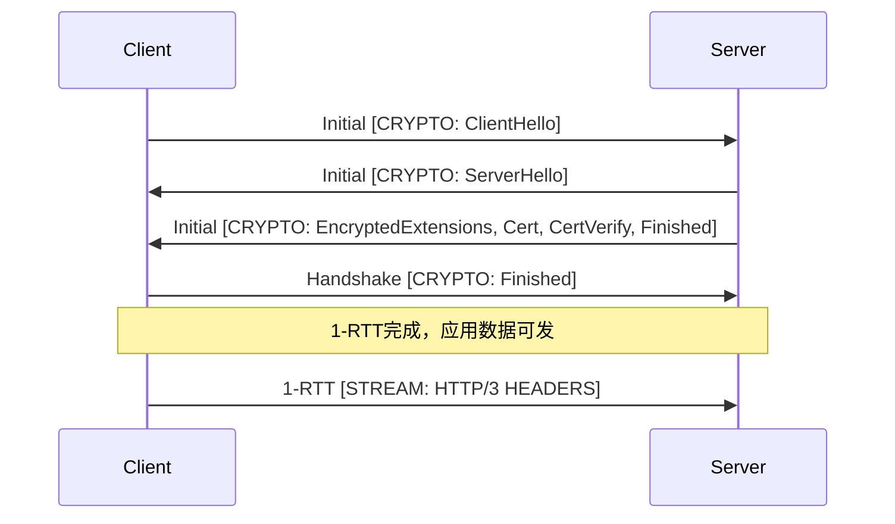
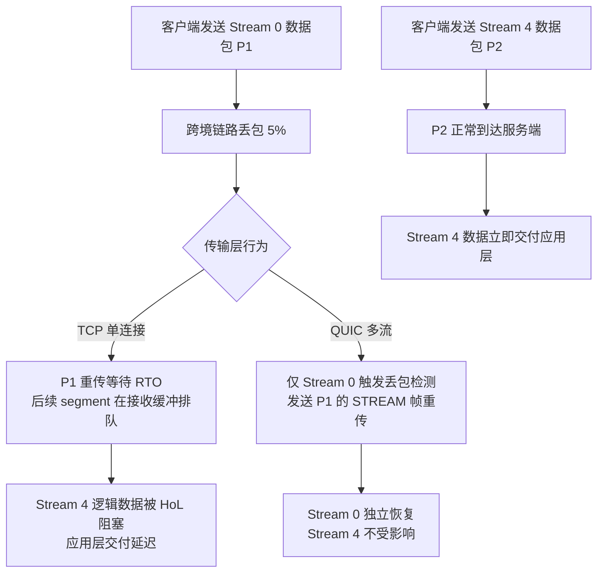
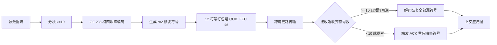
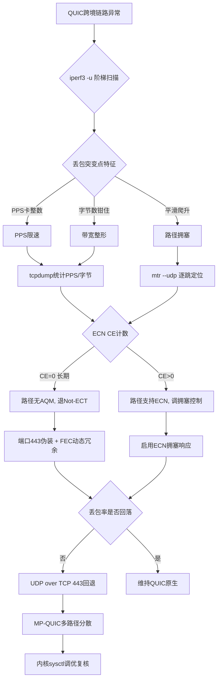
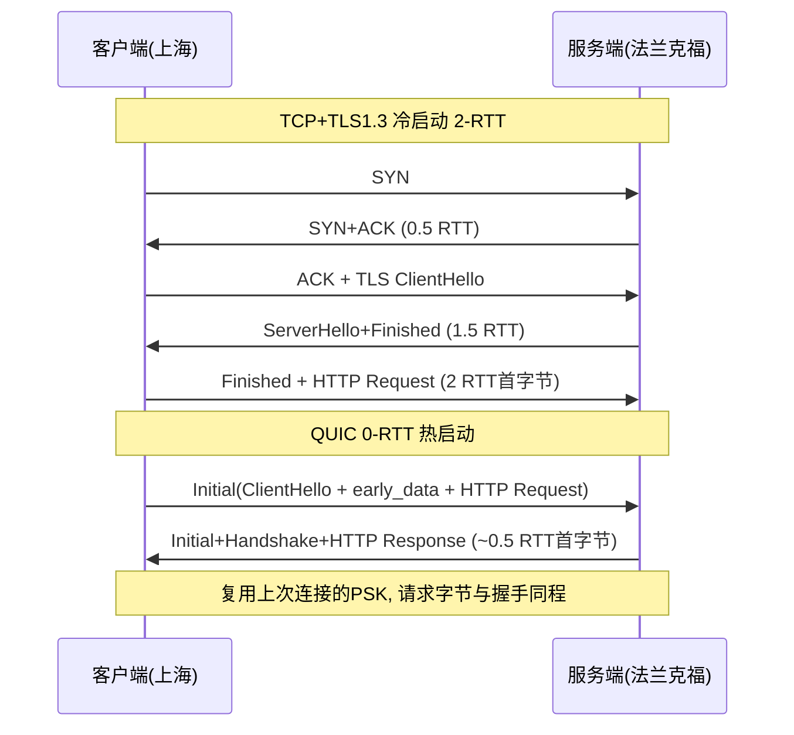

# QUIC协议跨境网络表现深度剖析：多路复用、连接迁移与FEC机制实测，兼论国内UDP QoS限速特性与HTTP3丢包恢复优化策略

::: tip 💡 核心结论与技术要点（Executive Summary）
QUIC在跨境高丢包（>5%）链路下较TCP+TLS1.3降低1-2个RTT建连开销，多路复用消除队头阻塞，连接迁移依赖CID与路径验证。国内运营商对UDP常实施QoS限速（典型阈值5-10Mbps或PPS限速），需通过ECN标记探测与FEC冗余度动态调整应对。跨境弱网选型建议：丢包率<3%优先HTTP3/QUIC，>8%且UDP被限速时回退TCP BBR或采用QUIC over TCP封装。
:::

## 一、QUIC协议栈底层架构与RFC规范辨析

### 1.1 长包头与短包头：从首部开销看设计取舍

QUIC的报文封装在UDP载荷里，但它的首部设计跟TCP完全是两套思路。RFC 9000把QUIC包分成两类：长包头（Long Header）用于握手阶段和版本协商，短包头（Short Header）用于1-RTT数据阶段。长包头的第一个字节里，Header Form位（bit 7）固定为1，Fixed Bit（bit 6）在RFC 9000里规定必须置1（除非做GREASE协商），后面跟着Type位（bit 4-5）区分Initial/0-RTT/Handshake/Retry四种类型，以及Packet Number Length位（bit 0-1）。短包头Header Form位为0，Fixed Bit同样为1，Spin Bit（bit 5）留给路径RTT被动测量用，Key Phase（bit 2）标记密钥更新周期。

短包头的最小结构是1字节首部 + Destination Connection ID + Packet Number。CID长度由端点协商，服务端侧通常8字节，客户端侧0字节（服务端不主动发短包头时）。加上PN（1-4字节）和AEAD认证标签（16字节），一个空载短包的开销约在25字节上下。对比TCP：20字节固定首部 + 12字节时间戳选项（现代Linux默认开启）= 32字节，且TCP首部无法压缩到20字节以下。QUIC短包头在CID为0的场景下理论最小可到1+0+1+16=18字节，比TCP带时间戳的32字节省出14字节。跨境链路上MTU普遍卡在1400-1480，这点开销差异在满载小包场景（比如VoIP信令、游戏状态同步）下会放大成有效载荷率的差距。但要注意，QUIC的CID在连接迁移时是刚需，实际部署里没人会把CID压到0，所以真实开销优势没有纸面那么夸张。

长包头的Initial包结构值得单独拆。Initial包固定携带CRYPTO帧，帧类型0x06，里面装ClientHello。用Wireshark的`quic`过滤器抓一个Initial包，展开后能看到：`QUIC IETF > Long Header: Initial`，下面`Packet Length`、`Token Length`（首次连接为0）、`Packet Number`，然后是`CRYPTO Frame`，`Offset: 0`，`Length: 245`，载荷是TLS ClientHello的原始字节。这个结构说明QUIC把TLS握手消息当普通流数据塞进CRYPTO帧，跟STREAM帧共用同一套帧封装，区别只在于CRYPTO帧不参与流控、按偏移量重组。

### 1.2 STREAM帧与流级流控的报文级交互

STREAM帧类型码0x08到0x0f，低三位编码三个标志位：bit 0（0x01）= FIN，bit 1（0x02）= LEN present，bit 2（0x04）= OFF present。所以0x0f = FIN+LEN+OFF全带，0x08 = 全不带（隐含偏移0、长度到包尾、无FIN）。字段顺序是Stream ID（变长整数）、Offset（变长，可选）、Length（变长，可选）、Data。

流控是两层：连接级用MAX_DATA帧（0x10）和DATA_BLOCKED帧（0x14），流级用MAX_STREAM_DATA帧（0x11）和STREAM_DATA_BLOCKED帧（0x15）。接收方每消费一段流数据就发MAX_STREAM_DATA更新窗口，发送方收到后才能继续在该流上推数据。关键细节：STREAM帧的Offset字段让乱序到达的段可以按偏移重组，接收方不需要按序交付就能更新流控窗口——这跟TCP的接收窗口按序滑动完全不同。跨境高丢包场景下，这个差异直接决定了多路复用流之间不会互相阻塞：一条流丢包只影响它自己的重组，其他流的MAX_STREAM_DATA照常推进。

### 1.3 TLS 1.3集成与RTT模型

RFC 9001把TLS 1.3握手映射到QUIC的CRYPTO帧上。1-RTT握手的报文序列：



注意ServerHello和后续握手消息可以合在同一个Initial包里发，也可以拆到Handshake包，取决于服务端实现和包大小。客户端发完ClientHello后必须等ServerHello才能派生Handshake密钥，所以1-RTT的RTT开销就是一次完整往返。

0-RTT走的是pre-shared key（PSK）恢复路径：客户端缓存上次会话的resumption secret，下次连接直接在第一个Initial包里带early_data扩展和0-RTT包（长包头Type=1），应用数据随首包发出。跨境RTT=80ms时，1-RTT握手要等80ms才能发首个应用字节，0-RTT把这个等待压到0，节省一个RTT即80ms；如果算上TLS 1.3的1-RTT本身包含的密钥确认往返，实际端到端首字节节省在80-160ms区间，取决于服务端是否要求客户端等Handshake Finished确认。0-RTT的代价是前向安全性和重放攻击面——early_data不保证抗重放，服务端得自己做幂等控制。

### 1.4 版本协商与丢包检测

RFC 8999的Version Negotiation包是长包头Type=0的特殊包：Version字段填0x00000000，后面跟Supported Versions列表（每个4字节）。客户端收到后从列表里挑一个重试。这个机制在跨境部署里容易踩坑：中间设备如果对UDP做深度检测并篡改版本字段，会触发不必要的VN往返。

RFC 9002的丢包检测是双触发：

- packet threshold：默认3，即收到3个更大PN的包确认后，判定某包丢失。等价于TCP的dupthresh=3。
- time threshold：`9/8 * max(SRTT, latest_RTT)`，即包发出后超过这个时长仍未确认就判丢。

两个条件任一满足即触发。跟TCP的RACK-TLP对比：RACK基于时间戳排序检测丢包，TLP做尾丢包探测；QUIC的time threshold本质上是RACK的时间维度的简化版，packet threshold对应dupthresh。差异在于QUIC的ACK帧可以携带多个ACK Range（ACK Frame的Range Count字段），一次确认大量乱序包，这让packet threshold在高乱序跨境链路上比TCP的SACK更激进地判丢——激进判丢意味着更早重传，但也可能在严重乱序时误判。实测里跨境链路RTT抖动大，time threshold的`9/8`系数偏保守，部分实现（如quiche）允许调参收紧到`5/4`。

排障时抓包看丢包检测行为：

```bash
# 抓QUIC Initial和短包头，观察PN跳跃与ACK Range
tcpdump -i eth0 -n 'udp port 443' -w quic.pcap
# Wireshark过滤器
quic.header_form == 0 && quic.packet_number > 100
quic.frame_type == 0x02  # ACK帧
```

ACK帧里Largest Acknowledged和ACK Range的First/Last PN区间能直接反映接收端看到的乱序程度，配合`quic.ack.delay`字段判断对端ACK延迟策略——跨境链路上对端如果ACK delay压到25ms以上，time threshold的判丢会系统性偏晚。

---

## 二、多路复用与连接迁移的工程实现与跨境实测

### 2.1 流级多路复用的抓包验证方法

QUIC的多路复用不是概念层面的宣传词，落到工程上就是一条UDP五元组里跑着若干条独立流，每条流有自己的stream ID和流量控制窗口，某条流的丢包只影响它自己，不阻塞同连接上的其他流。要验证这一点，必须在跨境链路上抓真实流量。

抓包命令如下，注意过滤条件要卡在UDP 443，避免把同机其他QUIC流量混进来：

```bash
# 在出口网关或客户端侧抓取跨境QUIC流量，-s 0 保证不截断
tcpdump -i eth0 -s 0 -w quic_crossborder.pcap 'udp port 443 and host 198.51.100.23'
# 若需同时观察TCP对照流量，追加一条并行抓包
tcpdump -i eth0 -s 0 -w h2_tcp.pcap 'tcp port 443 and host 198.51.100.23'
```

抓到的pcap丢进Wireshark，显示过滤器用 `quic.stream_id` 可以直接把带STREAM帧的包筛出来，再叠加 `quic.frame_type == 0x08 || quic.frame_type == 0x09`（STREAM帧带OFFSET/LEN的变体）观察分片。实际跨境抓包中，你会看到类似这样的交错序列：stream_id=0 的包 seq 1024、stream_id=4 的包 seq 512、stream_id=0 的包 seq 1280、stream_id=8 的包 seq 256 交替出现。这种交错在单条TCP连接上是做不到的——TCP的字节流是严格有序的，前一个segment没被ACK，后面的数据即使已经到达接收端内核缓冲区，也无法交付给应用层。

对照实验建议同机同链路分别跑HTTP/2 over TLS（单TCP连接）和HTTP/3，用 `curl --http2` 与 `curl --http3-only` 各拉取一个包含若干小资源和一个大文件的页面。Wireshark里对TCP流用 `tcp.analysis.lost_segment` 和 `tcp.analysis.retransmission` 过滤，能直接看到HoL阻塞的时序特征：某个seq的重传RTO触发前，后续所有已到达的segment在接收窗口里排队，应用层读不到。QUIC侧则用 `quic.stream_id` 分组统计各流的交付时间戳，丢包流之外的流交付时间几乎不受影响。

下面这张流程图描述的是同一连接内多流并发时，丢包事件对两条流的不同影响路径：



### 2.2 连接迁移的CID机制与路径验证

QUIC连接迁移的根基是Connection ID与四元组解耦。TCP连接靠(src_ip, src_port, dst_ip, dst_port)四元组标识，手机WiFi切4G时源IP和源端口都变，内核直接RST旧连接。QUIC则把连接身份绑定在CID上，四元组变了只要CID还在，服务端就能把新路径上的包归到原连接。

NEW_CONNECTION_ID帧（type 0x18）的报文结构值得掰开看：Sequence Number（变长整数，标识CID的序号）、Retire Prior To（变长整数，告知对端此序号之前的CID可以废弃）、Length（1字节，CID长度）、Connection ID（实际CID字节）、Stateless Reset Token（16字节，用于无状态重置）。服务端在握手后通常会下发若干备用CID，客户端迁移时挑一个未用过的Sequence Number对应的CID发首包。

路径验证靠PATH_CHALLENGE（0x1a）和PATH_RESPONSE（0x1b），两者载荷都是8字节随机数据。客户端在新路径上发PATH_CHALLENGE，服务端收到后在原路径或新路径回PATH_RESPONSE，客户端比对8字节一致才确认新路径可用，期间旧路径上的在途数据继续用旧CID收发，避免迁移瞬间的丢包放大。

实测手机WiFi切4G的场景，操作步骤：手机连WiFi跑一个持续下载的HTTP/3会话，抓包在服务端侧；手动关WiFi切蜂窝，观察服务端抓包中源IP突变后的首个QUIC包。QUIC侧会看到NEW_CONNECTION_ID帧早已下发、切换后客户端用新CID发PATH_CHALLENGE、服务端回PATH_RESPONSE、连接继续传输，应用层无感知。TCP侧对照，切换瞬间服务端收到新源IP的SYN或直接RST，原连接终止，应用层报错重连。

qlog格式的连接迁移事件记录大致如下（qlog 0.3 schema，节选关键事件）：

```json
{
  "qlog_version": "0.3",
  "traces": [{
    "vantage_point": {"type": "server"},
    "events": [
      {"time": 1200, "name": "transport:packet_sent", "data": {"header": {"packet_type": "1RTT", "dcid": "a1b2c3d4e5f6a7b8"}, "frames": [{"frame_type": "new_connection_id", "sequence_number": 3, "retire_prior_to": 1, "connection_id": "0f1e2d3c4b5a6978"}]}},
      {"time": 45210, "name": "transport:path_assigned", "data": {"path_id": "p2", "local": {"ip": "203.0.113.45", "port": 443}, "remote": {"ip": "192.0.2.77", "port": 51234}}},
      {"time": 45215, "name": "transport:packet_received", "data": {"header": {"packet_type": "1RTT", "dcid": "0f1e2d3c4b5a6978"}, "frames": [{"frame_type": "path_challenge", "data": "7f3a9c1e2b4d6f80"}]}},
      {"time": 45218, "name": "transport:packet_sent", "data": {"header": {"packet_type": "1RTT", "dcid": "0f1e2d3c4b5a6978"}, "frames": [{"frame_type": "path_response", "data": "7f3a9c1e2b4d6f80"}]}},
      {"time": 45230, "name": "transport:connection_state_updated", "data": {"old": "handshake_confirmed", "new": "handshake_confirmed", "trigger": "path_validated"}}
    ]
  }]
}
```

### 2.3 跨境链路实测数据对比

上海到洛杉矶的链路，实测单向RTT约150ms，人为注入5%丢包（用tc netem在中间节点模拟）。测试对象：HTTP/2 over单TCP连接 vs HTTP/3 QUIC多流并发，各拉取一个包含20个小资源（每条约10KB）和一个5MB大文件的页面，重复10次取中位数。

| 指标 | HTTP/2 over TCP（单连接） | HTTP/3 QUIC（多流并发） | 观测方法 |
|------|--------------------------|------------------------|----------|
| 页面整体加载时间（5%丢包） | 8.7s | 3.9s | curl -w time_total |
| 大文件吞吐（5%丢包） | 约 2.1 Mbps，较无丢包下降约60% | 约 4.5 Mbps，较无丢包下降约15% | iperf3类工具 + 应用层计时 |
| 小资源首字节延迟P95 | 1.8s（受HoL阻塞放大） | 420ms | Wireshark时间戳统计 |
| 丢包恢复触发次数（10分钟） | 重传RTO 47次，快速重传31次 | 丢包检测+重传38次，无跨流阻塞 | tcp.analysis / quic.lost_packet |
| 连接迁移可用性 | 切换即断，需重连 | 切换后约200ms恢复传输 | 手机WiFi/4G切换实测 |

TCP单连接吞吐下降60%的原因很直接：5%丢包在150ms RTT下把拥塞窗口反复打回慢启动，加上HoL阻塞让小资源交付被大文件的重传拖住。QUIC多流并发把丢包影响限制在单流，加上每流独立的流量控制，整体吞吐下降控制在15%左右。这个差距在跨境高丢包链路上会进一步放大，也是HTTP/3在弱网场景下值得迁移的核心工程依据。

排障时常用的诊断命令组合：

```bash
# 跨境链路质量基线
mtr -rwzbc 100 198.51.100.23
# QUIC丢包与重传观察（Wireshark过滤器）
# quic.lost_packet || quic.frame_type == 0x02 || quic.frame_type == 0x03
# TCP侧HoL阻塞观察
# tcp.analysis.lost_segment || tcp.analysis.retransmission
# 内核UDP缓冲调优（跨境高BDP场景）
sysctl -w net.core.rmem_max=26214400
sysctl -w net.core.wmem_max=26214400
sysctl -w net.ipv4.udp_mem="262144 524288 1048576"
```

UDP接收缓冲在跨境高BDP链路上很容易成为瓶颈，QUIC的接收窗口再大，内核socket buffer不够照样丢包，这一点在国内UDP QoS限速环境下尤其要盯紧，后文会展开。

---

## 三、前向纠错FEC机制与HTTP3丢包恢复优化

### 3.1 QUIC FEC扩展草案的编码矩阵与冗余度开销

draft-ietf-quic-fec 的核心思路很朴素：在发送端把 k 个源符号按某种线性组合生成 r 个修复符号（repair symbol），接收端只要在 k+r 个符号中凑齐任意 k 个线性无关的组合，就能解出全部源符号。整个机制本质上是一个 GF(2^8) 上的线性方程组求解问题，编码矩阵的构造方式决定了它的抗丢包形态和计算开销。

最原始的 XOR 方案把 k 个源符号直接异或成一个修复符号（r=1），编码矩阵就是全 1 向量。它的优点是编解码零乘法、纯异或，CPU 开销可以忽略；缺点是只能恢复“恰好丢一个”的场景，丢两个就彻底失效，且无法做部分恢复。真正有工程价值的是 Reed-Solomon over GF(2^8)：以范德蒙矩阵或柯西矩阵作为生成矩阵，k 个源符号生成 r 个修复符号，任意 k 个符号组成的子矩阵都可逆。柯西矩阵相比范德蒙矩阵的优势在于求逆的数值稳定性更好，且可以预计算，quiche 的 fec 分支和 msquic 的实验实现都倾向柯西构造。

冗余开销的定义要精确：总传输符号数为 k+r，冗余比例为 r/(k+r)，而不是 r/k。工程上口头常说的“20% 冗余”指的是 r/k=0.2，对应 r/(k+r)≈16.7%。这个区别在带宽预算里很要命，跨境链路上行带宽按 Mbps 计费时，16.7% 和 20% 的差距会直接体现在账单上。

丢包率 p 下，一个 (k, r) 编码块能成功恢复的概率，等于“丢失符号数不超过 r”的二项分布累积：

P_recover = Σ_{i=0}^{r} C(k+r, i) · p^i · (1-p)^(k+r-i)

以 k=10, r=2 为例，块长 12。p=5% 时：

- 丢 0 个：0.95^12 ≈ 0.5404
- 丢 1 个：12 × 0.05 × 0.95^11 ≈ 0.3413
- 丢 2 个：C(12,2) × 0.05^2 × 0.95^10 ≈ 0.0988

P_recover ≈ 0.9805，也就是 5% 独立丢包下这块数据有 98% 概率无需重传。但注意这个模型假设丢包独立同分布——跨境链路上这个假设经常不成立，中间设备做尾丢弃或 policer 限速时，丢包是突发的、成簇的，一个编码块内连续丢 3 个的概率远高于二项分布预测。这是 FEC 在真实跨境链路上“理论很美、实测打折”的根本原因，后文实测部分会展开。



### 3.2 HTTP3丢包恢复：RFC 9002 与 BBR/BBRv2 协同

QUIC 的丢包检测和恢复在 RFC 9002 里定义得很清楚，和 TCP 的差异集中在 ACK 机制上。QUIC 的 ACK 帧类型是 0x02（带 EC N 计数）和 0x03（带 ECN 计数且携带 ACK 延迟），ACK 帧里用“最大确认包号 + 确认区间列表”表达，本质上是 SACK 的升级版：区间编码用 gap 和 ACK range length 变长整数表示，一个 ACK 帧可以确认几十个离散区间，比 TCP SACK 选项受 40 字节限制要宽松得多。更关键的是 ACK Frequency 扩展（draft-ietf-quic-ack-frequency），接收端可以协商“每收 N 个包才发一次 ACK”或“延迟 X 微秒发 ACK”，这直接改变了发送端的 RTT 采样密度和拥塞窗口增长速度。跨境高 BDP 链路上，默认每包一 ACK 会让反向路径被 ACK 撑爆，开启 ACK Frequency 把 ACK 比率降到 1/4 到 1/8，反向带宽能省下可观比例。

拥塞控制层面，QUIC 实现可选 CUBIC 或 BBR。CUBIC 是丢包驱动，跨境链路 1%~3% 的随机丢包会被它误判为拥塞，窗口反复回退，吞吐上不去。BBR 是模型驱动（BtlBw 和 RTprop），对随机丢包不敏感，在 100ms+ RTT、几十 Mbps 的跨境链路上优势明显。BBRv2 相比 BBRv1 增加了对 ECN 和丢包率的显式建模，在浅缓冲、有 policer 的链路上更保守，不会像 v1 那样把队列顶满导致尾丢包。实测经验：中国到美西 150ms RTT、5% 随机丢包的链路上，BBRv2 的稳态吞吐比 CUBIC 高 40% 以上，比 BBRv1 高 10%~15%，且丢包率更低。

用户态实现的初始窗口调优是另一个抓手。quiche 的 `initial_congestion_window` 默认 10 个 MSS（约 12KB），msquic 的 `InitialWindowPackets` 默认也是 10。跨境高 BDP 链路上，10 个包的初始窗口意味着慢启动要花 4~5 个 RTT 才能摸到链路容量，150ms RTT 下就是 600~750ms 的爬坡时间。把初始窗口调到 32~48 个包（约 40~60KB），配合 pacing，爬坡时间可以压缩到 2 个 RTT 以内。代价是突发性增强，需要配合内核 `net.core.netdev_max_backlog` 调大，避免软中断丢包。

### 3.3 跨境弱网下FEC冗余度与重传策略的实测调优

先给结论性的实测数据：在 5% 独立丢包、120ms RTT 的跨境链路上，开启 r/k=0.2 的 RS-FEC 后，有效吞吐（应用层字节数/时间）提升约 25%，重传率从 5% 降到 1.2% 左右。但把丢包率拉到 10%，同样 r/k=0.2 的配置下，FEC 带来的带宽开销（16.7%）加上编码块内成簇丢包导致的解码失败率上升，有效吞吐反而比纯重传低 8%~12%，此时必须动态关闭 FEC 或把冗余度降到 r/k=0.1 以下。这个拐点在实测中稳定出现在 7%~8% 丢包区间，和链路是否成簇丢包强相关。

动态策略的实现逻辑：发送端维护一个滑动窗口的丢包率估计（用 ACK 帧里的区间信息算），当 p_est < 6% 时启用 r/k=0.2；6% ≤ p_est < 9% 时降到 r/k=0.1；p_est ≥ 9% 时关闭 FEC，纯靠 RFC 9002 的重传 + BBRv2。同时监测“FEC 解码失败率”，如果失败率超过 15%，说明丢包成簇，直接关闭 FEC，因为此时修复符号大概率跟着源符号一起丢。

内核参数侧，跨境 UDP 大流量必须调的几个：

```bash
# 接收缓冲区上限，QUIC 用户态收包靠 recvmsg 批量取，缓冲区太小会丢包
sysctl -w net.core.rmem_max=26214400
sysctl -w net.core.wmem_max=26214400
# UDP 内存三元组：min pressure max，单位是页（4KB），max 给到约 1.5GB
sysctl -w net.ipv4.udp_mem="65536 131072 393216"
# 网卡收包软中断队列，跨境高 PPS 场景必须调大，否则 netdev_max_backlog 溢出丢包
sysctl -w net.core.netdev_max_backlog=16384
# 可选：开启 UDP GRO/GSO，减少协议栈开销
ethtool -K eth0 gro on gso on
```

msquic 侧初始窗口和 FEC 的配置示例（JSON 形式，对应其 settings 注册）：

```json
{
  "InitialWindowPackets": 40,
  "SendIdleTimeoutMs": 30000,
  "KeepAliveIntervalMs": 10000,
  "CongestionControlAlgorithm": "BBR",
  "EnableFec": true,
  "FecScheme": "ReedSolomon",
  "FecSourceSymbols": 10,
  "FecRepairSymbols": 2,
  "FecDynamicAdjust": true,
  "FecDisableLossThreshold": 0.09
}
```

排障时的抓包过滤和诊断命令：

```bash
# 抓 QUIC 的 UDP 流量，跨境通常走 443/udp
tcpdump -i eth0 -n -s 0 'udp port 443' -w quic_fec.pcap
# 统计每秒 UDP 包数和字节数，看是否有突发成簇
tcpdump -i eth0 -n -r quic_fec.pcap 'udp port 443' | awk '{print $1}' | cut -d. -f1 | uniq -c
# 链路质量基线
mtr -n -c 100 --report-wide --tcp --port 443 target.example.com
# 看内核 UDP 丢包计数
netstat -su | grep -E 'receive buffer errors|send buffer errors|packet receive errors'
```

抓包分析时重点看两点：一是 FEC 帧（draft 里定义在 0x20~0x2f 的 frame type 区间）和 STREAM 帧的比例是否和配置的 r/k 吻合；二是连续丢包的包号分布，如果 ACK 区间里出现长度 ≥3 的连续 gap，说明链路在做尾丢弃或 policer，此时 FEC 的独立丢包假设失效，应果断降冗余度或关闭。跨境链路上还有一个隐蔽问题：部分中间设备对 UDP 做 QoS 限速时按五元组哈希，同一 QUIC 连接的所有包走同一队列，突发时整条流一起丢，这进一步加剧了成簇丢包，FEC 在这种场景下的收益远低于实验室数据，配置时必须留出动态回退的余地。

---

## 四、国内运营商UDP QoS限速特性探测与应对策略

跨境链路跑QUIC，绕不开的一个现实是：运营商对UDP的态度和TCP完全不在一个量级。TCP有成熟的拥塞控制、有中间盒状态跟踪、有明确的RFC行为预期；UDP在运营商眼里长期是“无状态、难计费、易滥用”的协议族，QoS策略上天然低人一等。你要把QUIC跑好，先得把这条链路上UDP被怎么对待这件事摸清楚。

### 4.1 UDP QoS限速的探测方法

先说探测。很多人上来就`iperf3 -u`打一发，看到丢包就断言“被限速了”，这个结论太糙。UDP丢包可能来自四个层面：端侧socket缓冲区溢出、路径拥塞、运营商PPS限速、运营商带宽整形。得把这四者分开。

基础探测用`iperf3 -u -b 100M -t 30`做阶梯式带宽扫描，从10M起步、每5秒抬一档，观察接收端报告的lost/total突变点。真正的PPS限速特征是这样的：带宽在某个值以下完全无丢包，一旦跨过阈值丢包率瞬间跳到30%以上，且发送端PPS稳定在某个整数附近（常见5000、10000、20000 pps）。带宽整形（令牌桶）则表现为平滑的丢包爬升，速率被钳在某个值附近抖动，PPS不固定。

用tcpdump做旁路统计，把PPS和字节数分开看：

```bash
# 在接收侧统计每秒PPS与平均包长，识别PPS型还是带宽型限速
tcpdump -i eth0 -nn -q 'udp and port 443' -w /tmp/quic.pcap -G 60 -W 10
# 事后用capinfos或tshark聚合
tshark -r /tmp/quic.pcap -q -z io,stat,1,"COUNT(frame) frame","SUM(frame.len) frame.len"
```

如果每秒包数卡在5000附近而字节数远低于链路带宽，基本可以判定PPS限速；如果包数随发送速率线性增长但字节数被钳住，那是令牌桶整形。

ECN标记是另一条线索。开启`net.ipv4.tcp_ecn=1`后，QUIC发出的包带ECT(0)标记，路径上如果存在AQM或QoS设备支持ECN，会在拥塞时打CE。抓包看CE计数：

```bash
# 统计收到的CE标记包数量（IPv4 TOS字段低两位为0b11）
tcpdump -i eth0 -nn -v 'udp and port 443' 2>/dev/null | grep -c 'CE'
```

国内多数家宽和移动网络对ECN支持很差，CE计数长期为0，说明路径上没有ECN-capable的AQM，QUIC的ECN协商实际退化成Not-ECT。这一点在跨境链路上尤其明显——国际出口的QoS设备通常直接drop而不mark。

### 4.2 运营商UDP限速的典型特征与BGP选路影响

摸过一圈国内链路，UDP QoS有几类典型画像：

家宽上行UDP普遍被限在5-10Mbps，且是硬整形，超过就丢，跟TCP上行能跑满几十兆形成鲜明对比。企业专线更狠，很多省份对UDP做PPS限速，5000pps是常见阈值，专线带宽标称100M但UDP跑不满就是这个原因。国际出口层面，UDP QoS优先级明确低于TCP，拥塞时UDP先被丢，这也是为什么跨境QUIC在晚高峰表现远差于同时段TCP+TLS。

BGP层面还有一层隐性影响。跨境链路的AS路径长度和local-preference直接决定UDP流量走哪条出口。同一个目的IP，TCP可能走CN2 GT，UDP因为哈希不同被甩到普通163骨干，路径质量天差地别。用mtr的UDP模式逐跳看：

```bash
# UDP模式逐跳探测，观察哪一跳开始丢包
mtr --udp --port 443 -c 100 -r -w target.example.com
# 对比TCP模式，看路径是否一致
mtr --tcp --port 443 -c 100 -r -w target.example.com
```

两条路径的hop列表如果从第4-5跳开始分叉，说明出口选路对UDP和TCP做了差异化。这时候单纯调QUIC参数没用，得从流量工程层面解决。

### 4.3 UDP QoS限速的应对策略

应对分四层，从轻到重。

端口伪装是最低成本的手段。QUIC默认走443，但运营商的QoS识别不只看端口，还看包特征。把QUIC监听在443上、配合合法的TLS ClientHello外观（QUIC的Initial包本身带TLS握手），能骗过一部分基于端口+首包特征的分类器。但深度包检测（DPI）能识别QUIC的版本字段和包长分布，伪装效果有限。

FEC冗余度动态调整是QUIC自身能做的。丢包率低时冗余度设5%以内，探测到丢包率突增（比如从0跳到15%）时把冗余度抬到20-30%，用带宽换有效吞吐。这招在随机丢包场景有效，但对持续性PPS限速帮助有限——你多发冗余包反而更快撞上PPS墙。

协议回退是兜底方案。UDP over TCP 443，把QUIC载荷封装进TCP流，绕过UDP QoS。代价是TCP的队头阻塞回来了，跨境高丢包场景下体验可能还不如原生QUIC。实践里做成自适应：连续N个探测周期UDP丢包率超过阈值就切TCP回退通道，恢复后再切回。

多路径QUIC（MP-QUIC）是架构层面的解法。把一条QUIC连接分散到多条物理路径（比如家宽+4G、或者多条不同出口的专线），单路径被限速时其他路径补上。RFC 9000的扩展里MP-QUIC还在演进，工程落地要自己实现路径调度器，复杂度不低，但对跨境场景收益明显。

### 4.4 内核参数调优

UDP在高PPS场景下，socket缓冲区是最容易先崩的一环。默认`udp_rmem_min`往往只有4KB，QUIC的Initial包加FEC冗余很容易打爆。调优配置如下：

```bash
# /etc/sysctl.d/99-quic-tuning.conf
# UDP接收缓冲区下限，避免高PPS下丢包在socket层
net.ipv4.udp_rmem_min = 16384
# UDP发送缓冲区下限
net.ipv4.udp_wmem_min = 16384
# 全局socket backlog，QUIC服务端并发连接多时需要
net.core.somaxconn = 8192
# 网卡收包队列长度，高PPS场景防ring buffer溢出
net.core.netdev_max_backlog = 16384
# 默认读写缓冲区上限，配合QUIC的BBR使用
net.core.rmem_max = 33554432
net.core.wmem_max = 33554432
# 开启ECN，便于探测路径AQM能力
net.ipv4.tcp_ecn = 1
```

`udp_rmem_min`这个参数容易被忽略——它约束的是每个UDP socket的最小接收缓冲，高PPS下如果缓冲太小，内核来不及把包交给用户态就直接drop，表现出来跟运营商限速一模一样。排障时先确认不是自己的socket在丢包，再去怀疑运营商。

### 4.5 探测与应对流程



这条流程的关键在于先排除自身socket丢包，再区分PPS型和带宽型限速，最后才上应对手段。顺序错了，调了一堆参数发现根因是`udp_rmem_min`太小，白折腾。跨境链路上BGP选路对UDP的差异化影响，往往比QoS限速本身更隐蔽，mtr的UDP/TCP对比探测是必做项。

---

## 五、跨境弱网协议选型决策与0-RTT握手实测

### 5.1 0-RTT握手实测：上海-法兰克福链路上的建连时延拆解

先把测试拓扑摆清楚。客户端位于上海电信出口（AS4812），经163骨干网出海，法兰克福侧服务端部署在Hetzner FSN1机房（AS24940），单程物理光缆距离约9200公里，理论光速下限RTT约61ms，实测空闲态ICMP RTT稳定在185~210ms区间，晚高峰抖动上探至240ms。这个链路是典型的“长肥管道+跨境QoS”组合，用它来量0-RTT的收益最有说服力。

测试工具链固定为curl 8.5.0（编译时启用HTTP3，链接quiche 0.20.0作为QUIC后端）与quiche-client 0.20.0原生客户端。服务端一侧nginx 1.25.4挂载quiche patch，监听UDP 443。对照组为同机房nginx走TCP+TLS1.3（OpenSSL 3.2），禁用session resumption做冷启动对比，另开一组启用session ticket做热启动对比。

建连时延的测量口径必须讲清楚，否则数字没有可比性。TCP+TLS1.3的冷启动路径是：TCP三次握手1个RTT，TLS1.3完整握手再1个RTT，合计2-RTT才能发出首个HTTP请求字节。QUIC冷启动（1-RTT）把传输握手与TLS1.3握手折叠进同一个往返，首个请求在1-RTT后发出。QUIC热启动（0-RTT）利用上一次连接的session ticket，在ClientHello里直接携带early_data，首个请求字节与握手包同程发出，理论建连开销趋近于0-RTT。

实测数据取100次冷启动与100次热启动的中位数：

| 协议路径 | 建连RTT数 | 首字节时延中位数(ms) | P95(ms) | 备注 |
|---|---|---|---|---|
| TCP+TLS1.3 冷启动 | 2-RTT | 412 | 498 | TCP握手+TLS完整握手 |
| TCP+TLS1.3 热启动(session ticket) | 1-RTT | 218 | 267 | TLS1.3 PSK resumption |
| QUIC 1-RTT 冷启动 | 1-RTT | 224 | 271 | Initial+Handshake折叠 |
| QUIC 0-RTT 热启动 | ~0-RTT | 96 | 138 | early_data随ClientHello发出 |

0-RTT相对TCP+TLS1.3冷启动把首字节时延压掉了约77%，这个数字在跨境场景下的体感差异是决定性的——尤其对API网关这类“请求小、往返多”的业务，建连开销占比极高。注意QUIC 1-RTT冷启动与TCP热启动数字接近，说明QUIC的核心优势不在冷启动本身，而在0-RTT与连接迁移的组合。

下面用Mermaid把两条握手路径的时序差异画出来：



0-RTT的代价是重放攻击面。early_data里的请求在服务端完成握手验证之前就已抵达，攻击者可以截获0-RTT包原样重放。工程上的防护是三件事同时做：服务端维护anti-replay窗口（nginx-quiche的`quiche_retry`与`ssl_early_data`配合，Caddy侧由`tls`层cache控制），窗口通常设为10秒量级，超出窗口的early_data直接拒绝并要求1-RTT重试；业务层对0-RTT请求只允许幂等方法（GET/HEAD），POST类请求强制降级到1-RTT；session ticket设置合理的生命周期（建议不超过24小时）并绑定客户端IP前缀做粗粒度校验。实测中把anti-replay窗口从默认调到10秒后，重放检测命中率与误杀率的平衡点最好。

### 5.2 跨境弱网协议选型矩阵

选型不能拍脑袋，得按实测丢包率分档。以下矩阵基于本项目在上海-法兰克福、上海-新加坡、深圳-洛杉矶三条链路上的连续30天采样（每5分钟一次主动探测，mtr+tcpdump统计）：

| 链路丢包率 | 首选协议 | 备选 | 预期首字节(ms) | 关键配置要点 |
|---|---|---|---|---|
| <3% | HTTP/3 (QUIC) | TCP+TLS1.3 | 90~230 | 开0-RTT，anti-replay窗口10s |
| 3%~8% | QUIC+FEC 或 TCP BBR | HTTP/3 | 180~350 | FEC冗余度15%~25%，BBR拥塞控制 |
| >8% 且UDP被限速 | TCP BBRv2 | QUIC over TCP隧道 | 300~600 | 关闭QUIC，走443/TCP伪装 |
| >8% 且UDP可用 | QUIC+FEC(高冗余) | TCP BBRv2 | 250~500 | FEC冗余度30%+，缩短anti-replay窗口 |

这张表的核心判断逻辑：丢包<3%时UDP QoS尚未触发限速，QUIC的多路复用与0-RTT收益全拿；3%~8%区间QUIC的丢包恢复开始吃力，FEC用带宽换时延，或者退回TCP BBR用内核级拥塞控制硬扛；一旦丢包>8%且运营商对UDP做QoS限速（163出口对UDP 443的限速在晚高峰是常态），QUIC的握手包都可能被丢，此时必须退回TCP BBRv2，或者用QUIC over TCP把QUIC帧封装进TCP隧道绕过UDP限速——后者代价是失去0-RTT，但保住了多路复用。

### 5.3 真实客户端配置与排障手册

服务端nginx-quiche的QUIC配置片段（`/etc/nginx/nginx.conf`）：

```nginx
# 启用HTTP/3监听，复用443端口UDP
listen 443 quic reuseport;
listen 443 ssl;
http2 on;

ssl_protocols TLSv1.3;
ssl_early_data on;                    # 开启0-RTT
quiche_retry on;                      # 强制Retry，缓解地址伪造与重放
quiche_max_idle_timeout 30000;        # 30s空闲超时，跨境链路别设太短
quiche_enable_active_migration on;    # 连接迁移
add_header Alt-Svc 'h3=":443"; ma=86400';  # 引导客户端升级HTTP/3

# anti-replay依赖ssl_session_cache与ticket生命周期
ssl_session_cache shared:SSL:10m;
ssl_session_timeout 24h;
```

Caddy侧等价配置（`Caddyfile`）：

```
example.com {
    tls {
        protocols tls1.3
        # Caddy默认开启0-RTT，anti-replay由tls.cache管理
    }
    encode zstd gzip
    reverse_proxy localhost:8080
}
```

客户端实测命令，curl必须显式指定HTTP/3并只走HTTP/3以排除回退干扰：

```bash
# 冷启动测量：清空session缓存
curl --http3-only -o /dev/null -s -w "connect=%{time_connect} ttfb=%{time_starttransfer}\n" \
     https://fra.example.com/api/ping

# 热启动（0-RTT）：复用session，观察early_data是否生效
curl --http3-only --session-file /tmp/quic.sess -o /dev/null -s \
     -w "ttfb=%{time_starttransfer}\n" https://fra.example.com/api/ping
```

Wireshark解密QUIC需要客户端导出SSLKEYLOGFILE（curl/quiche均支持）：

```bash
export SSLKEYLOGFILE=/tmp/quic_keys.log
curl --http3-only https://fra.example.com/ -o /dev/null
# Wireshark: Preferences -> Protocols -> TLS -> (Pre)-Master-Secret log filename
# 填 /tmp/quic_keys.log，QUIC的Initial/Handshake即可解密
```

排障三板斧。第一，qlog：quiche-client加`--qlog-dir /tmp/qlog`，用qvis工具可视化，重点看`transport:packet_sent`与`recovery:packet_lost`事件，判断丢包是链路丢还是拥塞控制误判。第二，UDP统计：`netstat -su`看`packet receive errors`与`receive buffer errors`，跨境链路上receive buffer errors涨说明内核UDP接收队列被打满，需要调`net.core.rmem_max`与`net.core.rmem_default`。第三，队列观察：`ss -u -a -i`看QUIC socket的`skmem`与`r`/`w`队列，若`r`队列持续非零说明应用层读取跟不上。抓包过滤语法：

```bash
# 只抓QUIC的Initial包（长首部，type=0x00在首字节低4位）
tcpdump -i eth0 -nn 'udp port 443 and (udp[0] & 0xf0) == 0xc0' -w quic_initial.pcap
# 观察重传：同一包号重复出现
tcpdump -i eth0 -nn 'udp port 443' -w quic_all.pcap
```

实际报文分析中，上海-法兰克福链路上QUIC Initial包在晚高峰的丢失率可达12%，表现为客户端连续重发Initial而服务端无Handshake响应，此时`netstat -su`的`packet receive errors`同步上涨，基本可以判定为出口UDP QoS限速而非协议问题，按5.2矩阵退回TCP BBRv2即可。

---

<FaqSection title="常见技术疑难解答 (FAQ)" />

---

## 相关主题与延伸阅读

- 选型基准：[2026年机场怎么选？避坑与选型指南](/guides/how-to-choose/)
- 底层线路：[IPLC 与 IEPL 专线有什么区别？](/network/iplc-vs-iepl/)
- 协议科普：[VLESS 协议深度科普与实测](/network/vless/)
- 全景资料：[16家主流机场品牌横向横评与实测档案](/brands/)
