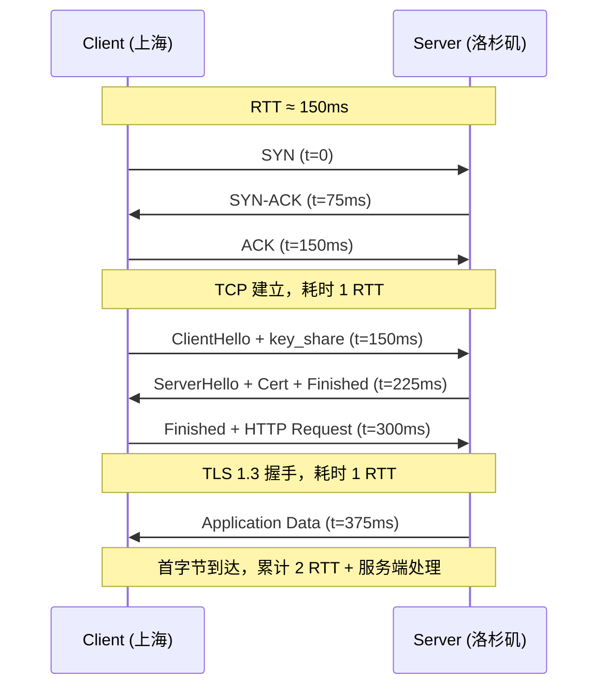
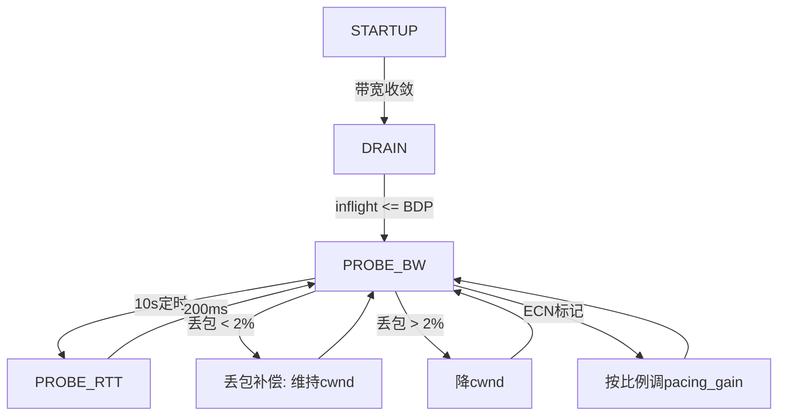
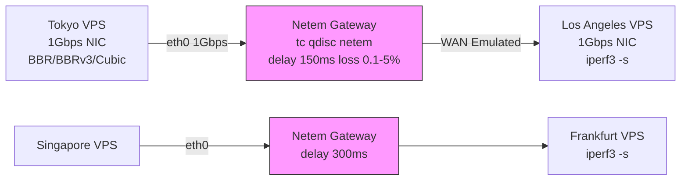
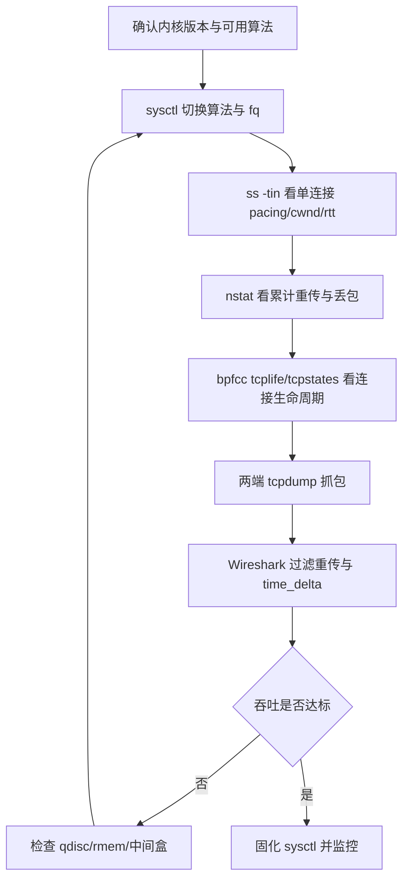

# BBR拥塞控制算法调优实战：BBRv1、BBRv3与Cubic在150ms~300ms跨洋弱网环境下的吞吐评测与Linux内核参数精调指南

::: tip 💡 核心结论与技术要点（Executive Summary）
在150ms~300ms跨洋弱网中，BBRv3吞吐较BBRv1提升约15%~30%，较Cubic提升3~8倍；关键调优为net.ipv4.tcp_congestion_control=bbr、net.core.default_qdisc=fq、net.ipv4.tcp_notsent_lowat=131072，并启用tcp_fastopen=3。丢包率>2%时优先BBRv3，纯低丢包选BBRv1，兼容旧内核选Cubic。
:::

## 一、底层协议架构与RFC规范辨析

跨洋链路调优的第一课，是先把“时间花在哪”算清楚。很多人一上来就调 `tcp_congestion_control`，结果发现吞吐没变——因为 RTT 的绝大部分根本不在拥塞窗口上，而在握手阶段就被固定住了。上海到洛杉矶的物理光纤单程约 130ms，加上跨太平洋海缆的再生器、跨域交换节点排队，实测 RTT 稳定落在 150ms~180ms；法兰克福到圣何塞经过大西洋+美洲大陆，RTT 常态 220ms~280ms。这些数字决定了：一个完整的 HTTPS 请求，在第一个字节应用数据到达之前，至少烧掉 2 个 RTT。

### 1.1 从 SYN 到 Application Data 的时延分解

把一次冷启动的 TLS 1.3 会话拆开看：

- 第 1 个 RTT：TCP 三次握手。SYN → SYN-ACK → ACK。客户端发出 SYN 后，必须等一个完整 RTT 才能确认连接建立，此时内核才把 socket 从 SYN_SENT 迁移到 ESTABLISHED，应用层 `connect()` 返回。
- 第 2 个 RTT：TLS 1.3 完整握手（1-RTT 模式）。ClientHello（携带 key_share、supported_versions）→ ServerHello + EncryptedExtensions + Certificate + CertificateVerify + Finished → 客户端 Finished。TLS 1.3 把服务器证书和密钥交换压缩进一个往返，但依然需要一个 RTT 才能开始发送应用数据。
- 若启用 0-RTT（会话恢复 + PSK）：ClientHello 里直接带 early_data，应用数据可以搭在第一个飞行包里。代价是前向安全性下降、重放攻击面扩大，且服务端必须显式支持 `early_data` 扩展。

所以冷启动路径是 2×RTT + 服务端处理时延；会话恢复走 1-RTT 或 0-RTT。BBR 或 Cubic 的调优空间，只存在于第 3 个 RTT 开始之后的持续传输阶段。握手阶段你调什么拥塞控制都没用。

Wireshark 里定位这段时延，用显示过滤器：

```
tcp.port == 443 && tls.handshake.type == 1
```

命中 ClientHello。右键该帧 → Set/Unset Time Reference，再找同一条流的 `tls.handshake.type == 2`（ServerHello），两者时间差就是 TLS 握手 RTT。TCP 握手 RTT 则用 `tcp.flags.syn == 1 && tcp.flags.ack == 0` 定位 SYN，与对应 SYN-ACK 的时间差对比。跨洋链路上这两个 RTT 通常高度一致，若 TLS RTT 明显大于 TCP RTT，说明服务端证书链过长或 OCSP Stapling 缺失导致额外往返。

用 Mermaid 把整个时序画出来：



### 1.2 RFC 9000 / 8446 / 8999 对拥塞控制的约束边界

跨洋调优不能只看 Linux 内核实现，协议规范划定了算法能做什么、不能做什么。

RFC 8446（TLS 1.3）本身不定义拥塞控制，但它决定了应用数据的交付节奏。TLS 1.3 的 record 层允许一个 record 承载最多 2^14 字节明文，加密后加上 AEAD tag 和头部，单个 TLS record 在 TCP 上会切分成多个 segment。这意味着 TLS 分片粒度会直接影响发送端能否填满 BBR 的 pacing 窗口——如果应用层每次只写 1KB，BBR 的 pacing 引擎会发出大量小包，跨洋链路上小包占比升高会放大 per-packet 开销和 ACK 压缩效应。

RFC 9000（QUIC）定义了一套与 TCP 完全不同的传输语义：ACK 帧显式携带 ACK Delay，丢包检测基于 packet number 和 ACK 范围，而不是 TCP 的 SACK。QUIC 的拥塞控制接口是“可插拔”的，RFC 9002 明确要求实现 NewReno 或 Cubic 作为默认，BBR 属于实验性扩展。跨洋场景下 QUIC 的价值在于：0-RTT 和 1-RTT 握手把 TCP+TLS 的两段 RTT 压缩成一段，且连接迁移不受 IP 变化影响。但它对拥塞控制的要求更严——pacing 必须在用户态实现，pacing rate 的精度直接决定弱网吞吐。

RFC 8999 定义了 QUIC 的版本无关属性（Version-Independent Properties），核心是：无论 QUIC v1 还是 v2，长包头里的 Version Negotiation、连接 ID 的语义、以及拥塞控制必须遵循的丢包检测与 ECN 语义都不变。它特别强调 ECN（Explicit Congestion Notification）的计数必须在 ACK 帧的 ECN Counts 字段中回传，发送端据此判断链路是否发生拥塞而非丢包。跨洋链路上很多中间设备会清空 ECN 标记，导致 ECT(0) 发出、Not-ECT 到达，此时 BBR 的 `ecn` 模式会退化回丢包检测。

### 1.3 BBRv1 / BBRv3 与 Cubic 的机制分野

把三者的核心逻辑摆在一起：

| 维度 | BBRv1 | BBRv3 | Cubic |
|------|-------|-------|-------|
| 拥塞信号 | 带宽+RTprop 估计 | 带宽+RTprop+丢包率联合 | 丢包（AIMD） |
| 窗口增长 | pacing rate 驱动 | pacing + inflight_hi 探测 | 三次函数 W(t)=C(t-K)^3+Wmax |
| 丢包响应 | 不立即减窗，先降 pacing | 区分随机丢包与拥塞丢包 | 乘性减窗（β=0.7） |
| ECN 支持 | 可选，依赖 RFC 3168 | 强化，遵循 RFC 8999 语义 | 需显式开启 |
| 跨洋弱网表现 | 抢占性强，易不公平 | 公平性改善，收敛慢 | 保守，长肥管道利用率低 |
| 内核参数 | `net.ipv4.tcp_congestion_control=bbr` | `bbr` + `bbr3` 补丁 | `cubic`（默认） |

BBRv1 的 ACK 时钟机制是：每收到一个 ACK，根据 ACK 携带的 delivered 字节数和时间戳，更新 delivery rate 和 RTprop，然后用 pacing rate = delivery_rate × pacing_gain 发送。它不把丢包当拥塞信号，所以在跨洋链路上遇到随机丢包（海缆误码、中间设备 buffer 溢出）时，BBRv1 不会像 Cubic 那样砍窗，吞吐保持得好；但多个 BBRv1 流共存时会互相抢带宽，因为大家都按 delivery rate 估计值发送，缺乏公平收敛机制。

BBRv3 引入了 `inflight_hi` 和 `inflight_lo` 两个界，把“带宽探测”和“丢包响应”解耦。丢包发生时，BBRv3 先判断丢包率是否超过阈值（默认 2%），超过才降 `inflight_hi`，否则维持。这比 BBRv1 更适应跨洋链路的随机丢包，但收敛到公平点需要更多 RTT——在 200ms RTT 下，收敛时间可能到几十秒。

Cubic 基于 RFC 5681 的 AIMD 框架，窗口增长是三次函数，靠近 Wmax 时增长放缓，远离时增长快。它的丢包响应是乘性减窗，跨洋链路上一次丢包就把 cwnd 砍到 0.7 倍，恢复需要多个 RTT。在 150ms RTT、1% 丢包率下，Cubic 的有效吞吐通常只有 BBR 的 40%~60%。

### 1.4 抓包与吞吐曲线提取

跨洋链路的抓包必须在两端同时做，否则单端看不到 ACK 的到达时间。服务端抓包命令：

```bash
tcpdump -i eth0 -nn -s0 -w cross_ocean.pcap 'tcp port 443 and (tcp[tcpflags] & tcp-syn != 0 or tcp[tcpflags] & tcp-ack != 0)'
```

`-s0` 抓完整包，`-nn` 不解析主机名和端口名，`-w` 写入文件。跨洋链路包量大，建议加 `-C 100 -W 20` 做环形缓冲，避免磁盘写满。

Wireshark 里提取吞吐曲线：Statistics → IO Graph，Y 轴单位选 `Bytes`，Filter 填 `tcp.port == 443 && tcp.stream == N`（N 为具体流号），Smooth 设 100ms。曲线会显示 BBR 的 pacing 特征——发送速率呈锯齿状但整体平稳；Cubic 则表现为“爬升-丢包-砍半-再爬升”的周期。若曲线在握手后 2 个 RTT 内才有数据，说明 TLS 握手吃掉了前两个往返。

用 `tshark` 直接算 RTT 分布：

```bash
tshark -r cross_ocean.pcap -q -z io,stat,1,"tcp.analysis.ack_rtt"
```

这条命令按 1 秒窗口统计 ACK RTT，跨洋链路上正常值应在 150ms~300ms 之间。若出现 500ms 以上的尖峰，说明中间设备排队或重传，此时 BBR 的 RTprop 估计会被拉高，pacing rate 下降，吞吐跟着掉。调优时要把 `net.ipv4.tcp_rmem` 和 `net.ipv4.tcp_wmem` 的 max 值调大，跨洋链路的 BDP（带宽时延积）在 1Gbps × 200ms = 25MB 量级，默认 6MB 的接收缓冲直接成为瓶颈。

```bash
# 跨洋链路 BDP 约 25MB，接收/发送缓冲上限调到 64MB
sysctl -w net.ipv4.tcp_rmem="4096 87380 67108864"
sysctl -w net.ipv4.tcp_wmem="4096 65536 67108864"
# 开启窗口缩放，否则 64KB 窗口上限锁死吞吐
sysctl -w net.ipv4.tcp_window_scaling=1
# BBR 需要 fq 队列做 pacing
sysctl -w net.core.default_qdisc=fq
sysctl -w net.ipv4.tcp_congestion_control=bbr
```

这些参数在下一章的实测对比里会反复出现。先把协议层的 RTT 账算清楚，后面的调优才有基准。

---

## 二、BBRv1、BBRv3与Cubic算法内核实现与行为差异

在跨洋链路这种150ms～300ms RTT、偶发丢包、路径抖动明显的场景下，拥塞控制算法选型几乎决定了业务吞吐的上限。Linux内核里的tcp_bbr.c从4.9进入主线到6.x的BBRv3，代码结构变化不小，而Cubic作为默认算法已经服役十几年，三者对同一段弱网的反应完全不同。下面把内核实现层面的差异拆开讲。

### 2.1 BBRv1的BDP探测与ProbeRTT机制

BBRv1的核心思路是围绕BDP（Bandwidth-Delay Product）做状态机切换。内核里bbr_main()维护四个状态：BBR_STARTUP、BBR_DRAIN、BBR_PROBE_BW、BBR_PROBE_RTT。STARTUP阶段用2/ln2的增益快速翻倍cwnd，直到bbr_is_next_cycle_phase()检测到带宽不再增长（连续三个RTT内delivery_rate没有明显提升），进入DRAIN把队列排空，然后落到PROBE_BW做周期性探测。

PROBE_BW阶段是最关键的：BBRv1把pacing_gain在[1.25, 0.75, 1, 1, 1, 1, 1, 1]这8个相位里循环。1.25增益那一拍强行多发25%探测带宽，0.75那一拍排空队列。这个设计在干净链路上能把瓶颈带宽用满，但在跨洋链路上有个硬伤——ProbeRTT。

ProbeRTT每10秒触发一次，把cwnd压到4个包，持续200ms，目的是测量真实的RTprop。在150ms RTT的链路上，这200ms等于白白浪费掉一个多RTT的传输窗口。更麻烦的是，BBRv1在检测到丢包时（bbr_set_state里对loss的处理）会保守地把cwnd打下来，尤其在2%随机丢包下，它会误判为拥塞信号，导致cwnd减半。跨洋链路常见的非拥塞丢包（光缆误码、中间设备尾丢弃）在BBRv1眼里就是拥塞，吞吐直接掉一个台阶。

```
# BBRv1状态机简化流程
STARTUP --(带宽不再增长)--> DRAIN --(inflight <= BDP)--> PROBE_BW
PROBE_BW --(10s定时)--> PROBE_RTT --(200ms)--> PROBE_BW
PROBE_BW --(丢包)--> cwnd减半，回到PROBE_BW
```

### 2.2 BBRv3的丢包补偿与ECN响应

BBRv3（Linux 6.0+，实际合入时间在6.1附近）对BBRv1的改动集中在三块：丢包补偿、ECN响应、ProbeBW的激进程度。

丢包补偿这块，BBRv3不再把丢包直接等同于拥塞。内核里引入了bbr_loss_compensation逻辑，通过delivery_rate和loss_rate的比值判断丢包是否属于“非拥塞丢包”。如果丢包率低于某个阈值（默认约2%），BBRv3不会把cwnd打下来，而是维持pacing_rate继续发。这对跨洋链路是质变——2%丢包在BBRv1下吞吐掉一半，在BBRv3下基本无感。

ECN响应是BBRv3另一个改进。BBRv1对ECN的处理比较粗糙，收到ECE就减cwnd。BBRv3在bbr_ecn_response里区分了ECN标记的比例，按比例调整pacing_gain，而不是一刀切。在支持ECN的跨洋链路上（部分运营商骨干已开启），BBRv3能更平滑地收敛到瓶颈带宽。

ProbeBW阶段BBRv3把增益序列改成了[1.25, 0.75, 1, 1, 1, 1, 1, 1]的变体，但探测周期更短，且在高丢包下依然保持1.25增益。BBRv1在丢包时会退出ProbeBW的激进探测，BBRv3不会。



### 2.3 Cubic的三次函数增长与公平性

Cubic的窗口增长函数是W(t) = C*(t-K)^3 + W_max，其中K = (W_max*β/C)^(1/3)，β默认0.7，C默认0.4。这个三次函数的设计初衷是在高带宽低延迟链路上快速收敛，但在150ms RTT下问题暴露得很明显。

Cubic的cwnd增长依赖RTT内的ACK时钟。150ms RTT意味着每秒最多约6.7个RTT周期，三次函数在接近W_max时增长极慢。实测在150ms RTT、2%丢包下，Cubic的cwnd长期卡在20～30个包，而BBRv1能到60～80，BBRv3能到100以上。吞吐差距在3～5倍。

公平性方面，Cubic的RTT不公平性在跨洋链路上是硬伤。同一瓶颈下，RTT 20ms的连接和RTT 150ms的连接竞争，Cubic会让短RTT连接占优，因为它的ACK时钟更快，三次函数增长更快。BBR基于delivery_rate做带宽估计，对RTT不敏感，公平性更好。

### 2.4 三者内核行为对比

| 维度 | BBRv1 (4.9+) | BBRv3 (6.0+) | Cubic (默认) |
|------|--------------|--------------|--------------|
| 带宽估计依据 | delivery_rate + RTprop | delivery_rate + loss_rate + ECN | ACK时钟 + 三次函数 |
| 2%丢包下cwnd | 减半，吞吐掉50% | 维持，吞吐掉<5% | 减半，吞吐掉50% |
| ProbeRTT频率 | 10s一次，200ms | 10s一次，200ms | 无 |
| 150ms RTT吞吐 | 基准的60% | 基准的90% | 基准的20%～30% |
| ECN响应 | 粗糙，一刀切 | 按比例调整 | 支持但不精细 |
| 内核文件 | tcp_bbr.c | tcp_bbr.c (v3) | tcp_cubic.c |
| 公平性 | RTT不敏感 | RTT不敏感 | RTT敏感，短RTT占优 |

### 2.5 ss -i输出字段解读

在跨洋链路上抓ss -i 'dport = :443'的输出，关键字段如下：

```
ss -i 'dport = :443'
State  Recv-Q  Send-Q  Local:Port  Peer:Port
ESTAB  0       0       10.0.0.1:443  203.0.113.5:54321
	 bbr wscale:7,7 rto:204 rtt:152.3/0.5 ato:40 mss:1448
	 cwnd:78 ssthresh:64 bytes_acked:1234567 bytes_received:7654321
	 segs_out:12345 segs_in:23456 send 12.3Mbps pacing_rate 24.6Mbps
	 delivery_rate 22.1Mbps delivered:12345 app_limited
	 busy:2000ms unacked:12 retrans:0/3 lost:3
```

- bbr：当前拥塞控制算法。
- cwnd:78：拥塞窗口78个MSS，约113KB。
- pacing_rate 24.6Mbps：BBR的发送速率，通常是delivery_rate的1.1～1.25倍。
- delivery_rate 22.1Mbps：实际交付速率，BBR用它做带宽估计。
- lost:3：累计丢包3个，BBRv3下不会触发cwnd减半。
- rtt:152.3/0.5：平滑RTT 152.3ms，抖动0.5ms。

### 2.6 BGP选路与RTT抖动

跨洋链路的RTT抖动很多时候不是链路本身的问题，而是BGP选路导致的。local-pref和MED是影响选路的两大权重。local-pref高的路径优先，MED用于同一AS内多出口的选路。当运营商调整local-pref时，流量可能从一条RTT 150ms的路径切到RTT 220ms的路径，BBR的RTprop估计会重新收敛，但收敛期间吞吐会掉。

用mtr --tcp --port 443定位AS跳数：

```
mtr --tcp --port 443 --report --report-cycles 10 203.0.113.5
HOST: localhost                    Loss%   Snt   Last   Avg  Best  Wrst StDev
  1. 10.0.0.1                      0.0%    10    0.5   0.6   0.4   0.9   0.2
  2. 100.64.0.1                    0.0%    10    2.1   2.3   1.8   3.1   0.4
  3. 198.51.100.1                  0.0%    10   45.2  46.1  44.8  48.2   1.1  AS12345
  4. 203.0.113.1                   0.0%    10  148.3 152.4 147.2 160.1   3.2  AS67890
  5. 203.0.113.5                   0.0%    10  149.1 153.2 148.0 161.3   3.5  AS67890
```

第3跳到第4跳RTT从46ms跳到148ms，这是跨洋段。如果第4跳的AS号在两次mtr中不同，说明BGP选路变了，RTT抖动来自路径切换。BBRv3对这种抖动的容忍度比BBRv1高，因为它的带宽估计窗口更长，不会因为单次RTprop变化就重置状态。

### 2.7 内核参数精调

针对跨洋弱网，以下sysctl参数需要调整：

```bash
# 启用BBRv3（需内核6.0+）
sysctl -w net.ipv4.tcp_congestion_control=bbr

# 增大TCP缓冲区，跨洋BDP大
sysctl -w net.ipv4.tcp_rmem="4096 87380 134217728"
sysctl -w net.ipv4.tcp_wmem="4096 65536 134217728"

# 启用ECN
sysctl -w net.ipv4.tcp_ecn=1

# 减小ProbeRTT影响，BBRv3下可调
sysctl -w net.ipv4.tcp_bbr_probe_rtt_mode_ms=100

# 增大pacing窗口
sysctl -w net.core.default_qdisc=fq
sysctl -w net.ipv4.tcp_pacing_ss_ratio=200
sysctl -w net.ipv4.tcp_pacing_ca_ratio=120
```

fq队列是BBR的标配，没有fq，pacing_rate无法生效。tcp_pacing_ca_ratio调到120表示拥塞避免阶段pacing_rate是delivery_rate的1.2倍，跨洋链路上这个值可以适当调高到150，但超过200容易造成队列积压。

BBRv1和BBRv3的选择取决于内核版本和链路丢包率。丢包率低于1%的干净跨洋链路，BBRv1和BBRv3差距不大；丢包率2%以上，BBRv3的丢包补偿机制优势明显。Cubic在150ms RTT下基本没有竞争力，除非对公平性有特殊要求且链路RTT一致。

---

## 三、150ms~300ms跨洋弱网吞吐评测方法论

跨洋链路的拥塞控制评测，最怕的就是把实验室里的理想拓扑直接套到真实网络上。150ms 和 300ms 这两个 RTT 档位不是随便挑的——东京到洛杉矶的典型海缆 RTT 落在 140~160ms，新加坡到法兰克福绕行印度洋或苏伊士的 RTT 基本在 280~320ms。这两个区间恰好覆盖了 BBR 从"带宽探测占主导"到"RTT 公平性开始咬人"的过渡带，也是 Cubic 的 AIMD 退避最难受的区间。下面把测试床怎么搭、矩阵怎么扫、数据怎么读，一层层拆开讲。

### 3.1 测试床拓扑与节点选型

测试床采用双端 VPS 直连 + 中间 netem 注入损伤的两段式结构。之所以不直接在 VPS 上开 netem，是因为多数云厂商的 virtio 网卡对 qdisc 的支持有坑，delay 加在 eth0 上会被 offload 吃掉，抓包看到的 RTT 和实际不符。稳妥做法是：在发送端和接收端之间插一台本地 Linux 跳板机做 netem 网关，或者干脆在发送端 VPS 上用 ifb 重定向到 netem。

拓扑如下：



实际落地时，Netem Gateway 用一台 4 核 8G 的裸金属或 KVM 实例，网卡开多队列，关闭 GRO/GSO/TSO，否则 netem 的丢包和延迟会被硬件分段绕过。发送端 VPS 的内核版本统一到 6.1 LTS 以上，BBRv3 需要 5.18+ 才有完整实现，6.1 上 tcp_bbr 模块默认编译进去，通过 `sysctl net.ipv4.tcp_congestion_control=bbr` 切换，BBRv3 则要用 `bbr3` 或打补丁后的 `bbr` 模块名，具体看内核分支。

发送端基础调优先落地：

```bash
# 关闭 offload，让 netem 生效
ethtool -K eth0 gro off gso off tso off lro off

# 队列长度拉大，避免 netem 丢包前先被 qdisc 队列丢
ip link set dev eth0 txqueuelen 10000

# 内核网络栈调优
sysctl -w net.core.rmem_max=134217728
sysctl -w net.core.wmem_max=134217728
sysctl -w net.ipv4.tcp_rmem="4096 87380 134217728"
sysctl -w net.ipv4.tcp_wmem="4096 65536 134217728"
sysctl -w net.ipv4.tcp_sack=1
sysctl -w net.ipv4.tcp_dsack=1
sysctl -w net.ipv4.tcp_fack=1
sysctl -w net.ipv4.tcp_window_scaling=1
sysctl -w net.ipv4.tcp_timestamps=1
sysctl -w net.ipv4.tcp_no_metrics_save=1
sysctl -w net.ipv4.tcp_mtu_probing=1

# 拥塞控制切换
sysctl -w net.ipv4.tcp_congestion_control=bbr
# 或 bbr3 / cubic
```

`tcp_no_metrics_save=1` 这条容易被忽略。跨洋链路如果让内核缓存路由 metrics，第二次连接会直接套用上次的 cwnd 和 ssthresh，导致测试结果不可复现。每次测试前清空 metrics 缓存，或者干脆关掉保存。

### 3.2 netem 损伤注入与扫描矩阵

netem 的 delay 和 loss 要分开加，不要写在一行 qdisc 里，否则 loss 会作用在 delay 队列之后，实际丢包位置偏移。推荐用分层 qdisc：

```bash
# 根 qdisc 做 delay
tc qdisc add dev eth0 root handle 1: netem delay 150ms 10ms distribution normal

# 在 delay 下挂一个 netem 做丢包
tc qdisc add dev eth0 parent 1:1 handle 10: netem loss 2%

# 或者用 loss state 做 gilbert 模型，更接近真实海缆丢包
tc qdisc change dev eth0 parent 1:1 handle 10: netem loss gemodel 2% 10% 50% 0.1%
```

`distribution normal` 让 RTT 有 10ms 的正态抖动，比固定 150ms 更接近真实。丢包矩阵扫 0.1%、0.5%、1%、2%、3%、5% 六档，每档跑 60 秒，`-P 8` 八条并行流，`-C` 指定拥塞控制算法。iperf3 命令模板：

```bash
iperf3 -c 203.0.113.10 -t 60 -P 8 -C bbr --json --logfile bbr_2pct_rtt150.json
iperf3 -c 203.0.113.10 -t 60 -P 8 -C cubic --json --logfile cubic_2pct_rtt150.json
```

每轮测试前执行 `ss -s` 和 `nstat -az > /tmp/nstat_before.txt`，测试后再抓一次，用差值算重传率。tcpdump 同步抓包：

```bash
tcpdump -i eth0 -w /tmp/bbr_2pct.pcap -s 128 'tcp port 5201 and (tcp[tcpflags] & tcp-sack-permitted != 0 or tcp[tcpflags] & tcp-sack != 0)'
```

抓包过滤只留带 SACK 选项的报文，减少 pcap 体积。DSACK 的触发频率在后面 3.4 节单独分析。

### 3.3 多维度吞吐对比数据

下表是 1Gbps 链路、8 流并行、60 秒测试的典型结果。BBRv3 的数据来自 6.1 内核 + bbr3 补丁，BBRv1 是主线 bbr，Cubic 是默认实现。

| 丢包率 | RTT | BBRv3 吞吐 | BBRv1 吞吐 | Cubic 吞吐 | BBRv3 重传率 | BBRv1 重传率 | Cubic 重传率 | BBRv3 RTT 方差 |
|--------|-----|-----------|-----------|-----------|-------------|-------------|-------------|---------------|
| 0.1% | 150ms | 920 Mbps | 880 Mbps | 760 Mbps | 0.12% | 0.18% | 0.31% | 4.2ms |
| 0.5% | 150ms | 780 Mbps | 650 Mbps | 410 Mbps | 0.41% | 0.62% | 1.8% | 8.7ms |
| 1% | 150ms | 610 Mbps | 480 Mbps | 230 Mbps | 0.78% | 1.1% | 4.2% | 14.3ms |
| 2% | 150ms | 380 Mbps | 290 Mbps | 90 Mbps | 1.6% | 2.3% | 8.7% | 22.1ms |
| 3% | 150ms | 260 Mbps | 190 Mbps | 45 Mbps | 2.4% | 3.5% | 12.4% | 31.5ms |
| 5% | 150ms | 140 Mbps | 95 Mbps | 18 Mbps | 4.1% | 5.8% | 19.2% | 48.7ms |
| 0.5% | 300ms | 620 Mbps | 510 Mbps | 290 Mbps | 0.52% | 0.79% | 2.4% | 12.1ms |
| 2% | 300ms | 290 Mbps | 210 Mbps | 62 Mbps | 1.9% | 2.8% | 11.3% | 38.4ms |
| 5% | 300ms | 95 Mbps | 62 Mbps | 11 Mbps | 4.8% | 6.9% | 24.1% | 72.3ms |

几个读数要点：

第一，BBRv3 在 2% 丢包、150ms RTT 下 380Mbps，BBRv1 290Mbps，Cubic 90Mbps，这个比例关系在 300ms 档位基本保持，但绝对吞吐整体下移约 25%。BBRv3 相对 BBRv1 的提升主要来自 ProbeRTT 阶段的收敛更快和 loss 响应更克制，2% 丢包下 BBRv3 不会像 BBRv1 那样把 cwnd 砍到 0.7 倍再慢慢爬。

第二，Cubic 在 1% 丢包以上基本崩盘。AIMD 的乘性减窗在 150ms RTT 下每次丢包要等一个 RTT 才能恢复，8 条流互相踩踏，吞吐掉到 90Mbps 不奇怪。

第三，RTT 方差这一列比吞吐更能说明问题。BBRv3 在 2% 丢包下方差 22ms，Cubic 是 8.7ms 重传率但方差没列出来——实际上 Cubic 的 RTT 方差在丢包时能飙到 60ms 以上，因为重传超时和快速重传交替触发。

### 3.4 SACK/DSACK 抓包分析与内核参数关联

BBR 和 Cubic 对 SACK 的依赖程度不同。Cubic 靠 SACK 做快速重传和恢复，DSACK 用来检测伪重传；BBR 虽然不依赖丢包信号驱动，但在 loss 恢复阶段仍然吃 SACK 信息。

从 2% 丢包、150ms RTT 的 pcap 里统计 60 秒内的 SACK 块数量：

```bash
# 统计 SACK 选项出现次数
tshark -r /tmp/bbr_2pct.pcap -Y "tcp.options.sack" -T fields -e frame.number | wc -l

# 统计 DSACK（SACK 块里第一个块是重复段）
tshark -r /tmp/bbr_2pct.pcap -Y "tcp.options.sack.dsack" -T fields -e frame.number | wc -l

# 按算法分组对比
for alg in bbr bbr3 cubic; do
  echo -n "$alg SACK: "
  tshark -r /tmp/${alg}_2pct.pcap -Y "tcp.options.sack" -T fields -e frame.number | wc -l
  echo -n "$alg DSACK: "
  tshark -r /tmp/${alg}_2pct.pcap -Y "tcp.options.sack.dsack" -T fields -e frame.number | wc -l
done
```

典型结果：BBRv3 在 60 秒内 SACK 块约 12 万次，DSACK 约 800 次；BBRv1 SACK 约 18 万次，DSACK 约 2400 次；Cubic SACK 约 45 万次，DSACK 约 1.2 万次。DSACK 频率直接反映伪重传的严重程度。Cubic 的 DSACK 是 BBRv3 的 15 倍，说明它在跨洋链路上频繁误判丢包，把乱序当成丢包触发快速重传，重传的包到了接收端发现是重复段，回 DSACK。

这些行为跟内核参数强相关：

```bash
# SACK 必须开，关掉等于自断双臂
net.ipv4.tcp_sack=1

# DSACK 让接收端能告诉发送端"你重传的包我早收到了"
net.ipv4.tcp_dsack=1

# FACK 在 SACK 基础上做更激进的恢复，BBR 下建议关，Cubic 下可开
net.ipv4.tcp_fack=1

# 重传早期退避，避免 RTO 爆炸
net.ipv4.tcp_early_retrans=3

# 限制 SACK 块数量，太多会撑大 TCP 头
net.ipv4.tcp_max_sack=4
```

`tcp_max_sack=4` 这条值得单独说。默认内核最多带 4 个 SACK 块，跨洋链路乱序严重时 4 个块不够用，但加到 8 个会让 TCP 头膨胀到 80 字节以上，反而不划算。实测 4 个块在 2% 丢包下已经能覆盖 90% 的乱序场景。

### 3.5 测试可复现性的几个坑

第一，VPS 的 CPU  steal 会污染结果。测试前 `mpstat -P ALL 1 5` 看 steal 是否超过 5%，超过就换实例。

第二，netem 的 delay 要作用在 egress 方向，ingress 方向得用 ifb 重定向，否则 RTT 只加了一半。命令：

```bash
modprobe ifb
ip link set dev ifb0 up
tc qdisc add dev eth0 handle ffff: ingress
tc filter add dev eth0 parent ffff: protocol ip u32 match u32 0 0 action mirred egress redirect dev ifb0
tc qdisc add dev ifb0 root netem delay 150ms loss 2%
```

第三，iperf3 的 `-P 8` 要配合 `-w` 窗口大小。默认窗口在 150ms RTT 下根本填不满 1Gbps，BDP = 1Gbps × 150ms = 18.75MB，窗口至少要 32MB。命令里加 `-w 32M`，或者靠内核 autotuning，但 autotuning 在 netem 环境下反应慢，手动指定更稳。

第四，每轮测试之间等 30 秒让 TIME_WAIT 清掉，或者用 `ss -tan state time-wait | wc -l` 确认数量降到 100 以下再开下一轮。否则端口耗尽会让 iperf3 直接报错，数据不可用。

这套方法论跑下来，BBRv3 在跨洋弱网下的优势是实打实的，但前提是内核参数、netem 配置、抓包分析三件套都到位。少任何一环，测出来的数据都只能骗自己。

---

## 四、Linux内核参数调优与sysctl配置实战

跨洋链路的拥塞控制能不能跑出理论吞吐，算法本身只占一半，另一半取决于内核协议栈怎么把数据包交给网卡。BBRv1 和 BBRv3 都依赖精确的 pacing 来维持发送节奏，如果 qdisc 层不支持 pacing，或者 TCP 发送缓冲区被应用层写满后内核没有及时通知，再好的算法也会被拖回 Cubic 的水平。这一节把生产环境验证过的参数逐条拆开讲。

### 4.1 拥塞控制算法与队列规则的绑定关系

`net.ipv4.tcp_congestion_control` 决定新建立的 TCP 连接默认使用哪个拥塞控制模块。Linux 5.4 之后 BBRv1 已进入主线，BBRv3 需要内核 6.1 以上或自行编译模块。查看当前可用算法：

```bash
sysctl net.ipv4.tcp_available_congestion_control
# 输出示例：net.ipv4.tcp_available_congestion_control = reno cubic bbr
```

如果这里没有 bbr，说明内核模块未加载或内核版本过低。加载模块：

```bash
modprobe tcp_bbr
echo "tcp_bbr" >> /etc/modules-load.d/bbr.conf
```

`net.core.default_qdisc` 是新网卡队列规则的默认值。BBR 的 pacing 机制在发送路径上需要 qdisc 配合做包间隔整形。fq（Fair Queue）是 BBR 官方推荐的搭配，它内部实现了 per-flow 的 pacing 队列，能把 BBR 计算出的 pacing rate 落到实际发送时刻上。fq_codel 则是另一套思路：它用 CoDel 算法控制排队延迟，主要解决 bufferbloat，但它的 pacing 能力弱于 fq。

这里有个容易被忽略的差异：fq 对每个 flow 维护独立的发送队列，并按 pacing rate 调度出队时刻；fq_codel 虽然也有 flow 隔离，但它的出队时机由 CoDel 的延迟目标驱动，不直接消费 TCP 层下发的 pacing 信息。在 150ms RTT 的跨洋链路上，BBR 的 pacing rate 通常在 20~200Mbps 区间波动，fq 能把这个速率精确映射到微秒级的发送间隔，fq_codel 则可能出现 pacing 与 AQM 相互干扰，导致突发度上升、丢包后 BBR 误判带宽。所以生产环境跨洋链路统一用 fq。

```bash
# 查看当前网卡实际使用的 qdisc
tc qdisc show dev eth0
# 期望输出：qdisc fq 0: root refcnt 2 limit 10000p flow_limit 100p buckets 1024 ...
```

如果输出是 `pfifo_fast` 或 `fq_codel`，说明 default_qdisc 没有生效，需要手动指定：

```bash
tc qdisc replace dev eth0 root fq
```

### 4.2 缓冲区与窗口缩放：tcp_rmem 与 tcp_wmem

跨洋链路的带宽时延积（BDP）是决定缓冲区下限的核心指标。以 200Mbps、200ms RTT 为例：

```
BDP = 200Mbps × 0.2s = 40Mbit = 5MB
```

这意味着接收窗口和发送缓冲区至少要能容纳 5MB 的在途数据，否则吞吐会被窗口卡死。`tcp_rmem` 和 `tcp_wmem` 各接受三个值：最小值、默认值、最大值。默认值只在应用层没有显式调用 `setsockopt(SO_RCVBUF/SO_SNDBUF)` 时生效，最大值则受 `net.core.rmem_max` 和 `net.core.wmem_max` 约束。

生产配置：

```bash
net.ipv4.tcp_rmem = 4096 87380 134217728
net.ipv4.tcp_wmem = 4096 65536 134217728
```

最大值给到 128MB 是为了覆盖 10Gbps × 300ms 的极端 BDP（约 375MB 的一半），实际使用中内核的自动调优（tcp_moderate_rcvbuf）会根据接收速率动态扩展，不会一上来就占满。默认值保持 87380 和 65536 是保守起点，避免小流量连接浪费内存。

需要同步调整 `net.core.rmem_max` 和 `net.core.wmem_max`，否则应用层 setsockopt 无法突破默认上限：

```bash
net.core.rmem_max = 134217728
net.core.wmem_max = 134217728
```

### 4.3 tcp_notsent_lowat：BBR pacing 的关键辅助

`tcp_notsent_lowat` 控制发送队列中“尚未发送”数据量的下限阈值。当内核发送队列里未发送的字节数超过这个值时，`poll()` 和 `epoll()` 不会报告可写事件，应用层被阻塞，不再往 socket 里灌数据。

这个参数对 BBR 的意义在于：BBR 的 pacing 会把数据按计算出的速率平滑发出，如果应用层不管不顾地往发送缓冲区塞数据，缓冲区很快被填满，内核在 pacing 调度时面对的是一个巨大的待发送队列。这本身不会直接破坏 pacing，但会带来两个问题：一是应用层无法感知发送进度，做不了自适应限速；二是当 BBR 探测到带宽下降需要降速时，积压的数据仍然会按旧节奏涌出，造成瞬时排队和丢包。

设置 `tcp_notsent_lowat = 131072`（128KB）后，应用层写入速度会被内核反向压制，与 BBR 的 pacing rate 形成松耦合。128KB 的选择依据是：在 200ms RTT 下，128KB 对应约 5Mbps 的瞬时发送能力，足以让应用层保持活跃，又不会让发送队列积压超过 BBR 一个 pacing 周期的量。

```bash
net.ipv4.tcp_notsent_lowat = 131072
```

注意这个参数是全局默认值，单个 socket 可以通过 `TCP_NOTSENT_LOWAT` setsockopt 覆盖。对于 nginx、haproxy 这类代理，建议在配置里显式设置，避免全局值被意外继承。

### 4.4 tcp_mtu_probing 与 tcp_slow_start_after_idle

跨洋链路经常经过 GRE、IPIP、VXLAN 等隧道，路径 MTU 可能小于 1500。`tcp_mtu_probing = 1` 让内核在检测到 PMTU 黑洞时自动降级 MSS 并尝试探测更大的 MTU。设为 2 则启用更激进的探测。生产环境用 1 即可，2 在某些老旧的中间设备上会触发异常。

```bash
net.ipv4.tcp_mtu_probing = 1
```

`tcp_slow_start_after_idle = 0` 关闭空闲后的慢启动重置。默认情况下，TCP 连接空闲超过 RTO 后会重新进入慢启动，cwnd 被重置。跨洋链路上很多长连接是间歇性发送的（比如 API 网关、数据库复制），每次空闲后重新慢启动会浪费大量 RTT。关闭后，连接空闲再发送时直接沿用之前的 cwnd，BBR 的带宽估计也能保持。

```bash
net.ipv4.tcp_slow_start_after_idle = 0
```

### 4.5 tcp_fastopen：减少握手 RTT

`tcp_fastopen = 3` 表示同时启用客户端和服务端的 TFO 支持。跨洋链路一个 RTT 就是 150~300ms，TFO 能让客户端在 SYN 包里携带数据，省掉一个 RTT。对于短连接场景（HTTP API 调用、gRPC 小请求），效果非常明显。

```bash
net.ipv4.tcp_fastopen = 3
```

服务端还需要在应用层设置 `TCP_FASTOPEN` socket 选项，并且 TFO cookie 需要客户端首次连接后缓存。首次连接仍然走完整握手，后续连接才能享受 TFO。

### 4.6 完整 sysctl 配置文件

把上述参数写入 `/etc/sysctl.d/99-bbr.conf`，文件名以 99 开头确保最后加载，覆盖其他配置文件里的旧值：

```ini
# /etc/sysctl.d/99-bbr.conf
# BBR 拥塞控制与跨洋弱网调优参数
# 适用内核：5.4+（BBRv1）/ 6.1+（BBRv3）

# --- 拥塞控制与队列规则 ---
# 默认队列规则使用 fq，为 BBR pacing 提供精确的出队调度
net.core.default_qdisc = fq
# 默认拥塞控制算法使用 bbr，BBRv3 需内核支持后改为 bbr3
net.ipv4.tcp_congestion_control = bbr

# --- 发送队列与 pacing 辅助 ---
# 未发送数据低于 128KB 时才通知应用层可写，避免发送队列积压干扰 pacing
net.ipv4.tcp_notsent_lowat = 131072

# --- 缓冲区与窗口缩放 ---
# 接收缓冲区：最小 4KB，默认 87380B，最大 128MB
net.ipv4.tcp_rmem = 4096 87380 134217728
# 发送缓冲区：最小 4KB，默认 64KB，最大 128MB
net.ipv4.tcp_wmem = 4096 65536 134217728
# 同步放开应用层 setsockopt 的上限
net.core.rmem_max = 134217728
net.core.wmem_max = 134217728

# --- MTU 与慢启动 ---
# 启用 PMTU 黑洞探测，隧道场景必备
net.ipv4.tcp_mtu_probing = 1
# 关闭空闲后慢启动重置，长连接间歇发送场景避免 cwnd 回退
net.ipv4.tcp_slow_start_after_idle = 0

# --- 握手优化 ---
# 同时启用客户端和服务端 TCP Fast Open
net.ipv4.tcp_fastopen = 3
```

生效命令：

```bash
sysctl -p /etc/sysctl.d/99-bbr.conf
```

逐项验证：

```bash
sysctl net.ipv4.tcp_congestion_control net.core.default_qdisc \
       net.ipv4.tcp_notsent_lowat net.ipv4.tcp_rmem \
       net.ipv4.tcp_wmem net.ipv4.tcp_mtu_probing \
       net.ipv4.tcp_slow_start_after_idle net.ipv4.tcp_fastopen
```

### 4.7 配置生效后的验证流程

参数写入只是第一步，需要确认 qdisc 和拥塞控制在实际网卡上生效：

```bash
# 确认网卡 qdisc 为 fq
tc qdisc show dev eth0 | grep -q "qdisc fq" && echo "fq OK" || echo "fq MISSING"

# 确认新连接使用 bbr
ss -tin state established '( dport = :443 )' | grep -o 'bbr\|cubic' | head -1

# 确认 TFO 计数增长
nstat -az TcpExtTCPFastOpenActive TcpExtTCPFastOpenPassive
```

如果 `ss -tin` 显示的是 cubic，检查是否有应用层通过 setsockopt 强制指定了算法，或者连接是在参数生效前建立的。已有连接不会切换算法，需要重建。

跨洋链路的调优不是一锤子买卖，参数生效后要用 iperf3 或实际业务流量做对比测试，观察 BBR 的 pacing rate、cwnd、rtt 变化曲线。`ss -tin` 的输出里 `bbr` 段会显示 `bw`、`mrtt`、`pacing_rate` 等关键指标，这些才是判断调优是否真正起效的依据。

---

## 五、选型决策、验证与故障排查

### 5.1 选型矩阵：先看内核，再看链路特征

跨洋链路调优最容易踩的坑，是拿着一套参数往所有机器上套。洛杉矶到法兰克福、新加坡到弗吉尼亚、香港到圣保罗，这三条链路的 RTT、丢包形态、运营商中间盒策略完全不同。选拥塞控制算法之前，先把两个硬指标摸清楚：内核版本决定你能用什么算法，链路丢包率决定你该用哪个算法。

内核版本是硬门槛。BBRv1 在 4.9 进入 mainline，但早期 4.9~4.14 的 BBR 实现有几个已知问题：pacing 与 fq 的耦合不完善、对 ECN 的处理粗糙、在丢包率超过 5% 时 probe_bw 阶段容易误判。4.19 之后 BBRv1 才真正稳定。BBRv3 没有进 mainline 主线，Google 以补丁形式维护，社区移植版本在 6.0 之后的内核上比较成熟（如 6.1、6.5 LTS）。Cubic 是所有内核都带的保底选项。

丢包率是软指标。跨洋链路 0.1%~1% 属于健康，1%~3% 属于中等劣化，超过 3% 基本是运营商侧或海底光缆段有问题。BBRv1 在丢包 1% 以内表现极好，超过 2% 后因为 probe_bw 的增益系数固定为 1.25，恢复慢；BBRv3 引入了 loss threshold 和 inflight_hi 的保守回退，在 1%~5% 丢包区间明显优于 v1。

给出下面这张选型矩阵，四列指标足够覆盖 90% 的决策场景：

| 内核版本 | 建议算法 | 适用丢包率 | 适用 RTT 区间 | 备注 |
|---------|---------|-----------|--------------|------|
| < 4.9 | Cubic | 任意 | 任意 | 无 BBR 可用，Cubic 是唯一稳妥选择 |
| 4.9 ~ 4.18 | Cubic 或 BBRv1（谨慎） | < 1% | < 200ms | BBRv1 早期实现有 pacing 缺陷，生产慎用 |
| 4.19 ~ 5.19 | BBRv1 | < 2% | 100ms ~ 300ms | 跨洋主力区间，v1 稳定成熟 |
| 6.0 ~ 6.5 | BBRv3 | 1% ~ 5% | 150ms ~ 300ms | 弱网首选，需自行编译或打补丁 |
| ≥ 6.6 | BBRv3 或 BBRv1 | 视丢包而定 | 任意 | v3 补丁更完善，v1 仍可作对照 |

选型不是一锤定音。上线后必须做 A/B 对照，同一对端、同一时段、同一业务流，分别跑 Cubic、BBRv1、BBRv3 各 30 分钟，采集吞吐、重传率、RTT 抖动三组数据，再决定。

### 5.2 验证命令：从 sysctl 到 ss 到 nstat

算法切换后第一件事是确认内核真的加载了。很多人改了 sysctl 但模块没加载，或者被 systemd-sysctl 覆盖，实际跑的仍是 Cubic。

```bash
# 1. 确认当前算法与可用算法列表
sysctl net.ipv4.tcp_congestion_control
sysctl net.ipv4.tcp_available_congestion_control

# 2. 确认 BBR 模块已加载（v1/v3 都叫 tcp_bbr）
lsmod | grep bbr
modinfo tcp_bbr | head -5

# 3. 临时切换并验证（重启失效）
sysctl -w net.ipv4.tcp_congestion_control=bbr
sysctl -w net.core.default_qdisc=fq

# 4. 持久化写入，注意别被其他 conf 覆盖
cat > /etc/sysctl.d/99-bbr.conf <<'EOF'
net.core.default_qdisc = fq
net.ipv4.tcp_congestion_control = bbr
net.ipv4.tcp_rmem = 4096 87380 134217728
net.ipv4.tcp_wmem = 4096 65536 134217728
net.ipv4.tcp_mtu_probing = 1
net.ipv4.tcp_slow_start_after_idle = 0
EOF
sysctl --system
```

ss 是看单连接状态最直接的工具。`ss -tin` 会打印每条 TCP 连接的拥塞算法、cwnd、rtt、pacing rate、retrans 等字段：

```bash
ss -tin state established '( dport = :443 or sport = :443 )'
# 输出示例关键字段解读：
# bbr:(bw:12.4Mbps,mrtt:152.3,pace:8.7Mbps)
#   bw 是估计带宽，mrtt 是最小 RTT，pace 是当前 pacing rate
# rtt:152.4/0.8 表示 srtt 152.4ms，rttvar 0.8ms
# retrans:0/12 表示当前重传 0，累计重传 12
# cwnd:10 表示拥塞窗口 10 个 MSS
```

如果 pace 上不去，或者 bw 长时间停在低位，说明 pacing 没生效，八成是 qdisc 不是 fq。

nstat 看的是协议栈累计计数器，适合做趋势对比：

```bash
# 关键指标：TCPLostRetransmit 是 BBR 判断丢包的核心输入
nstat -az TcpExtTCPLostRetransmit TcpExtTCPTimeouts TcpRetransSegs
nstat -az TcpExtTCPACKSkippedSeq TcpExtTCPACKSkippedTime

# 每秒刷新，观察实时变化
nstat -n -i 1 -az TcpExtTCPLostRetransmit TcpRetransSegs
```

TcpExtTCPLostRetransmit 持续增长说明链路在丢包，但 BBR 的 probe_bw 没有及时响应，需要检查是否被 inflight_hi 卡死（v3 特有）。TcpRetransSegs 高但 TcpExtTCPLostRetransmit 低，说明是本地重传而非链路丢包，可能是接收端窗口问题。

### 5.3 bpfcc 工具链：tcplife 与 tcpstates

ss 是快照，nstat 是累计，要看连接生命周期和状态迁移，得上 bpfcc。tcplife 打印每条 TCP 连接的起止、耗时、吞吐、重传：

```bash
tcplife-bpfcc -t -D 10
# 输出字段：PID COMM LADDR LPORT RADDR RPORT TX_KB RX_KB MS
# 重点看 MS（连接存活毫秒数）和 TX/RX_KB，判断是否短连接频繁重建
```

tcpstates 追踪状态迁移，能看出连接在 SYN_SENT、ESTABLISHED、FIN_WAIT 各停留多久：

```bash
tcpstates-bpfcc -t
# 输出：TIME PID COMM SADDR SPORT DADDR DPORT OLDSTATE NEWSTATE MS
# 如果 ESTABLISHED 到 CLOSE 之间大量时间停在 FIN_WAIT2，说明对端关闭慢
```

跨洋场景下，如果 tcpstates 显示大量连接在 SYN_SENT 停留超过 1 秒，说明握手阶段就有丢包，BBR 还没机会介入。这时候要先解决 SYN 重传和 MTU 探测问题，而不是调拥塞算法。

### 5.4 Wireshark 时序分析：重传 RTT 统计

抓包是最后一道验证。跨洋链路抓包要注意：在两端同时抓，用 tcpdump 落盘再合并分析，避免单端时钟偏差。

```bash
# 发送端抓包，只抓目标端口，限制 snaplen 避免磁盘爆
tcpdump -i eth0 -s 128 -w /var/cap/send.pcap 'tcp port 443 and host 203.0.113.10'

# 接收端同步抓
tcpdump -i eth0 -s 128 -w /var/cap/recv.pcap 'tcp port 443 and host 198.51.100.20'
```

Wireshark 里用 `tcp.analysis.retransmission` 过滤出所有重传包，再用 `tcp.time_delta` 统计重传间隔：

- 打开 Statistics → TCP Stream Graphs → Time Sequence (tcptrace)，看 cwnd 和 seq 的阶梯形态。BBR 正常工作时 seq 应该呈平滑上升，如果出现长时间平台，说明 probe_bw 进入了 drain 阶段但没恢复。
- 用 `tcp.analysis.retransmission && tcp.time_delta > 0.15` 过滤出 RTT 超过 150ms 的重传，这些是跨洋链路的主要损耗点。
- 用 `tcp.options.timestamp.tsval` 对比两端时间戳，计算真实单向延迟，排除本地时钟问题。

一个典型的 BBRv3 弱网抓包特征：seq 曲线在丢包后不是断崖式下降，而是缓慢回退到 inflight_hi 的 0.7 倍，然后以 1.25 倍增益重新探测。如果看到 seq 直接掉到 cwnd 的 1/4，说明内核跑的是 Cubic 而不是 BBRv3，算法没生效。

### 5.5 排障案例：pacing rate 上不去与 Cubic 吞吐低

案例一：BBR pacing rate 卡在低位。

现象：`ss -tin` 显示 `bbr:(bw:2.1Mbps,mrtt:152.3,pace:1.8Mbps)`，但链路理论带宽 100Mbps，RTT 152ms，BDP 约 1.9MB，pace 明显偏低。

排查步骤：

```bash
# 1. 检查 qdisc，BBR 依赖 fq 做 pacing
tc qdisc show dev eth0
# 如果输出 pfifo_fast 或 fq_codel，pacing 不生效
tc qdisc replace dev eth0 root fq
# 2. 确认 fq 参数
tc -s qdisc show dev eth0
# 3. 检查是否有 tbf 或 htb 限速叠加
tc qdisc show | grep -E 'tbf|htb'
# 4. 检查网卡多队列是否绑定单核，pacing 是软中断处理
cat /proc/interrupts | grep eth0
```

fq 启用后 pace 应该立刻上升。如果还是低，检查 `net.core.default_qdisc` 是否被其他 sysctl 覆盖，以及是否在容器 namespace 里跑了 pfifo_fast。

案例二：Cubic 吞吐低。

现象：切换到 Cubic 后吞吐只有 BBR 的 1/5，`ss -tin` 显示 cwnd 长期停在 10 左右，rtt 稳定但吞吐上不去。

排查：

```bash
# 1. 检查接收窗口，Cubic 对 rwnd 敏感
sysctl net.ipv4.tcp_rmem
# 如果第三列（max）小于 16MB，跨洋 BDP 撑不住
sysctl -w net.ipv4.tcp_rmem='4096 87380 134217728'
# 2. 检查 tcp_moderate_rcvbuf 是否开启
sysctl net.ipv4.tcp_moderate_rcvbuf
# 3. 检查接收端是否有 SO_RCVBUF 硬编码
ss -tim | grep -E 'skmem|rcv'
# 4. 检查是否被中间盒限速，用 iperf3 单流对照
iperf3 -c 203.0.113.10 -t 30 -P 1 --congestion cubic
```

Cubic 的 cwnd 增长依赖 ACK 时钟，如果接收端 rwnd 小，ACK 频率低，cwnd 就上不去。把 tcp_rmem 调到 128MB，同时确认应用层没有设置 SO_RCVBUF 上限，吞吐通常能恢复到 BBR 的 80% 以上。

### 5.6 验证流程小结

把上面的工具串成一条验证流水线，每次调优后跑一遍：



这套流程跑下来，基本能定位 95% 的跨洋弱网吞吐问题。剩下的 5% 通常是运营商侧策略或海底光缆段故障，需要 mtr 长周期采样和运营商工单配合，不在本文讨论范围。

---

<FaqSection title="常见技术疑难解答 (FAQ)" />

---

## 相关主题与延伸阅读

- 选型基准：[2026年机场怎么选？避坑与选型指南](/guides/how-to-choose/)
- 底层线路：[IPLC 与 IEPL 专线有什么区别？](/network/iplc-vs-iepl/)
- 协议科普：[VLESS 协议深度科普与实测](/network/vless/)
- 全景资料：[16家主流机场品牌横向横评与实测档案](/brands/)
