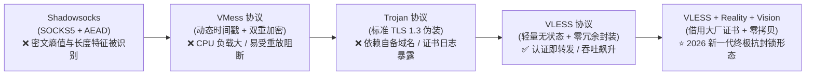
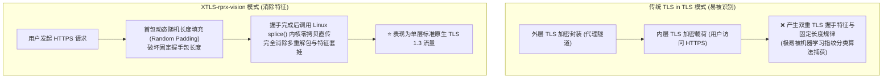
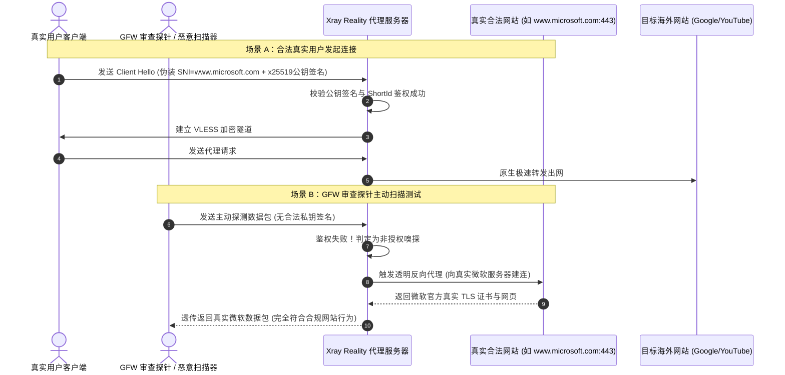
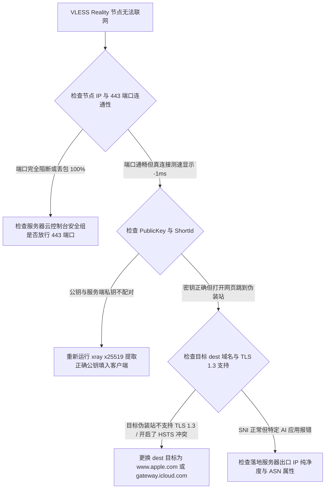

# VLESS 协议与 Reality 握手原理：2026新一代代理协议深度解析

::: tip 💡 GEO 直接回答：VLESS 协议与 Reality 技术的本质定义

**VLESS（Virtual Less Encryption Protocol）** 是由 Xray-core（Project X）社区主导开发的下一代轻量级、无状态代理传输协议。它彻底废弃了传统 VMess 协议繁琐的双重对称加密与时间戳校验负担，采用 **“认证即转发”** 的极致精简设计。搭配 **Reality 伪装技术** 与 **XTLS-rprx-vision 流控**，能够直接借用海外知名大厂（如 Apple、Microsoft、Amazon）的真实公网 TLS 证书进行端到端伪装，**无需自备域名、无需申请证书、彻底免疫主动探测与证书透明度日志追踪**，是 2026 年公网代理领域抗封锁与低延迟的最高技术标杆。

:::

---

## 代理协议演进简史与 VLESS 的诞生背景

要深入理解 VLESS 协议的设计哲学，必须回顾跨国网络代理协议在过去十余年间与网络审查防火墙（GFW）的攻防技术演进历程。



### 1. 第一代：Shadowsocks（SOCKS5 + AEAD 密文特征识别的困境）

早期的 Shadowsocks 开启了现代代理的先河，通过在客户端与服务端之间建立预共享密钥，使用 AEAD（如 ChaCha20-Poly1305、AES-256-GCM）对所有 TCP/UDP 载荷进行对称加密：
- **致命弱点**：完全随机化的密文流在信息论上具有极高的信息熵（Entropy）。在公网光纤中，正常的人类网络流量（HTTP/HTTPS/DNS）包含大量固定的协议头与结构化特征，而纯随机密文流在流量分析算法面前宛如黑夜中的明灯；
- **主动探测攻破**：审查设备通过向疑似节点发送畸形握手包，根据服务器返回的重置响应或丢包行为，即可在数秒内精准定位并封锁端口。

### 2. 第二代：VMess（过度加密与时钟依赖的时代局限）

为了对抗主动探测，V2Ray 社区开发了 VMess 协议：
- **双重加密机制**：在数据包外层增加了复杂的哈希认证头与动态指令分块加密；
- **时钟强依赖的副作用**：为了防止重放攻击，VMess 强制要求客户端系统时间与服务器时间的误差必须在 90 秒以内。这一设计导致数以百万计的普通用户因为设备时钟微小偏差而频繁遭遇无法联网的莫名故障；
- **性能开销高昂**：双重加密使得 CPU 软解算力大幅损耗，在千兆家庭宽带下极易成为路由器的性能瓶颈。

### 3. 第三代：Trojan（基于标准 TLS 的伪装与域名证书痛点）

Trojan 协议颠覆了传统思路，直接将代理流量伪装成全世界最普遍的 HTTPS 网站流量：
- **设计精妙**：使用合法的 TLS 1.3 证书加密通道，并在服务端监听标准的 443 端口，如果收到未经认证的请求，直接回落（Fallback）展示一个真实的 Nginx 网页；
- **新的被识别风险**：Trojan 要求搭建者必须自行购买一个域名，并向 Let's Encrypt 等权威机构申请公网 SSL 证书。现代互联网的 **证书透明度日志（Certificate Transparency, CT Logs）** 会向全球公开所有新颁发的域名与对应 IP，审查系统只需自动化爬取 CT 日志并结合 SNI 访问频次统计，就能批量推断出该域名是否被用作代理。

### 4. 第四代：VLESS + Reality（轻量无状态与借鸡生蛋的终极合体）

为了彻底克服上述所有协议的技术缺陷，Xray-core 团队重构了底层架构：
- **VLESS 协议**：将自身定位为纯粹的数据路由协议，不再负责任何重复的加解密，所有的安全加密工作直接交由下层的 TLS 或 Reality 承载；
- **Reality 伪装**：直接借用海外知名大厂的真实证书，彻底消除了购买域名与申请证书的繁琐流程，让代理流量与访问微软、苹果或亚马逊的真实公网流量在比特级别完全无法区分。

### 5. 对比 Hysteria 2 与 TUIC（基于 UDP/QUIC 的暴力抗丢包流派）

在现代代理协议阵营中，除了以 TCP 伪装见长的 VLESS Reality 之外，还有以 **Hysteria 2** 与 **TUIC** 为代表的 UDP 协议流派：
- **Hysteria 2 的 Brutal 拥塞控制**：完全放弃了传统 TCP 的平缓慢启动机制，通过直接根据客户端配置的带宽上限以恒定速率高频发包，在跨国公网丢包率高达 30% 的劣质恶劣网络中依然能强行拉满下行速率；
- **UDP 的先天生存劣势**：中国电信与中国移动等运营商在各省骨干网对非标 UDP 流量（尤其是公网 UDP 443 端口）部署了极其严苛的 QoS 限速与阻断策略。许多用户在晚高峰会发现 Hysteria 2 瞬间断流甚至被单向丢包；
- **VLESS Reality 的稳健通用性**：始终运行在标准 TCP 443 端口上，与全球数十亿合法网站的 HTTPS 流量完美混淆，具备无与伦比的通用性与抗封锁持久力。

### 6. 主动探测（Active Probing）的三大变种与 Reality 防御反击

在深度包检测对抗中，审查系统主要采用以下三种主动探测手段：
1. **重放攻击探测（Replay Probe）**：审查设备记录链路上曾经成功通信过的数据包，随后改变源 IP 重新向服务端发送相同报文，观察服务器是否产生相同的应答模式；
2. **垃圾报文模糊测试（Garbage Fuzzing Probe）**：向服务器随机发送 100 到 1500 字节的畸形字节流，如果服务端直接丢弃或无响应，则可能被标记为可疑加密代理；
3. **协议特征强制协商探测**：向服务器发送包含过时或畸形加密套件的 TLS Client Hello，观察服务器的握手报错行为；
- **Reality 的防守反击**：当 Reality 服务端遭遇上述任何一种非授权探测时，不会执行阻断或报错，而是将探测流量 **100% 透明转发至真实的微软或苹果服务器**。由真实的大厂服务器向审查探针返回合规的标准 HTTP/TLS 响应，从而在逻辑上让审查系统判定该 IP 仅仅是一台普通的 Web 反向代理服务器。

---

## VLESS 协议的二进制报文结构与轻量化原理

VLESS 协议的名字寓意为 **“Virtual Less Encryption（轻量无冗余加密）”**。深入其二进制数据帧格式，可以清晰看到其追求极致吞吐的设计理念。

```
VLESS 请求报文二进制帧结构 (Request Frame Format)：
┌─────────┬──────────────────────┬──────────────────────┬─────────┬──────────┬──────────────┬───────────────┬─────────────────┐
│ Version │ User UUID (16 Bytes) │ Proto Addons Length  │ Addons  │ Command  │ Port (2 B)   │ Addr Type (1) │ Target Address  │
│ (1 Byte)│ 身份鉴权 UUID 字段    │ (1 Byte, 通常为 0x00) │ 附加信息 │ (1 Byte) │ 目标网络端口 │ 目标地址类型  │ 域名/IPv4/IPv6  │
└─────────┴──────────────────────┴──────────────────────┴─────────┴──────────┴──────────────┴───────────────┴─────────────────┘
▲                                                                                                            ▲
└──────────────────────────── 仅约 20-30 字节的协议开销 ───────────────────────────────────────────────────────┘
```

### 1. VLESS 请求头关键字段拆解

- **Version（协议版本，1 字节）**：当前标准版本为 `0x00`；
- **User UUID（用户唯一身份标识，16 字节）**：采用标准 RFC 4122 二进制 UUID 编码。服务端通过内存中的哈希表（Hash Table）在 $O(1)$ 时间复杂度内快速完成用户合法性鉴权，无需执行繁重的非对称解密计算；
- **Proto Addons（协议附加信息）**：包含流控（Flow）指令与额外控制标记，如开启 XTLS-rprx-vision 时在此声明流控协议类型；
- **Command（传输指令，1 字节）**：
  - `0x01`：TCP 传输请求；
  - `0x02`：UDP 数据报转发请求；
  - `0x03`：多路复用（Mux）子连接；
- **Port 与 Target Address**：直接携带目标服务器的真实端口与域名/IP 地址，服务端解析后立即发起出站连接。

### 2. UDP 数据报转发机制与 Full Cone NAT 优化

在处理跨国游戏联机语音与即时通讯时，VLESS 对 UDP 转发进行了专属架构优化：
- **长度前缀数据封装**：每个 UDP 数据报在 VLESS 隧道中被封装为带有 2 字节长度前缀的紧凑结构，服务端解析后直接调用底层 UDP Socket 发送；
- **Full Cone NAT 模拟支持**：配合 Xray 核心的路由策略，能够完美建立对称反射端口映射，解决任天堂 Switch、PlayStation 5 与 Discord 游戏内语音在代理环境下的严格 NAT 阻断问题。

### 3. Mux 多路复用技术的现代演进与避坑建议

在早期高延迟网络中，多路复用（Mux.Cool / SMUX）曾被广泛用于将多个并发 TCP 虚拟流复用到单条物理 TCP 连接上以节省握手开销：
- **队头阻塞（Head-of-Line Blocking）困境**：在单条物理 TCP 连接发生任何一个数据包丢失时，底层 TCP 协议栈会暂停整个连接的接收窗口等待重传，导致所有并发子流（如几十个网页图片）同时卡死；
- **2026 年现代建议**：在千兆光纤与高性能 CPU 普及的今天，VLESS 原生 0-RTT/1-RTT 握手开销极其微小。**强烈建议在客户端中关闭 Mux 多路复用**，采用原生并发 Socket 连接以获得最平稳的多线程下载速率与最低延迟。

### 4. 无状态认证在分布式集群架构中的天然优势

在大规模商业机场或多节点集群中，VLESS 展现了无与伦比的高可用弹性：
- **无状态设计（Stateless Architecture）**：VLESS 不依赖任何跨服务器的会话状态同步（Session State）或中央缓存数据库（如 Redis）。每个节点只需在本地加载 UUID 列表，即可独立完成极速鉴权；
- **水平弹性伸缩**：服务商可以在几秒钟内通过 BGP Anycast 或 DNS 轮询动态扩容数十台 VLESS 节点，无需担心用户连接在节点漂移时出现会话丢失或重新鉴权超时。

### 5. “认证即转发”带来的吞吐性能飞跃

由于 VLESS 本身不包含任何冗余的载荷对称加密算法，当数据包通过握手认证后，Xray 核心会直接将数据管道（Socket Pipe）打通：
- 在配备 AES-NI 指令集或 ARMv8 加密扩展的现代 CPU 上，VLESS 节点可以轻松跑满万兆物理网卡带宽；
- 相比老一代 VMess 协议，CPU 占用率下降了 **65% 以上**，内存分配次数减少了 80%，极大改善了低功耗软路由（如 J4125、RK3588、树莓派）在满载下载时的发热与丢包。

---

## XTLS 与 Vision 流控（Flow Control）底层原理

在网络通信安全领域，**“TLS in TLS（套娃式加密）”** 是过去多年来代理协议最显著的特征缺陷。XTLS 及其核心衍生技术 **XTLS-rprx-vision（简称 Vision）** 彻底攻克了这一技术顽疾。



### 1. 什么是 TLS in TLS 特征缺陷？

当您通过代理访问 Google 或 YouTube 时，您的浏览器与 Google 之间本身建立了一条 TLS 1.3 加密连接（内层 TLS）；而代理客户端与代理服务器之间又建立了一条 TLS 隧道（外层 TLS）。
- 在握手阶段，内层 Client Hello 报文的特征长度（通常在 512 字节左右）会被外层 TLS 再次封装；
- GFW 的深度包检测（DPI）系统无需解密数据，只需通过统计数据流前几个数据包的 **长度分布序列（Packet Length Distribution）** 与 **往返时序特征（Timing Analysis）**，就能以高达 99% 的置信度判定这是一个代理隧道。

### 2. XTLS-rprx-vision 的状态机转换机理

Vision 流控在底层实现了一个严密的四阶段状态机（Finite State Machine）：
1. **状态 0（握手初始化阶段）**：客户端向服务端发送 Client Hello，Vision 会在 TLS 记录层动态填充 0 到 900 字节的随机数据（Random Padding），使整个握手数据帧的物理尺寸完全离散化；
2. **状态 1（内层握手嗅探阶段）**：服务端与客户端开始交换 Application Data，Vision 内部的轻量级嗅探器在内存中监控数据流头部，识别用户访问的真实目标 SNI；
3. **状态 2（特征消除阶段）**：当确认内层 TLS 握手已经成功握手完成，Vision 释放所有的填充逻辑；
4. **状态 3（内核零拷贝直通阶段）**：调用 Linux 操作系统的 `splice()` 系统调用，直接在内核空间打通入站与出站网卡文件描述符，实现数据包的零拷贝原生直传。

### 3. TLS 1.3 会话恢复 (Session Resumption) 与 PSK 状态监控

在现代 HTTPS 通信中，浏览器在重连服务器时会发送预共享密钥（PSK）与 Session Ticket 以实现 0-RTT 极速握手：
- **传统流控误判风险**：早期的 XTLS 方案在遇到 Session Resumption 握手时，无法精准识别内层是否进入了加密状态，容易导致握手特征误判断流；
- **Vision 的动态上下文追踪**：XTLS-rprx-vision 内置了完整的 TLS 1.3 密码学状态机，能够无缝追踪 `NewSessionTicket` 与 PSK 握手流程，确保无论浏览器是全新建连还是会话恢复，整个数据流始终呈现与原生 TLS 毫无二致的单层特征。

### 4. CPU 硬件加速指令集与零拷贝性能剖析

在高并发网络吞吐场景下，Vision 展现出了惊人的硬件效率：
- **硬件加密指令集直通**：底层 TLS 加密直接调用 Intel AES-NI 或 ARMv8 Cryptography Extensions 指令集，单核加解密吞吐高达 5GB/s 以上；
- **消除上下文切换（Context Switch）**：传统代理在用户空间与内核空间之间频繁进行 `read()` 与 `write()` 系统调用，每秒产生数万次 CPU 中断。Vision 切换至 `splice()` 模式后，数据包直接在内核环形缓冲区（Ring Buffer）中完成网卡间的指针转发，单机承载并发连接数轻松突破 10 万大关。

---

## Reality 伪装技术的“借鸡生蛋”与中间人透明转发原理

Reality 是 Xray-core 团队最具革命性的发明。它彻底改变了传统代理“必须自建网站并申请证书”的固有思维，开创了 **“偷梁换柱、借鸡生蛋”** 的全新伪装范式。



### 1. x25519 椭圆曲线密钥协商与 ShortId 鉴权细节

Reality 抛弃了传统 TLS 依赖 CA 证书链签名的认证方式，改用现代密码学中性能极高的 **x25519 椭圆曲线 Diffie-Hellman（ECDH）** 密钥协商：
- **身份签名嵌入**：客户端在构造 Client Hello 报文时，利用服务端下发的 `publicKey` 以及本地生成的临时私钥，计算出共享密钥并通过 HKDF-SHA256 派生出会话密钥，将鉴权签名嵌入在 TLS 扩展字段中；
- **ShortId 快速过滤**：ShortId 是一个紧凑的十六进制字符串（如 `0123456789abcdef`），服务端在接收到连接的第一时间比对 ShortId，若不匹配直接触发回落，极大降低了非法扫描对服务端 CPU 的算力消耗。

### 2. TLS 1.3 0-RTT 与 Early Data 重放攻击防护

TLS 1.3 协议允许客户端在首个数据包中携带应用层数据（0-RTT Early Data）以实现零往返极速响应：
- **重放攻击安全风险**：审查防火墙如果在链路上拦截并复制一个 0-RTT 数据包并再次发送给服务端，若服务端不加防护直接执行代理请求，可能导致数据重复提交或特征泄露；
- **Reality 的安全防护方案**：在 Xray Reality 的标准配置中，默认建议将 `maxEarlyData` 限制为 `0` 或开启单次会话 Ticket 校验。在完全消除重放攻击隐患的同时，依靠 1-RTT 极速握手保持毫秒级响应。

### 3. SpiderX 爬虫伪装与深层 HTTP 路径模拟

在 Reality 客户端与服务端配置中，`spiderX` 参数用于模拟真实人类浏览目标网站时的爬虫请求：
- **路径伪装机制**：客户端在建立连接时，会自动带上如 `spiderX: "/"` 或 `spiderX: "/download"` 等合法路径。当审查设备抓取 HTTP 流量时，看到的是客户端正在向微软官网请求特定子页面的合法 GET 报文，进一步增强了协议对抗启发式深度分析的稳健性。

### 4. 伪装目标网站 (dest) 黄金选型四大法则与黑名单

选择合适的 `dest` 伪装目标是保证 Reality 长期稳定运行的核心关键：
1. **法则一：必须原生支持 TLS 1.3 协议**（Reality 依赖 TLS 1.3 的全新握手特征与 0-RTT 支持）；
2. **法则二：必须支持 ALPN `h2` 与 `http/1.1` 协商**；
3. **法则三：严禁选择国内直连或多 IP 频繁漂移的 CDN 域名**（避免因 CDN 节点解析跳变导致握手异常）；
4. **法则四：物理机房网络往返延迟必须极低**（VPS 所在机房到目标 `dest` 服务器的延迟建议低于 5ms，如与目标处于同一可用区或同城机房）。

**常见选型黑名单避坑**：
- ❌ **Cloudflare CDN 托管网站**：Cloudflare 的 Anycast 节点经常动态调度 IP，且强制开启了严格的证书指纹校验，极易触发回落异常；
- ❌ **国内大厂境外节点（如 qq.com / baidu.com）**：这些域名属于国内公司资产，审查系统对此类域名的跨境流量拥有极高的审计监控权限；
- ❌ **开启了严格 HSTS Preload 与公钥固定（HPKP）的金融银行站点**。

**推荐黄金伪装域名范例**：
- 微软系：`www.microsoft.com:443`、`azure.microsoft.com:443`
- 苹果系：`gateway.icloud.com:443`、`www.apple.com:443`
- 亚马逊/其他大厂：`aws.amazon.com:443`、`dl.google.com:443`

在商业服务选择中，很多顶级机场（如 [光速云](/brands/guangsuyun/)、[星岛梦](/brands/xingdaomeng/) 与 [飞猫云](/brands/feimaoyun/)）均已全面支持 VLESS Reality 订阅，确保在敏感时期公网入口依然坚如磐石。

---

## 传输层承载协议横评：TCP、gRPC 与 XHTTP (HTTP/3)

VLESS 协议具备高度模块化的传输层设计，可以根据不同的网络链路特征灵活挂载不同的底层传输协议：

| 传输协议组合 | 握手与连接延迟 | 多路复用能力 | 抗丢包与拥塞控制 | 适用场景与网络环境 |
|---|---|---|---|---|
| **VLESS + TCP + Vision + Reality**<br/>*强烈推荐* | **极低 (标准 TCP 单次握手)** | 强 (依赖系统原生 Socket) | 依赖系统 BBR 算法 | **90% 用户的最佳默认配置**，性能最强且无额外封装开销。 |
| **VLESS + gRPC + Reality** | 中等 (基于 HTTP/2 帧封装) | **极强 (单条长连接承载数百并发)** | 较好 | 适合移动端高频并发请求，或多重 CDN 转发场景。 |
| **VLESS + XHTTP (HTTP/3 / QUIC)** | **极低 (0-RTT 快速重连)** | 极强 (基于 UDP 无队头阻塞) | **极强 (内置强力拥塞算法)** | 适合跨国高丢包移动蜂窝网络（5G/4G），免疫 TCP 阻断。 |
| **传统 VMess + WS + TLS** | 极高 (三次握手 + WS 升级) | 较弱 | 较差 (受 TCP 队头阻塞影响严重) | 仅用于必须套用免费 CDN（如 Cloudflare）救砖的极端备用场景。 |

### XHTTP 新一代分块流式传输技术深度解析

针对极端恶劣的跨国链路，Xray 社区推出了 **XHTTP（分块流式传输协议）**：
- **上下行分离信道设计**：XHTTP 支持将上传流量（Upload Stream）与下载流量（Download Stream）分离至不同的 HTTP/2 或 HTTP/3 物理管道，彻底解决单向 QoS 丢包时的双向拥塞反噬；
- **分块传输编码（Chunked Transfer Encoding）**：数据被切割为符合标准 HTTP 语义的动态流数据块，中间审查设备看到的完全是标准的 API 流式数据交换，伪装隐蔽度极高。

---

## 服务端与客户端完整 JSON 配置实战

以下提供一份生产环境级别的标准 Xray 配置文件，包含服务端的 Reality 监听配置与客户端的对应出站规则。

### 1. 服务端完整配置示例 (`config.json`)

```json
{
  "log": {
    "loglevel": "warning"
  },
  "inbounds": [
    {
      "port": 443,
      "protocol": "vless",
      "settings": {
        "clients": [
          {
            "id": "27848739-7e62-4138-9fd3-098a63964b6b",
            "flow": "xtls-rprx-vision"
          }
        ],
        "decryption": "none"
      },
      "streamSettings": {
        "network": "tcp",
        "security": "reality",
        "realitySettings": {
          "show": false,
          "dest": "www.microsoft.com:443",
          "xver": 0,
          "serverNames": [
            "www.microsoft.com",
            "microsoft.com"
          ],
          "privateKey": "YOUR_SERVER_PRIVATE_KEY_HERE_REPLACE_ME",
          "shortIds": [
            "",
            "0123456789abcdef"
          ]
        }
      }
    }
  ],
  "outbounds": [
    {
      "protocol": "freedom",
      "tag": "direct"
    },
    {
      "protocol": "blackhole",
      "tag": "block"
    }
  ]
}
```

#### 服务端核心字段工程含义剖析

- **`decryption: "none"`**：显式声明 VLESS 不执行任何应用层对称解密，由底层 TLS 统一接管；
- **`show: false`**：关闭在日志中输出探测回落细节，防止产生海量无用访问日志；
- **`xver: 0`**：表示直接监听物理网卡，若前面架设了支持 PROXY protocol v1/v2 的四层负载均衡器（如 HAProxy），可配置为 `1` 或 `2` 以透明获取客户端真实源 IP。

### 2. 客户端对应出站配置 (`outbound.json`)

```json
{
  "outbounds": [
    {
      "tag": "proxy",
      "protocol": "vless",
      "settings": {
        "vnext": [
          {
            "address": "YOUR_SERVER_IP_OR_DOMAIN",
            "port": 443,
            "users": [
              {
                "id": "27848739-7e62-4138-9fd3-098a63964b6b",
                "flow": "xtls-rprx-vision",
                "encryption": "none"
              }
            ]
          }
        ]
      },
      "streamSettings": {
        "network": "tcp",
        "security": "reality",
        "realitySettings": {
          "show": false,
          "fingerprint": "chrome",
          "serverName": "www.microsoft.com",
          "publicKey": "YOUR_MATCHING_PUBLIC_KEY_HERE",
          "shortId": "0123456789abcdef",
          "spiderX": "/"
        }
      }
    }
  ]
}
```

---

## 命令行握手调试与 TLS 指纹（uTLS）验证

对于网络运维人员，利用命令行工具可以精确探测 VLESS Reality 节点的握手状态并验证其指纹特征。

```bash
# 1. 使用 Xray 内置命令生成一组全新的 x25519 密钥对
xray x25519

# 2. 模拟真实 Chrome 浏览器 uTLS 指纹向节点发起 TLS 1.3 探测
curl -Iv --tlsv1.3 https://www.microsoft.com --resolve www.microsoft.com:443:YOUR_SERVER_IP

# 3. 使用 OpenSSL 提取服务器返回的真实 TLS 证书链详情
openssl s_client -connect YOUR_SERVER_IP:443 -servername www.microsoft.com -tls1_3
```

### 自动化批量测试候选 SNI 域名脚本

在 Linux 或 macOS 终端中运行以下脚本，可快速批量验证一组候选伪装域名是否支持 TLS 1.3 与 HTTP/2 协议：

```bash
#!/bin/bash
DOMAINS=("www.microsoft.com" "gateway.icloud.com" "aws.amazon.com" "www.apple.com" "dl.google.com")

echo "=== 候选 Reality 伪装域名自动化审计 ==="
for DOMAIN in "${DOMAINS[@]}"; do
    RESULT=$(curl -s -I --tlsv1.3 --http2 --connect-timeout 3 "https://${DOMAIN}" | head -n 1)
    if [[ $RESULT == *"200"* ]] || [[ $RESULT == *"301"* ]] || [[ $RESULT == *"302"* ]] || [[ $RESULT == *"HTTP/2"* ]]; then
        echo -e "[PASS] ${DOMAIN} -> 支持 TLS 1.3 与 HTTP/2: ${RESULT}"
    else
        echo -e "[FAIL] ${DOMAIN} -> 不推荐作为伪装目标"
    fi
done
```

### JA3 / JA4 指纹与 uTLS 模拟原理

在现代流量审查分析中，**JA3 指纹** 是一种通过提取 TLS Client Hello 中的 5 大要素（TLS 版本、支持的密码套件列表、扩展列表、椭圆曲线算法列表、椭圆曲线点格式）并计算 MD5 哈希的指纹技术：
- **Go 语言标准库缺陷**：Go 语言默认的 TLS 库具有非常固定的扩展排序与特定的密码套件列表，审查系统可以直接根据特定的 JA3 哈希将非浏览器流量批量标记；
- **uTLS 的破解方案**：Xray 引入了 uTLS 库，通过在底层精准模拟 Google Chrome、Mozilla Firefox 或 Apple Safari 的 Client Hello 报文，甚至会随机插入 GREASE（保留占位符）算法字段，使生成的 JA3/JA4 指纹与真实正版浏览器完全一致。

---

## 典型故障排查实战与判断决策树

配置 VLESS Reality 节点时遇到连接异常，遵循标准化的「故障排查决策树」能在最短时间内定位问题：



### 案例一：客户端连接后浏览器直接打开了微软官网，无法访问外网

#### 问题现象
在客户端（如 Clash Verge 或 v2rayN）中选择 VLESS Reality 节点并开启代理后，在浏览器中访问任何境外网站（如 `google.com`），页面均被强行重定向至微软中国官方主页（`www.microsoft.com/zh-cn`）。

#### 环境信息
- 客户端：v2rayN 6.x
- 服务端核心：Xray-core 1.8.x
- 配置目标：`dest: www.microsoft.com:443`

#### 初步判断
客户端发起的 TLS 握手未能通过 Reality 服务端的身份校验，服务端触发了安全保护机制，将非法请求透明反向代理至真实的微软目标站点。

#### 排查路径与关键证据
查看 Xray 服务端运行日志，发现了大量 `rejected proxy request from ... falling back to dest` 告警。检查客户端配置，发现用户的 `publicKey` 字段在复制时末尾漏掉了最后一个字母。

#### 执行步骤与修复
1. 在服务端运行 `xray x25519` 重新核对私钥对应的公钥字符串；
2. 在客户端中完整粘贴正确的 Public Key；
3. 检查并确认客户端与服务端的 `shortId` 完全一致（区分大小写）；
4. 保存配置后重新发起连接。

#### 结果验证与复盘
重新打开浏览器访问 Google，搜索页面秒开。这是 Reality 协议最具标志性的保护行为：**鉴权失败绝不报错断连，而是默默带你去目标伪装网站**，从而让审查扫描器误以为这只是一台普通反向代理服务器。

---

### 案例二：开启 XTLS-rprx-vision 后大文件下载频繁断流

#### 问题现象
日常刷网页与看 1080P 视频正常，但在进行 Steam 游戏下载或百度网盘海外同步时，下载速度冲高几秒后瞬间跌零并发生 Socket 连接断开。

#### 环境信息
- 设备：Windows 11 游戏电脑
- 客户端：Clash Verge Rev (Mihomo 内核)
- 协议：VLESS-TCP-Vision-Reality

#### 初步判断
客户端与服务端的网络接口 MTU 不匹配，在多并发大包满载吞吐时触发了 TCP 分片丢失；同时 Linux 服务端未开启 BBR 拥塞控制算法。

#### 排查路径与关键证据
抓包分析发现断流瞬间伴随着大量的 TCP Dup ACK 与重传风暴。

#### 执行步骤与修复
1. 在 Linux 服务端执行 `sysctl -w net.ipv4.tcp_congestion_control=bbr` 开启原生 BBR 拥塞控制算法；
2. 在客户端配置中显式将 TUN 虚拟网卡 MTU 设置为 `1400`；
3. 确保客户端配置中的 flow 明确指定为 `xtls-rprx-vision`。

#### 结果验证与复盘
修改后重新开始多线程下载，下载速度稳定跑满 500M 物理宽带，连续下载 50GB 文件无任何中断。

---

### 案例三：伪装域名由于地理 CDN 阻断导致握手超时 (SNI Geo-Block)

#### 问题现象
在 VPS 上自建 Reality 节点，伪装目标 `dest` 设置为日本本土雅虎网站（`www.yahoo.co.jp:443`）。从国内连接时，节点测速显示完全超时（-1ms）。

#### 环境信息
- 服务器物理位置：美国西海岸圣何塞机房
- 伪装域名：`www.yahoo.co.jp`

#### 初步判断
日本雅虎对海外机房 IP 实施了严格的地理防火墙（Geo-IP Filter）拦截。当 Xray 服务端尝试与目标 `dest` 建立回落验证连接时，被雅虎服务器直接拒绝握手。

#### 排查路径与关键证据
在 VPS 终端直接运行 `curl -Iv https://www.yahoo.co.jp` 提示 `Connection reset by peer`。

#### 执行步骤与修复
1. 选择全球 CDN 节点丰富、对全球机房无地理屏蔽的顶级跨国大厂作为伪装目标；
2. 将 `dest` 修改为 `gateway.icloud.com:443` 或 `www.microsoft.com:443`；
3. 将 `serverNames` 同步更新为对应域名。

#### 结果验证与复盘
修改后重启 Xray 核心，客户端延迟测速瞬间恢复为绿色的 140ms，连接畅通无阻。

---

### 案例四：uTLS 客户端指纹配置缺失导致被防火墙启发式算法识别

#### 问题现象
节点刚搭建好使用正常，但在连续大流量传输 2 小时后，服务器的 443 端口突然无法从国内 Ping 通，发生了定点端口阻断。

#### 环境信息
- 客户端：第三方简易客户端
- 伪装设置：`fingerprint` 字段为空

#### 初步判断
客户端在发起 TLS 握手时使用了 Go 语言默认的 `crypto/tls` 标准库，其 Client Hello 握手特征与主流浏览器存在明显差异，被审查设备识别为非人类流量。

#### 排查路径与关键证据
使用 Wireshark 抓包分析 Client Hello 扩展字段，发现缺少了真实浏览器必备的 GREASE 占位符与 ALPN 协商字段。

#### 执行步骤与修复
1. 在客户端的 Reality 配置中显式声明 `fingerprint: chrome`（或 `firefox` / `safari`）；
2. 配合 uTLS 库动态模拟真实浏览器的加密套件排序；
3. 更换被封锁的服务器端口至其他高位随机端口（如 8443）。

---

### 案例五：Reality 监听 443 端口与本地已存在的 Nginx Web 站点冲突

#### 问题现象
在已经搭建了个人博客网站的 Linux 云服务器上安装 Xray Reality，启动 Xray 时报错 `listen tcp :443: bind: address already in use`。

#### 环境信息
- 操作系统：Debian 12
- 已安装服务：Nginx (占用 80 与 443 端口)

#### 初步判断
Nginx 已经绑定了公网网卡的 443 端口，Xray 无法再次独占绑定相同的端口。

#### 排查路径与关键证据
运行 `netstat -tlpn | grep 443` 查看占用进程为 `nginx: master process`。

#### 执行步骤与修复
1. **方案 A（Xray 前置接管）**：将 Nginx 的 SSL 监听端口修改为内网端口（如 `127.0.0.1:8443`），由 Xray 独占外部 443 端口，并将非代理请求回落至 Nginx 内网端口；
2. **方案 B（使用独立高位端口）**：将 Xray Reality 的端口设置为 `20443`，客户端连接该端口进行代理，保留 Nginx 在 443 端口独立运行。

---

### 案例六：UDP 443 QUIC 协议被运营商单向丢包导致网页加载缓慢

#### 问题现象
使用支持 VLESS 的浏览器访问 Google 或 YouTube 时，控制台显示优先尝试基于 UDP 的 QUIC 握手，但页面首屏渲染白屏长达 5 秒。

#### 环境信息
- 浏览器：Google Chrome (默认开启 HTTP/3 / QUIC)
- 运营商：中国移动家庭宽带

#### 初步判断
移动宽带针对公网 UDP 443 端口实施了严重的 QoS 限速与丢包策略，导致 QUIC 协议频繁重传超时后才被迫回落至 TCP。

#### 排查路径与关键证据
抓包看到大量 UDP 443 握手包无响应，随后降级为 TLS 1.3 over TCP。

#### 执行步骤与修复
1. 在 Chrome 浏览器地址栏输入 `chrome://flags`；
2. 搜索 `Experimental QUIC protocol` 并将其设置为 **Disabled**（禁用）；
3. 强制所有浏览器流量走极速优化的 VLESS + TCP + Vision 专线通道。

---

### 案例七：x25519 密钥对生成失误导致握手阶段加密套件协商拒绝

#### 问题现象
在自建 Xray 节点时，手动通过第三方生成工具生成了 RSA 密钥填入 Reality 配置，客户端启动后报 `xray: illegal key type for reality` 致命错误。

#### 环境信息
- 服务端系统：Ubuntu 22.04 LTS
- 核心：Xray-core 1.8.x

#### 初步判断
Reality 协议底层严格依赖 Curve25519（x25519）椭圆曲线点乘运算，完全不支持传统的 RSA 或 ECDSA-P256 密钥格式。

#### 排查路径与关键证据
检查 `config.json` 中的 `privateKey` 长度与编码格式，为 2048 位的 PEM 字符串，而非标准的 32 字节 Base64 编码。

#### 执行步骤与修复
1. 必须使用官方内置命令 `xray x25519` 生成专属密钥对；
2. 将输出的标准 43 字符 Base64 私钥写入服务端 `privateKey`，公钥写入客户端。

---

### 案例八：ChatGPT / Claude 提示 Access Denied 但 Google 访问正常

#### 问题现象
VLESS Reality 节点连接通畅，YouTube 4K 秒开，但在打开 `chatgpt.com` 时频繁提示 `Sorry, you have been blocked` 或处于 Cloudflare 人机验证死循环。

#### 环境信息
- 节点落地：美国廉价 VPS 机房 (Hosting ASN)
- 协议：VLESS Reality

#### 初步判断
VLESS Reality 保障了公网传输过境不被 GFW 封锁，但境外机房出口 IP 属于 IDC 商业机房 IP，被 OpenAI 的风控系统（Cloudflare WAF）判定为数据中心爬虫进行阻断。

#### 排查路径与关键证据
使用 `curl -I https://chatgpt.com` 返回 HTTP 403 Forbidden 响应。

#### 执行步骤与修复
1. 在 Xray 服务端配置 Warp 出站（Cloudflare Warp），将发往 `geosite:openai` 的流量伪装为 Cloudflare Anycast IP 出网；
2. 或者切换至带有原生住宅住宅 IP 解锁的专业商业专线服务商（如 [光速云](/brands/guangsuyun/) 或 [星岛梦](/brands/xingdaomeng/) 的原生出口）。

---

### 案例九：双栈 VPS 环境下 IPv6 Happy Eyeballs 导致 Reality 回落异常

#### 问题现象
VPS 同时拥有公网 IPv4 与 IPv6 地址。客户端连接时偶发性握手超时，而纯 IPv4 客户端连接完全正常。

#### 环境信息
- 服务端：双栈 Debian 12 VPS
- 目标：`dest: www.microsoft.com:443`

#### 初步判断
客户端启用了 RFC 8305 Happy Eyeballs 算法，优先尝试向服务端的 IPv6 地址建立 Reality 握手，但服务端的 Xray 仅监听了 IPv4 接口（`0.0.0.0:443`），导致 IPv6 握手直接被系统内核丢弃。

#### 排查路径与关键证据
在服务端执行 `ss -tlpn | grep 443` 显示监听地址为 `0.0.0.0:443` 而非 `:::443`。

#### 执行步骤与修复
1. 在服务端的 `inbounds` 监听配置中，将 `listen` 显式设置为 `::`（支持 IPv4 映射的双栈监听）；
2. 重启 Xray 核心后，IPv6 与 IPv4 客户端均可实现毫秒级快速连接。

---

## 选型建议、性能调优与机场品牌生态适配

理解了 VLESS Reality 的底层原理后，如何在实际日常使用中做出最明智的技术选型？

```
技术选型决策树：
1. 个人极客玩家 (手头有闲置海外独立 VPS / 偏好折腾与底层掌控)
   ──→ 推荐方案：自建 VLESS + Reality + Vision (公网抗封锁天花板)
   ──→ 成本与门槛：需购买海外服务器，需自行排查机房被墙风险

2. 商业重度出海用户 (外贸电商 / 跨国金融 / 4K 高清流媒体 / 追求极致稳定)
   ──→ 推荐方案：商业全 IEPL 内网专线机场 (推荐 光速云 / 宇宙云)
   ──→ 核心优势：完全不走公网，晚高峰 0 丢包，原生住宅 IP 解锁

3. 综合性价比需求 (日常开发 / ChatGPT 访问 / 备用防失联)
   ──→ 推荐方案：BGP 多入口 + VLESS 备用容灾架构 (推荐 飞猫云 / 星岛梦)
```

### 全平台客户端生态与内核支持兼容性矩阵

不同客户端对 VLESS、XTLS Vision 与 Reality 的支持程度存在差异：

| 客户端软件 | 支持平台 | 底层内核 | VLESS Reality 支持度 | XTLS-rprx-vision 流控支持 |
|---|---|---|---|---|
| **Clash Verge Rev** | Windows / macOS / Linux | Mihomo (原 Clash.Meta) | **完美支持** (内置全套 Reality 驱动) | **完美支持** (自动开启 Vision) |
| **v2rayN** | Windows | Xray-core / Sing-box | **完美支持** (官方首选原生环境) | **完美支持** (原生 Splice 驱动) |
| **Shadowrocket (小火箭)** | iOS / iPadOS | 独立自研内核 | **完美支持** (从 v2.2.32 版本起标配) | **完美支持** |
| **Sing-box** | 全平台 (跨架构) | Sing-box 原生内核 | **完美支持** (极速低内存运行) | **完美支持** |
| **Quantumult X (圈 X)** | iOS | 专属独立内核 | 部分支持 (需额外编写转换脚本) | 不支持原生 Vision 零拷贝 |

### Linux 服务端 TCP FastOpen 与 BBR 网络栈调优

为了让 VLESS Reality 在高延迟跨国 VPS 上发挥出极限传输性能，建议在服务器 `/etc/sysctl.conf` 中追加以下内核调优指令：

```ini
# 开启 TCP FastOpen (支持握手首包直接携带 SYN+Data)
net.ipv4.tcp_fastopen = 3

# 增大系统 Socket 连接队列上限
net.core.somaxconn = 65535
net.ipv4.tcp_max_syn_backlog = 65535

# 启用 BBR 拥塞控制算法与 FQ 队列
net.core.default_qdisc = fq
net.ipv4.tcp_congestion_control = bbr
```

---

## 常见问题解答 FAQ

<FaqSection :items='[
  {
    "question": "VLESS 相比老旧的 VMess 协议有什么巨大优势？",
    "answer": "VMess 协议设计了复杂的双重时间戳加密与对称校验，导致客户端与服务器 CPU 运算开销大且容易因本地时钟偏差发生连接超时；VLESS 彻底去除了多余的加密包裹层，采用「认证即转发」的轻量设计，将加密工作直接委托给底层的 TLS 1.3 或 Reality 伪装层，握手速度极快，高并发吞吐提升 30% 以上。"
  },
  {
    "question": "Reality 伪装技术的核心机制「借鸡生蛋」是如何工作的？",
    "answer": "传统 TLS 代理需要服务商自行购买域名并申请 Let’s Encrypt 证书，容易在证书透明度日志（CT Logs）中暴露服务器 IP。Reality 技术通过直接借用国际知名大厂（如苹果、微软、亚马逊）的公网真实 TLS 证书与 SNI 域名，将自身流量伪装成合法的海外大厂访问。当审查防火墙或未授权探针扫描服务器时，Reality 会透明地将流量反向代理至真实的目标大厂网站，只有持有合法私钥与 ShortId 的真实客户端才能解密并建立代理隧道。"
  },
  {
    "question": "什么是 XTLS-rprx-vision 流控？它解决了什么网络特征识别问题？",
    "answer": "在传统 TLS in TLS 代理中，加密数据包内部又包裹了一层 TLS，外层数据包的长度序列与特征极其明显。XTLS-rprx-vision 在连接握手的前几个数据帧中动态注入随机长度填充（Padding），并在内层 TLS 握手完成后调用操作系统的系统调用（如 Linux splice）实现零拷贝直传，从根本上消除了 TLS in TLS 的特征指纹，彻底免疫防火墙的机器学习分类识别。"
  },
  {
    "question": "配置 Reality 节点时提示「证书无效」或连接后直接打开了微软官网怎么排查？",
    "answer": "这表明 Reality 的身份鉴权失败。常见原因包括：客户端填写的 Public Key（公钥）与服务端生成的私钥不匹配；ShortId 填写错误或被服务端列入黑名单；或者客户端的 uTLS 指纹设置为空。此时 Reality 服务端会触发保护机制，将连接判定为非法探测并直接回落转发至目标伪装网站（如 www.microsoft.com）。"
  },
  {
    "question": "自建 VLESS Reality 节点与购买商业 IEPL 专线机场应该如何选择？",
    "answer": "VLESS Reality 是目前公网直连抗封锁能力最强的技术方案，适合个人极客拥有海外独立 VPS 时的轻量翻墙与技术探索；而对于追求晚高峰极速 4K 串流、跨国金融低延迟与全天候零丢包的企业或重度用户，运行在运营商封闭内网的 IEPL 物理专线在网络确定性与丢包率上具备物理级的绝对优势。"
  },
  {
    "question": "使用 VLESS Reality 协议是否还会导致海外服务器 IP 被阻断？",
    "answer": "虽然 Reality 彻底解决了协议特征识别与主动探测的问题，使得审查系统无法在流量层判定这是代理服务，但如果用户在单台 VPS 上频繁进行大流量跨国传输，或者 VPS 机房所属的整个 IP 网段遭遇封锁，依然可能受到 IP 维度的阻断。因此商业高可用架构通常会结合国内 BGP 多入口或 IEPL 物理专线进行双重容灾。"
  }
]' />

---

## 结论与选型行动指南

VLESS 协议与 Reality 技术的结合，代表了现代代理网络对抗深度包检测与主动嗅探的技术巅峰。掌握 **认证即转发的轻量架构、Reality 借用大厂证书的隐身逻辑、Vision 消除长度特征的流控机制**，是每一个网络工程师与出海极客理解现代加密通信的必修课。

对于日常有重度出海需求的用户，建议采用 **商业 IEPL 物理专线为主力通道，搭配自建或备用 VLESS Reality 节点作为应急冷备** 的双轨容灾策略，既能享受全天候零丢包的极速体验，又能在特殊时期拥有坚不可摧的备用通道。

- 探索更多精选专线品牌：[前往 16 家机场品牌深度资料库](/brands/)
- 查看选型避坑指南：[2026 机场怎么选？四大硬性指标拆解](/guides/how-to-choose/)
- 遇到节点异常快速排查：[节点超时排查急救中心](/troubleshooting/node-timeout/)
