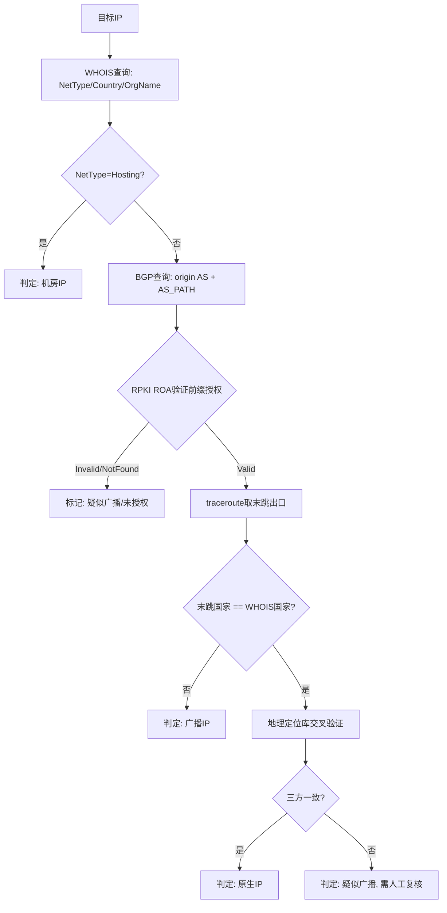
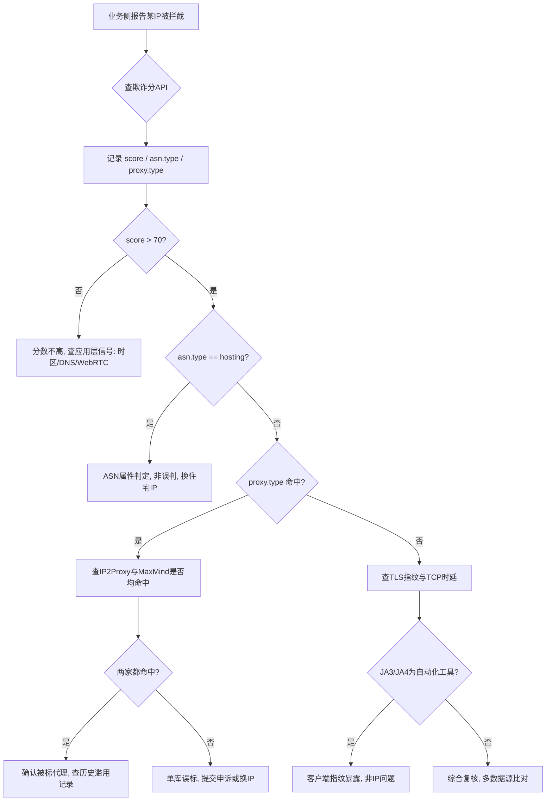
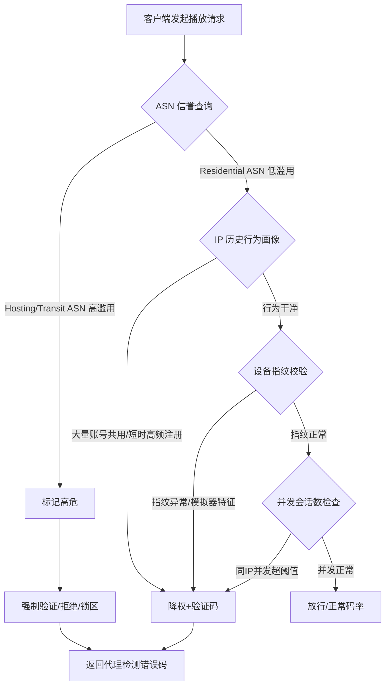
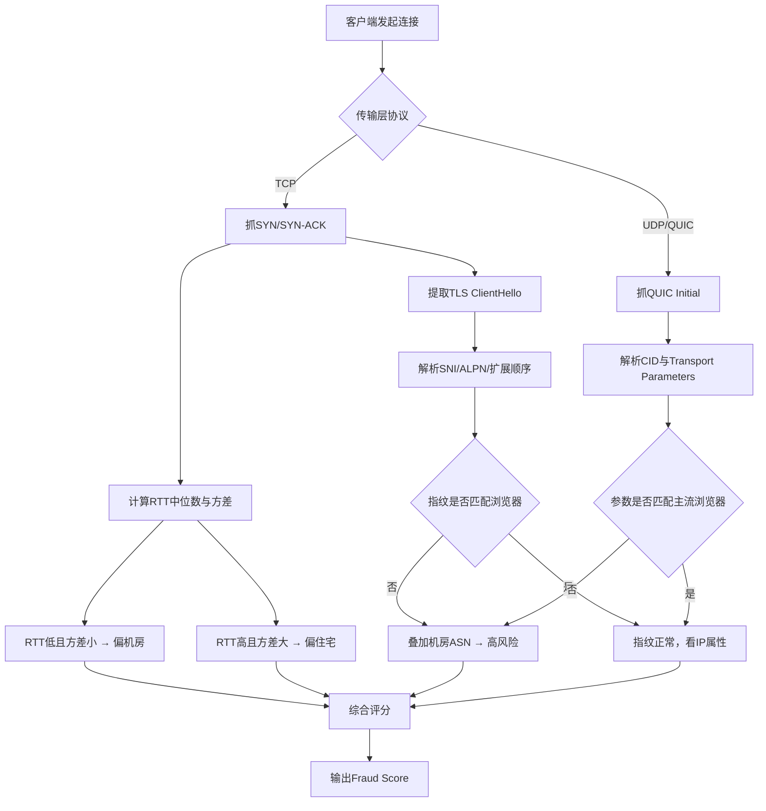
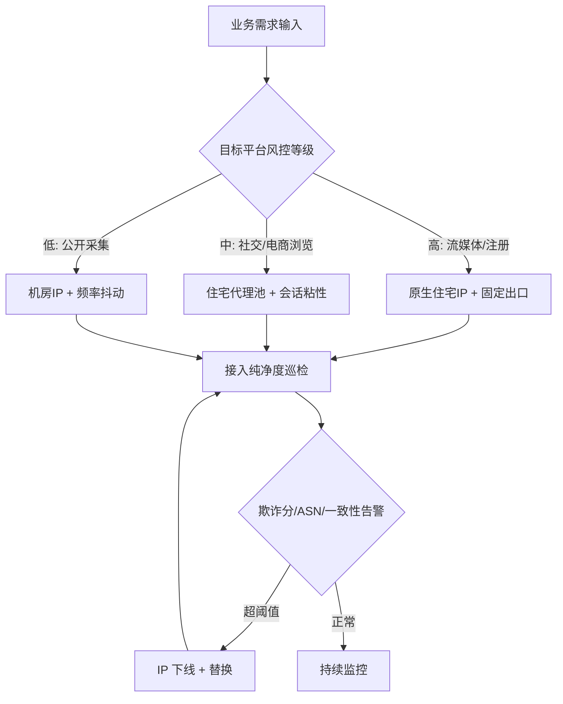

# 住宅IP与机房IP区别深度拆解：IP纯净度体系、Fraud Score判定逻辑与流媒体风控识别差异

::: tip 💡 核心结论与技术要点（Executive Summary）
住宅IP与机房IP区别的核心在于ASN归属与注册类型：住宅IP由ISP分配、ASN为运营商且WHOIS标记为ISP，机房IP归属IDC/云厂商ASN并标记为Hosting。Fraud Score综合ASN类型、代理库命中、时区与DNS泄漏、TLS指纹等维度打分，机房IP通常落在高风险区间。流媒体平台以ASN+IP信誉+行为特征三重判定，原生IP需WHOIS国家与出口路由一致，广播IP则存在注册地与实际出口分离，易触发风控。
:::

## 一、IP归属的协议层证据链：从ASN、WHOIS到BGP选路

判断一个出口IP是住宅还是机房，凭“感觉”和凭“证据”是两码事。风控系统不会看你商家页面怎么写，它只看协议层留下的痕迹。这一章把判定链拆到可复现的粒度：从WHOIS的注册类型字段，到BGP的origin AS与AS_PATH，再到RPKI的ROA授权，最后用traceroute和地理定位做交叉验证。整条链路跑通，一个IP的“出身”基本就藏不住了。

### 1.1 ASN与WHOIS注册类型：ISP与Hosting的硬指标

WHOIS查询是第一步，但大多数人只看了NetRange和OrgName就下结论，这不够。真正有判定价值的是NetType字段和ASN的注册性质。

ARIN的WHOIS响应里有一个明确字段叫NetType，取值包括ISP、Hosting、Business、University、Government等。这个字段由注册人申报，RIR审核，是判定IP性质的第一手材料。查询方式：

```bash
whois -h whois.arin.net "n 8.8.8.8" | grep -Ei "NetType|OrgName|Country|NetRange"
```

对住宅IP的典型期望是NetType为ISP，OrgName指向区域性宽带运营商（Comcast、Verizon、中国电信某省分公司之类）。对机房IP的典型期望是NetType为Hosting，OrgName指向数据中心或云厂商（DigitalOcean、Hetzner、阿里云等）。

但这里有个坑：NetType是申报制，存在历史遗留和错报。更硬的指标是ASN本身的注册类型。ARIN/RIPE/APNIC的ASN WHOIS记录里，AS的注册用途和持有者性质能进一步佐证。比如AS14061属于DigitalOcean，AS24940属于Hetzner，这类ASN下挂的前缀几乎不可能是住宅出口。反过来，AS7922（Comcast）下挂的前缀，即便某段被转租给托管商，其WHOIS的NetType通常仍保留ISP痕迹，但BGP层面会露出马脚——这正是下一节要讲的。

工程上建议把判定做成两级：一级看NetType和ASN持有者，二级看BGP路径。一级命中Hosting直接判机房；一级命中ISP但二级路径异常，判为“疑似广播/转租”，需要进一步验证。

### 1.2 BGP路由通告与广播IP：注册地与实际出口分离的报文证据

广播IP（也常被叫“伪原生”）的核心特征是：WHOIS注册国家、BGP origin AS的归属地、traceroute末跳的实际出口国家，三者不一致。这种不一致在BGP报文里有直接证据。

查origin AS和AS_PATH，最顺手的是bgp.tools的Web界面，命令行侧可以用RIPE RIS的looking glass或`bgp.tools`的API。以查询某前缀为例：

```bash
# 通过RIPE RIS查询某前缀的当前路由
curl -s "https://stat.ripe.net/data/looking-glass/data.json?resource=203.0.113.0/24" | jq '.data.rrcs[0].peers[0].as_path'
```

返回的AS_PATH形如`174 64500 64501`，第一跳是上游，最后一个是origin AS。关键看origin AS的注册地和该前缀WHOIS注册国是否一致。如果WHOIS写的是美国，origin AS却是一家香港或东欧的小运营商，且AS_PATH经过了非本地上游（比如路径里出现欧洲Tier1再绕回亚洲），这就是广播IP的典型报文证据。

更直接的证据来自tcpdump抓BGP UPDATE。在边界路由器或具备BGP会话的Linux主机上（比如用FRR/BIRD起了eBGP会话做观测），可以这样抓：

```bash
# 抓取来自上游的BGP UPDATE，过滤包含目标前缀的更新
tcpdump -i eth0 -n -s 0 -w bgp_update.pcap 'tcp port 179 and (tcp[tcpflags] & tcp-push != 0)'
# 实时打印并十六进制查看载荷，便于定位NLRI
tcpdump -i eth0 -n -A 'tcp port 179' | grep -A2 "UPDATE"
```

BGP UPDATE报文的关键字段：Withdrawn Routes Length、Total Path Attribute Length、Path Attributes里的ORIGIN（0=IGP，1=EGP，2=INCOMPLETE）、AS_PATH、NEXT_HOP，以及NLRI。解读时重点看AS_PATH的末尾AS与WHOIS注册AS是否一致，以及AS_PATH长度是否异常（广播IP常因绕路上游导致路径偏长）。RFC 4271定义的选路过程中，LOCAL_PREF是本地优先级，只在同一AS内部传播，值越高越优先；AS_PATH长度越短越优先。广播IP的提供方往往通过调高LOCAL_PREF、伪造短AS_PATH来让流量走自己的出口，但AS_PATH的origin段无法完全伪造——origin AS必须是实际通告该前缀的AS，这一点在RPKI普及后越来越难糊弄。

### 1.3 原生IP与广播IP的工程判别：traceroute、RPKI与地理定位交叉验证

原生IP的工程定义要求三方一致：WHOIS注册地、BGP出口路由的末跳国家、地理定位数据库的国家。广播IP至少有一方不一致，最常见的是注册地与实际出口分离。

判别流程可以固化成下面这条链路：



RPKI ROA验证是这条链里最容易被忽略但最硬的一环。ROA（Route Origin Authorization）由前缀持有者签发，声明“某AS被授权通告某前缀”。验证命令可以用Routinator或rpki-client本地跑，也可以走RIPE的API：

```bash
# 使用rpki-client验证某前缀的ROA状态
rpki-client -t 203.0.113.0/24 -a 64500
# 或通过RIPE Validator API
curl -s "https://rpki-validator.ripe.net/api/v1/validity/64500/203.0.113.0/24" | jq '.validated_route.validity.state'
```

返回Valid说明origin AS被授权；Invalid说明前缀被未授权AS通告，这是广播IP的强信号；NotFound说明该前缀没有ROA，需要结合其他证据。机房IP通常ROA齐全且origin AS与持有者一致，广播IP常见ROA缺失或origin AS与ROA声明的AS不符。

traceroute的用法要讲究。普通ICMP traceroute的末跳可能被目标侧防火墙吞掉，建议用TCP SYN到目标常见端口（80/443）做探测，并配合mtr看路径稳定性：

```bash
# TCP traceroute到443，避开ICMP过滤
traceroute -T -p 443 -n 203.0.113.10
# mtr持续观测，看末跳AS归属
mtr -T -P 443 -n -c 20 203.0.113.10
```

末跳的IP反查ASN（`whois -h whois.cymru.com " -v 203.0.113.10"`）能直接给出该跳的AS号和国家。如果WHOIS注册国是美国，末跳ASN归属却是香港或新加坡，且AS_PATH经过了跨洋上游，广播IP的嫌疑基本坐实。

地理定位数据库（MaxMind、IP2Location）在这里的作用是辅助而非决定。anycast广播会严重干扰地理定位——同一个IP在全球多个PoP同时通告，GeoIP库可能把它标到任播节点所在地，而实际出口在另一地。判定anycast可以看BGP路径是否在多个RRC观测点出现不同的末跳AS或不同的上游，RIPE RIS的多观测点数据正好能干这个。对住宅IP判定而言，anycast场景较少，但机房IP的CDN节点常是anycast，风控系统对这类IP的地理定位置信度会打折，这也是机房IP在流媒体风控里吃亏的原因之一。

把上面几步串起来，一个可复现的判定脚本骨架大致是：WHOIS取NetType和Country → bgp.tools/RIS取origin AS和AS_PATH → rpki-client验ROA → TCP traceroute取末跳ASN和国家 → 三方比对输出结论。这套链路跑下来，住宅IP和机房IP的协议层证据链就完整了，后续章节的IP纯净度评分和Fraud Score判定，都建立在这条链的输出之上。

---

## 二、IP纯净度体系与Fraud Score欺诈分判定逻辑

住宅IP与机房IP的区别，落到风控系统眼里，最终会收敛成一个 0 到 100 的分数。这个分数业内叫 Fraud Score、风险分、欺诈分，各家叫法不同，输入维度大同小异。做住宅代理业务和做机房 VPS 业务的人，如果只盯着“IP 归属地是不是住宅”这一个字段，基本会在真实对抗里翻车。原因很简单：现代风控早就不看单一标签了，它把 IP 的注册属性、网络层行为、传输层指纹、应用层泄漏揉成一个多维向量，再丢进模型里打分。这一节把输入维度拆开讲，把工程落地时的 API 调用、阈值分级、误判排查讲透。

### 2.1 Fraud Score 的输入维度拆解

先建立一个认知：Fraud Score 不是“IP 黑名单查询”的别名。黑名单只是其中一个输入源，权重通常还没那么高。真正拉开住宅 IP 和机房 IP 差距的，是下面这几组信号叠加后的结果。

#### 商业代理库命中（IP2Proxy、MaxMind Anonymous IP）

这是最直接的一层。IP2Proxy 的 PX 系列数据库会把 IP 标记为 VPN、TOR、DCH（数据中心）、PUB（公共代理）、WEB（网页代理）等类型；MaxMind 的 Anonymous IP 库则给出 is_anonymous、is_hosting_provider、is_public_proxy、is_tor_exit_node 几个布尔位。机房 IP 在这里几乎必然命中 is_hosting_provider=true，这是 ASN 类型决定的，洗不掉。住宅 IP 如果被前手用户拿去跑过爬虫、发过垃圾邮件，也可能被这些库收录成 PUB 或 WEB 类型，这就是所谓“住宅 IP 不纯净”的来源之一。

工程上要注意：这两家库的更新频率不同，IP2Proxy 日更，MaxMind 周更左右。同一个 IP 在两家库里的结论可能打架，风控方通常会取并集——任一家标了代理就算命中。所以排查误判时，必须两家都查。

#### ASN 类型（Hosting 权重极高）

ASN 的注册类型是硬属性。ASN 注册信息里有个字段叫 category，常见值有 isp、hosting、business、education。机房 IP 的 ASN 基本全是 hosting，比如 DigitalOcean 的 AS14061、AWS 的 AS16509、阿里云海外节点的 AS45102。住宅 IP 的 ASN 是 isp，比如各地电信、联通、Comcast、Verizon 的 ASN。

风控模型里 hosting 这个特征的权重给得非常高，原因在于：正常家庭宽带用户不会从 hosting ASN 发起登录、下单、看流媒体。一旦 ASN 类型是 hosting，哪怕这个 IP 没被任何代理库收录，分数也会被顶到一个不低的水位。这是住宅 IP 与机房 IP 最本质的区分点，也是为什么很多人买了“原生 IP”的 VPS 依然过不了风控——ASN 属性摆在那，原生不原生只影响地理位置判定，不影响 hosting 判定。

#### 时区与浏览器时区不一致

这一层是应用层信号。服务端拿到请求后，会比对三个东西：IP 归属地推导出的时区、HTTP 请求头里 Accept-Language 暗示的区域、以及前端 JS 通过 Intl.DateTimeFormat().resolvedOptions().timeZone 上报的浏览器时区。三者不一致就是强风险信号。

典型翻车场景：机房 IP 在美国，浏览器时区设成 Asia/Shanghai，Accept-Language 是 zh-CN。风控一看，一个美国 IP 的用户，浏览器时区是中国时区，语言是中文，行为轨迹还像脚本，分数直接往上跳。住宅 IP 用户如果人在国内用国内宽带，三个信号天然自洽，这一项不加分也不减分。这也是住宅 IP 在“环境一致性”上的天然优势——它不需要你费劲去伪造时区。

#### DNS 泄漏（出口 DNS 与 IP 归属不符）

DNS 泄漏的判定逻辑是：服务端或前端探测脚本拿到你实际使用的递归 DNS 服务器 IP，再查这个 DNS 服务器的归属 ASN 和地理位置，跟你出口 IP 的归属做比对。机房 IP 常见的翻车是：出口 IP 在洛杉矶，但 DNS 请求走的是 8.8.8.8 或者国内运营商的 DNS，甚至走的是机房内网自建的 DNS。出口 DNS 的 ASN 跟出口 IP 的 ASN 对不上，风控就认为你在用代理隧道，真实流量路径和出口不一致。

住宅 IP 的 DNS 通常由运营商递归解析器提供，ASN 跟宽带 ASN 一致，地理位置也吻合，这一项天然干净。做机房代理的人经常忽略这点，以为改个出口 IP 就完事，结果 DNS 还在走本地，泄漏得明明白白。

#### WebRTC 泄漏

WebRTC 的 STUN 请求会暴露本机的内网 IP 和部分情况下的公网 IP。浏览器环境下，如果 WebRTC 拿到的公网 IP 跟 HTTP 出口 IP 不一致，风控基本可以断定你在用代理。机房 IP 场景下，用户本地是家庭宽带，WebRTC 暴露的是家庭公网 IP，HTTP 出口是机房 IP，两者一比对，代理实锤。住宅代理如果做的是透明转发且禁用了 WebRTC，这一项可以规避；但很多廉价住宅代理方案在浏览器指纹层面没处理干净，照样泄漏。

### 2.2 TLS 层指纹：JA3/JA4 与 ClientHello 细节

网络层之上，风控还会看 TLS 握手特征。JA3 是把 ClientHello 里的 TLS 版本、加密套件列表、扩展列表、椭圆曲线、EC 点格式拼成字符串再取 MD5。JA4 是新一代，格式更结构化，把传输层协议、TLS 版本、SNI 有无、加密套件数量、扩展数量、ALPN 首值都编码进去，抗混淆能力更强。

关键点在于：真实浏览器的 JA3/JA4 指纹是相对固定的。Chrome 某个大版本、Firefox 某个版本，指纹都有公开的特征库。而自动化工具——curl、Python requests、Go 的 net/http、各种爬虫框架——它们的 TLS 栈跟浏览器不一样，ClientHello 里的加密套件顺序、扩展顺序都对不上。风控拿 JA3/JA4 一比对，发现这个“Chrome 用户”的指纹其实是 curl 的，直接判定为非浏览器客户端。

再往深一层，TLS 1.3（RFC 8446）的 ClientHello 里有个 GREASE 机制（RFC 8701），浏览器会随机插入一些保留值来防止协议僵化。Chrome、Firefox 都会发 GREASE 值，而多数自动化工具的 TLS 库不发或者发得不规范。扩展顺序也是特征：浏览器有自己固定的扩展排列顺序，curl 的 OpenSSL 栈排出来是另一套。这些细节单独看权重不高，但跟 JA3/JA4 联合起来，识别自动化客户端的准确率相当高。

机房 IP 场景下，很多人用 curl 或脚本直接打接口，TLS 指纹这一关就过不去，哪怕 IP 是住宅的也没用——指纹暴露了客户端性质。住宅 IP 的价值在于配合真实浏览器环境时，IP 层和指纹层同时自洽。

### 2.3 TCP 层时延特征

TCP 层的信号比较隐蔽，但老练的风控会拿来辅助判定。核心指标是 SYN 到 SYN-ACK 的 RTT。机房 IP 的典型特征是低时延、低抖动：同机房内 RTT 常在 0.1~1ms，跨机房骨干网也就几毫秒到几十毫秒，且抖动很小。住宅宽带的 RTT 通常更高，抖动更大，尤其移动网络和 PPPoE 拨号线路，RTT 波动能到几十毫秒。

风控拿到一个声称是住宅用户的连接，测出来 SYN-SYN-ACK RTT 稳定在 0.5ms、抖动接近 0，这个时延特征跟机房内网互联高度吻合，跟真实家庭宽带对不上。这一项权重不高，但作为辅助特征，在分数边缘地带能把判定往高风险推一把。

工程上可以用 tcpdump 抓握手包算 RTT：

```bash
# 抓取与目标 443 端口的 SYN/SYN-ACK，统计握手 RTT
sudo tcpdump -i eth0 -nn -c 20 'tcp port 443 and (tcp[tcpflags] & (tcp-syn|tcp-ack) != 0)' -w /tmp/handshake.pcap
# 用 tshark 提取 SYN 与对应 SYN-ACK 的时间差
tshark -r /tmp/handshake.pcap -Y 'tcp.flags.syn==1 && tcp.flags.ack==0' -T fields -e frame.time_epoch -e ip.src -e tcp.srcport
```

拿到时间戳后做差，连续采样十几次看均值和方差，就能判断这条链路是机房内网还是住宅接入。

### 2.4 工程实践：API 调用、阈值分级与误判排查

#### curl 调用欺诈分 API 示例

各家欺诈分服务商的接口形态接近，下面以通用 REST 形态举例，实际接入时替换 endpoint 和鉴权头：

```bash
# 查询单个 IP 的欺诈分，携带 ASN、代理类型、地理信息返回
curl -s -X GET "https://api.fraudscore.example/v1/score?ip=203.0.113.45" \
  -H "Authorization: Bearer ${FRAUD_API_KEY}" \
  -H "Accept: application/json" \
  | jq '{
      ip: .ip,
      score: .fraud_score,
      asn: .asn.number,
      asn_type: .asn.type,
      is_proxy: .proxy.is_proxy,
      proxy_type: .proxy.type,
      is_hosting: .hosting.is_hosting,
      timezone: .location.timezone,
      country: .location.country_code
    }'
```

返回里重点看四个字段：fraud_score、asn.type（hosting 还是 isp）、proxy.type（是否命中 PUB/WEB/DCH）、hosting.is_hosting。四个字段联合判断，比只看分数靠谱。

#### 阈值分级

工程上常用三段式分级，具体边界按业务容忍度调：

| 分数区间 | 风险等级 | 处置策略 | 典型 IP 类型 |
|---|---|---|---|
| 0–30 | 低风险 | 放行，正常业务流 | 干净住宅 IP、运营商移动 IP |
| 30–70 | 中风险 | 加验证（验证码、二次认证、限流） | 被标记过的住宅 IP、部分企业专线 |
| 70–100 | 高风险 | 拦截或强制人工审核 | 机房 IP、公开代理、TOR 出口 |

这个表只是起点。电商下单场景可能把中风险阈值压到 50，流媒体登录场景可能放宽到 80，因为流媒体对住宅 IP 的容忍度更高、对机房 IP 更敏感，判定逻辑本身就不一样。

#### 误判排查流程

误判是常态，排查要有章法。下面这张流程图是实际排障时的判断路径：



排查时几个硬动作：

第一，多数据源比对。IP2Proxy、MaxMind、Scamalytics、IPQualityScore 至少查三家。单家标代理、其他家干净，大概率是误标，可以走申诉流程。三家都标，基本坐实。

第二，检查是否被误标为代理。住宅 IP 被前手用户污染是常见事。查 IP 的历史 Whois 变更记录、看这个 IP 段有没有被大规模爬虫用过。如果 IP 段整段被标，说明是段级别污染，换 IP 比申诉快。

第三，核对 ASN 属性。有些小运营商把住宅宽带和机房业务放在同一个 ASN 下，ASN 注册类型写的是 isp，但实际有 hosting 子段。这种情况查 RIR 的 whois 详情，看 route object 和 inetnum 的分配记录，能区分出来。

第四，应用层信号自查。时区、DNS、WebRTC 三项在浏览器环境里用脚本自测一遍，确认出口 IP、DNS 出口、浏览器时区三者自洽。很多“IP 没问题但过不了风控”的案例，最后查出来是 DNS 走了本地递归、时区对不上。

住宅 IP 与机房 IP 的区别，在 Fraud Score 这套体系里体现得淋漓尽致：机房 IP 在 ASN 类型这一项上先天失分，在 TCP 时延上又暴露机房特征；住宅 IP 在 ASN、时区、DNS 三项上天然自洽，但一旦被代理库收录或者客户端指纹不对，照样翻车。理解这套多维输入的逻辑，才能在实际选型和排障时知道该补哪一块，而不是盲目换 IP。

---

## 三、商业数据中心广播IP与原生住宅IP的流媒体识别差异

流媒体平台的风控体系走到今天，早已不是"查一个IP归属地数据库"这么粗糙的做法。Netflix 这类平台的风控是一个多输入联合决策系统，输入维度至少包括 ASN 信誉、IP 历史行为画像、设备指纹、并发会话数，输出是一个概率化的拒绝/放行/降级（降码率、锁区、强制验证）决策。理解这个决策链路，才能理解为什么同样是"美国IP"，机房广播段和原生住宅段的通过率能差出一个数量级。

### 3.1 Netflix 风控判定的联合决策链路

先把判定逻辑拆开看。Netflix 的接入侧风控大致按以下顺序做过滤，任何一层命中高危信号都会导致后续请求被降权或直接拒绝：



第一层是 ASN 信誉库。Netflix 维护（并采购第三方）ASN 级别的滥用评分，AWS、GCP、Azure、DigitalOcean、Hetzner、OVH 这些 Hosting ASN 天然带高滥用权重——不是因为这些段里每个IP都在干坏事，而是因为这些段里"被用于代理/爬虫/多账号"的密度太高，统计上就是高危。一个 IP 的 WHOIS 写着住宅 ISP，但如果它的 BGP 起源 ASN 是某个 hosting 提供商，风控侧看到的是 ASN，不是 WHOIS 文本。

第二层是 IP 历史行为画像。同一个出口 IP 在时间窗口内被多少个不同账号使用过、这些账号的注册地分布、登录时间分布是否呈现"代理池"特征（比如一个 IP 在 24 小时内被 5 个不同国家的账号登录），这些都会沉淀成该 IP 的行为分。机房 IP 因为被大量用户共用，行为画像几乎必然是"高共用、高切换"，这是它被拒的核心原因之一。

第三层是设备指纹与并发会话数。TLS 指纹（JA3/JA4）、HTTP/2 帧特征、浏览器 Canvas/WebGL 指纹、DRM 模块的 CDM 版本，这些组合起来标识"这是不是一个真实的消费级设备"。并发会话数则是同一出口 IP 上同时活跃的播放会话数量，超过阈值直接触发"疑似代理共享"。

三层联合决策的结果，就是机房 IP 在 ASN 层就已经大概率被判死，而原生住宅 IP 能一路走到设备指纹层才被细查。

### 3.2 原生住宅IP与机房广播IP在分流中的表现差异

这里要区分两个容易混淆的概念：原生住宅 IP 和"标记为住宅的广播 IP"。

原生住宅 IP 的特征是三位一体：WHOIS 注册信息归属当地住宅 ISP、BGP 出口路由从该 ISP 的接入网直接出去、地理定位（MaxMind/ipinfo 等库）与账号注册地一致。三者一致时，Netflix 的地理交叉验证拿不到矛盾信号，通过率高。

广播 IP（BGP anycast/租用段）的问题在于：WHOIS 可能被包装成住宅 ISP 的分配段，但实际出口路由绕行——数据包从你所在的机房出发，经过若干 transit 跳到目标 ISP 的边界，再"假装"从那里出去。地理定位库如果同时参考 RTT 探测、traceroute 路径特征和 DNS 解析器位置，很容易发现"这个 IP 声称在洛杉矶，但到它的 RTT 和路径特征指向法兰克福机房"。这种地理定位交叉验证一旦识破，账号会被标记为"位置不一致"，触发二次验证甚至锁区。

多维度对比如下：

| 指标维度 | 原生住宅IP | 机房广播IP | 判定影响 |
|---|---|---|---|
| 起源 ASN 类型 | Residential ISP（如 Comcast、Verizon） | Hosting/Transit ASN 或租用段 | ASN 信誉层直接决定生死 |
| WHOIS 与路由一致性 | 一致，接入网直出 | 常不一致，WHOIS 包装但路由绕行 | 地理交叉验证的关键破绽 |
| IP 历史共用密度 | 低，单户独享或小范围共享 | 高，代理池共用 | 行为画像层高危 |
| 地理定位交叉验证 | RTT/路径/注册地三者吻合 | RTT 与声称位置矛盾 | 触发位置不一致告警 |
| 流媒体通过率（经验值） | 高，稳定放行 | 低，高概率验证/锁区 | 直接体现在可用性上 |

### 3.3 流媒体分流解锁技巧：分流规则、DNS 策略与出口一致性

工程上要做的是让流媒体流量走住宅出口，其余流量走默认出口，同时保证 DNS 解析与出口一致、避免泄漏。核心原则：域名分流要覆盖 Netflix 的全套域名族，DNS 必须由出口侧解析，出口 IP 必须可验证。

先给一份 Clash 风格的分流配置示例（关键在 `rules` 段的域名族覆盖和 `dns` 段的 fake-ip 与 nameserver-policy 配合）：

```yaml
# Clash Meta / mihomo 配置片段：流媒体走住宅出口
dns:
  enable: true
  enhanced-mode: fake-ip
  fake-ip-range: 198.18.0.1/16
  # 关键：流媒体域名强制由住宅出口侧的 DNS 解析，避免 DNS 泄漏导致解析到本地 CDN
  nameserver-policy:
    "+.netflix.com,+.nflxvideo.net,+.nflximg.net,+.nflxext.com,+.nflxso.net":
      - "https://1.1.1.1/dns-query#RESIDENTIAL_PROXY"   # 指定走住宅出口的 DoH
  nameserver:
    - https://223.5.5.5/dns-query
    - https://1.1.1.1/dns-query

proxies:
  - name: "RESIDENTIAL_PROXY"
    type: socks5
    server: 10.0.0.10        # 住宅出口跳板地址
    port: 1080
    udp: true

proxy-groups:
  - name: "STREAM"
    type: select
    proxies: ["RESIDENTIAL_PROXY", "DIRECT"]

rules:
  # Netflix 全套域名族走住宅出口，注意 nflxvideo 是实际视频流 CDN
  - DOMAIN-SUFFIX,netflix.com,STREAM
  - DOMAIN-SUFFIX,nflxvideo.net,STREAM
  - DOMAIN-SUFFIX,nflximg.net,STREAM
  - DOMAIN-SUFFIX,nflxext.com,STREAM
  - DOMAIN-SUFFIX,nflxso.net,STREAM
  - DOMAIN-SUFFIX,fast.com,STREAM
  # 其余流量走默认
  - MATCH,DIRECT
```

DNS 与出口一致性的关键点在 `nameserver-policy`：如果流媒体域名用本地 DNS 解析，会拿到离你物理位置近的 CDN 节点，而你的出口却在住宅段，Netflix 侧看到"解析请求来源"和"播放请求来源"不一致，这本身就是代理特征。让流媒体域名的 DNS 查询走住宅出口，解析结果和播放请求同源，才是一致性。

出口 IP 必须可验证，不能靠猜。用 `curl --resolve` 强制把域名解析到指定 IP 并观察实际出口，或者直接查出口 IP 归属：

```bash
# 强制解析 netflix 域名到指定 IP，观察 TLS 握手与响应（验证出口是否真的从住宅段出去）
curl -v --resolve www.netflix.com:443:203.0.113.45 https://www.netflix.com/ 2>&1 | grep -E "Connected to|subject:|issuer:"

# 从住宅出口查实际出口 IP 及其 ASN 归属，确认不是 hosting ASN
curl -s --socks5-hostname 10.0.0.10:1080 https://ipinfo.io/json | jq '{ip, org, country, region}'

# 对比默认出口与住宅出口的 ASN，确认分流生效
curl -s https://ipinfo.io/org
curl -s --socks5-hostname 10.0.0.10:1080 https://ipinfo.io/org
```

握手时延这块，流媒体首帧加载对 TCP 握手和 TLS 握手敏感。在出口侧主机上做内核调优，扩大收发缓冲区、开启窗口缩放，能明显降低高 RTT 链路上的握手与首包时延：

```bash
# /etc/sysctl.d/99-stream-tuning.conf
# 扩大 TCP 接收/发送缓冲区，适配高 RTT 住宅链路，降低握手与首包时延
net.ipv4.tcp_rmem = 4096 87380 33554432
net.ipv4.tcp_wmem = 4096 65536 33554432
net.core.rmem_max = 33554432
net.core.wmem_max = 33554432
# 开启窗口缩放与时间戳，提升高延迟链路吞吐
net.ipv4.tcp_window_scaling = 1
net.ipv4.tcp_timestamps = 1
# 复用 TIME_WAIT 连接，降低频繁短连接握手开销
net.ipv4.tcp_tw_reuse = 1

# 应用并验证
sysctl -p /etc/sysctl.d/99-stream-tuning.conf
sysctl net.ipv4.tcp_rmem net.ipv4.tcp_wmem
```

排障时抓包确认流媒体流量确实走了住宅出口、DNS 查询没有泄漏：

```bash
# 抓取流媒体域名相关的 DNS 查询，确认解析请求从住宅出口发出
tcpdump -i any -n 'udp port 53 and (host 1.1.1.1 or host 223.5.5.5)' -c 20

# 抓取到 nflxvideo CDN 段的 TCP 握手，确认 SYN 从住宅出口 IP 发出
tcpdump -i any -n 'tcp[tcpflags] & tcp-syn != 0 and net 198.18.0.0/16' -c 10

# 路径探测，确认到流媒体 CDN 的出口路由不绕行机房
mtr -n -c 20 --tcp --port 443 www.nflxvideo.net
```

实际报文分析上，如果 `tcpdump` 看到 DNS 查询的源地址是机房内网、而播放请求的源地址是住宅出口，这就是典型的 DNS 泄漏，Netflix 侧会拿到不一致的解析来源与播放来源，风控分立刻上升。修正方法就是上面 `nameserver-policy` 里把流媒体域名钉死在住宅出口的 DoH 上。

一句话收束这一节：机房 IP 死在 ASN 信誉层，广播 IP 死在路由与地理交叉验证层，原生住宅 IP 赢在三者一致；分流工程要做的，是把域名族、DNS 解析、出口路由三件事绑到同一个住宅出口上，再用 `curl --resolve` 和 `tcpdump` 把"一致性"验证到报文级。

---

## 四、传输层与TLS层指纹：机房IP与住宅IP的报文级差异

前面三章我们聊的是IP归属、ASN、WHOIS、地理库这些“纸面属性”，以及基于这些属性衍生出的纯净度评分。到了这一章，视角要往下沉——沉到内核协议栈和TLS握手那一层。因为真正做风控的团队，早就不满足于查一个IP的注册信息了，他们会看你这个IP在传输层“怎么说话”。机房IP和住宅IP在这一层的差异，比很多人想象的要明显，而且这种差异是结构性的，不是换个User-Agent能糊弄过去的。

### 4.1 TCP三次握手的RTT特征：Wireshark能直接看出来的东西

先从最原始的TCP握手说起。一个客户端连到目标服务器，内核发出SYN，服务器回SYN-ACK，客户端再回ACK。SYN到SYN-ACK之间的时间差，就是一次RTT的近似值。这个值在机房IP和住宅IP上的分布，差异非常直观。

机房IP的典型画像：服务器托管在Tier-3以上机房，到主流目标（比如Cloudflare、Akamai边缘节点）的RTT通常在1~15ms之间，而且方差极小。你连续抓100个SYN，RTT曲线几乎是平的。原因不复杂——机房有专线接入、BGP优化、物理距离近、中间跳数少，且没有家庭宽带那种PPPoE拨号、NAT转换、Wi-Fi空口抖动带来的噪声。

住宅IP的画像则完全不同：RTT基线可能在20~80ms，但关键是抖动大。晚高峰、Wi-Fi信号弱、光猫NAT会话表满、运营商CGNAT排队，都会让RTT出现几十毫秒的突刺。你在Wireshark里看Time Delta列，机房的序列像尺子画的，住宅的序列像心电图。

Wireshark抓三次握手的过滤表达式：

```text
tcp.flags.syn == 1 && tcp.flags.ack == 0
```

这条抓的是纯SYN（客户端发起）。要同时看SYN-ACK，用：

```text
tcp.flags.syn == 1
```

然后看返回包的`tcp.time_delta`字段，或者直接用`tcp.analysis.ack_rtt`。更省事的做法是用tcpdump先落盘再分析：

```bash
# 抓取目标443端口的握手包，-s 0抓全包，-w落盘
sudo tcpdump -i eth0 -s 0 -w handshake.pcap 'tcp port 443 and (tcp[tcpflags] & tcp-syn != 0)'

# 抓100个包就停，避免文件过大
sudo tcpdump -i eth0 -s 0 -c 100 -w handshake.pcap 'tcp port 443 and tcp[tcpflags] & tcp-syn != 0'
```

关键字段解读：`tcp.time_delta`是同一流内相邻包的时间差，SYN到SYN-ACK的delta就是RTT；`tcp.analysis.ack_rtt`是Wireshark根据ACK推算的往返时延。把这两个值和IP的ASN一对照，机房IP的RTT中位数和P99几乎重合，住宅IP的P99往往是中位数的3~5倍。

这里要泼一盆冷水：RTT只是辅助特征，不能单独定罪。跨境住宅代理（比如美国住宅IP从亚洲连过去）RTT照样很高，而某些机房IP如果走的是劣质线路，RTT也会抖。所以工程上的做法是把RTT的“中位数/方差/跳数”三个量一起看，配合`mtr`的路径特征做联合判断。机房IP的路径通常跳数少、每跳延迟均匀；住宅IP的路径经常在运营商骨干网里绕，出现某一跳延迟突增。

```bash
# mtr看路径稳定性，机房IP通常10跳内到达，住宅IP经常15跳以上且有抖动
mtr -rwzc 50 1.1.1.1
```

### 4.2 TLS 1.3握手指纹：ClientHello里的“口音”

TCP层之上是TLS。RFC 8446定义的TLS 1.3握手，ClientHello报文里塞了一堆扩展（extensions），这些扩展的种类、顺序、内容，构成了一个客户端的“口音”。JA3/JA4这类指纹算法就是从这个报文里提取特征做哈希的。机房IP本身不直接决定ClientHello长什么样，但机房IP往往对应着特定的客户端栈——比如数据中心里跑的是curl、Python requests、Go的net/http，它们的ClientHello扩展顺序和浏览器差异明显。

一个真实的ClientHello里值得盯的字段：

- SNI（server_name）：目标域名。机房批量请求时SNI分布往往很集中，住宅用户则长尾。
- ALPN：应用层协议协商，浏览器通常是`h2,http/1.1`，某些自动化工具只给`http/1.1`。
- supported_versions：是否声明TLS 1.3。
- 扩展顺序：Chrome、Firefox、curl、Go各有各的排列，顺序本身就是指纹。
- GREASE值：Chrome会插入GREASE扩展做抗指纹，curl不会。

抓ClientHello的tcpdump命令：

```bash
# 抓TLS握手第一个包（ClientHello通常在TCP payload起始位置，content type 0x16）
sudo tcpdump -i eth0 -s 0 -w tls.pcap 'tcp port 443 and tcp[((tcp[12] & 0xf0) >> 2)] = 0x16'
```

Wireshark里过滤`tls.handshake.type == 1`就是ClientHello。看`tls.handshake.extensions_server_name`拿SNI，看`tls.handshake.extensions_alpn_str`拿ALPN列表。

机房IP的风险点在于：大量请求来自同一批IP，ClientHello指纹高度同质化，SNI集中，ALPN单一。风控侧把“IP的ASN属于机房”和“ClientHello指纹不像浏览器”两个信号一叠加，判定权重立刻上去。住宅IP的优势在于，它的ClientHello往往来自真实浏览器，扩展顺序、GREASE、ALPN都和主流浏览器一致，单看报文层没有破绽。

这里有个实操细节：如果你用住宅代理但客户端是curl，那ClientHello指纹依然是curl的，住宅IP的优势被你自己浪费了一半。真正讲究的做法是让出口IP的“身份”和TLS指纹的“身份”匹配——住宅IP配浏览器指纹，机房IP配自动化工具指纹，别错配。

### 4.3 QUIC（RFC 9000）：UDP上的新战场

HTTP/3普及之后，QUIC成了绕不开的一层。QUIC跑在UDP上，RFC 9000定义了它的连接建立流程。QUIC的Initial包里有几个特征值得风控方关注：

- Connection ID：客户端选的CID长度和生成方式，不同实现差异明显。Chrome的CID有特定长度和随机性，某些库生成的CID短且可预测。
- Initial包大小：QUIC要求Initial包至少1200字节，但不同客户端填充策略不同。
- Transport Parameters：里面的`initial_max_data`、`max_idle_timeout`等参数，各家实现默认值不同，构成指纹。
- 版本协商：是否支持版本协商扩展。

抓QUIC的tcpdump：

```bash
# QUIC走UDP 443，抓Initial包（long header，packet type 0x00在首字节高位）
sudo tcpdump -i eth0 -s 0 -w quic.pcap 'udp port 443'
```

Wireshark对QUIC的解码支持已经比较成熟，过滤`quic.long.packet_type == 0`看Initial包，`quic.connection.id`看CID，`quic.tls.handshake.extensions`看Transport Parameters。

机房IP在QUIC层的特征：如果客户端是Go的quic-go或某些爬虫库，CID生成规律、Transport Parameters默认值都和Chrome对不上。住宅IP配真实浏览器，QUIC指纹自然正常。风控方现在越来越多地把QUIC指纹纳入评分，因为HTTP/3的采用率上来了，绕过TLS层指纹的人往往在QUIC层露馅。

### 4.4 内核网络参数调优对出口特征的影响

这一节是给做代理出口、做IP池运维的人看的。Linux内核的sysctl参数会直接改变握手行为，进而改变出口指纹。调优本身没错，但调错了会把机房特征放大，或者把住宅特征搞得不伦不类。

几个关键参数：

```bash
# /etc/sysctl.d/99-proxy-tuning.conf
# SYN Cookie：高并发下防止SYN Flood，但开启后SYN-ACK的某些行为会变化
net.ipv4.tcp_syncookies = 1

# 全连接队列长度：影响高并发下的握手成功率，机房出口常调大
net.core.somaxconn = 4096
net.ipv4.tcp_max_syn_backlog = 8192

# TCP Fast Open：客户端和服务端都支持时，SYN包可携带数据，改变握手时序
net.ipv4.tcp_fastopen = 3

# 时间戳：影响PAWS和RTT测量，关闭后某些指纹会变化
net.ipv4.tcp_timestamps = 1

# 窗口缩放：影响TCP窗口行为
net.ipv4.tcp_window_scaling = 1
```

逐个说影响：

`tcp_syncookies=1`在SYN队列溢出时启用，此时SYN-ACK的序列号是编码过的，某些高级指纹工具能识别出“这个出口在被打或者并发极高”，间接暴露机房属性。住宅出口几乎不会触发syncookie。

`tcp_fastopen=3`（客户端+服务端都开）会让SYN包携带数据，Wireshark里能看到SYN包payload非空。机房出口常开TFO来降延迟，住宅宽带的光猫和运营商设备大多不支持TFO，所以“SYN带数据”本身就是一个偏机房的信号。

`somaxconn`和`tcp_max_syn_backlog`调大是机房标配，反映在高并发场景下的握手成功率上。住宅IP不会有这种调优痕迹，因为家庭路由器根本不管这些。

调优的回滚方法要记牢，别调完出事找不回来：

```bash
# 查看当前值
sysctl net.ipv4.tcp_syncookies net.core.somaxconn net.ipv4.tcp_fastopen

# 临时回滚（重启失效）
sudo sysctl -w net.ipv4.tcp_syncookies=1
sudo sysctl -w net.core.somaxconn=128
sudo sysctl -w net.ipv4.tcp_fastopen=1

# 永久回滚：删掉/etc/sysctl.d/下的自定义文件，恢复默认
sudo rm /etc/sysctl.d/99-proxy-tuning.conf
sudo sysctl --system
```

工程建议：如果你运营的是住宅IP池，别在出口机上乱调这些参数。住宅IP的价值就在于“像家庭网络”，你把TFO、大backlog、syncookie全开上，等于给住宅IP打上了机房烙印。反过来，机房IP池可以调优，但要清楚这些调优痕迹会被风控方看到，得配合其他层的伪装。

### 4.5 四维指标对比

把这一章涉及的传输层特征整理成一张表，方便对照：

| 指标维度 | 机房IP典型值 | 住宅IP典型值 | 风控侧敏感度 | 抓取方法 |
|---|---|---|---|---|
| SYN-SYNACK RTT中位数 | 1~15ms，方差极小 | 20~80ms，方差大 | 中 | tcpdump + tcp.analysis.ack_rtt |
| 路径跳数（mtr） | 通常≤12跳，每跳均匀 | 常≥15跳，存在突增跳 | 中 | mtr -rwzc 50 |
| TLS ClientHello指纹 | 同质化高，ALPN单一 | 浏览器指纹，含GREASE | 高 | tcpdump + Wireshark tls.handshake.type==1 |
| QUIC Initial特征 | CID规律性强，参数默认值偏库 | 浏览器CID，参数贴近Chrome | 高 | tcpdump udp port 443 + quic.long.packet_type==0 |
| 内核调优痕迹 | TFO开启、大backlog、syncookie易触发 | 基本默认值 | 中低 | sysctl -a + 握手时序分析 |

### 4.6 握手与指纹判定流程

下面这张图把从报文到判定的链路串起来，风控侧大致就是这么走的：



这张图想说明一件事：传输层和TLS层的信号，单独看都不足以定罪，但和IP属性叠加之后，判别力很强。机房IP + 非浏览器TLS指纹 + 低方差RTT，这三个信号一起出现，基本可以确定是自动化流量。住宅IP + 浏览器指纹 + 高方差RTT，即使IP纯净度评分一般，风控侧也会给较低权重。

回到本章的核心关键词——住宅IP与机房IP区别。在报文这一层，区别不在于“谁更干净”，而在于“谁的行为更像它声称的身份”。机房IP声称自己是数据中心，那就该有数据中心的低延迟、高并发调优痕迹；住宅IP声称自己是家庭用户，那就该有家庭网络的抖动、默认内核参数、浏览器指纹。错配才是风险的来源：住宅IP配机房调优，或者机房IP配浏览器指纹，都会在传输层留下不自然的痕迹。做IP池和代理架构的人，得把这一层的自洽性当回事，别只盯着IP库的纯净度分数。

---

## 五、工程选型与风控对抗：住宅IP与机房IP的部署决策

把前面几章的判定逻辑落到工程上，选型这件事其实没那么玄。我见过太多团队在这一步翻车，不是因为不懂原理，而是因为把“IP类型”当成了万能钥匙，忽略了业务本身的风控暴露面和运维成本。这一章按三个层次拆：选型矩阵怎么定、运维体系怎么搭、合规边界怎么划。

### 5.1 业务场景选型矩阵

选型的核心变量只有两个：目标平台的风控强度，以及业务对吞吐量和成本的要求。把这两个变量交叉，基本能覆盖 90% 的决策场景。下面这张表是我在实际项目中反复校准过的版本，指标列刻意拆细，因为“住宅 vs 机房”这种二元对比在工程上几乎没有指导意义——真正决定成败的是 ASN 归属、IP 历史信誉、出口稳定性这些可观测项。

| 指标维度 | 原生住宅IP（ISP分配） | 住宅代理池（P2P/轮换） | 机房IP（IDC/云厂商） | 移动蜂窝IP |
|---|---|---|---|---|
| ASN 归属 | 目标国主流 ISP（Comcast、DTAG 等） | 混合 ISP，质量方差大 | 云厂商/IDC ASN（AWS、Hetzner 等） | 移动运营商 ASN |
| 典型 Fraud Score 区间 | 5–25 | 15–60（取决于池子质量） | 40–90 | 10–40 |
| 出口稳定性（会话保持） | 高，可长期固定 | 低，轮换频繁 | 极高 | 中，NAT 超时不可控 |
| 单位成本（相对值） | 高 | 中高 | 极低 | 最高 |
| 吞吐能力 | 受限于单线带宽 | 中 | 极高 | 低 |
| 适用风控等级 | 高 | 中高 | 低 | 高 |

基于这张表，三类典型业务的决策逻辑如下。

公开数据采集（低风控、高吞吐）。目标站点没有强账号体系，风控主要靠频率限制和 UA/行为特征。这类场景用机房IP完全够用，配合请求间隔抖动和连接池复用即可。硬上住宅IP是纯浪费——成本翻十倍，吞吐还掉一个量级。唯一要注意的是目标站点如果接了 Cloudflare 的 Bot Management，机房 ASN 会被直接打上高风险标签，这时候要么降速要么换住宅池，别硬刚。

流媒体访问（高风控、中低吞吐）。Netflix、Disney+ 这类平台的风控链路里，ASN 类型是硬性判据之一，机房 IP 段基本在注册环节就被标记。这类场景优先原生住宅IP，且要求出口 IP 的 ASN 与账号注册地一致。轮换型住宅池在这里反而是减分项——会话中途换 IP 会触发平台的风控重校验。工程上要做的是固定出口 + 长会话保持，代理层配置里把 session 粘性拉到最高。

账号注册与养号（最高风控、低吞吐）。这是对 IP 纯净度要求最苛刻的场景。除了住宅属性，还要看 IP 的历史欺诈分、是否落在已知代理段、DNS 与出口是否一致。机房IP在这里基本没有生存空间。实操中建议用独享原生住宅IP，注册前先跑一遍 Fraud Score 查询，分数超过阈值直接弃用换 IP，别抱侥幸心理。

### 5.2 IP纯净度维护与欺诈分监控的运维体系

选型定完之后，运维才是真正拉开差距的地方。IP 的信誉是动态的——今天干净的住宅 IP，可能因为同段邻居被滥用，两周后欺诈分就爬到了 70。没有监控体系的团队，往往是在业务被封了才知道 IP 已经脏了。

运维体系由三块组成：定期欺诈分查询、ASN 变更监控、出口一致性巡检。

欺诈分查询建议按 IP 池规模设定周期。小于 500 个 IP 的池子每天全量跑一遍；大规模池子按 10%–20% 抽样，命中高分的 IP 再全量复查。查询源不要只依赖单一服务商，IPQualityScore、Scamalytics、AbuseIPDB 三家交叉验证，取保守值。下面是一个巡检脚本的框架，用 Python 写，输出结构化结果供告警系统消费：

```python
#!/usr/bin/env python3
# ip_health_check.py —— IP 纯净度巡检框架
import json, subprocess, datetime, requests

# 告警阈值：按业务风控等级调整
THRESHOLDS = {
    "fraud_score": 50,        # 欺诈分超过 50 触发告警
    "asn_change": True,       # ASN 发生变更即告警
    "dns_mismatch": True,     # DNS 解析地与出口地不一致即告警
}

def query_fraud_score(ip: str) -> dict:
    """多源交叉查询，取最高分作为保守值"""
    scores = []
    # 示例：IPQualityScore（需替换为实际 key）
    r = requests.get(
        f"https://ipqualityscore.com/api/json/ip/{API_KEY}/{ip}",
        timeout=10
    )
    if r.ok:
        scores.append(r.json().get("fraud_score", 0))
    # 可追加 Scamalytics / AbuseIPDB 查询
    return {"ip": ip, "max_score": max(scores) if scores else -1}

def check_asn(ip: str) -> str:
    """通过 whois 提取 ASN，与基线比对"""
    out = subprocess.run(
        ["whois", "-h", "whois.cymru.com", ip],
        capture_output=True, text=True, timeout=15
    ).stdout
    # 输出格式：AS | IP | BGP Prefix | CC | Registry | Allocated | AS Name
    for line in out.splitlines():
        if "|" in line and not line.startswith("AS"):
            return line.split("|")[0].strip()
    return "UNKNOWN"

def check_egress_consistency(ip: str, expected_cc: str) -> bool:
    """出口一致性：比对 IP 地理归属与预期国家"""
    r = requests.get(f"https://ipapi.co/{ip}/json/", timeout=10)
    if r.ok:
        return r.json().get("country_code") == expected_cc
    return False

def run(pool_file: str, baseline_file: str):
    baseline = json.load(open(baseline_file))  # {ip: {"asn": ..., "cc": ...}}
    alerts = []
    for ip in [l.strip() for l in open(pool_file) if l.strip()]:
        score = query_fraud_score(ip)
        asn = check_asn(ip)
        base = baseline.get(ip, {})
        if score["max_score"] >= THRESHOLDS["fraud_score"]:
            alerts.append({"ip": ip, "type": "fraud_score",
                           "value": score["max_score"]})
        if THRESHOLDS["asn_change"] and base.get("asn") and asn != base["asn"]:
            alerts.append({"ip": ip, "type": "asn_change",
                           "old": base["asn"], "new": asn})
        if THRESHOLDS["dns_mismatch"] and base.get("cc"):
            if not check_egress_consistency(ip, base["cc"]):
                alerts.append({"ip": ip, "type": "egress_mismatch"})
    print(json.dumps({"ts": datetime.datetime.utcnow().isoformat(),
                      "alerts": alerts}, indent=2))

if __name__ == "__main__":
    run("pool.txt", "baseline.json")
```

告警阈值的设定没有放之四海的标准，但有几条经验值可以参考：欺诈分阈值按业务风控等级分档，账号注册类业务设 40，流媒体设 50，采集类设 70；ASN 变更对住宅 IP 是强信号，一旦偏离基线立即告警，因为住宅 IP 的 ASN 理论上不该变；出口一致性巡检要同时比对 IP 地理库和 DNS 解析地，两者不一致说明可能走了透明代理或 DNS 污染，这种 IP 在平台侧的风控画像里往往已经被标记。

巡检频率上，欺诈分查询每天一次，ASN 和出口一致性每 6 小时一次。告警接入现有的监控通道（Prometheus Alertmanager 或自建 webhook），按 IP 池维度做聚合，避免单 IP 告警风暴淹没真正的信号。

### 5.3 合规边界与风控对抗的工程约束

这一节必须说清楚，因为工程上踩线的代价远高于技术选型失误。

合规约束的第一层是目标平台的服务条款。绝大多数平台（流媒体、社交、电商）在 ToS 里明确禁止使用代理或 VPN 规避地域限制，违反的后果是账号封禁、订阅终止，严重的会触发法律追责。工程团队在选型阶段就应该把目标平台的 ToS 作为硬约束输入，而不是等业务跑起来再补。第二层是当地法律，数据采集涉及目标站点的 robots 协议、著作权法、以及部分司法辖区的计算机访问相关法规，跨境业务还要考虑数据出境合规。

工程约束的具体落法：在代理层做出口白名单，只允许业务声明的目标域名走对应 IP 池，防止 IP 池被挪作他用导致信誉污染；在请求层做频率上限和并发上限的硬编码，不提供绕过平台频率限制的自动化手段；在审计层记录每个 IP 的使用轨迹，出问题时能回溯到具体业务和操作。

关于风控对抗，这里只讲工程约束，不讲规避操作。合理的工程实践是让业务行为在平台规则内保持稳定——固定出口、合理频率、真实会话特征，这些是降低误判的手段，不是绕过风控的工具。任何试图伪造设备指纹、破解验证码、模拟平台风控白名单的操作，都不在本文的讨论范围内，也不建议任何团队触碰。

最后给一个部署决策的流程参考，把上面的逻辑串起来：



这套流程跑通之后，IP 选型就从“拍脑袋”变成了可度量、可回滚的工程决策。下一章会接着讲流媒体风控的识别链路，把平台侧的判定逻辑拆到协议层。

---

<FaqSection title="常见技术疑难解答 (FAQ)" />

---

## 相关主题与延伸阅读

- 选型基准：[2026年机场怎么选？避坑与选型指南](/guides/how-to-choose/)
- 底层线路：[IPLC 与 IEPL 专线有什么区别？](/network/iplc-vs-iepl/)
- 协议科普：[VLESS 协议深度科普与实测](/network/vless/)
- 全景资料：[16家主流机场品牌横向横评与实测档案](/brands/)
