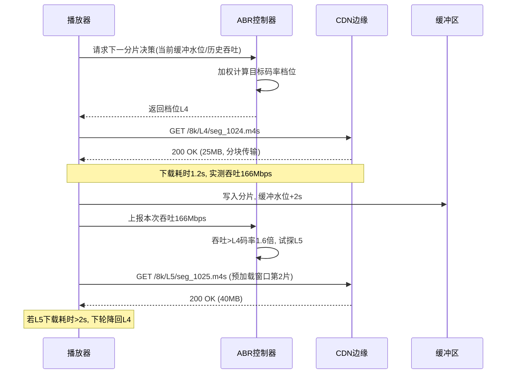
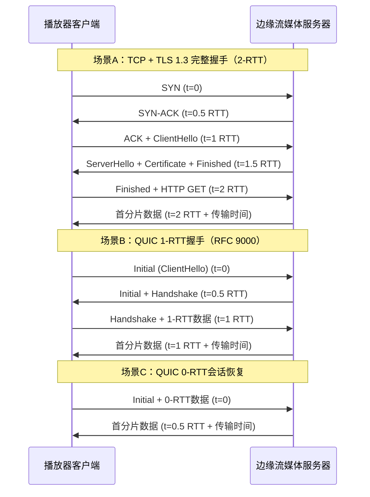
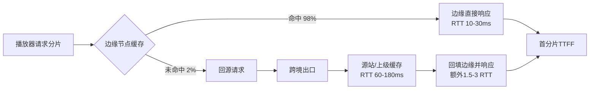
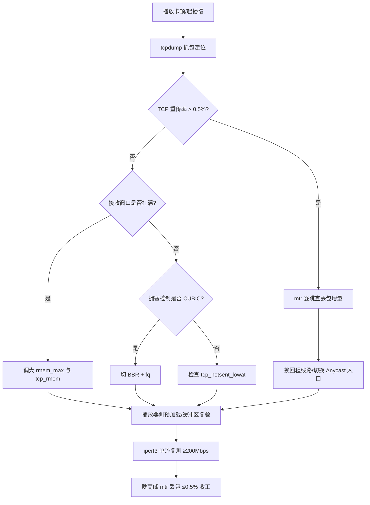

# 8K高清流媒体网络要求深度剖析：分片加载机制、TCP初始窗口与播放器缓冲区跨境带宽优化实战

::: tip 💡 核心结论与技术要点（Executive Summary）
8K流媒体稳定播放需持续带宽≥150Mbps、端到端RTT≤180ms、播放器缓冲区≥30s。跨境场景下，将Linux initcwnd从10调至20、启用BBR拥塞控制、提升CDN边缘命中率至95%以上，可降低首帧时间40%。大带宽机场选型应优先考察其是否支持QUIC、Anycast接入与BGP多线回程。
:::

## 一、4K/8K分片加载机制与码率模型解构

### 1.1 CMAF/fMP4封装下的8K分片体量与码率阶梯

8K的分片加载，第一件事要先算清楚“一个分片到底有多大”。8K@60fps 的 HEVC Main10 码流，行业里实际落地的编码档位大致落在 100–160 Mbps 区间（HDR、高动态场景、体育赛事直播会顶到 160 甚至更高，静态演播室访谈类内容压到 100 以下也常见）。把这个码率换算成分片体量：单分片时长 2 秒，对应 100 Mbps × 2 s ÷ 8 = 25 MB；160 Mbps × 2 s ÷ 8 = 40 MB。也就是说，一个 2 秒的 8K 分片，物理尺寸在 25–40 MB 之间，这已经超过了很多家庭宽带单条 TCP 连接在 1 秒内能稳定搬完的数据量。

封装层面，现在主流是 CMAF（Common Media Application Format）承载 fMP4 分片。一个 CMAF 分片由三部分组成：moof（movie fragment box，含分片元数据、样本表）、mdat（media data box，真正的 HEVC NAL 单元）、以及可选的 styp/sidx。sidx（Segment Index Box）是 ABR 算法的重要输入——它把分片内部再切成若干子段并标注每个子段的字节偏移与时长，播放器可以据此做子分片级别的码率切换，而不必等整个 25–40 MB 的分片下载完。8K 场景下 sidx 的价值被放大：一个 2 秒分片里若含 4 个子段，播放器可以在下载到第 2 个子段时根据实时吞吐决定是否在下一个分片降档，切换粒度从 2 秒缩到 0.5 秒。

码率阶梯（bitrate ladder）的设计直接决定带宽映射关系。典型的 8K 阶梯不会从 8K 直接跳到 1080p，中间要铺 4K、1440p 档位做缓冲：

| 档位 | 分辨率 | 帧率 | 目标码率 | 2s分片体量 | 建议接入带宽下限 | 典型编码器preset |
|------|--------|------|----------|------------|------------------|------------------|
| L5 | 7680×4320 | 60 | 160 Mbps | 40 MB | 400 Mbps | slow / 10bit |
| L4 | 7680×4320 | 30 | 100 Mbps | 25 MB | 250 Mbps | medium / 10bit |
| L3 | 3840×2160 | 60 | 40 Mbps | 10 MB | 100 Mbps | slow / 10bit |
| L2 | 2560×1440 | 60 | 16 Mbps | 4 MB | 40 Mbps | medium |
| L1 | 1920×1080 | 30 | 6 Mbps | 1.5 MB | 15 Mbps | fast |

这张表里“建议接入带宽下限”取的是目标码率的 2.5 倍左右，留出 TCP 慢启动、丢包重传、以及 ABR 探测抖动的余量。低于这个倍数，8K 档位基本没有稳定驻留的可能。

### 1.2 SegmentTemplate的$Number$与$Time$寻址差异

MPD 里分片地址的生成方式，直接影响到播放器的请求时序和 CDN 缓存命中。DASH 的 SegmentTemplate 有两种主流寻址模式：

$Number$ 模式：分片按序号递增命名，如 `seg_$Number$.m4s`，配合 `startNumber` 和 `duration` 计算。播放器只需知道当前是第几片，URL 就是确定性的。这种模式对 CDN 极友好——同一码率档位下所有观众请求的 URL 完全一致，边缘节点缓存命中率接近 100%。缺点是直播场景下序号与时间没有直接绑定，做时移（timeshift）或追赶播放时需要额外维护序号到时间轴的映射表。

$Time$ 模式：分片按起始时间戳命名，如 `seg_$Time$.m4s`，`$Time$` 的值是分片起始 PTS（以 timescale 为单位）。这种模式天然支持时移和任意时间点起播，播放器可以直接根据目标播放时间反推出 URL。代价是 URL 空间随时间增长而膨胀，CDN 缓存键分散，且对时钟同步要求高——服务端与播放器的 timescale 换算一旦有偏差，就会请求到不存在的分片。

实际工程里，VOD 多用 $Number$，直播时移多用 $Time$，大型赛事直播常见混合方案：主直播流用 $Number$ 保证缓存效率，时移流用 $Time$ 保证可寻址。8K 直播因为分片体量大、CDN 回源成本高，$Number$ 的缓存优势更明显，选型时值得优先考虑。

### 1.3 分片请求时序、预加载窗口与ABR耦合

播放器的预加载窗口（preload window）通常设定为当前播放分片之后的 2–3 片。以 2 秒分片、3 片预加载计算，播放器需要常驻约 6 秒的“在途+已缓存”数据，对应 8K 档位就是 75–120 MB 的缓冲水位。这个窗口大小不是拍脑袋定的：窗口太小，ABR 来不及在缓冲区耗尽前完成降档切换，卡顿；窗口太大，8K 场景下内存和带宽占用飙升，且切换码率时要丢弃的已预加载数据变多，浪费带宽。

ABR 算法的决策输入有两个核心信号：分片下载吞吐量（throughput）和缓冲区水位（buffer level）。吞吐量通过 `分片字节数 ÷ 下载耗时` 实时估算，缓冲区水位则是当前已缓冲时长。主流 ABR（如 dash.js 的 ThroughputRule + BolaRule 组合）在这两个信号上做加权：吞吐量高但缓冲区低时，倾向保守选档；吞吐量中等但缓冲区充裕时，可以激进试探高一档。8K 场景的特殊性在于，单分片下载耗时本身就长（40 MB 在 200 Mbps 链路上要 1.6 秒，接近一个分片时长），吞吐量估算的采样窗口变粗，ABR 的反应延迟被放大。这就是为什么 8K 播放器普遍把预加载窗口调到 3 片而非默认的 2 片——给 ABR 多留一个分片的决策余量。



### 1.4 Wireshark抓包定位：带宽不足还是分片过小

线上排障时，8K 卡顿的第一嫌疑人永远是“带宽不够”，但真实案例里相当一部分是分片过小导致请求开销占比过高。判断方法很直接：抓包统计每个 .m4s 的下载耗时与吞吐。

Wireshark 显示过滤器：

```text
http.request.uri contains ".m4s"
```

导出匹配报文的 `http.time`（请求到响应完成耗时）和 `tcp.len` 累计值，或者直接用 tshark 做批量统计：

```bash
# 统计每个m4s请求的URI、响应字节数、下载耗时
tshark -r 8k_capture.pcapng -Y 'http.request.uri contains ".m4s"' \
  -T fields -e http.request.uri -e http.content_length -e http.time \
  -E separator=, > m4s_stats.csv

# 按吞吐降序排列，找出异常慢的分片
awk -F',' '{if($2>0 && $3>0) printf "%s,%d,%.3f,%.2f Mbps\n",$1,$2,$3,($2*8)/($3*1000000)}' \
  m4s_stats.csv | sort -t',' -k4 -n
```

判读逻辑：

- 单分片实测吞吐持续低于目标码率的 1.5 倍，且多个分片一致——带宽不足，需要降档或扩CDN容量。
- 单分片吞吐正常（接近链路带宽），但请求间隔里存在大量空闲 RTT，且分片体量偏小（比如 1 秒分片、12 MB）——请求开销占比过高。每个 HTTP 请求的 TCP 握手（或复用的 TLS 记录开销）+ 首字节时间（TTFB）在跨境链路上可能吃掉 200–400 ms，1 秒分片下这部分开销占比可达 20–40%，有效吞吐被严重稀释。解法是把分片时长从 1 秒拉到 2–4 秒，或启用 HTTP/2 多路复用减少连接建立开销。
- 分片下载耗时波动大（P95 是 P50 的 3 倍以上），但平均吞吐尚可——跨境链路丢包或拥塞，需要看 tcp.analysis.retransmission 计数，结合 mtr 定位是接入段还是国际出口段的问题。

```bash
# 跨境链路分段定位
mtr -rwzbc 100 8k-origin.example.com
# 抓包侧看重传与零窗口
tshark -r 8k_capture.pcapng -Y 'tcp.analysis.retransmission || tcp.analysis.zero_window' \
  -T fields -e ip.dst -e tcp.srcport -e tcp.analysis.retransmission -e tcp.analysis.zero_window
```

8K 场景下还有一个容易被忽略的点：TCP 初始窗口（initcwnd）对首分片起播时间的影响。40 MB 的分片在 initcwnd=10（约 14.6 KB）的链路上，慢启动阶段要经历约 12 个 RTT 才能爬到链路带宽，跨境 RTT 150 ms 时这段爬坡就吃掉近 2 秒——正好是一个分片的时长。起播慢、首片卡顿的案例里，调大服务端 initcwnd（Linux 下 `ip route change ... initcwnd 32`）配合 BBR 拥塞控制，往往比单纯加带宽更立竿见影。这部分在后续 TCP 初始窗口章节会展开，此处先点明它与分片加载时序的耦合关系。

---

## 二、TCP初始窗口与传输层握手RTT对首帧时间的影响

8K流媒体首帧时间（Time to First Frame）的账，一半在应用层的分片调度，另一半埋在传输层握手和初始拥塞窗口里。很多团队把首帧慢归咎于CDN节点远、边缘带宽不足，抓包一看，SYN发出到第一个媒体分片抵达的时间轴上，握手占了大头，首窗口又小得可怜，服务器发完初始窗口就得等ACK，管道空转。这一节把initcwnd、握手RTT账本、跨境调优三件事拆开讲透。

### 2.1 RFC 6928的initcwnd=10到底意味着什么

RFC 6928（2013年）把TCP初始拥塞窗口从RFC 3390的4个MSS提升到10个MSS，按以太网标准MSS=1460字节算，10×1460=14600字节，约14.6KB。这个数字在当年DSL和早期宽带环境里够用，一个RTT就能把首屏HTML或小图标推完。放到8K流媒体场景，14.6KB连一个8K视频分片（通常2~6秒时长，码率80~120Mbps，单分片动辄20~80MB）的零头都算不上。

跨境高BDP链路的算术很直接。假设中美链路RTT=200ms，带宽100Mbps，BDP=100Mbps×0.2s=20Mbit=2.5MB。首窗口14.6KB只填满管道的0.58%，服务器发完10个MSS就得停等ACK，一个RTT后才能发下一批。慢启动阶段每RTT翻倍，要爬到能填满2.5MB管道，需要约log2(2.5MB/14.6KB)≈7.4个RTT，也就是接近1.5秒纯用于拥塞窗口爬坡。8K首帧要求通常在1~2秒内出画面，这1.5秒的爬坡直接把预算吃光。

这里有个常见误区：有人以为调大initcwnd就能线性改善首帧。实际受限于接收端接收窗口（rwnd）和应用层读取速度，initcwnd只是发送端的起跑线。接收端SO_RCVBUF小、播放器缓冲线程调度慢，窗口再大也白搭。调优要两端一起看。

### 2.2 内核参数与路由级initcwnd的实操

Linux上控制初始拥塞窗口有两个层面。全局sysctl参数在不同内核版本命名有差异，主流5.x/6.x内核用的是net.ipv4.tcp_initcwnd（部分发行版补丁或老内核走tcp_slow_start_after_idle配合路径），路由级则用ip route的initcwnd属性覆盖单条路由。生产环境建议路由级精细控制，全局参数作为兜底。

```bash
# 全局兜底：把初始拥塞窗口提到20个MSS（约29.2KB）
# 注意：部分内核该参数名为 net.ipv4.tcp_initcwnd，若不存在则检查内核版本
sysctl -w net.ipv4.tcp_initcwnd=20

# 持久化写入，避免重启丢失
cat >> /etc/sysctl.d/99-8k-stream.conf <<'EOF'
# 8K流媒体跨境场景：提升TCP初始拥塞窗口
# 20 MSS ≈ 29.2KB，仍远小于高BDP链路，但比RFC 6928默认值翻倍
net.ipv4.tcp_initcwnd = 20
# 空闲后不重置拥塞窗口，避免播放器暂停后重新爬坡
net.ipv4.tcp_slow_start_after_idle = 0
EOF
sysctl -p /etc/sysctl.d/99-8k-stream.conf

# 路由级覆盖：针对跨境出口路由单独设initcwnd
# 先确认默认路由
ip route show default
# 假设默认路由经eth0网关10.0.0.1，修改其initcwnd
ip route change default via 10.0.0.1 dev eth0 initcwnd 20
# 验证路由属性已生效
ip route show default
# 输出应包含 initcwnd 20 字段
```

几个实战坑要提醒。第一，`ip route change`对已存在的路由生效，若路由不存在要用`ip route add`。第二，容器环境里sysctl可能被宿主机namespace隔离，改的是容器内netns，宿主机出口路由的initcwnd才是跨境链路真正生效的那一层，别改错地方。第三，initcwnd调到20甚至30在丢包敏感链路上会加剧突发丢包，跨境链路本身有随机丢包时，盲目调大反而触发更早的拥塞事件，建议配合BBR拥塞控制一起上，BBR对初始窗口的依赖比CUBIC小。

### 2.3 握手RTT账本：TCP+TLS 1.3与QUIC的差异

首帧时间里的握手成本必须按RTT逐笔记账。传统HTTPS链路走TCP三次握手加TLS 1.3握手，TLS 1.3（RFC 8446）相比1.2已经把握手压缩到1-RTT（完整握手）或0-RTT（会话恢复），但TCP本身的1-RTT省不掉。



把账算清楚：TCP 1-RTT加TLS 1.3完整握手1-RTT，合计2-RTT才能发出第一个HTTP请求。RTT=200ms的跨境链路，握手阶段就是400ms，这400ms里一个字节的媒体数据都没传。QUIC（RFC 9000）把传输层握手和TLS 1.3握手合并，首次连接1-RTT即可发应用数据，会话恢复走0-RTT，首包就能带媒体请求。对于8K这种对首帧极度敏感的场景，QUIC在跨境链路上的握手优势是实打实的200ms级节省。

但QUIC不是银弹。0-RTT有重放攻击风险，服务端对0-RTT数据的处理策略要谨慎，媒体分片请求是幂等的GET，风险可控，但鉴权token别放在0-RTT里。另外部分跨境网络对UDP有QoS降级或限速，QUIC走UDP可能被中间设备差别对待，上线前必须实测。

### 2.4 抓包验证：从SYN到首分片的RTT实测

调优不能拍脑袋，抓包看真实握手时序和Initial window字段。tcpdump抓SYN包过滤语法如下：

```bash
# 抓取eth0上所有SYN标志置位的TCP包，含时间戳，用于分析握手RTT
tcpdump -i eth0 -nn -tttt 'tcp[tcpflags] & tcp-syn != 0' -w /tmp/syn_handshake.pcap

# 同时抓取目标端口443的完整流，便于关联TLS握手
tcpdump -i eth0 -nn -tttt 'tcp port 443' -w /tmp/tls_flow.pcap

# 实时观察SYN与SYN-ACK时间差（RTT近似值）
tcpdump -i eth0 -nn -tttt 'tcp[tcpflags] & (tcp-syn|tcp-ack) != 0' -c 20
```

抓到的pcap丢进Wireshark，展开TCP头部看Initial window字段（Wireshark显示为`Calculated window size`或TCP选项里的窗口缩放前的值），确认发送端SYN-ACK里通告的初始窗口是否符合预期。同时用Wireshark的`Statistics > TCP Stream Graphs > Time-Sequence (Stevens)`看拥塞窗口爬坡曲线，首窗口20 MSS的曲线起点明显高于默认10 MSS。对照`tcp.analysis.initial_rtt`字段可以直接读出Wireshark计算的初始RTT，和ping/mtr测出的链路RTT交叉验证。

排障时把三组数据摆一起：ping测的ICMP RTT、mtr看逐跳丢包和RTT抖动、tcpdump抓的TCP握手RTT。三者差异大说明中间有设备对ICMP或TCP差别对待，跨境链路上这种QoS策略很常见，别只信ping的结果。

调优顺序建议：先抓包确认当前握手RTT和initcwnd实际值，再按链路BDP决定initcwnd调到多少（20~30 MSS是跨境场景的常见区间），然后评估QUIC迁移收益，最后用首帧时间埋点数据闭环验证。8K流媒体的首帧预算以百毫秒计，握手这400ms省下200ms，比在应用层抠分片调度算法见效快得多。

---

## 三、播放器缓冲区机制与卡顿阈值的量化建模

### 3.1 缓冲区水位的本质：一个被码率与吞吐同时拉扯的动态队列

播放器的缓冲区本质上是一个以“秒”为单位的水位计，而不是以“字节”为单位的存储池。这个区别非常关键。字节池告诉你还能播多少数据，秒水位告诉你还能撑多久。8K 场景下码率 R 高达 120Mbps，同样 300MB 的缓冲，在 1080p/8Mbps 下能撑 300 秒，在 8K 下只能撑 20 秒。所以讨论缓冲区永远要绑定码率，脱离码率谈“缓存了多大”是没有工程意义的。

缓冲区的动态过程可以写成一个简单的微分方程式的直觉版本：水位变化速率 = 网络填充速率 − 播放消耗速率。填充速率由 CDN 吞吐 C 决定，消耗速率就是当前码率 R。当 C > R，水位上升；C < R，水位下降；C = R，水位持平。卡顿发生在水位触底的那一刻——播放器把最后一帧解码完，下一帧还没到，画面冻结，触发 waiting 事件。

这里有一个很多人忽略的细节：填充不是连续的。DASH/HLS 都是分片加载，一个 8K 分片常见 2~6 秒时长，单分片体积在 30~90MB 量级。分片请求是“脉冲式”的——请求发出、等待首字节（TTFB）、突发下载、完成。缓冲区水位曲线因此是锯齿状的，不是平滑直线。你看到的 buffer health 曲线在 chrome://media-internals 里那种阶梯下降再陡升的形态，就是分片粒度的直接体现。

### 3.2 再缓冲事件的触发条件与安全不等式

再缓冲（rebuffer / stall）的触发点由播放器的 bufferForPlayback 参数定义。以 ExoPlayer 为例，DefaultLoadControl 里 bufferForPlaybackMs 默认 2500ms，意思是当缓冲水位低于 2.5 秒时，播放器不会立即开播或恢复播放，而是进入再缓冲等待。Shaka Player 对应的是 rebufferingGoal，默认 2 秒。

工程上要保证不卡顿，需要同时满足两个条件，缺一不可：

第一个是稳态吞吐条件：C ≥ R。网络持续吞吐必须不低于码率，否则水位单调下降，再大的缓冲也只是延缓死亡。8K 的 R=120Mbps，意味着端到端稳定吞吐至少要跑到 130~150Mbps 才有余量，因为 TCP 握手、TLS、分片请求间隙都会吃掉有效吞吐。

第二个是瞬态容错条件：B ≥ RTT × 抖动系数。跨境链路 RTT 抖动 ±80ms 是常态，遇到拥塞窗口收缩、路由切换、丢包重传，单次吞吐塌陷可能持续数个 RTT。缓冲区必须覆盖这段“吞吐真空期”。把抖动系数记为 k（经验值 1.5~3，跨境高抖动链路取上限），安全条件写成：

```
B_safe ≥ RTT_max × k + bufferForPlayback
```

代入 8K 跨境场景：RTT 基线 180ms，抖动 +80ms 取 RTT_max = 260ms，k 取 2.5，则瞬态覆盖需求约 650ms；加上 bufferForPlayback 的 5 秒安全垫，理论下限约 5.7 秒。但这只是“不立刻卡”的下限，不是“体验良好”的下限。真实跨境链路的吞吐塌陷经常持续 2~5 秒（BGP 收敛、丢包引发的拥塞窗口减半、CDN 节点切换），所以 maxBufferAhead 必须显著大于这个理论值。

8K 场景的实操建议是 maxBufferAhead ≥ 30 秒。理由拆开看：30 秒 × 120Mbps ≈ 450MB 内存占用，现代播放设备（Apple TV 4K、高端 Android TV、PC 浏览器）可以承受；30 秒水位意味着单次 5 秒的吞吐塌陷只消耗 1/6 的缓冲，水位从 30 降到 25，远高于 5 秒的再缓冲阈值，播放完全无感。如果 maxBufferAhead 只给 10 秒，一次 6 秒的塌陷就会把水位打到 4 秒，逼近 bufferForPlayback，播放器开始激进降码率或者直接 stall。

这里要提醒一个反直觉的点：maxBufferAhead 不是越大越好。设得过大（比如 60 秒以上），一是内存压力，二是码率自适应（ABR）会变迟钝——缓冲区里塞满了低码率分片，ABR 想升码率也得等这些分片播完，切换延迟被拉长。30 秒是 8K 跨境场景下“容错深度”和“ABR 响应速度”的平衡点。

### 3.3 客户端播放器配置实测：ExoPlayer 与 Shaka Player 参数调优

ExoPlayer 的缓冲策略集中在 DefaultLoadControl，通过 Builder 配置。下面是一段针对 8K 跨境场景调过的真实配置，注释写清了每个参数的取舍逻辑：

```java
// ExoPlayer DefaultLoadControl 针对 8K 跨境流媒体调优
// 码率 R=120Mbps，跨境 RTT 180±80ms，目标：零再缓冲 + ABR 可响应
DefaultLoadControl loadControl = new DefaultLoadControl.Builder()
    // 缓冲区水位低于 5s 触发再缓冲等待（默认 2.5s 对 8K 太激进）
    // 8K 单分片 2~6s，2.5s 阈值意味着分片间隙就可能误触发 stall
    .setBufferDurationsMs(
        50000,   // minBufferMs：最低维持缓冲，8K 下不低于 50s 才够 ABR 周转
        30000,   // maxBufferAheadMs：前向缓冲上限 30s，容错深度与内存的平衡
        5000,    // bufferForPlaybackMs：水位 <5s 进入再缓冲等待
        10000    // bufferForPlaybackAfterRebufferMs：恢复播放需回填到 10s
                 // 比首次开播更保守，避免抖动链路上反复 stall-recover 震荡
    )
    // 分片加载优先级：8K 大分片下按码率排序加载，避免小分片插队打乱水位
    .setPrioritizeTimeOverSizeThresholds(true)
    // 分配器余量：8K 分片 30~90MB，预留 20% 余量防 OOM
    .setAllocator(new DefaultAllocator(true, C.DEFAULT_BUFFER_SEGMENT_SIZE))
    .build();

// 注意：setBufferDurationsMs 的参数顺序是
// (minBufferMs, maxBufferAheadMs, bufferForPlaybackMs, bufferForPlaybackAfterRebufferMs)
// 不同 ExoPlayer 版本签名略有差异，2.18+ 以 Builder 链式为准
```

Shaka Player 的对应配置走 player.configure()，字段名不同但语义对齐：

```javascript
// Shaka Player 8K 跨境缓冲配置
player.configure({
  streaming: {
    rebufferingGoal: 5,        // 对应 bufferForPlayback，单位秒
    bufferingGoal: 30,         // 对应 maxBufferAhead，前向缓冲上限
    bufferBehind: 10,          // 回看缓冲，8K 下不宜过大，省内存
    lowLatencyMode: false,     // 8K 点播/VOD 场景关闭低延迟模式
    // 分片请求重试策略：跨境链路丢包重试要快，避免水位被拖垮
    retryParameters: {
      maxAttempts: 4,
      baseDelay: 500,          // 首次重试 500ms
      backoffFactor: 2,        // 指数退避 500/1000/2000/4000ms
      timeout: 15000           // 单分片 15s 超时，8K 大分片给足时间
    }
  }
});
```

两个播放器的参数语义对照值得记一下：ExoPlayer 的 bufferForPlaybackMs ≈ Shaka 的 rebufferingGoal；maxBufferAheadMs ≈ bufferingGoal；bufferForPlaybackAfterRebufferMs 在 Shaka 里没有直接对应，Shaka 用 rebufferingGoal 统一处理首次和恢复。跨境高抖动链路上，ExoPlayer 把“恢复阈值”单独拉到 10 秒是有价值的——它防止了水位在 5 秒附近反复穿越阈值导致的 stall-recover 震荡，这个震荡在实测中比单次长 stall 更伤体验。

### 3.4 观测与验证：buffer health 曲线 + tc netem 注入

配置改完必须验证，不能拍脑袋上线。观测面有两个入口：Chrome 系的 chrome://media-internals，看 buffer health 曲线、分片请求时间线、stall 事件计数；播放器自带的 stats for nerds（YouTube 系、Shaka demo 都有），看 buffer health 秒数、dropped frames、当前码率切换记录。重点看三个量：buffer health 的谷值（是否逼近 bufferForPlayback）、stall 次数（目标为 0）、码率切换频率（ABR 是否在抖）。

验证卡顿阈值不能靠真实跨境链路碰运气，要用 tc netem 在本地复现。下面是一组在 Linux 网关上注入延迟抖动和丢包的命令，模拟 8K 跨境链路的劣化条件：

```bash
# 在出口网卡 eth0 上注入跨境链路特征
# 基线延迟 180ms，抖动 ±80ms（正态分布），丢包 0.5%
sudo tc qdisc add dev eth0 root netem \
    delay 180ms 80ms distribution normal \
    loss 0.5% \
    rate 200mbit

# 验证注入是否生效
tc qdisc show dev eth0

# 抓包确认分片请求的 TTFB 与吞吐塌陷点
# 过滤 DASH 分片请求（假设分片路径含 /seg/）
sudo tcpdump -i eth0 -nn -s 0 -w /tmp/8k_seg.pcap \
    'tcp port 443 and host cdn.example.com'

# 分析：看单个分片请求的 RTT 分布与重传
tshark -r /tmp/8k_seg.pcap -q -z io,stat,1,"COUNT(tcp.analysis.retransmission)tcp.analysis.retransmission"

# 清理注入规则
sudo tc qdisc del dev eth0 root
```

实测时把 netem 的丢包从 0.5% 逐步拉到 2%、5%，观察 buffer health 谷值的变化曲线。在 maxBufferAhead=30s、bufferForPlayback=5s 的配置下，2% 丢包应该只让水位谷值降到 18~22 秒，不触发 stall；5% 丢包时谷值可能跌到 8~10 秒，仍在阈值之上但 ABR 会开始降码率。如果 1% 丢包就 stall，说明 maxBufferAhead 给少了或者分片超时设得太短，回头调参数。这套“注入—观测—回调”的闭环，比在真实跨境链路上盲调可靠得多，也是把缓冲区机制从经验变成可量化模型的唯一路径。

---

## 四、CDN边缘节点命中率与BGP选路的跨境优化

8K流媒体单路码率按HEVC Main10 60fps估算在100~150Mbps区间，一个分片按2秒切、单分片体积约25~37MB。这个量级下，边缘节点的缓存命中率不再是"省点回源带宽"的成本问题，而是直接决定首分片时延（TTFF）和卡顿率的可用性问题。跨境场景里，回源路径往往要跨一两个AS、绕行国际出口，一次未命中付出的代价是命中路径的几倍甚至十几倍。这一节把命中率放大效应和BGP回程选路两件事拆开讲透。

### 4.1 边缘命中率对回源带宽与首分片时延的放大效应

先算一笔账。假设单边缘节点服务1000路并发8K，单路平均码率120Mbps，则节点出口带宽约120Gbps。命中率90%时回源带宽为12Gbps；命中率提到98%，回源带宽降到2.4Gbps，绝对降幅9.6Gbps，相对降幅80%。这就是"90%→98%、回源降80%"的来源：命中率每提升1个百分点，回源流量按当前未命中比例的相对值下降，边际收益在90%以上区间非常陡。

时延侧的放大更值得关注。命中的分片从边缘节点直接吐给播放器，RTT通常在10~30ms（同城/同区域）；未命中的分片要走回源链路，跨境回源RTT按中国大陆到新加坡/美西的典型值在60~180ms，叠加回源TCP握手、TLS（若回源未复用长连接）、源站磁盘/对象存储读取，单次未命中的额外时延轻松到1.5~3个RTT。播放器在起播阶段要连续拉取2~3个分片填满缓冲区，只要其中有一个分片未命中，起播时间就被拉长一个RTT量级。所以"首分片时延降一个RTT量级"不是理论推导，是命中率从90%到98%后，起播窗口内未命中概率从10%降到2%、期望额外RTT从0.1~0.3个降到0.02~0.06个的直接结果。



命中率要提上去，缓存键的设计是第一道关。很多团队默认用完整URL做key，结果URL带上了`?token=xxx&expire=xxx`这类每次请求都变的鉴权参数，命中率直接掉到个位数。正确的做法是把缓存键拆成"稳定部分+可变部分"：稳定部分取`scheme + host + path`，Query里只保留影响内容的参数（如`?quality=8k&seg=00123`），鉴权类参数（token、签名、时间戳）剥离出key、放到回源校验逻辑里。Header同理，`User-Agent`、`Cookie`、`Accept-Encoding`这些默认不进key，除非业务确实按UA分发不同码率。

Range请求是8K场景的隐性杀手。播放器拖动进度条、或者做分片内预加载时会发`Range: bytes=0-1048575`这类请求，如果CDN把Range头纳入缓存键，同一个分片的不同Range段会各存一份，命中率被切碎。主流CDN（Akamai、CloudFront、阿里云CDN）的做法是：对媒体分片忽略Range做整对象缓存，边缘按Range切片响应；只有当对象极大（如单文件超100MB）时才考虑分片缓存。配置上要显式声明`ignore-range-in-cache-key`或等价策略。

TTL策略要和分片生命周期对齐。8K直播分片是"一次写入、短期可读"，TTL设成分片时长（2秒）的2~3倍即可，设太长会导致下架分片继续被命中、设太短则频繁回源。点播VOD分片内容不变，TTL可以拉到小时级甚至天级，但要配合主动预热（prefetch）把热门分片提前推到边缘。Cookie导致的命中率下降常见于带登录态的付费内容：如果CDN把`Cookie`整体纳入key，同一用户不同会话、不同用户之间都无法共享缓存。解法是把鉴权信息从Cookie迁移到URL签名或`Authorization`头，CDN侧只对签名做校验、不纳入key。

### 4.2 BGP AS-Path与Local Preference权重下的跨境回程选路分析

命中率解决了"要不要回源"，BGP选路解决"回源走哪条路"。跨境回源最怕的是次优路径：物理上从上海到新加坡，逻辑上却绕了美西一圈。BGP的路径决策在Cisco体系里按权重顺序是：Weight（本地）→ Local Preference（AS内）→ 本地始发 → AS-Path长度 → Origin → MED → eBGP优于iBGP → IGP metric。跨境场景里真正起作用的是Local Preference和AS-Path长度这两级。

Local Preference是AS内部传播的、默认100，数值越高越优先。运营商和大型CDN会在自己的边界路由器上给不同上游/对等体打不同的Local Preference：直连对等（如与新加坡ISP直连）给200，经香港转接给150，经美西转接给100。这样即使美西路径的AS-Path更短，也会因为Local Preference低而被排除。AS-Path长度是第二道闸：同样的Local Preference下，AS-Path越短越优先，这就是为什么"绕行美国"的路径有时反而被选中——如果它AS-Path是`65001 65002 65003`（3跳），而直连新加坡的路径是`65001 65010 65011 65012 65013`（5跳），在Local Preference相同的前提下美西路径胜出。

排查次优路径的标准动作是`show ip bgp`配合`traceroute`交叉验证。在边界路由器上看目标前缀的候选路径：

```bash
# 查看目标前缀的所有BGP候选路径，重点看AS-Path、Local Preference、next-hop
show ip bgp 203.0.113.0/24

# 输出示例解读：
#   Network          Next Hop        Metric LocPrf Weight Path
# *> 203.0.113.0/24  198.51.100.1         0    200      0 65010 65011 65012 i
# *  203.0.113.0/24  192.0.2.1            0    100      0 65020 65021 i
# 带 *> 的是最优：Local Preference 200 胜出，尽管AS-Path更长（3跳 vs 2跳）
# 若发现最优路径的AS-Path里出现美西/新加坡的AS号而物理位置不符，即为次优
```

`traceroute`从数据面验证控制面的判断：

```bash
# 从边缘节点向源站方向做逐跳探测，观察是否绕行
traceroute -n -I 203.0.113.10
# 或用mtr持续观测丢包与路径稳定性
mtr -n -c 100 203.0.113.10
```

如果`show ip bgp`显示最优路径的AS-Path是`65010 65011 65012`（经新加坡），但`traceroute`的跳数里出现了美西的ISP网关IP，说明控制面选路和数据面转发不一致（常见于MPLS VPN或策略路由覆盖），需要检查`ip route`和PBR配置。另一种情况是控制面本身就选了美西路径：这时在边界路由器上对目标前缀调高直连新加坡对等体的Local Preference，或对美西路径调低，强制流量走直连。

```bash
# 在边界路由器上调整Local Preference，优先直连新加坡对等体
route-map PREFER-SG permit 10
 match ip address prefix-list SG-DEST
 set local-preference 250
route-map PREFER-SG permit 20
 set local-preference 100
!
router bgp 65001
 neighbor 198.51.100.1 route-map PREFER-SG in
```

### 4.3 Anycast接入与EDNS Client Subnet的就近调度精度

Anycast让同一个VIP在多个POP宣告，BGP天然把用户导向"AS-Path最短/ Local Preference最高"的POP，但BGP的度量是网络拓扑距离，不是地理距离，也不感知POP的负载和缓存状态。跨境场景里Anycast会把用户导到"网络最近"的POP，这个POP可能在新加坡而用户在广州，物理延迟反而高于香港POP。EDNS Client Subnet（ECS）是补这个短板的关键：递归DNS在查询时把用户子网（通常/24）带给权威DNS，权威DNS据此返回地理上更近的POP IP，而不是依赖Anycast的BGP选路。

ECS的精度取决于递归DNS是否支持、以及子网粒度。公共DNS（8.8.8.8、1.1.1.1）普遍支持ECS，但部分运营商递归DNS会剥离ECS或只带/32，导致调度精度退化到城市级甚至国家级。实战中要做的验证是：从不同运营商、不同地域发起DNS查询，看返回的POP IP是否落在预期区域。

```bash
# 带ECS的dig查询，观察权威DNS返回的POP IP
dig +short @8.8.8.8 media.example.com A
# 对比不同子网的ECS，验证调度是否按子网区分
dig @8.8.8.8 media.example.com A +subnet=203.0.113.0/24
dig @8.8.8.8 media.example.com A +subnet=198.51.100.0/24
```

如果两次查询返回同一个POP IP，说明权威DNS没启用ECS或调度粒度太粗。Anycast与ECS的组合策略是：Anycast负责POP级容灾和DDoS清洗（同一VIP多POP宣告，单POP故障时BGP收敛），ECS负责用户到POP的精细映射（权威DNS按子网返回最优POP）。两者叠加后，跨境回源的起点从"BGP认为最近的POP"变成"地理和网络都最近的POP"，回源RTT能再压一个档。

最后给一组排障时常用的抓包过滤，用于确认回源请求的实际路径和分片命中情况：

```bash
# 在边缘节点抓回源方向的HTTP请求，确认哪些分片未命中走了回源
tcpdump -i eth0 -n -A 'tcp port 80 and host 203.0.113.10 and tcp[((tcp[12:1] & 0xf0) >> 2):4] = 0x47455420'
# 抓Range请求，确认播放器是否在用Range拉分片
tcpdump -i eth0 -n -A 'tcp port 443 and tcp[((tcp[12:1] & 0xf0) >> 2):4] = 0x47455420' | grep -i 'range:'
```

命中率和BGP选路这两件事在8K场景里是耦合的：命中率决定回源频次，BGP选路决定每次回源的代价。把缓存键和TTL理顺、把Local Preference和AS-Path调对、再用ECS补上Anycast的调度精度，跨境回源的带宽和首分片时延才能同时压下来。

---

## 五、大带宽机场选型与端到端调优落地清单

8K 流媒体这条链路，真正决定成败的往往不是播放器解码头，也不是 CDN 边缘节点的存储吞吐，而是你手里那条“机场”线路在晚高峰时段能不能稳定扛住 150~200 Mbps 的单流码率，并且在丢包、抖动、排队延迟三个维度上都不塌方。8K 视频（HEVC/H.265 或 AV1，主流码率 100~200 Mbps，峰值可冲到 250 Mbps）对网络的敏感度远超 4K：4K 时代 25 Mbps 就能看，丢个 1% 顶多糊一下；8K 时代单分片动辄 4~8 MB，一个 TCP 拥塞窗口回退就可能造成播放器缓冲区被瞬间抽干。所以选型和调优必须当成一个端到端工程来做，而不是“买个贵套餐就完事”。

### 5.1 大带宽机场选型的硬性技术指标

先立几条不可妥协的硬指标，这些是压测和核查的基线，任何一条不达标，后面所有调优都是白费力气。

| 核查项 | 硬性阈值 | 为什么是这条线 | 验证手段 |
|---|---|---|---|
| QUIC/UDP 支持 | 必须支持，且 UDP 不被 QoS 限速 | 8K 低延迟分片走 QUIC 可绕开 TCP 队头阻塞，弱网下重传粒度更细 | 客户端启用 QUIC 后 `tcpdump udp port 443` 看是否有双向流量 |
| Anycast 接入 | 入口节点支持 Anycast | 就近接入降低首包 RTT，跨境场景下能少 30~80 ms | `mtr` 看首跳 AS 与地理延迟是否匹配 |
| 回程 BGP 多线 | 至少双线（CN2 GIA / 9929 / CMIN2 之类） | 单线回程晚高峰必堵，多线可自动切换 | `mtr --report` 看回程路径 AS 序列是否单一 |
| 单线程带宽 | ≥ 200 Mbps | 8K 单连接码率上限就在这，多线程聚合不算数 | `iperf3 -c -P 1` 单流实测 |
| 晚高峰丢包率 | ≤ 0.5% | 超过 0.5% 时 BBR 也会频繁降窗，分片加载抖动明显 | 20:00~23:00 时段 `mtr --report -c 100` |

这里要特别说一句“单线程带宽”这条。很多机场宣传“1 Gbps 大带宽”，实际是 8 线程聚合的数字。8K 播放器在 CMAF 分片加载时，通常只维持 2~4 条并行连接（预加载 2 片 + 当前播放片），单连接吞吐上不去，聚合带宽再高也没用。所以压测必须区分单流和多流。

压测方法我固定用两条命令组合：

```bash
# 多流聚合压测，-P 8 模拟播放器多连接并发拉分片
iperf3 -c <机场入口IP> -p 5201 -P 8 -t 30 -O 3

# 单流压测，验证单连接能否顶到 200 Mbps
iperf3 -c <机场入口IP> -p 5201 -P 1 -t 30 -O 3

# 全程丢包与抖动观测，report 模式输出每一跳统计
mtr --report --report-cycles 100 <机场入口IP>

# 跨境回程路径核查，看 AS 序列
mtr --report --aslookup --report-cycles 50 <机场入口IP>
```

`-O 3` 是跳过前 3 秒的 TCP 慢启动阶段，让统计落在稳态区间；`--report-cycles 100` 保证样本量足够看出晚高峰的丢包分布，而不是被一两次瞬时抖动带偏。mtr 报告里重点看两个数：Loss% 在每一跳的增量（增量出现在哪一跳，问题就在那段链路），以及 StDev（抖动标准差），8K 场景下 StDev 超过 15 ms 就要警惕分片加载节奏被打乱。

### 5.2 内核 sysctl 调优：为 8K 分片加载准备接收窗口

播放器拉 8K 分片时，单分片 4~8 MB，跨境 RTT 动辄 150~250 ms。按 BDP 公式算：200 Mbps × 200 ms / 8 = 5 MB，也就是接收窗口至少要能撑到 5 MB 量级，否则吞吐被窗口卡死。默认的 `rmem_max` 往往只有 208 KB，这是 8K 场景下最容易被忽视的瓶颈。

```bash
# /etc/sysctl.d/99-8k-stream.conf
# 接收缓冲区上限拉到 128 MB，覆盖跨境高 BDP 场景
net.core.rmem_max = 134217728
net.core.wmem_max = 134217728

# TCP 自动调优区间，min/default/max，max 与 rmem_max 对齐
net.ipv4.tcp_rmem = 4096 87380 134217728
net.ipv4.tcp_wmem = 4096 65536 134217728

# 拥塞控制切 BBR，弱网与高丢包下比 CUBIC 吞吐高一个档
net.ipv4.tcp_congestion_control = bbr
net.core.default_qdisc = fq

# 关键一条：未发送数据低于 16 KB 就立刻推出去，降低分片首字节延迟
net.ipv4.tcp_notsent_lowat = 16384

# 开启窗口缩放与时间戳，跨境长肥管道必备
net.ipv4.tcp_window_scaling = 1
net.ipv4.tcp_timestamps = 1

# 连接复用与快速回收，缓解分片高频短连接压力
net.ipv4.tcp_fastopen = 3
net.ipv4.tcp_slow_start_after_idle = 0
```

`tcp_notsent_lowat=16384` 这条值得单独讲。默认情况下内核会把待发送数据攒在缓冲区里等更多数据一起发，这在批量传输里是好事，但在 8K 分片加载场景里会人为抬高首字节延迟——播放器请求一个分片，内核却压着不发，等攒够一批。设成 16 KB 后，只要待发数据低于这个阈值就立即推送，分片首包延迟能降 10~30 ms，对缓冲区吃紧的播放器是实打实的救命参数。

`tcp_slow_start_after_idle=0` 也是分片场景的隐藏坑：播放器拉完一片、停顿几百毫秒再拉下一片，如果开启这个参数，每次空闲后拥塞窗口回退到初始值重新慢启动，吞吐直接腰斩。关掉它，连接空闲后窗口保持。

### 5.3 播放器侧配置：CMAF 低延迟分片 + 预加载 + 缓冲区

内核调好只是把路修宽，播放器怎么走路同样关键。8K 场景下我固定这套配置：

- 启用 CMAF 低延迟分片（fMP4 + chunked transfer），分片时长压到 2 s，配合 `tcp_notsent_lowat` 能让首帧时间明显前移；
- 预加载 2 片（preload 2 segments），保证缓冲区里始终有下一片的余量，对抗跨境 RTT 抖动；
- 播放缓冲区 30 s，这是 8K 的甜点值——低于 20 s 在丢包 0.5% 的链路上容易断流，高于 40 s 则起播太慢、seek 响应迟钝。

以常见播放器配置为例（shaka-player / hls.js 思路一致）：

```javascript
// 播放器侧关键参数
player.configure({
  streaming: {
    lowLatencyMode: true,          // 启用 CMAF 低延迟分片
    rebufferingGoal: 2,            // 起播前缓冲 2 s
    bufferingGoal: 30,             // 目标缓冲区 30 s
    bufferBehind: 10,              // 回看缓冲 10 s
    segmentPrefetchLimit: 2,       // 预加载 2 片
    retryParameters: {
      maxAttempts: 4,
      baseDelay: 500,
      backoffFactor: 2             // 分片失败指数退避重试
    }
  }
});
```

### 5.4 端到端落地 Checklist：从抓包到参数生效

下面这张流程图把“发现问题 → 定位 → 落参数 → 复验”串成一条闭环，实际排障按这个顺序走，不要跳步。



抓包过滤语法固定用这几条，覆盖 8K 分片加载的核心观测点：

```bash
# 抓 QUIC/UDP 443 流量，验证机场是否真的放行 UDP
tcpdump -i eth0 -nn 'udp port 443' -w quic.pcap -c 5000

# 抓 TCP 重传与零窗口，看接收窗口是否被打满
tcpdump -i eth0 -nn 'tcp port 443 and (tcp[tcpflags] & tcp-rst != 0 or tcp[14:2] == 0)' -w retrans.pcap

# 抓分片请求的 HTTP/2 头部，确认 CMAF 分片是否按 2s 粒度下发
tcpdump -i eth0 -nn -A 'tcp port 443 and tcp[((tcp[12] & 0xf0) >> 2):4] = 0x47455420' | grep -i 'cmaf\|\.m4s'
```

最后给一张参数落地核对表，逐项打勾才算调优完成：

| 序号 | 落地项 | 目标值 | 验证命令 |
|---|---|---|---|
| 1 | 机场 UDP 放行 | 双向有包 | `tcpdump udp port 443` |
| 2 | 单流带宽 | ≥ 200 Mbps | `iperf3 -c -P 1 -t 30 -O 3` |
| 3 | 晚高峰丢包 | ≤ 0.5% | `mtr --report -c 100` |
| 4 | 接收窗口上限 | 128 MB | `sysctl net.core.rmem_max` |
| 5 | 拥塞控制 | bbr | `sysctl net.ipv4.tcp_congestion_control` |
| 6 | notsent_lowat | 16384 | `sysctl net.ipv4.tcp_notsent_lowat` |
| 7 | 播放器预加载 | 2 片 | 播放器配置项 |
| 8 | 播放缓冲区 | 30 s | 播放器配置项 |
| 9 | CMAF 分片 | 2 s 粒度 | 抓包看 `.m4s` 请求间隔 |

这套清单的意义在于把“感觉卡”变成“可测量、可归因、可复验”的工程动作。8K 流媒体的网络要求从来不是单点参数能解决的，机场选型决定了下限，内核调优抬高了上限，播放器配置决定了实际体验落在哪一段——三者对齐，跨境 8K 才有稳定的可能。

---

<FaqSection title="常见技术疑难解答 (FAQ)" />

---

## 相关主题与延伸阅读

- 选型基准：[2026年机场怎么选？避坑与选型指南](/guides/how-to-choose/)
- 底层线路：[IPLC 与 IEPL 专线有什么区别？](/network/iplc-vs-iepl/)
- 协议科普：[VLESS 协议深度科普与实测](/network/vless/)
- 全景资料：[16家主流机场品牌横向横评与实测档案](/brands/)
