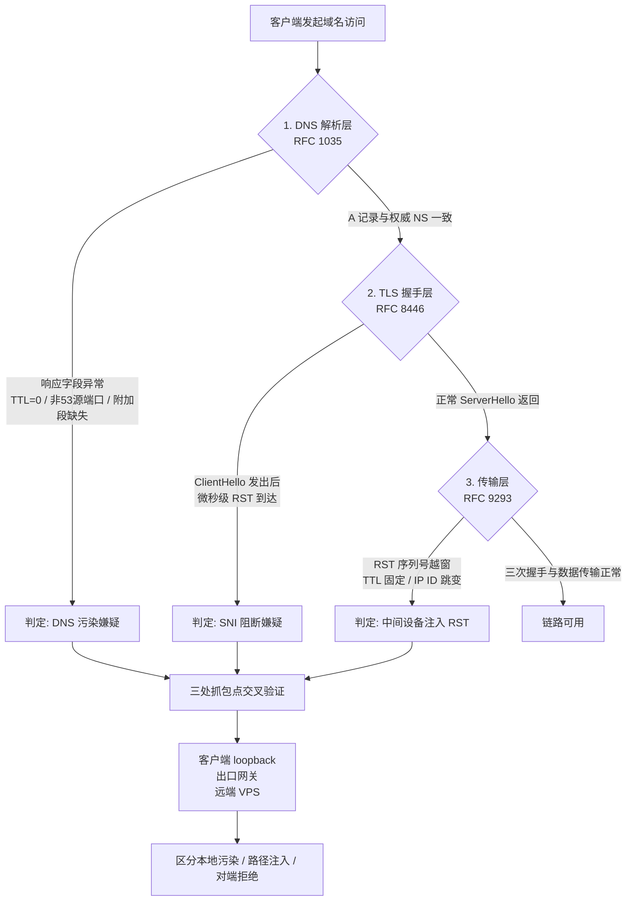
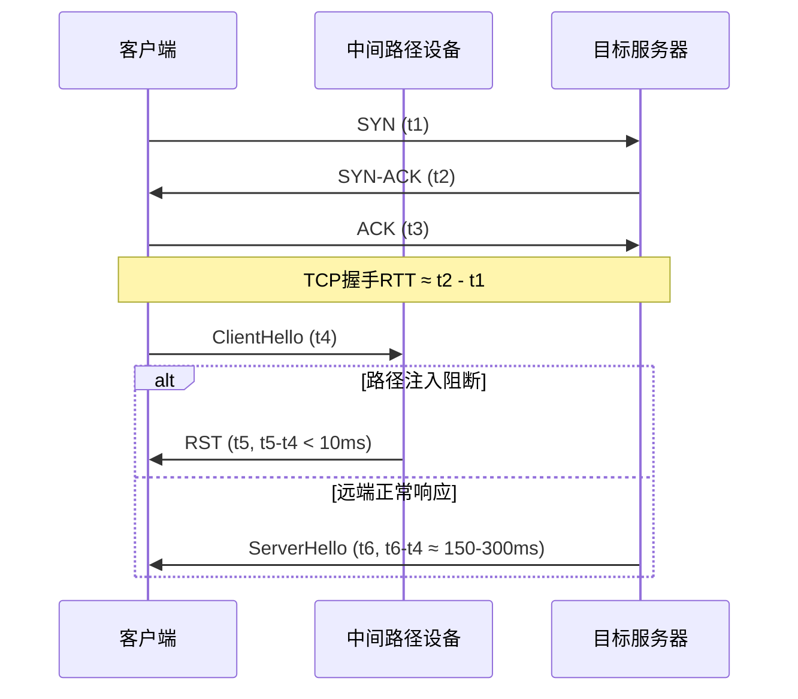
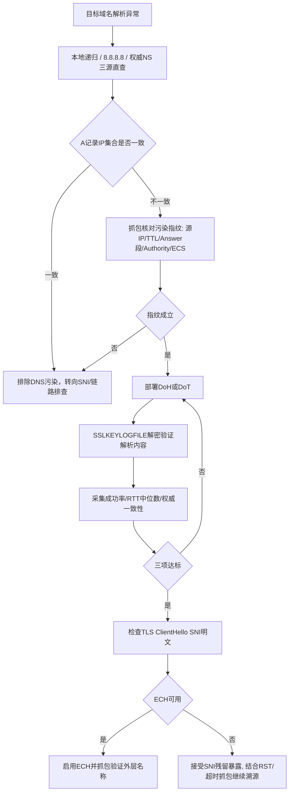
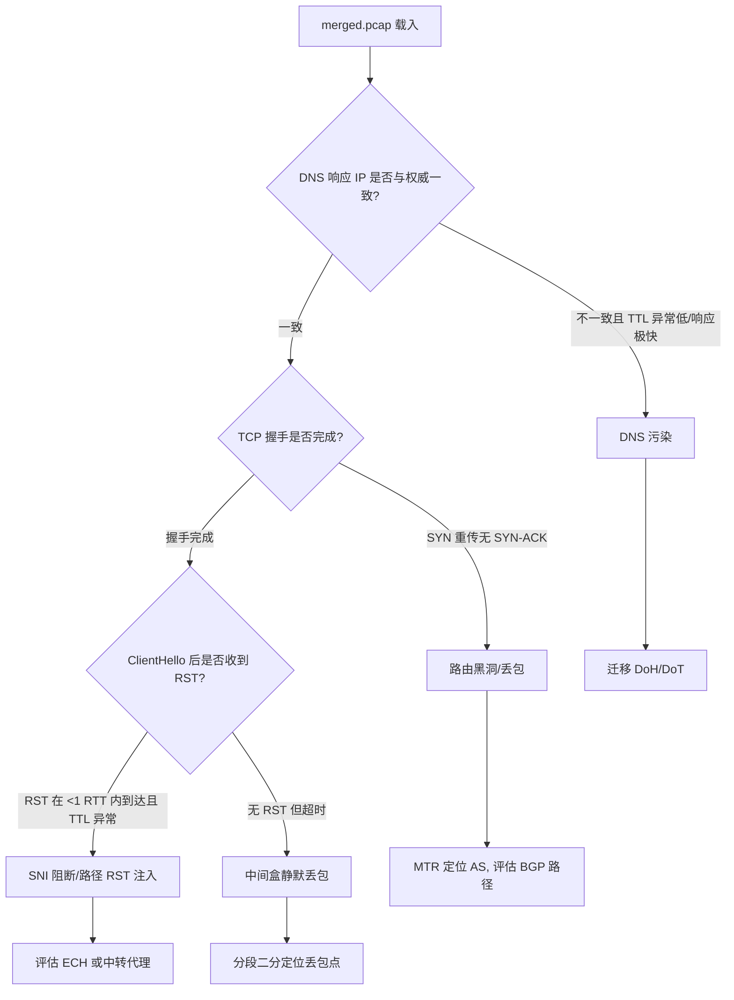

# DNS污染与SNI阻断抓包分析：Wireshark与tcpdump定位TCP RST复位及跨境连接超时溯源

::: tip 💡 核心结论与技术要点（Executive Summary）
跨境连接异常优先在客户端与出口网关双向抓包：tcpdump -i any -w cap.pcap 'port 53 or (tcp port 443 and (tcp[tcpflags] & tcp-rst != 0))'。DNS污染表现为权威响应与本地响应IP不一致且TTL异常；SNI阻断表现为ClientHello后立即收到RST或握手超时；TCP RST需区分内核复位（seq号匹配）与中间设备注入（TTL/窗口异常）。加密DNS可规避53端口污染，但SNI仍暴露于TLS明文扩展，需结合ECH评估。
:::

## 一、跨境链路异常的分层定位模型与RFC协议基线

跨境链路出问题，最怕的就是一上来就猜。有人看到连接超时就喊“被墙了”，有人看到 RST 就认定是运营商干的，结果折腾半天发现是本地 DNS 返回了脏地址、或者 VPS 自己的 nftables 规则把包给拒了。真正靠得住的排查方式，是把一次跨境 TCP 连接拆成三个可独立观测的层：DNS 解析层、TLS 握手层、传输层。每一层都有对应的 RFC 基线作为“正常长什么样”的参照系，偏离基线的字段就是证据。

先给出三层定位模型的整体视图，后面每一节都围绕这张图展开。



三处抓包点是这套模型能落地的关键：客户端 loopback 抓的是“我发出的和我收到的”，出口网关抓的是“离开本地网络时的样子”，远端 VPS 抓的是“到达对端时的样子”。同一个 RST 在三处出现与否，直接决定它是本地中间件、路径上的设备、还是对端内核发出的。

### 1.1 DNS 解析层：RFC 1035 报文结构与污染响应的字段级特征

RFC 1035 定义的 DNS 报文头是 12 字节固定结构，其中几个字段是判断污染的第一手材料：

- QR 位（1 bit）：0 为查询，1 为响应。污染包有时在时序上抢在权威响应之前到达，但 QR 已经置 1，属于伪造响应。
- RA 位（1 bit）：是否支持递归。递归解析器返回的响应 RA 通常为 1；某些污染注入设备直接构造的响应 RA 为 0，因为它并不真的具备递归能力。
- RCODE（4 bit）：0 为 NOERROR。污染包常见 RCODE=0 但 Answer 段指向一个错误的 A 记录，也有 RCODE=3（NXDOMAIN）用于直接掐断解析的情况。
- ANCOUNT / NSCOUNT / ARCOUNT：Answer、Authority、Additional 段的记录数。污染响应的典型特征是 Additional 段缺失（ARCOUNT=0），因为伪造者懒得构造 glue 记录，而真实权威响应通常带 NS 的 A/AAAA glue。

字段之外还有几个工程上极好用的指纹：

1. TTL 异常。真实 CDN 或权威记录的 TTL 通常在 60~3600 秒量级；污染包常见 TTL=0 或个位数，原因是注入设备不想让结果被缓存，希望每次查询都重新污染。
2. 响应源端口非 53。正常 DNS 响应来自服务器的 53 端口；某些中间设备在路径上伪造响应时，源端口是随机高位端口，抓包里 `udp src port != 53` 而 `udp dst port == 客户端的临时端口`，基本可以定性。
3. 响应源 IP 与权威 NS 不一致。把 Answer 段里的 A 记录和 Authority 段里的 NS 做交叉比对，如果 NS 指向的权威服务器根本不在这条链路上，而响应却“来自”它，逻辑上不成立。
4. 事务 ID 与查询匹配但内容矛盾。污染设备能读到查询报文，因此 Question 段和 TXID 通常是对的，这恰恰说明它是在路径上嗅探后即时伪造，而不是猜的。

抓包过滤可以这样写，先只盯 DNS 响应：

```bash
# 在客户端 loopback 与出口网关同时抓，比对响应差异
tcpdump -i lo -nn -s0 -w dns_lo.pcap 'udp port 53'
tcpdump -i eth0 -nn -s0 -w dns_eth0.pcap 'udp port 53'

# 事后用 tshark 提取响应关键字段，快速筛异常
tshark -r dns_eth0.pcap -Y 'dns.flags.response == 1' \
  -T fields -e ip.src -e udp.srcport -e dns.id \
  -e dns.flags.rcode -e dns.count.answers -e dns.count.auth_rr \
  -e dns.count.add_rr -e dns.resp.ttl
```

如果出口网关抓到的响应源端口不是 53、ARCOUNT=0、TTL=0，而客户端 loopback 上看到的却是另一份“干净”响应，说明本地有 DNS 代理在做二次处理；反过来，如果两处一致地脏，污染点在上游递归链路。

### 1.2 TLS 握手层：RFC 8446 ClientHello/SNI 扩展与 RST 注入时序

RFC 8446 第 4.1.2 节规定了 ClientHello 的结构：2 字节 legacy_version、32 字节 random、变长 legacy_session_id、变长 cipher_suites、变长 legacy_compression_methods，然后是 extensions 块。server_name 扩展（type=0x0000）就藏在 extensions 里，其结构是 2 字节扩展类型、2 字节扩展长度、2 字节 server_name_list 长度、1 字节 name_type（0 表示 host_name）、2 字节 host_name 长度、最后是明文的域名。

这个结构意味着 SNI 在 TLS 1.3 里依然是明文可读的（除非启用 ECH），路径上的设备只要解析到 ClientHello 的 extensions 段，就能在毫秒级内定位到域名并决定是否注入 RST。工程上要抓的关键证据是时序：ClientHello 发出到 RST 到达之间的时间差。

正常 RTT 内不应该出现 RST。一次跨境连接的 RTT 动辄 150~300ms，如果 ClientHello 发出后 1~5ms 内就收到 RST，这个 RST 不可能来自对端——光速都跑不完这段距离。这种“微秒到毫秒级”的 RST 是路径注入的强指纹。反过来，如果 RST 在 1 个 RTT 之后到达，且序列号合法，那更可能是对端内核真的拒绝了连接（比如对端防火墙 REJECT）。

抓包时把 TLS 握手和 RST 放在同一个过滤表达式里，直接看时序：

```bash
# 抓 ClientHello 与 RST，带微秒时间戳
tcpdump -i eth0 -nn -tttt -s0 -w tls_rst.pcap \
  'tcp port 443 and (tcp[tcpflags] & tcp-rst != 0 or tcp[((tcp[12] & 0xf0) >> 2):1] = 0x16)'

# 用 tshark 提取 ClientHello 的 SNI 与时间
tshark -r tls_rst.pcap -Y 'tls.handshake.type == 1' \
  -T fields -e frame.time_epoch -e ip.dst -e tls.handshake.extensions_server_name

# 提取 RST 的时间与序列号
tshark -r tls_rst.pcap -Y 'tcp.flags.reset == 1' \
  -T fields -e frame.time_epoch -e ip.src -e tcp.seq -e tcp.window_size -e ip.ttl
```

把两组时间戳相减，差值落在个位数毫秒而 RTT 实测 200ms 以上，SNI 阻断的嫌疑就非常重。再叠加 RST 包的 TTL 与 IP ID 特征（下一节展开），基本可以锁定注入设备的位置区间。

### 1.3 传输层：RFC 9293 TCP RST 合法性判定与内核复位路径

RFC 9293 第 3.5 节对 RST 的合法性有明确约束：接收方收到 RST 后，只有在 RST 的 SEQUENCE 落在当前接收窗口内（或与下一个期望序列号精确匹配）时才应接受并复位连接。换句话说，一个合法的、由对端内核发出的 RST，其序列号必然与当前连接状态机对齐。中间设备要伪造一个“看起来合法”的 RST，必须精确猜到当前序列号，这在加密流量里并不容易——很多注入设备干脆发一个序列号随便填的 RST，靠的是部分老旧协议栈校验不严。

工程判定上，以下几个字段组合是中间设备注入 RST 的典型画像：

1. TTL 异常且固定。合法 RST 的 TTL 应等于对端初始 TTL 减去路径跳数，跨境链路常见落在 40~50 区间且随路由变化。注入设备的 RST 常见 TTL=64 或 128 的“出厂默认值”，且多次抓包完全不变，偏离路径基线。
2. IP ID 不连续。同一五元组的正常报文 IP ID 递增或有规律，注入 RST 的 IP ID 往往与前后报文完全脱节，甚至是 0。
3. TCP 窗口为 0。合法 RST 的窗口字段无意义但通常继承连接状态；注入包常把 window 填 0。
4. TCP 校验和。部分粗糙的注入设备校验和计算错误，Wireshark 会标 “Bad checksum”，这是送分题。
5. 序列号越窗。用 `tcp.analysis.flags` 里的 `tcp.analysis.rst_in_window` 辅助判断，越窗 RST 在 Wireshark 里会显示异常。

Wireshark 的专家信息过滤可以直接把可疑 RST 挑出来：

```bash
# 找出所有带异常的 RST
tshark -r tls_rst.pcap -Y 'tcp.flags.reset == 1 && (tcp.checksum.status == 0 || tcp.window_size == 0 || ip.ttl == 64 || ip.ttl == 128)' \
  -T fields -e frame.number -e ip.src -e ip.ttl -e ip.id -e tcp.seq -e tcp.window_size -e tcp.checksum.status
```

内核复位路径这一侧也要有基线认知。Linux 收到合法 RST 后走 `tcp_reset()`，连接进入 CLOSED，应用层 `recv` 返回 ECONNRESET；如果 RST 序列号越窗，内核在 `tcp_validate_incoming()` 里会丢弃它，连接不受影响。所以一个“看起来发了 RST 但连接没断”的现象，本身就是 RST 不合法的反证——注入设备发了包，但客户端内核判定无效丢弃了。反过来，连接确实被复位，说明 RST 序列号猜对了或者校验被绕过，这时候要怀疑注入设备具备序列号推断能力（比如在路径上做了完整的状态跟踪）。

三处抓包点在这里的价值再次体现：客户端 loopback 看到 RST 且连接断开、出口网关看到同一个 RST、远端 VPS 的 `tcpdump` 里根本没有这个 RST——三点定位，注入点就在出口网关到 VPS 之间的路径上。如果 VPS 侧也抓到了 RST，那要检查 VPS 本机的 nftables/iptables 是否有 REJECT 规则，别把自家防火墙当成运营商。

```bash
# VPS 侧确认是否有本地 RST 发出
tcpdump -i any -nn 'tcp[tcpflags] & tcp-rst != 0 and port 443'
nft list ruleset | grep -i reject
```

把三层串起来看：DNS 层的字段异常指向解析被污染，TLS 层的微秒级 RST 指向 SNI 阻断，传输层的 RST 合法性判定指向注入设备的具体行为特征。三层证据加上三处抓包点的交叉验证，才能把“跨境连接超时”这个笼统现象拆解成可定位、可复现、可举证的具体故障点。这也是后续章节做 Wireshark 逐包分析和 tcpdump 长周期取证的方法论基础。

---

## 二、tcpdump高效捕获策略与Wireshark深度解析流水线

抓包这件事，难的地方从来不在“抓”，而在“抓得准、抓得全、抓得住”。跨境链路做DNS污染与SNI阻断溯源时，一次抓包动辄跑几小时甚至几天，流量动辄几十GB，如果过滤表达式写得含糊、缓冲策略没配好、时钟源选错，最后拿回来的pcap要么缺关键报文，要么时间戳漂移到无法做RTT判定。下面按 tcpdump 采集侧、Wireshark 解析侧、时间序列判定侧三个层次拆开讲。

### 2.1 tcpdump过滤表达式与环形缓冲：BPF语法精准捕获RST与DNS响应

BPF 是内核里跑的虚拟机指令，过滤器在数据包进入 socket 缓冲区之前就已经完成筛选，所以表达式写得越精确，用户态拷贝和磁盘IO的压力越小。跨境长周期抓包的第一原则是：只抓你判定需要的报文，别图省事写 `host x.x.x.x` 了事。

捕获 TCP 控制报文（SYN 与 RST）的核心原语：

```bash
# 捕获 SYN 或 RST 置位的 TCP 报文，覆盖三次握手起点与复位注入点
tcpdump -i eth0 -n -nn \
  'tcp[tcpflags] & (tcp-syn|tcp-rst) != 0' \
  -w /data/cap/ctrl_%Y%m%d_%H%M%S.pcap \
  -C 200 -W 50 -s 0 -j adapter_unsynced -Z root
```

逐项说明这几个参数为什么不能省：

- `tcp[tcpflags] & (tcp-syn|tcp-rst) != 0`：直接读 TCP 头第 13 字节的标志位。相比 `tcp[13] & 0x05 != 0` 这种硬编码，用 `tcp-syn`/`tcp-rst` 符号名可读性更好，且 tcpdump/libpcap 会做常量折叠，生成的 BPF 指令完全等价。注意掩码里同时含 SYN 和 RST，是因为我们既要看到连接发起，也要看到复位注入，两者在同一时间轴上才能算“ClientHello 发出后多久收到 RST”。
- `-s 0`：snaplen 设为 0 表示抓完整帧，不截断。默认 262144 字节对普通以太网帧够用，但遇到巨帧或隧道封装（VXLAN/GRE）时可能截断载荷，TLS ClientHello 里的 SNI 扩展就丢了，后面 2.2 节提取 SNI 直接失败。
- `-C 200 -W 50`：环形缓冲。`-C` 按 MB 切文件（200MB/个），`-W` 限定文件数量（50 个），总占用上限约 10GB，写满后自动覆盖最老的文件。跨境链路动辄跑 24 小时以上，没有环形缓冲，要么磁盘写爆，要么中途手动 kill 导致关键时段报文丢失。
- `-j adapter_unsynced`：指定单调时钟源（Linux 上对应 `CLOCK_MONOTONIC_RAW` 一类），避免 NTP 校时导致的系统时钟跳变。跨境抓包常跨时区、跨校时周期，墙钟时间戳在分析 RTT 时会出现负值或突变，用单调时钟可保证时间差计算严格单调。
- `-Z root`：抓完包后降权到 root 用户（或指定非特权用户），避免 tcpdump 长期以 root 身份运行带来的攻击面。

DNS 响应筛选，关键在于区分查询与响应。DNS 报文头的 Flags 字段第 15 位是 QR 位（0=查询，1=响应），位于 UDP 载荷第 2 字节的最高位。UDP 头 8 字节，所以载荷从 `udp[8]` 开始，Flags 高字节在 `udp[10]`：

```bash
# 只抓 DNS 响应（QR=1），排除查询报文，降低噪声
tcpdump -i eth0 -n -nn \
  'udp port 53 and udp[10] & 0x80 != 0' \
  -w /data/cap/dns_resp_%Y%m%d_%H%M%S.pcap \
  -C 100 -W 30 -s 0 -j adapter_unsynced
```

`udp[10] & 0x80 != 0` 精确命中 QR 位为 1 的报文。若同时想抓 DNS over TCP（大响应或 zone transfer 场景），需补一条 `tcp port 53 and tcp[((tcp[12] & 0xf0) >> 2):2] ...` 的变长偏移表达式，但常规污染溯源用 UDP 53 足够。实际部署中常把两条表达式用 `or` 合并到一个抓包进程，减少多进程争抢 AF_PACKET 的开销：

```bash
tcpdump -i eth0 -n -nn -s 0 -j adapter_unsynced \
  '(udp port 53 and udp[10] & 0x80 != 0) or (tcp[tcpflags] & (tcp-syn|tcp-rst) != 0)' \
  -w /data/cap/mixed_%Y%m%d_%H%M%S.pcap -C 500 -W 40
```

如果链路带宽很高（10G+），单线程 tcpdump 可能跟不上，需要上 `PF_RING` 或 `AF_XDP`，或者用 `tcpdump -i any` 配合多队列网卡分流。这些属于容量工程，本节不展开，但要知道环形缓冲 + 精确 BPF 是基础盘。

### 2.2 Wireshark显示过滤器与TLS解密：从pcap到SNI字段提取

pcap 拿回来之后，Wireshark 的价值在于“在已采集的全量报文里做二次切片”。显示过滤器（display filter）和捕获过滤器（capture filter）是两套语法，前者跑在用户态，功能强得多。

定位“ClientHello 之后紧跟 RST”这一典型阻断特征：

```text
tcp.flags.reset == 1 && tls.handshake.type == 1
```

这条表达式本身只筛出 RST 和 ClientHello 两类报文，实际排查时更常用的是先筛出目标流再逐帧看时序。更实用的组合是：

```text
tls.handshake.type == 1 || tcp.flags.reset == 1
```

配合 `Frame` 列排序后，肉眼即可看到 ClientHello 帧号 N、RST 帧号 N+k，两帧时间差即“复位到达时延”。若 RST 的源 IP 是目标服务器且 TTL 与正常响应一致，倾向远端复位；若 RST 的 TTL 明显偏大（比如正常路径 TTL=52，RST 帧 TTL=64）或源 IP 伪装成中间设备，则是路径注入。

提取 SNI 字段：

```text
tls.handshake.extensions_server_name
```

在 Wireshark 的 Packet Details 面板展开 `Transport Layer Security → TLSv1.3 Record Layer: Handshake Protocol: Client Hello → Extension: server_name`，右键 `Apply as Filter → Selected` 即可把当前 SNI 作为过滤条件。批量提取时用 `tshark`：

```bash
tshark -r /data/cap/mixed_20250101_000000.pcap \
  -Y 'tls.handshake.type == 1' \
  -T fields -e frame.time_epoch -e ip.src -e ip.dst \
  -e tls.handshake.extensions_server_name \
  -E separator=, > sni_extract.csv
```

这里 `-Y` 是显示过滤器，`-e` 指定字段。注意 TLS 1.3 的 ClientHello 中 SNI 仍是明文扩展（RFC 8446 未加密 ClientHello），所以无需解密即可提取。若遇到 ECH（Encrypted Client Hello）部署场景，SNI 被封装进 `encrypted_client_hello` 扩展，明文 SNI 字段为空，此时只能靠外层 `server_name` 缺失 + 目标 IP 反查做推断，这是另一个话题。

TLS 解密方面，若手上有服务器私钥（RSA 密钥交换场景，TLS 1.2 及以前），可在 `Edit → Preferences → Protocols → TLS → RSA Keys List` 导入私钥解密应用数据。TLS 1.3 由于全面采用 (EC)DHE，私钥无法直接解密，只能靠 `SSLKEYLOGFILE` 环境变量让客户端导出会话密钥：

```bash
export SSLKEYLOGFILE=/data/cap/sslkeys.log
# 在该环境下启动 curl / 浏览器 / 客户端程序，密钥会写入日志
```

Wireshark 中配置 `Preferences → Protocols → TLS → (Pre)-Master-Secret log filename` 指向该文件，即可解密 TLS 1.3 应用数据。抓包分析 SNI 阻断时，解密通常不是必需——ClientHello 明文足够判定阻断点；解密主要用于确认“RST 之后是否还有应用层数据”以及“服务端证书是否被替换”。

报文完整性验证不能忘：

```text
tcp.analysis.flags && !tcp.analysis.window_update
tcp.checksum.status == "Bad"
```

`tcp.analysis.flags` 会高亮重传、乱序、零窗口等异常。但要注意网卡 offload（TSO/GSO/checksum offload）会导致抓到的报文校验和显示为 Bad 或 0x0000，这是伪错误。判定方法：若 `tcp.checksum.status == "Bad"` 的报文集中在出方向且本机网卡开启了 `tx-checksumming`，基本可判定为 offload 假象，用 `ethtool -K eth0 tx off` 关闭后重抓对比即可确认。真正需要警惕的是入方向校验和错误，那才可能指示链路损坏或中间设备篡改。

### 2.3 时间序列分析：TCP三次握手与TLS 1.3 1-RTT握手的RTT计算

时间序列分析是区分“远端复位”与“路径注入”的核心手段。先看 TCP 三次握手：



TCP 握手 RTT 计算：客户端发出 SYN 的时间戳 t1，收到 SYN-ACK 的时间戳 t2，`RTT_tcp = t2 - t1`。这个值反映的是当前路径的往返时延基线。跨境链路正常值在 150-300ms 区间（视物理距离与路由跳数），若 TCP 握手 RTT 本身就异常（比如 800ms+），说明路径拥塞或绕路，后续 TLS 握手超时判定要相应放宽阈值。

TLS 1.3 1-RTT 握手（RFC 8446 第 2.3 节）的 RTT 计算：客户端发出 ClientHello 的时间戳 t4，收到 ServerHello 的时间戳 t6，`RTT_tls = t6 - t4`。TLS 1.3 的 1-RTT 握手在 ClientHello 后一个往返即可完成密钥协商并开始传输应用数据，所以 `RTT_tls` 应接近 `RTT_tcp`（略大，因为多了服务端处理时间）。

判定逻辑：

- 若 `RST` 到达时间 t5 满足 `t5 - t4 < 10ms`，且 `RTT_tcp` 基线在 150-300ms，则 RST 不可能来自远端服务器（物理上光速都跑不回来），判定为路径注入。
- 若 `t6 - t4` 落在 150-300ms 区间且 ServerHello 正常，说明 TLS 握手成功，阻断发生在后续应用层或证书校验阶段。
- 若 `t6 - t4` 超过 3 倍 `RTT_tcp` 仍无 ServerHello 且无 RST，判定为静默丢包（连接超时），需结合 `mtr` 定位丢包跳。

用 tshark 批量算 RTT：

```bash
# 提取每条流的 SYN 与 SYN-ACK 时间戳，计算 TCP 握手 RTT
tshark -r /data/cap/mixed_20250101_000000.pcap \
  -Y 'tcp.flags.syn == 1' \
  -T fields -e tcp.stream -e tcp.flags.ack -e frame.time_epoch \
  -E separator=, | sort -t, -k1,1 -k3,3n
```

输出中同一 `tcp.stream` 下 `tcp.flags.ack == 0` 的是 SYN，`== 1` 的是 SYN-ACK，两者 `frame.time_epoch` 相减即 RTT。对 TLS 握手 RTT，把过滤器换成 `tls.handshake.type == 1 || tls.handshake.type == 2`，取同一流的 ClientHello 与 ServerHello 时间戳相减。

实际排障时配合 `mtr` 做路径侧验证：

```bash
mtr -n -c 100 --report-wide --tcp --port 443 target.example.com
```

`--tcp --port 443` 让 mtr 用 TCP SYN 探测，模拟真实握手路径，比 ICMP 更贴近实际转发行为。若 mtr 显示某跳丢包率突增且后续跳恢复正常，说明该跳做了限速而非真丢包；若丢包持续到目标，则路径存在实质性阻断。把 mtr 的跳数与 tcpdump 抓到的 RST 源 IP 的 TTL 做反推（`初始TTL - 收到TTL = 跳数`），可交叉验证 RST 是否来自路径中间设备。

最后给一段内核侧调优，避免抓包本身影响业务：

```bash
# 增大 AF_PACKET 环形缓冲区，降低高带宽下丢包率
sysctl -w net.core.rmem_max=268435456
sysctl -w net.core.rmem_default=67108864
# 关闭网卡 offload 以获取真实校验和（仅抓包机临时开启）
ethtool -K eth0 tx off rx off tso off gso off gro off
```

`rmem_max` 调到 256MB 是为了让 tcpdump 的 ring buffer 有足够空间吸收突发流量，尤其跨境链路抖动时会出现瞬时 burst。offload 关闭会牺牲吞吐，只在抓包分析机上临时做，生产转发节点不要动。

把这套流水线跑顺之后，DNS 污染的判定看 `udp[10] & 0x80` 筛出的响应里 A 记录是否指向保留地址或异常 IP、响应时间是否远早于正常递归查询；SNI 阻断的判定看 ClientHello 后 RST 的到达时延与 TTL 特征。两条线最终都收敛到同一个时间轴上的报文序列比对，工具只是手段，判定逻辑才是硬功夫。

---

## 三、DNS污染根因判定与DoH/DoT加密DNS迁移验证

### 3.1 污染响应识别：权威NS对比、TTL异常与EDNS Client Subnet线索

DNS污染最迷惑人的地方，是它伪装成一次“正常应答”。递归服务器返回的响应报文结构完整、RCODE=0、QR=1，若只看Wireshark的Info列，你甚至以为解析成功了。真正的判定必须靠多源交叉比对，把“谁在说谎”这件事钉死。

判定流程我一般固定成三步，任何一步出现分歧就立刻抓包固化证据：

第一步，向本地递归（运营商DNS或内网Unbound）查询目标域名A记录；第二步，向8.8.8.8、1.1.1.1这类境外公共递归查询同一域名；第三步，绕过所有递归，直接向该域名的权威NS发起迭代查询（用dig +norecurse @ns1.example.com，或dig +trace锁定权威段）。三份A记录IP集合做差集，如果本地递归返回的IP既不在权威集合里、也和境外公共递归不一致，污染嫌疑成立。

污染包有几个非常典型的指纹，抓包时逐条核对：

响应源地址非预期。你发往本地递归的查询，回来的包源IP却是某个中间设备或陌生地址，甚至出现源端口不匹配的“抢答包”。这类包往往比真实响应早到几十毫秒，抢占了解析器的等待窗口。

Answer段IP落在保留/黑洞地址段。经典的有0.0.0.0、127.0.0.1、10.x/172.16.x/192.168.x私有段，以及各类文档保留段（198.18.0.0/15、203.0.113.0/24）。近年更隐蔽的做法是返回真实CDN边缘但错误的节点IP，这时只能靠“与权威集合不一致”来判定。

TTL异常。污染响应常见TTL=0或个位数（1~5秒），目的是让错误答案快速过期、反复污染，同时避免被下游缓存长期留存而暴露。正常权威记录的TTL通常是300~3600秒。

无Authority段。权威应答会带NS和SOA记录作为授权链佐证，污染包往往Answer段孤零零一条A记录，Authority段为空，Additional段也残缺。

EDNS Client Subnet（ECS）是另一条关键线索。启用ECS的递归会在OPT记录里携带客户端子网，权威/CDN据此返回就近节点。污染设备通常不理解ECS语义，要么原样回显、要么直接丢弃OPT，导致响应里OPT缺失或ECS字段被篡改。抓包时展开Additional Records里的OPT，对比请求与响应的ECS前缀是否一致，不一致就是中间人插手的强信号。

下面这段tcpdump过滤语法，用于在递归出口侧同时抓DNS查询与响应，落地pcap后交给Wireshark做逐包比对：

```bash
# 在递归服务器出口抓53端口，双向，限制单个文件大小做滚动
tcpdump -i eth0 -s 0 -w dns_probe.pcap \
  'udp port 53 and (host 8.8.8.8 or host 1.1.1.1 or host <权威NS_IP>)' \
  -C 100 -W 10 -Z root
# 抓取含ECS的查询，便于定位OPT记录差异
tcpdump -i eth0 -nn -vvv 'udp port 53 and udp[10] & 0x01 != 0'
```

Wireshark侧建议加两条显示过滤器：`dns.flags.rcode == 0 && dns.count.answers == 1 && dns.resp.ttl < 10` 快速筛出可疑短TTL单答案包；`dns.opt.code == 8` 定位ECS字段。把可疑包与权威直查结果并排放在两个窗口里，源IP、Answer IP、TTL、Authority计数四项对齐，污染判定基本没有翻案空间。

### 3.2 DoH/DoT部署验证：RFC 8484与RFC 7858抓包差异分析

判定污染之后，迁移到加密DNS是常规动作，但“部署了”和“验证生效了”是两件事。DoH和DoT的抓包特征完全不同，验证手法也得分开。

DoH遵循RFC 8484，把DNS查询封装成application/dns-message，走标准HTTPS 443端口。抓包时你看到的是一条普通TLS会话，应用层是HTTP/2或HTTP/3，DNS报文藏在POST body或GET的base64参数里。不解密的话，Wireshark只能看到TLS Application Data。验证的关键是导入SSLKEYLOGFILE：在客户端（浏览器或支持keylog的解析器）设置环境变量`SSLKEYLOGFILE=/path/to/sslkeylog.txt`，Wireshark的Preferences → Protocols → TLS里指定该文件，解密后过滤器写`http2 && dns`或直接`dns`，就能看到明文的DNS question/answer。确认请求确实发往你配置的DoH端点、响应RCODE正常、Answer与权威一致。

DoT遵循RFC 7858，走853端口，是一条独立的TLS会话，没有HTTP外壳。抓包特征是TCP 853建连、TLS握手、之后每个DNS查询作为长度前缀的TLS记录传输。验证时看三点：TCP 853是否稳定建连（排除中间设备对853的阻断）、TLS握手SNI是否为你的DoT主机名、解密后dns过滤器下的查询是否成功。DoT的优点是协议干净、无HTTP开销；缺点是853端口特征明显，部分网络会对该端口做针对性干扰，这时抓包会看到SYN发出后无SYN-ACK，或握手到ClientHello就被RST。

两者抓包差异我整理成下表，排障时按列对照即可：

| 维度 | DoH (RFC 8484) | DoT (RFC 7858) | 明文DNS (RFC 1035) | 判定要点 |
|---|---|---|---|---|
| 传输端口 | TCP/UDP 443 | TCP 853 | UDP/TCP 53 | 端口即第一特征 |
| 应用层封装 | HTTP/2或HTTP/3 + application/dns-message | 长度前缀的TLS记录直载DNS | 裸DNS报文 | 决定解密后过滤器写法 |
| 抓包可见性（未解密） | 仅见TLS Application Data | 仅见TLS Application Data | 全明文 | DoH/DoT必须keylog |
| 解密后Wireshark过滤器 | `http2 && dns` 或 `dns` | `dns`（853流内） | `dns` | 验证解析内容 |
| 中间设备干扰特征 | 依赖443，较难针对性阻断 | 853端口易被SYN RST/握手RST | 易被抢答污染 | 看握手是否完成 |
| 部署复杂度 | 中（需证书校验、端点配置） | 低（指定IP+853） | 无 | 运维选型参考 |

迁移后的验证指标必须量化，不能凭“能上网了”下结论。我固定采集三项：DNS解析成功率（成功响应数/总查询数，按小时统计）、解析RTT中位数（从发出查询到收到有效Answer的时间差，Wireshark用`dns.time`字段导出CSV算中位数）、污染域名A记录与权威一致性（抽样比对差集为空的比例）。三项同时达标才算迁移成功；成功率上去但一致性不达标，说明只是绕开了污染源、没解决答案正确性。

### 3.3 加密DNS后的残留暴露面：SNI明文与ECH（RFC 9180）评估

DoH/DoT把DNS查询加密了，很多人以为暴露面就此关闭，这是误解。加密DNS只保护“你查了什么域名”，不保护“你连了什么域名”。TLS握手时的ClientHello里，SNI扩展依然是明文，中间设备照样能读到目标主机名并据此做阻断。抓包验证很直接：过滤`tls.handshake.extensions_server_name`，未启用ECH时该字段清晰可见，配合后续的TCP RST或连接超时，SNI阻断的因果链一目了然。

要堵这个残留暴露面，得评估ECH（Encrypted Client Hello，RFC 9180）。ECH把真实SNI放进加密的ClientHelloInner，外层ClientHello只暴露一个公共名称（通常是CDN的fronting域名），中间设备看到的是无害的外层。部署可行性取决于两个硬条件：一是服务端/CDN是否支持ECH，主流CDN的支持度参差不齐，需要逐个确认并抓包验证外层名称；二是客户端是否支持，浏览器较新版本已跟进，但自建解析器/代理链路要单独确认。评估时抓包看ClientHello里是否出现`encrypted_client_hello`扩展、外层SNI是否为预期fronting域名、握手是否成功。ECH未普及时，SNI明文就是必须接受的残留暴露面，排障时仍要把它当作首要怀疑对象。

整个判定与迁移的决策链路，用下面这张流程图固化下来，避免每次排障靠记忆：



配置层面给一段可直接落地的DoH/DoT示例（以支持两种上游的解析器配置为例，注释写清验证意图）：

```yaml
# 加密DNS上游配置示例：DoH为主、DoT为备，便于抓包对比两种协议
dns:
  servers:
    - name: doh-primary
      type: https            # RFC 8484, 走443, 抓包需SSLKEYLOGFILE解密
      url: https://dns.example.com/dns-query
      servername: dns.example.com   # 校验证书SNI
    - name: dot-backup
      type: tls              # RFC 7858, 走853, 独立TLS会话
      address: 1.1.1.1
      port: 853
      servername: cloudflare-dns.com
  # 迁移验证期保留明文上游做对照，验证完成后移除
  fallback:
    - udp://223.5.5.5:53
```

最后提醒一句实战经验：加密DNS迁移后如果解析成功率没上去，先别怀疑配置，回到3.1的三源比对，确认污染是否发生在更上游的链路（比如网关侧透明劫持53端口，把DoH端点域名本身也污染了）。这种“污染你的加密DNS入口”是常见反制手法，抓包时表现为DoH端点域名的A记录与权威不一致——加密DNS的第一步，仍然是先把入口域名解析对。

---

## 四、TCP RST与SNI阻断的内核态与路径态根因分离

抓到RST不等于被墙，抓到超时也不等于被墙。这句话我在内部培训里重复过很多次。Wireshark里一个红色的RST包，来源可能是对端服务器真的崩了、可能是本地conntrack表满了、可能是中间某台设备策略注入、也可能是运营商BRAS的会话老化。这四种情况的处置路径完全不同，混在一起排查只会浪费时间。这一章讲的是怎么把“内核态自己发的复位”和“路径态别人塞进来的复位”拆开，以及跨境超时到底断在哪一跳。

### 4.1 Linux内核复位路径：sysctl参数与netstat/ss复位计数核查

先解决“自己人打自己人”的问题。Linux内核在若干条件下会主动发RST，这些RST在抓包里和对端注入的RST长得一模一样，唯一可靠的区分手段是看本机协议栈的计数器增量。

第一步，抓包前先记基线。开两个终端，一个跑抓包，一个跑计数采样：

```bash
# 采样复位计数基线，间隔10秒采两次做增量对比
ss -s > /tmp/ss_before.txt
netstat -s | grep -iE 'reset|overflow|prune|drop' > /tmp/netstat_before.txt

# 抓包：只看目标流的RST与SYN
tcpdump -i eth0 -nn -vv -s 0 \
  'tcp and host 203.0.113.45 and (tcp[tcpflags] & tcp-rst != 0 or tcp[tcpflags] & tcp-syn != 0)' \
  -w /tmp/rst_capture.pcap

# 复现问题后再次采样
ss -s > /tmp/ss_after.txt
netstat -s | grep -iE 'reset|overflow|prune|drop' > /tmp/netstat_after.txt
diff /tmp/netstat_before.txt /tmp/netstat_after.txt
```

`netstat -s`里几个关键行的含义要抠清楚：

- `resets received`：本机收到的RST数量。这个数涨了，说明RST是从外部进来的，方向上是“别人发给我们”。
- `resets sent`：本机发出的RST数量。这个数涨了，且时间点与抓包里的RST吻合，基本可以定性为内核主动复位。
- `connections aborted due to timeout`：连接因超时被中止，这类通常伴随SYN重传耗尽。
- `TCPBacklogDrop` / `TCPReqQFullDrop`：半连接队列或accept队列溢出导致的丢弃，是高并发场景下“假性阻断”的常见来源。

`ss -s`的汇总里重点看`timewait`、`orphaned`和`closed`的数量。如果orphaned异常高，说明有大量socket没有应用层接管，内核在替你兜底。

接下来逐个核对嫌疑sysctl参数：

```bash
# 溢出时是否直接RST而非静默丢弃，排查“服务端主动复位”假象
sysctl net.ipv4.tcp_abort_on_overflow
# 值为1时，accept队列满会直接回RST，客户端看到的就是“对端拒绝”
# 生产环境建议为0，让内核静默丢弃SYN，由客户端重传兜底

# SYN Cookie开关，影响半连接队列溢出行为
sysctl net.ipv4.tcp_syncookies
# 值为1时溢出走cookie，不会回RST；值为0时溢出直接丢SYN

# conntrack已建立连接的老化时间，跨境长连接被“莫名断开”的头号嫌疑
sysctl net.netfilter.nf_conntrack_tcp_timeout_established
# 默认432000秒（5天），但很多云厂商NAT网关会改成3600甚至600
# 一旦中间NAT的老化时间短于你的keepalive间隔，连接会被静默回收
# 后续数据包触发NAT设备回RST或直接丢弃

# conntrack表容量，表满时新连接被丢
sysctl net.netfilter.nf_conntrack_max
cat /proc/sys/net/netfilter/nf_conntrack_count
# count逼近max时，新连接大量失败，表现为“间歇性连不上”
```

这里有个实战中反复踩的坑：`nf_conntrack_tcp_timeout_established`在你本机是5天，但你链路上的运营商NAT、云负载均衡、K8s的kube-proxy各自有独立的老化时间，取最小值生效。跨境长连接如果keepalive间隔设成300秒，而中间某台NAT的老化是180秒，连接就会被中途回收。回收后第一个数据包的命运取决于NAT实现——有的回RST，有的静默丢，还有的重新建一条映射导致五元组错乱。所以看到RST先别急着定罪，把本机计数器增量、conntrack老化参数、链路中间设备的老化策略三层对齐了再说。

### 4.2 中间设备注入特征：TTL基线、IP ID与BGP选路权重关联分析

排除了内核自产RST，剩下的RST基本来自路径上的某台设备。判定注入的核心方法是TTL基线比对——这是整个排查里最硬的证据。

原理不复杂：正常RST由对端服务器发出，其TTL经过的跳数与同一条流上的数据包完全一致。中间设备注入的RST是设备自己构造的包，初始TTL通常是64或255，到达你这里时剩下的TTL值往往和真实对端包对不上。经验阈值是偏差超过8就高度可疑。

```bash
# 抓同一条流的双向包，带TTL显示
tcpdump -i eth0 -nn -vv -s 0 \
  'tcp and host 203.0.113.45 and port 443' \
  -w /tmp/ttl_compare.pcap

# Wireshark里用这个过滤看RST
tcp.flags.reset == 1

# 命令行快速看TTL分布
tcpdump -r /tmp/ttl_compare.pcap -nn -vv 2>/dev/null | \
  awk '/IP/ {for(i=1;i<=NF;i++) if($i ~ /^ttl/) print $i, $0}' | \
  sort | uniq -c | sort -rn
```

实际报文分析长这样：

```
# 同一条流，服务端正常数据包
14:22:31.108 203.0.113.45.443 > 10.0.0.5.51234: Flags [P.], ttl 52, seq 1001:1401

# 几毫秒后出现的RST
14:22:31.113 203.0.113.45.443 > 10.0.0.5.51234: Flags [R], ttl 60, seq 1401
```

对端数据包TTL是52，RST的TTL是60，偏差8，踩在阈值线上。这种RST的源IP被伪造成了服务端，但TTL暴露了它的真实出身——它来自一个距离你更近、初始TTL为64的设备。再抓几个样本，如果RST的TTL稳定在某个值（比如60、58、62），基本可以锁定注入设备距离你的跳数。

IP ID是第二个辅助特征。很多老式中间设备构造RST时IP ID字段要么为0，要么递增规律与真实对端不一致。Wireshark里开`ip.id`列对比同流数据包，真实对端如果是Linux通常IP ID为0（DF置位时），如果是老内核或某些设备则递增。中间设备注入的RST经常出现IP ID为0但DF未置位、或IP ID跳变的情况。这个特征没有TTL可靠，但可以作为交叉验证。

拿到TTL异常的证据后，下一步是定位注入点属于哪个AS。方法是从你这一侧向目标做BGP looking glass查询，把去程AS_PATH拉出来：

```bash
# 用公开looking glass或本地BGP会话查去程路径
# 例如通过RIPE RIS或各运营商lg
# 记录去程AS_PATH: 本地AS -> AS4134 -> AS4809 -> ... -> 目标AS
```

拿到AS_PATH后，把TTL偏差换算成跳数，对照traceroute的跳数-AS映射，就能圈定注入设备大致落在哪个AS的网段内。跨境场景里，注入点常见于国际出口的汇聚层或对端运营商的边缘策略设备。这一步的产出不是“谁干的”这种结论，而是“嫌疑设备位于ASxxxx的某段路径上”这种可验证的判断。结合同时间段其他目标IP的抓包对比——如果只有特定目标被注入RST，说明是目的地址触发的策略；如果整段路径上多个目标都中招，说明是路径级的设备行为。

### 4.3 跨境超时溯源：MTR分段测量与握手超时阈值设定

超时比RST更难查，因为没有明确的信号包，只有沉默。跨境连接超时的溯源核心是把“哪一跳开始丢”和“丢的是ICMP还是TCP”分开。

先上MTR，但必须用TCP模式探测443端口，ICMP模式在跨境链路上经常被限速或丢弃，测出来的丢包率没有参考价值：

```bash
# TCP模式MTR，探测443端口，100个周期，报告模式
mtr --tcp --port 443 --report --report-cycles 100 203.0.113.45

# 同时跑ICMP模式做对照
mtr --icmp --report --report-cycles 100 203.0.113.45
```

两种模式的报告要对比着看。典型的分段特征：

| 测量段 | ICMP丢包 | TCP/443丢包 | 判读 |
|--------|----------|-------------|------|
| 本地到国际出口 | 0% | 0% | 正常 |
| 国际出口到对端入口 | 15% | 2% | ICMP被限速，TCP正常，非阻断 |
| 对端入口到目标 | 0% | 40% | TCP层丢包，疑似策略或拥塞 |
| 全程 | 15% | 42% | 综合判断，重点看TCP段 |

如果ICMP和TCP在某跳同时出现高丢包，且后续跳恢复正常，那是该跳设备对探测包限速，不代表数据面丢包。如果TCP丢包从某跳开始持续到目标且不回弹，那一段就是问题段。

握手超时阈值的设定要结合SYN重传行为。Linux默认`net.ipv4.tcp_syn_retries=6`，但实际跨境场景里，SYN重传3次（约1s+2s+4s+8s，累计约15秒，算上初始RTO偏差约21秒）还没收到SYN-ACK，基本可以判定该路径不通。抓包里用这两个显示过滤器定位：

```
# 找重传的SYN
tcp.analysis.retransmission && tcp.flags.syn == 1

# 找丢失的段（Wireshark基于序列号推断）
tcp.analysis.lost_segment

# 组合：看某条流从SYN到放弃的完整时间线
tcp.stream eq 12 && (tcp.flags.syn == 1 || tcp.analysis.retransmission)
```

时间线读法：第一个SYN发出时间t0，第二个SYN（重传）在t0+1s，第三个在t0+3s，第四个在t0+7s，如果到t0+15s仍无SYN-ACK且客户端开始发RST或直接放弃，说明握手在路径上被吞。结合MTR的分段结果，把“开始丢TCP的那一跳”和“SYN重传耗尽的时间点”对齐，就能把超时归因到具体路径段。

跨境场景还要注意一个细节：SYN能到、SYN-ACK回不来，和SYN根本出不去，处置方向完全不同。前者是对端或回程路径问题，后者是去程或本地出口问题。抓包时双向都要抓，或者至少在本地出口和入口各抓一份，用SYN的序列号和时间戳对齐，看SYN-ACK是在哪一侧消失的。这一步做扎实了，后面的处置才有靶子。

---

## 五、实战排障SOP与工具链协同决策

排障这件事，最怕的不是没有工具，而是工具之间各说各话。客户端抓到了 RST，网关没看到，VPS 那头连接正常建立——三个 pcap 摆在一起，时间戳差了几十秒，你根本没法判断这个 RST 是谁注入的。下面这套 SOP 是在多次跨境链路排障中磨出来的，核心就一句话：三端时钟对齐、抓包窗口覆盖完整生命周期、用 TCP 序列号把同一条流串起来。

### 5.1 三端同步抓包SOP：客户端、出口网关、远端VPS的时序对齐

三端抓包的第一前提是时钟。NTP 偏差超过 500ms，mergecap 合并后的时序图就会出现因果倒置——网关看到的 SYN 比客户端发出的还早，这种数据没法用。操作上，三端统一走同一个 NTP 源（跨境场景建议客户端和网关用国内 ntp.aliyun.com，VPS 用其机房本地 NTP，记录各自 offset）：

```bash
# 三端统一执行，确认 offset 在 ±50ms 内再开始抓包
chronyc tracking
chronyc sources -v
# 若偏差大，强制步进（仅客户端/网关可操作时）
sudo chronyc makestep
```

抓包命令统一模板，关键是 `-s 0` 全包捕获（默认 snaplen 会截断 ClientHello 里的 SNI 扩展，这是很多人踩过的坑）、`-w` 落盘、文件名带主机角色和时间戳：

```bash
# 客户端 / 出口网关 / VPS 三端使用同一模板，仅 ROLE 不同
ROLE=client   # client | gateway | vps
TS=$(date +%Y%m%dT%H%M%S)
sudo tcpdump -i any -s 0 -w /tmp/cap_${ROLE}_${TS}.pcap \
  'host 203.0.113.45 and (tcp port 443 or udp port 53 or tcp port 53)'
```

抓包窗口必须覆盖完整握手周期，实操上不少于 60 秒——SYN 重传在跨境链路上经常拖到 21 秒（Linux 默认 tcp_syn_retries=6），加上 DNS 解析、TLS 握手、可能的 RST 重试，60 秒是底线。建议三端同时启动，用一个协调脚本对齐：

```bash
# 在跳板机上通过 SSH 三端同时起抓包，sleep 65 后统一停止
for h in client gateway vps; do
  ssh $h "sudo timeout 65 tcpdump -i any -s 0 -w /tmp/cap_${h}.pcap \
    'host 203.0.113.45 and (tcp port 443 or udp port 53)'" &
done
wait
```

抓完后用 mergecap 合并，按时间排序，Wireshark 里用 `tcp.stream` 和 `tcp.seq`/`tcp.ack` 关联同一流。三端各看到什么，是判定注入位置的关键：

```bash
mergecap -w merged.pcap /tmp/cap_client.pcap /tmp/cap_gateway.pcap /tmp/cap_vps.pcap
# Wireshark 过滤：只看目标流，按 seq 对齐
# tcp.port==443 && ip.addr==203.0.113.45
```

关联技巧：客户端发出的 SYN 的初始序列号 ISN_c，在网关 pcap 里应该原样出现（NAT 只改 IP/端口不改 seq），在 VPS 的 SYN-ACK 里 ack=ISN_c+1。如果网关看到的 seq 与客户端不一致，说明中间有设备做了序列号随机化（部分防火墙会这么干），这时候要以网关为准往下追。

### 5.2 判定决策树：从pcap证据到DNS污染/SNI阻断/RST注入的结论输出

拿到合并后的 pcap，按下面的决策树走，每一步都给出可量化的判定指标阈值，结论必须附 pcap 证据编号（Wireshark 的 frame.number）。



判定 DNS 污染：对比本地递归解析器返回的 A 记录与权威 NS 直查结果。污染特征很典型——响应时间极短（<10ms，因为伪造包从路径中间直接回）、TTL 常被设成 0 或很小的值、返回的 IP 往往落在境外一些已知的“黑洞段”。证据链示例：frame 12 是客户端发出的 DNS query，frame 13 在 3ms 后就回了 A 记录 198.51.100.7，而用 `dig @a.root-servers.net` 逐级查权威得到的是 203.0.113.45，两者不一致，判定污染。

判定 SNI 阻断/RST 注入：过滤 `tcp.flags.reset==1`，看 RST 相对于 ClientHello 的时间差。正常服务端不会在收到 ClientHello 后立刻 RST（除非协议错误）。注入特征：RST 在 ClientHello 发出后不足 1 个 RTT 就到达（跨境 RTT 通常 150-250ms，若 RST 在 30ms 内回来，物理上不可能是对端发的），且 RST 包的 TTL 与正常服务端回包 TTL 明显不同（注入设备 TTL 常见 64/128/255 的整值，而真实路径经过多跳后 TTL 会递减）。证据链：frame 45 客户端 ClientHello（含 SNI: example.com），frame 46 在 28ms 后 RST，TTL=64，而对端正常 SYN-ACK 的 TTL=52，判定路径注入。

判定路由黑洞：SYN 发出后无任何响应，连续重传 6 次（约 21 秒）后放弃。此时用 MTR 定位：

```bash
mtr -n -c 100 --tcp --port 443 203.0.113.45
# 观察哪一跳开始出现 100% 丢包，记录该跳 IP 与 AS
whois <丢包跳IP> | grep -i origin
```

### 5.3 缓解方案选型：加密DNS、ECH、中转代理与BGP路径优化的取舍

四种手段解决的是不同层的问题，混用会浪费预算。用一张表把取舍讲清楚：

| 方案 | 解决层 | 对 DNS 污染 | 对 SNI 阻断 | 额外 RTT 开销 | 部署依赖 | 适用场景 |
|------|--------|------------|------------|--------------|----------|----------|
| DoH/DoT | 应用层解析 | 彻底解决 | 无效 | +0~20ms | 客户端支持、解析器可信 | 纯解析污染 |
| ECH | TLS 层 | 不涉及 | 有效（隐藏 SNI） | 0 | 服务端+CDN 支持、DNS HTTPS 记录 | 目标站支持 ECH |
| 中转代理 | 传输层 | 间接规避 | 有效（改路径） | +30~150ms | 中转节点、客户端配置 | 通用兜底 |
| BGP 路径优化 | 网络层 | 不涉及 | 部分有效（换路径） | 视路径 | 运营商协作 | 黑洞/丢包 |

DoH 配置示例（Clash Meta 内核），注意 `respect-rules` 与 `proxy-server-nameserver` 的配合，避免 DNS 查询本身走被污染路径：

```yaml
dns:
  enable: true
  enhanced-mode: fake-ip
  fake-ip-range: 198.18.0.1/16
  nameserver:
    - https://dns.alidns.com/dns-query      # 国内解析走 DoH
    - https://1.1.1.1/dns-query#PROXY       # 境外解析强制走代理，防污染
  proxy-server-nameserver:
    - https://dns.alidns.com/dns-query      # 代理节点域名解析，避免鸡生蛋
  nameserver-policy:
    "geosite:cn": https://dns.alidns.com/dns-query
    "geosite:geolocation-!cn": https://1.1.1.1/dns-query#PROXY
```

ECH 的前提是目标域名发布了 HTTPS 类型的 DNS 记录（含 ech 参数），客户端拿到后才能加密 ClientHello 里的 SNI。验证命令：

```bash
dig +short HTTPS example.com
# 输出含 ech=AEX+DQBB... 才说明服务端支持 ECH
```

如果目标站没发 ECH 配置，客户端单方面开 ECH 没用——这是最常见的误判。中转代理改变的是路径，SNI 依然明文，但注入设备不在路径上了，所以有效；代价是 RTT 增加，对延迟敏感业务要权衡。BGP 路径优化本质是让运营商把流量切到没有注入设备的对等路径，依赖协作，排障时更多是作为“上报证据”而非自助手段。

最终结论输出模板必须带证据编号和阈值，例如：“判定 SNI 阻断。证据：merged.pcap frame 45（ClientHello, SNI=example.com）、frame 46（RST, 距 ClientHello 28ms, TTL=64），阈值：RST 间隔 <1 RTT（实测 RTT 180ms）且 TTL 偏离正常路径 12 跳。缓解建议：目标站未发布 ECH 记录（dig HTTPS 无 ech 参数），优先走中转代理，RTT 预计增加 80ms。”这种带数字的结论，换个人复现也能得到同样判断，才算排障闭环。

---

<FaqSection title="常见技术疑难解答 (FAQ)" />

---

## 相关主题与延伸阅读

- 选型基准：[2026年机场怎么选？避坑与选型指南](/guides/how-to-choose/)
- 底层线路：[IPLC 与 IEPL 专线有什么区别？](/network/iplc-vs-iepl/)
- 协议科普：[VLESS 协议深度科普与实测](/network/vless/)
- 全景资料：[16家主流机场品牌横向横评与实测档案](/brands/)
